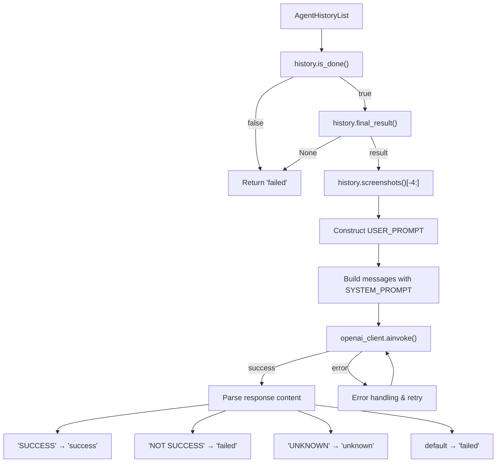
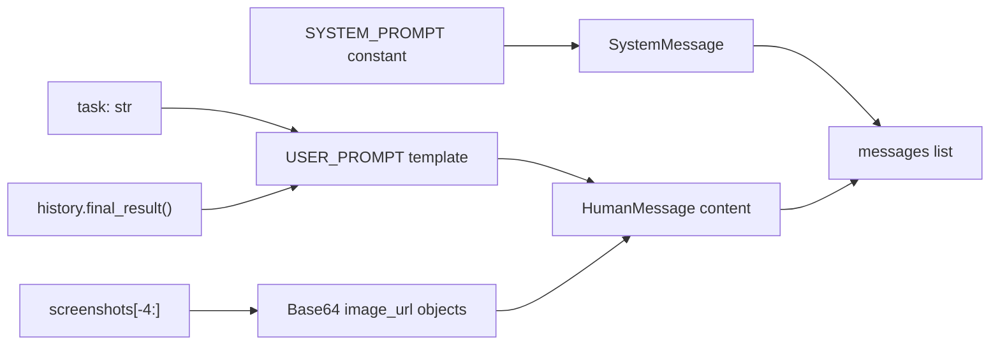
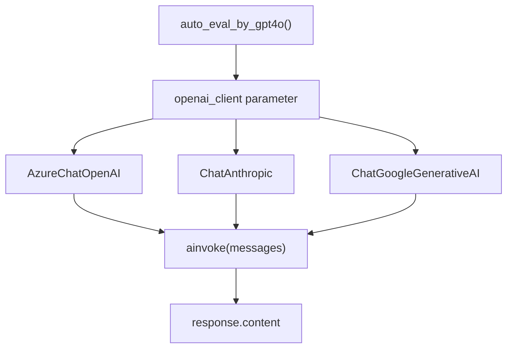
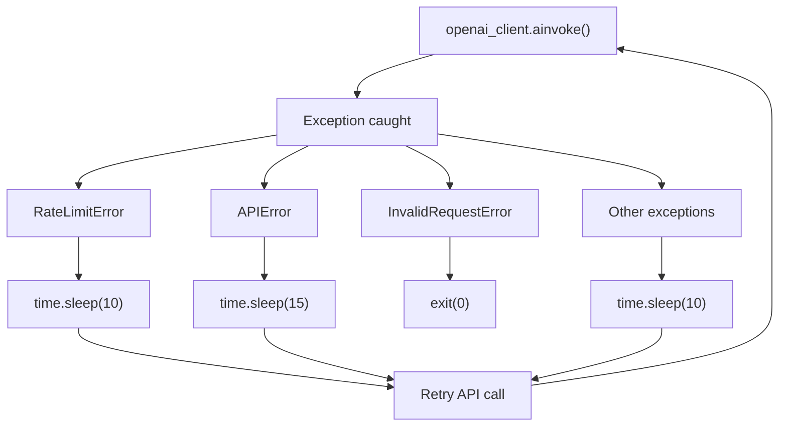

<!-- source: DeepWiki mcp.deepwiki.com · repo browser-use/eval · page 3 Evaluation System · fetched 2026-10-30 -->

# Evaluation System

Relevant source files

The following files were used as context for generating this wiki page:

- [evaluation/auto_eval_browser_use.py](evaluation/auto_eval_browser_use.py)

The evaluation system provides automated assessment of web task completion using vision-language models. It analyzes browser automation results by processing screenshots and text responses to determine whether tasks have been successfully completed. The system uses GPT-4o and other large language models to evaluate complex web interactions that would be difficult to assess through traditional rule-based methods.

For information about the core task execution that feeds into this evaluation system, see [Core Execution Engine](#2). For details about analyzing evaluation results and calculating success rates, see [Result Analysis and Scoring](#4).

## Core Evaluation Workflow

The evaluation system operates through the `auto_eval_by_gpt4o` function, which processes completed browser automation sessions to determine task success. The workflow begins when a browser agent completes a task and generates an `AgentHistoryList` containing the execution history.

### Evaluation Process Flow

Sources: [evaluation/auto_eval_browser_use.py:37-106]()

The evaluation function first validates that the browser session completed successfully by checking `history.is_done()` and ensuring a final result exists. It then extracts the last four screenshots from the session history to provide visual context for the evaluation.

### Multi-Modal Prompt Construction

The system constructs a sophisticated prompt that combines task instructions, agent responses, and visual evidence:

Sources: [evaluation/auto_eval_browser_use.py:32-74]()

The prompt template includes placeholders for the task description (`<task>`), the agent's final response (`<answer>`), and the number of screenshots (`<num>`). Screenshots are encoded as base64 data URLs and embedded directly in the multi-modal message.

## Assessment Criteria and Prompting

The evaluation system uses a detailed system prompt that establishes clear assessment criteria for the vision-language model. The prompt emphasizes evaluating task completion against both visual evidence (screenshots) and textual responses.

### System Prompt Guidelines

| Criteria | Instruction |
|----------|-------------|
| **Primary Responsibility** | Assess web task instruction against screenshot and response outcomes |
| **Multi-task Handling** | Instructions may involve multiple tasks; failure of any component = unsuccessful |
| **Visual Priority** | When response contradicts screenshot, screenshot content prevails |
| **Response Trust** | Believe response content not visible in screenshots |
| **Uncertainty Handling** | Use "UNKNOWN" verdict when assessment is unclear |

Sources: [evaluation/auto_eval_browser_use.py:14-30]()

The system prompt specifically addresses common evaluation challenges, such as discrepancies between visual evidence and text responses, and provides clear guidance for handling ambiguous cases.

## LLM Provider Integration

The evaluation system supports multiple LLM providers through a unified interface, enabling fallback capabilities and provider-specific optimizations.

### Supported Provider Types

Sources: [evaluation/auto_eval_browser_use.py:5-8](), [evaluation/auto_eval_browser_use.py:40]()

The function accepts any of the three supported LLM client types and uses the standardized `ainvoke` method for asynchronous evaluation. This design allows the core execution engine to select appropriate providers based on availability and cost considerations.

## Error Handling and Reliability

The evaluation system implements robust error handling with retry logic to manage API failures and rate limiting issues commonly encountered with LLM providers.

### Error Classification and Response

Sources: [evaluation/auto_eval_browser_use.py:76-92]()

The system distinguishes between recoverable errors (rate limits, API errors) and fatal errors (invalid requests). Rate limit errors trigger a 10-second delay, while API errors use a 15-second backoff. Invalid request errors cause immediate termination since they typically indicate configuration issues.

## Result Classification

The evaluation system parses LLM responses to extract standardized result classifications, handling variations in response format and providing fallback logic.

### Response Parsing Logic

| LLM Response Content | Classified Result | Description |
|---------------------|------------------|-------------|
| Contains "SUCCESS" | `"success"` | Task completed successfully |
| Contains "NOT SUCCESS" | `"failed"` | Task failed to complete |
| Contains "UNKNOWN" | `"unknown"` | Insufficient information to determine |
| No clear verdict | `"failed"` | Default fallback classification |
| `None` response | `"unknown"` | API returned empty response |

Sources: [evaluation/auto_eval_browser_use.py:94-106]()

The parsing logic uses string matching to identify key verdict phrases in the LLM response. The system defaults to marking tasks as failed when responses are ambiguous, ensuring conservative evaluation standards. The function returns both the classified result and the raw LLM response for further analysis.

---

