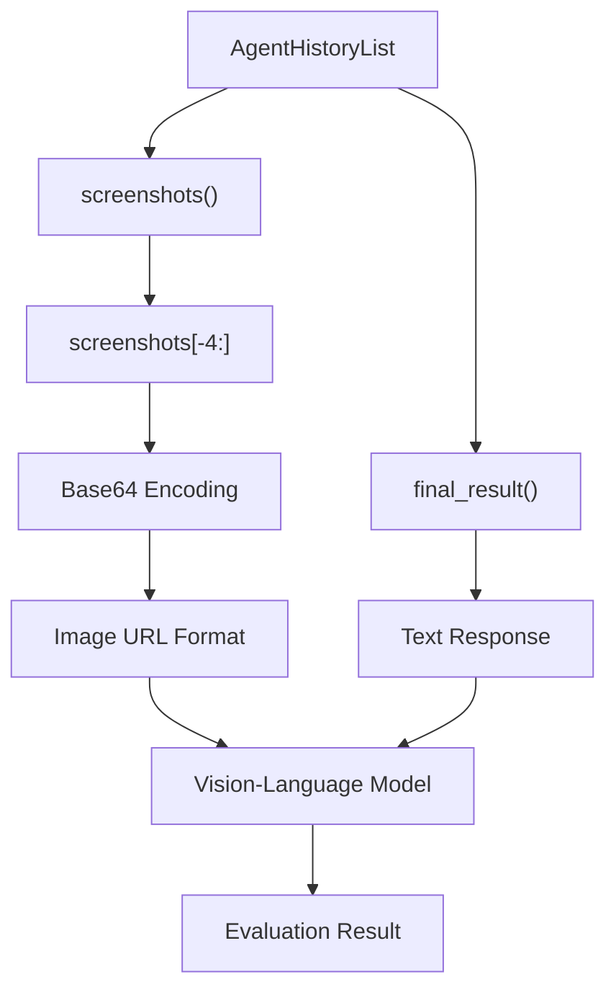
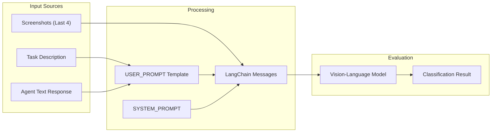
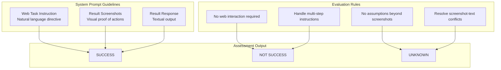
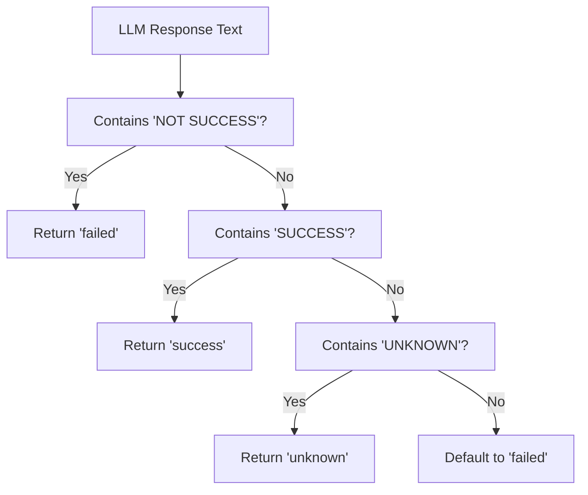
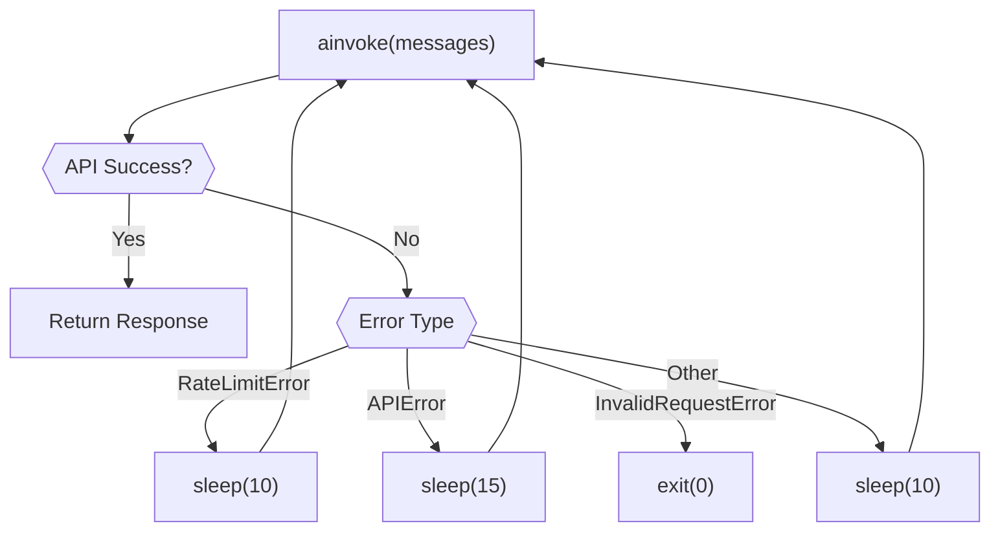

<!-- source: DeepWiki mcp.deepwiki.com · repo browser-use/eval · page 3.1 Multi-Modal Assessment · fetched 2026-10-30 -->

# Multi-Modal Assessment

<details>
<summary>Relevant source files</summary>

The following files were used as context for generating this wiki page:

- [evaluation/auto_eval_browser_use.py](evaluation/auto_eval_browser_use.py)

</details>


This document covers the multi-modal evaluation capabilities that combine visual screenshots and textual responses to assess task completion. The system uses vision-language models to evaluate whether browser automation tasks have been successfully completed by analyzing both the final visual state of web pages and the agent's textual output.

For information about the broader evaluation pipeline, see [Evaluation System](#3). For details on LLM provider configuration and management, see [LLM Provider Integration](#3.2).

## Multi-Modal Input Processing

The evaluation system processes two primary types of data to assess task completion:

### Screenshot Analysis
The system captures and analyzes the final screenshots from browser automation sessions. Screenshots are extracted from the `AgentHistoryList` and processed as base64-encoded images for vision-language model analysis.

**Screenshot Processing Workflow**


Sources: [evaluation/auto_eval_browser_use.py:51-58]()

### Text Response Integration
The system extracts the final textual response from the browser agent's execution history using the `final_result()` method. This text is combined with screenshots to provide comprehensive context for evaluation.

**Multi-Modal Data Combination**


Sources: [evaluation/auto_eval_browser_use.py:37-41](), [evaluation/auto_eval_browser_use.py:47-49]()

## Vision-Language Model Integration

The system leverages vision-language models through the `auto_eval_by_gpt4o` function, which supports multiple LLM providers including Azure OpenAI, Anthropic, and Google models.

### Message Structure
The evaluation uses LangChain's message format to combine textual prompts with visual content:

| Component | Type | Purpose |
|-----------|------|---------|
| `SystemMessage` | Text | Evaluation guidelines and criteria |
| `HumanMessage` | Multi-modal | Task description, answer, and screenshots |
| Image Content | Base64 | Visual evidence from browser automation |

Sources: [evaluation/auto_eval_browser_use.py:65-74]()

### Provider Support
The function accepts multiple LLM provider types:
- `AzureChatOpenAI` - Azure OpenAI GPT-4V models
- `ChatAnthropic` - Anthropic Claude models with vision capabilities  
- `ChatGoogleGenerativeAI` - Google Gemini models

Sources: [evaluation/auto_eval_browser_use.py:40]()

## Evaluation Prompt System

The multi-modal assessment uses a sophisticated prompt system designed to handle the complexity of web task evaluation.

### System Prompt Design
The `SYSTEM_PROMPT` provides comprehensive guidelines for evaluating web tasks across three components:

**Evaluation Components**


Sources: [evaluation/auto_eval_browser_use.py:14-30]()

### Dynamic Prompt Construction
The `USER_PROMPT` template is dynamically populated with task-specific information:

```
TASK: <task>
Result Response: <answer>
<num> screenshot at the end:
```

The template replacement process handles:
- Task description injection
- Answer text substitution  
- Screenshot count annotation

Sources: [evaluation/auto_eval_browser_use.py:32-34](), [evaluation/auto_eval_browser_use.py:61-63]()

## Assessment Classification

The evaluation system classifies task completion into three distinct categories based on the vision-language model's response.

### Classification Logic
The system parses the model's textual response to extract classification keywords:

**Classification Decision Tree**


Sources: [evaluation/auto_eval_browser_use.py:97-104]()

### Return Values
The `auto_eval_by_gpt4o` function returns a tuple containing:
1. **Classification result**: `"success"`, `"failed"`, or `"unknown"`
2. **Full response text**: Complete LLM evaluation reasoning

| Classification | Condition | Meaning |
|---------------|-----------|---------|
| `"success"` | Contains "SUCCESS" | Task completed successfully |
| `"failed"` | Contains "NOT SUCCESS" or default | Task failed or incomplete |
| `"unknown"` | Contains "UNKNOWN" | Insufficient evidence for classification |

Sources: [evaluation/auto_eval_browser_use.py:41](), [evaluation/auto_eval_browser_use.py:106]()

## Error Handling and Retry Logic

The evaluation system implements robust error handling for API interactions with vision-language models.

### Retry Mechanism
The system uses an infinite retry loop with exponential backoff for different error types:

**Error Handling Flow**


Sources: [evaluation/auto_eval_browser_use.py:76-91]()

### Error Classification
The system handles specific exception types with tailored responses:

| Error Type | Wait Time | Action |
|------------|-----------|--------|
| `RateLimitError` | 10 seconds | Retry API call |
| `APIError` | 15 seconds | Retry API call |
| `InvalidRequestError` | N/A | Exit program |
| Other exceptions | 10 seconds | Retry API call |

Sources: [evaluation/auto_eval_browser_use.py:84-91]()

## Pre-Evaluation Validation

The system performs validation checks before attempting multi-modal evaluation to ensure data integrity.

### History Validation
Two key validation checks prevent evaluation of incomplete or invalid task executions:

```python
if not history.is_done():
    return "failed", ""

answer = history.final_result()
if answer is None:
    return "failed", ""
```

**Validation Requirements**
- Task execution must be marked as complete (`is_done()`)
- Final result must be available and non-null
- Screenshot history must be accessible

Sources: [evaluation/auto_eval_browser_use.py:44-49]()

---

