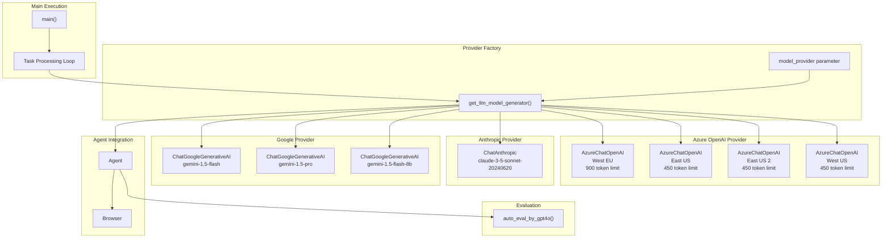
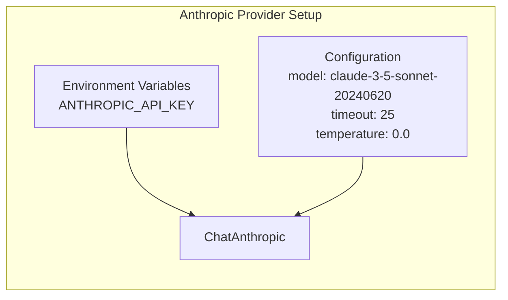
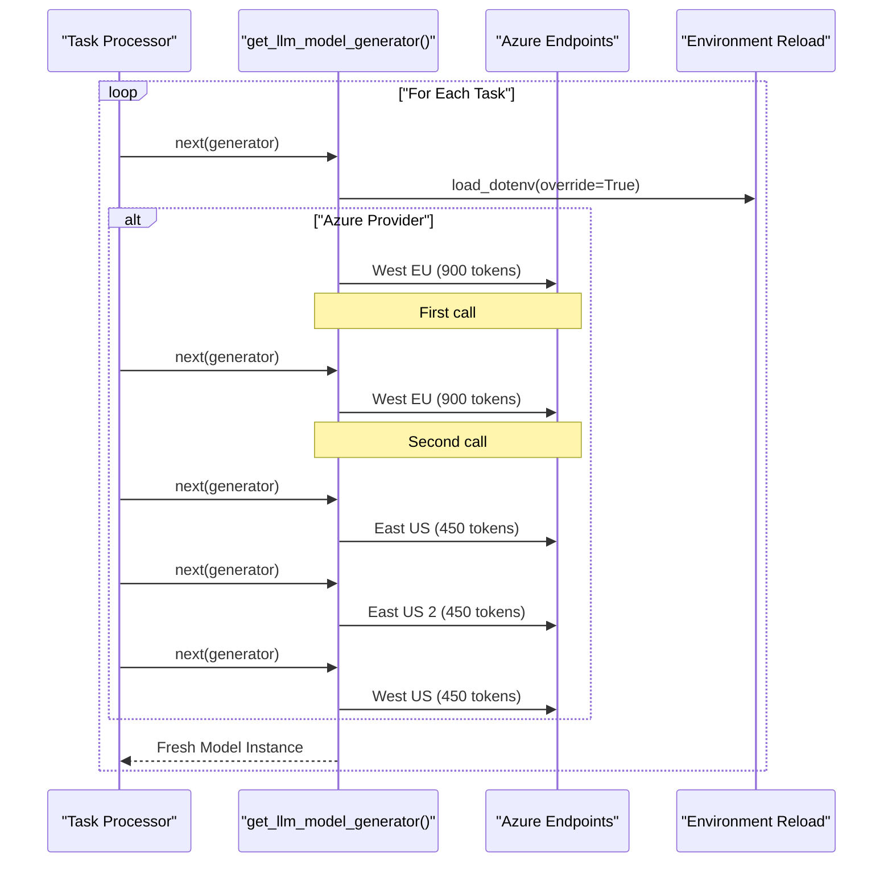
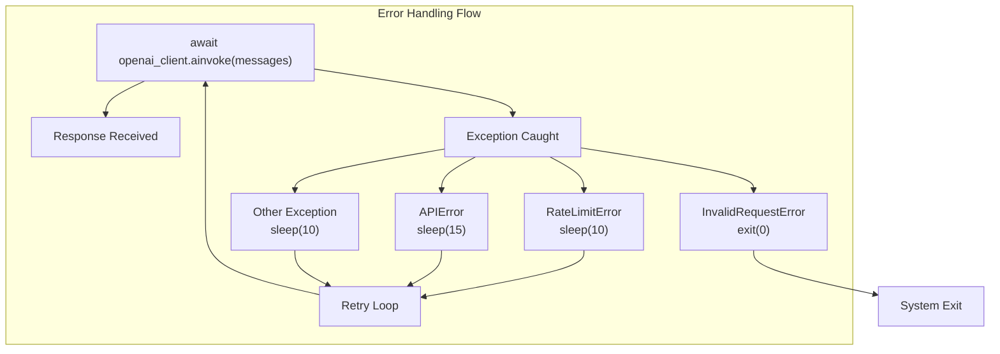
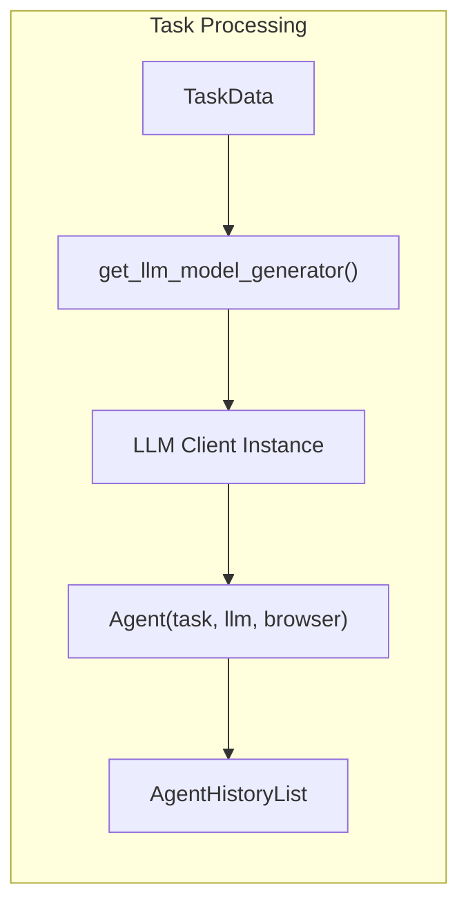

<!-- source: DeepWiki mcp.deepwiki.com · repo browser-use/eval · page 3.2 LLM Provider Integration · fetched 2026-10-30 -->

# LLM Provider Integration

<details>
<summary>Relevant source files</summary>

The following files were used as context for generating this wiki page:

- [evaluation/auto_eval_browser_use.py](evaluation/auto_eval_browser_use.py)
- [run_browser_use.py](run_browser_use.py)

</details>


This document covers the multi-provider LLM integration system that enables the browser-use evaluation framework to work with different language model providers. The system supports Azure OpenAI, Anthropic, and Google models with automatic failover, load balancing, and rate limiting capabilities.

For information about how these providers are used in the evaluation pipeline, see [Multi-Modal Assessment](#3.1). For details about the overall evaluation architecture, see [Evaluation System](#3).

## Provider Architecture Overview

The LLM provider integration is built around a generator pattern that creates fresh model instances on demand while managing multiple endpoints and handling provider-specific configurations.



**Sources:** [run_browser_use.py:161-238](), [run_browser_use.py:392-394]()

## Provider Configuration

Each provider has distinct configuration requirements and initialization patterns handled by the `get_llm_model_generator` function.

### Azure OpenAI Configuration

The Azure provider supports multiple endpoints with different token limits and implements a round-robin pattern for load distribution:

| Endpoint | Region | Token Limit | Environment Variables |
|----------|---------|-------------|----------------------|
| West EU | Europe | 900 | `AZURE_OPENAI_ENDPOINT_WEST_EU`, `AZURE_OPENAI_API_KEY_WEST_EU` |
| East US | US East | 450 | `AZURE_OPENAI_ENDPOINT_EAST_US`, `AZURE_OPENAI_API_KEY_EAST_US` |
| East US 2 | US East | 450 | `AZURE_OPENAI_ENDPOINT_EAST_US_2`, `AZURE_OPENAI_API_KEY_EAST_US_2` |
| West US | US West | 450 | `AZURE_OPENAI_ENDPOINT_WEST_US`, `AZURE_OPENAI_API_KEY_WEST_US` |

The `LLMModel` dataclass encapsulates the model instance with its token limit for tracking purposes.

**Sources:** [run_browser_use.py:155-159](), [run_browser_use.py:180-222]()

### Anthropic Configuration

The Anthropic provider uses Claude-3-5-Sonnet with standardized timeout and temperature settings:



**Sources:** [run_browser_use.py:169-176]()

### Google Provider Configuration

The Google provider supports multiple Gemini model variants with automatic API key detection:

| Model Variant | Model Name | Use Case |
|---------------|------------|----------|
| Flash | `gemini-1.5-flash` | Fast inference |
| Pro | `gemini-1.5-pro` | High-quality reasoning |
| Flash 8B | `gemini-1.5-flash-8b` | Lightweight tasks |

**Sources:** [run_browser_use.py:223-235]()

## Load Balancing and Rate Limiting

The system implements several strategies for managing API rate limits and distributing load across multiple endpoints.



### Token Limit Management

The Azure provider implements a weighted distribution system where West EU gets higher priority with a 900-token limit, while other regions are allocated 450 tokens each. This distribution is implemented through the yield pattern in the generator.

**Sources:** [run_browser_use.py:217-222]()

### Fresh Instance Strategy

The generator creates fresh model instances for each task to prevent state contamination and ensure proper environment variable reloading:

- Environment variables are reloaded with `load_dotenv(override=True)` for each iteration
- New client instances are created rather than reusing existing ones
- This prevents issues with stale credentials or configuration

**Sources:** [run_browser_use.py:164-167]()

## Error Handling and Retry Logic

The evaluation system includes comprehensive error handling for different types of API failures and rate limiting scenarios.



### Retry Strategy

The `auto_eval_by_gpt4o` function implements a retry loop with different wait times based on error type:

| Error Type | Wait Time | Action |
|------------|-----------|---------|
| `RateLimitError` | 10 seconds | Retry |
| `APIError` | 15 seconds | Retry |
| `InvalidRequestError` | N/A | Exit program |
| Other exceptions | 10 seconds | Retry |

**Sources:** [evaluation/auto_eval_browser_use.py:76-92]()

## Integration Points

The LLM provider system integrates with multiple components of the evaluation framework.

### Agent Integration

The main task processing loop creates Agent instances with the selected LLM provider:



**Sources:** [run_browser_use.py:258-267](), [run_browser_use.py:392-394]()

### Evaluation Integration

The evaluation system accepts multiple provider types through a union type annotation:

```python
openai_client: AzureChatOpenAI | ChatAnthropic | ChatGoogleGenerativeAI
```

This allows the same evaluation logic to work across all supported providers without modification.

**Sources:** [evaluation/auto_eval_browser_use.py:40](), [evaluation/auto_eval_browser_use.py:8]()

### Command Line Interface

The provider selection is exposed through command line arguments with validation:

| Provider Choice | Model Used |
|-----------------|------------|
| `azure` | GPT-4o (multiple endpoints) |
| `anthropic` | Claude-3-5-Sonnet |
| `google/gemini-1.5-flash` | Gemini 1.5 Flash |
| `google/gemini-1.5-pro` | Gemini 1.5 Pro |
| `google/gemini-1.5-flash-8b` | Gemini 1.5 Flash 8B |

**Sources:** [run_browser_use.py:418-429]()

---

