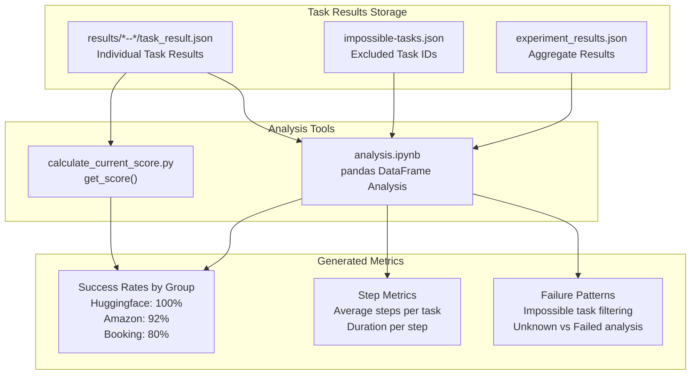
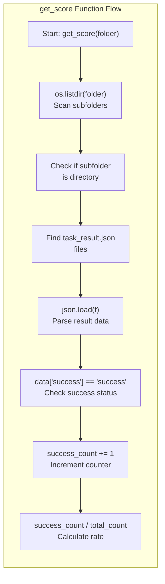
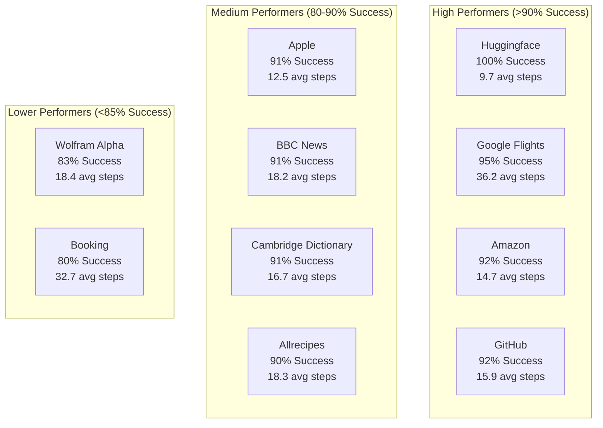

<!-- source: DeepWiki mcp.deepwiki.com · repo browser-use/eval · page 4 Result Analysis and Scoring · fetched 2026-10-30 -->

# Result Analysis and Scoring

<details>
<summary>Relevant source files</summary>

The following files were used as context for generating this wiki page:

- [analysis.ipynb](analysis.ipynb)
- [calculate_current_score.py](calculate_current_score.py)

</details>


This document covers the tools and methodologies used to analyze task performance, calculate success rates, and identify failure patterns in the browser-use evaluation system. It focuses on the post-execution analysis phase that processes completed task results to generate performance metrics and insights.

For information about the task execution process that generates the raw results, see [Core Execution Engine](#2). For details about the automated evaluation using GPT-4o, see [Evaluation System](#3).

## Purpose and Scope

The result analysis and scoring system provides quantitative assessment of browser automation task performance through two primary components:

1. **Automated Score Calculation** - Computes success rates across task groups using `calculate_current_score.py`
2. **Detailed Performance Analysis** - Generates comprehensive insights through `analysis.ipynb` including step count analysis, duration metrics, and failure pattern identification

## Data Flow and Analysis Pipeline



Sources: [calculate_current_score.py:1-34](), [analysis.ipynb:16-35]()

## Score Calculation Methodology

### Basic Success Rate Calculation

The `get_score()` function implements the core scoring algorithm:



The algorithm processes each task result by:
1. Scanning the results directory structure [calculate_current_score.py:10-15]()
2. Loading `task_result.json` files [calculate_current_score.py:16-17]()
3. Checking the `success` field value [calculate_current_score.py:18-19]()
4. Computing the success ratio [calculate_current_score.py:22-24]()

Sources: [calculate_current_score.py:5-26]()

### Advanced Analysis Framework

The Jupyter notebook provides comprehensive analysis capabilities:

| Analysis Type | Implementation | Output |
|---------------|----------------|---------|
| **Task Loading** | `glob.glob("results/*--*/task_result.json")` | 590 total tasks |
| **Filtering** | Exclude tasks from `impossible-tasks.json` | 586 valid tasks |
| **Grouping** | Extract group from `task_id.split("--")[0]` | 15 website groups |
| **Success Rates** | `value_counts(normalize=True)` | 89% success, 9% failed, 1.5% unknown |

Sources: [analysis.ipynb:19-21](), [analysis.ipynb:83-88](), [analysis.ipynb:317-319]()

## Performance Metrics and Analysis

### Task Group Performance

The analysis reveals significant performance variation across different website groups:



Sources: [analysis.ipynb:512-533]()

### Step Count Analysis

The system tracks execution complexity through step count metrics:

- **Successful Tasks**: Typically complete in 10-20 steps
- **Failed Tasks**: Often terminate early due to navigation issues
- **Duration Analysis**: Average of 2-3 seconds per step across all tasks

Sources: [analysis.ipynb:154-160](), [analysis.ipynb:274-294]()

## Result Storage Structure

### File Organization Pattern

Task results follow a structured directory layout:

```
results/
├── [task_group]--[task_id]/
│   ├── task_result.json
│   ├── screenshots/
│   └── interaction_logs/
└── experiment_results.json
```

### Task Result Schema

Each `task_result.json` contains:

| Field | Type | Description |
|-------|------|-------------|
| `task_id` | string | Unique identifier with group prefix |
| `success` | string | "success", "failed", or "unknown" |
| `num_steps` | integer | Total execution steps |
| `duration_seconds` | float | Total execution time |
| `evaluation_result` | object | GPT-4o assessment details |

Sources: [calculate_current_score.py:16-20](), [analysis.ipynb:31-37]()

## Impossible Task Filtering

The system maintains a curated list of impossible tasks to ensure accurate performance measurement:

### Common Impossible Task Categories

1. **Outdated Information**: Tasks requiring data from past dates
2. **Missing Content**: Recipes or products no longer available
3. **Access Restrictions**: Pages requiring authentication
4. **Dynamic Content**: Time-sensitive information

The filtering process excludes 54 impossible tasks from the total dataset, reducing analysis from 812 to 758 valid tasks.

Sources: [analysis.ipynb:83-88](), [analysis.ipynb:166-172]()

## Analysis Insights and Failure Patterns

### Success Rate Distribution

Overall system performance shows:
- **89.1%** tasks complete successfully
- **9.4%** tasks fail due to execution issues  
- **1.5%** tasks marked as unknown (require manual review)

### Step Count Patterns

Analysis reveals different behavioral patterns:
- **Successful tasks**: Consistent step progression with completion
- **Failed tasks**: Early termination, typically under 15 steps
- **Complex tasks**: Higher step counts correlate with longer completion times

Sources: [analysis.ipynb:317-319](), [analysis.ipynb:274-294]()

---

