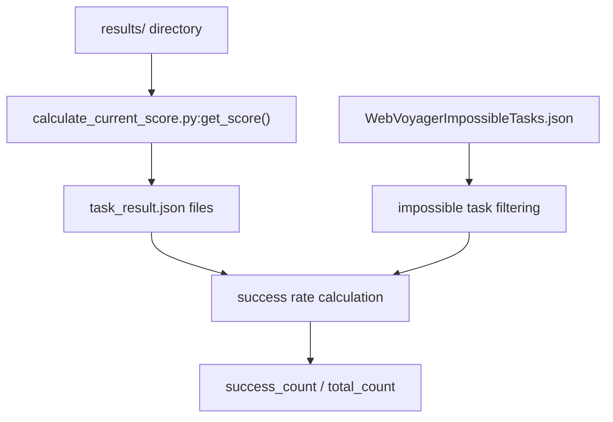
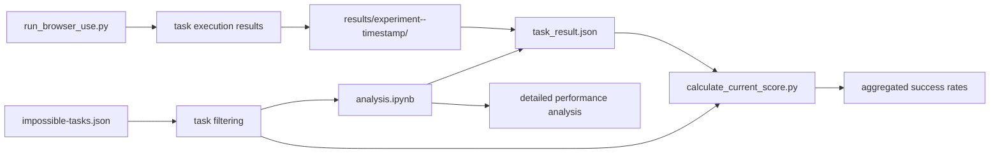
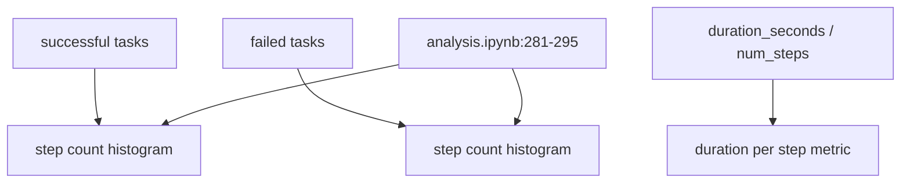

<!-- source: DeepWiki mcp.deepwiki.com · repo browser-use/eval · page 4.1 Performance Metrics · fetched 2026-10-30 -->

# Performance Metrics

Relevant source files

The following files were used as context for generating this wiki page:

- [analysis.ipynb](analysis.ipynb)
- [calculate_current_score.py](calculate_current_score.py)

This document covers the performance measurement system used to evaluate browser automation tasks in the WebVoyager dataset. It explains how success rates are calculated, task performance is categorized, and results are analyzed to understand system effectiveness.

For information about the evaluation process that generates these metrics, see [Multi-Modal Assessment](#3.1). For details about result storage structure, see [Result Storage Structure](#5.3).

## Core Performance Metrics

The primary performance metric is **success rate**, calculated as the percentage of tasks that complete successfully. Tasks are evaluated using three possible outcomes: `success`, `failed`, or `unknown`.

### Success Rate Calculation

The `calculate_current_score.py` script provides the main interface for computing success rates across different experimental runs:

The calculation logic iterates through result subdirectories, reading individual `task_result.json` files and counting successful completions [calculate_current_score.py:5-26](). Each task result contains a `success` field with values `"success"`, `"failed"`, or `"unknown"`.

### Task Grouping and Performance Distribution

Tasks are categorized by website domain, extracted from the task ID prefix (e.g., "Huggingface--1" belongs to the "Huggingface" group). Performance varies significantly across different domains:

| Domain | Success Rate | Avg Steps | Task Count |
|--------|-------------|-----------|------------|
| Huggingface | 100% | 9.7 | 35 |
| Amazon | 92% | 14.7 | 38 |
| Booking | 80% | 32.7 | 40 |
| Google Flights | 95% | 36.2 | 39 |

**Sources:** [analysis.ipynb:513-533]()

## Data Flow for Performance Analysis

The metrics collection system processes task execution results through a structured pipeline:

Task results are stored in timestamped directories under `results/`, with each task producing a `task_result.json` file containing execution metadata and success status [calculate_current_score.py:14-20]().

**Sources:** [calculate_current_score.py:28-34](), [analysis.ipynb:19-37]()

## Performance Analysis Tools

### Success Rate Distribution

The analysis system tracks several key performance indicators:

- **Overall success rate**: 89.1% across all valid tasks
- **Failure rate**: 9.4% of tasks fail completely  
- **Unknown rate**: 1.5% of tasks receive uncertain evaluation

**Sources:** [analysis.ipynb:317-319]()

### Step Count Analysis

Task complexity is measured by the number of browser interaction steps required:

Failed tasks typically require fewer steps than successful ones, suggesting early termination when the system encounters difficulties.

**Sources:** [analysis.ipynb:281-295](), [analysis.ipynb:155-160]()

## Data Quality and Filtering

### Impossible Task Exclusion

The system maintains a curated list of impossible tasks that are filtered from performance calculations:

- **54 impossible tasks** identified across domains
- Common issues: outdated content, missing data, temporal constraints
- Tasks filtered using `impossible-tasks.json` before metric calculation

Examples include recipes that no longer exist, products without pricing information, and date-dependent queries with past timestamps [analysis.ipynb:166-173]().

### Task ID Structure and Validation

Task identifiers follow the pattern `{domain}--{number}`, enabling systematic grouping and analysis:

The grouping mechanism enables domain-specific performance analysis and identification of platform-specific challenges [analysis.ipynb:124-125]().

**Sources:** [calculate_current_score.py:1-34](), [analysis.ipynb:83-89](), [analysis.ipynb:245-247]()

---

