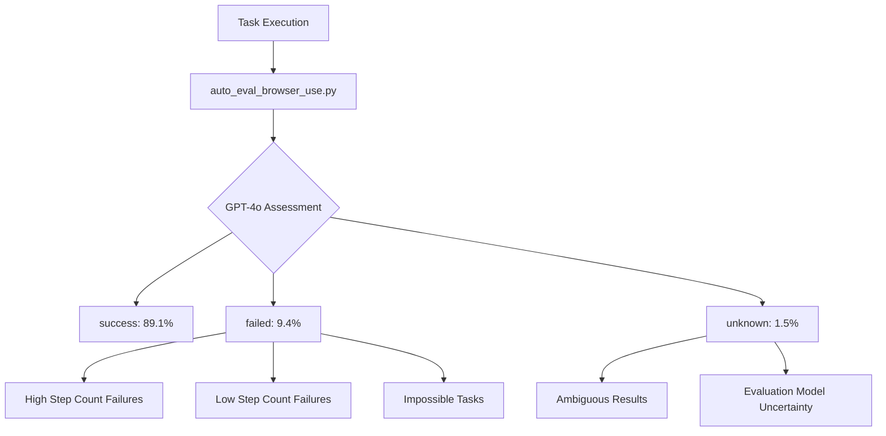
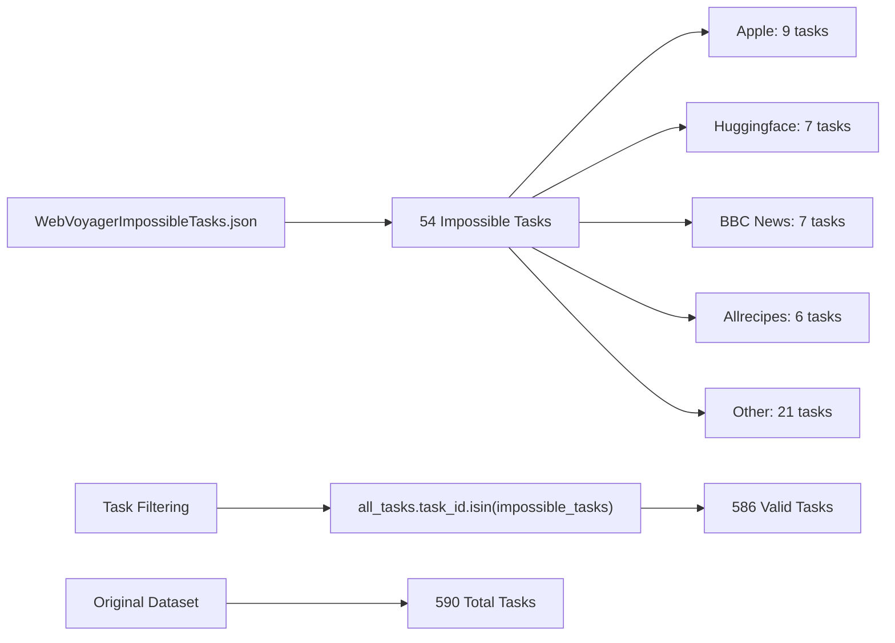
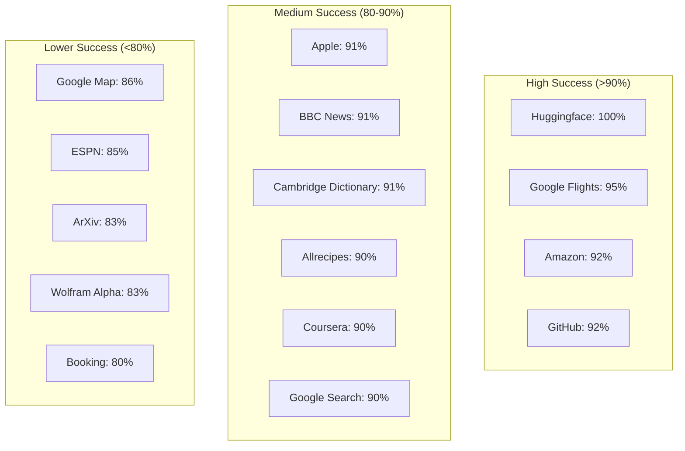
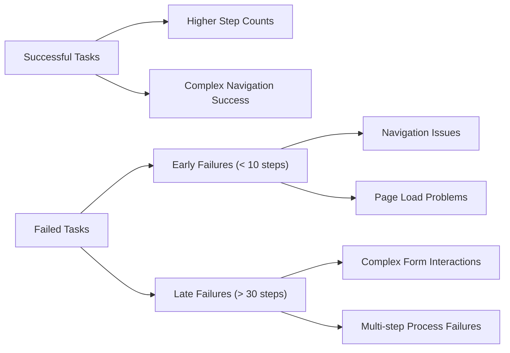
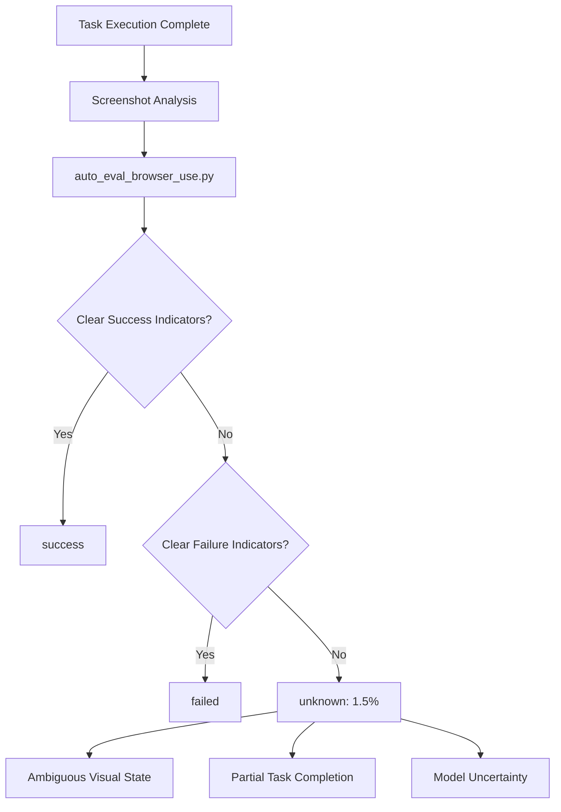
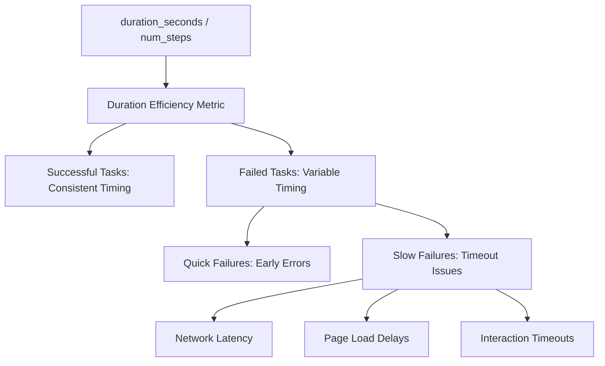

<!-- source: DeepWiki mcp.deepwiki.com · repo browser-use/eval · page 4.2 Failure Mode Analysis · fetched 2026-10-30 -->

# Failure Mode Analysis

Relevant source files

The following files were used as context for generating this wiki page:

- [analysis.ipynb](analysis.ipynb)
- [data/WebVoyagerImpossibleTasks.json](data/WebVoyagerImpossibleTasks.json)

This document provides a comprehensive analysis of failure modes in the browser-use evaluation system, including categorization of different failure types, identification of impossible tasks, and patterns in task completion across different website domains.

For information about the overall evaluation pipeline, see [Evaluation System](#3). For performance metrics calculation, see [Performance Metrics](#4.1).

## Failure Classification System

The evaluation system categorizes task execution outcomes into three primary states: `success`, `failed`, and `unknown`. This classification is performed by the automated evaluation pipeline using GPT-4o vision analysis.

Sources: [analysis.ipynb:318-319]()

## Impossible Task Identification

The system maintains a curated list of tasks that are fundamentally impossible to complete due to various constraints. These tasks are filtered out during analysis to provide accurate performance metrics.

### Impossible Task Categories

| Website Group | Count | Example Issues |
|---------------|-------|----------------|
| Apple | 9 | Missing product prices, discontinued items |
| Huggingface | 7 | Model/dataset access restrictions |
| BBC News | 7 | Outdated news articles, broken links |
| Allrecipes | 6 | Missing recipes, ingredient restrictions |
| Google Flights | 3 | Past flight dates, route unavailability |
| Booking | 4 | Past booking dates, location restrictions |

Sources: [data/WebVoyagerImpossibleTasks.json:1-57](), [analysis.ipynb:83-88]()

## Success Rate Analysis by Website Group

Different website groups exhibit varying success rates, indicating domain-specific challenges in browser automation. The analysis reveals significant performance variations across platforms.

### Performance Ranking

Sources: [analysis.ipynb:512-532]()

## Step Count Failure Patterns

Analysis of execution steps reveals distinct patterns between successful and failed task executions, providing insights into where automation typically breaks down.

### Step Distribution Analysis

The system tracks the number of automation steps (`num_steps`) for each task execution. Failed tasks show a bimodal distribution with failures occurring both early (indicating immediate navigation issues) and late (indicating complex interaction failures).

Sources: [analysis.ipynb:274-295]()

### Average Steps by Performance

| Performance Tier | Avg Steps | Interpretation |
|------------------|-----------|----------------|
| High Success | 9.7-15.9 | Efficient task completion |
| Medium Success | 8.5-18.3 | Moderate complexity |
| Lower Success | 14.9-36.2 | Complex interactions required |

Sources: [analysis.ipynb:522-524]()

## Evaluation Model Limitations

The GPT-4o evaluation model occasionally produces `unknown` classifications when task outcomes are ambiguous or when the model cannot definitively determine success from screenshots and execution history.

### Unknown Classification Triggers

Sources: [analysis.ipynb:318-319]()

## Duration-Based Failure Analysis

Task execution duration patterns reveal additional failure characteristics, with successful tasks generally showing more consistent timing patterns compared to failed attempts.

### Duration per Step Analysis

The system calculates duration efficiency by dividing total execution time by step count. This metric helps identify tasks that fail due to excessive wait times or timeout issues.

Sources: [analysis.ipynb:155-160]()

## Common Failure Scenarios

Based on the analysis, several recurring failure patterns emerge across different website groups:

### Navigation Failures
- **Early termination**: Tasks failing within first 10 steps due to navigation issues
- **Page structure changes**: Automation breaking on dynamic or updated layouts
- **Authentication barriers**: Unexpected login requirements

### Interaction Failures  
- **Form submission issues**: Complex forms with validation requirements
- **Dynamic content**: JavaScript-heavy pages with delayed content loading
- **Multi-step processes**: Booking flows, checkout processes requiring state management

### Content Availability
- **Temporal constraints**: Date-dependent content (flights, bookings, news)
- **Geographic restrictions**: Location-based content availability
- **Data freshness**: Outdated or removed content

Sources: [analysis.ipynb:165-172](), [data/WebVoyagerImpossibleTasks.json:1-57]()

This failure mode analysis provides essential insights for improving browser automation reliability and developing more robust evaluation methodologies. The systematic categorization enables targeted improvements in both the automation framework and evaluation criteria.

---

