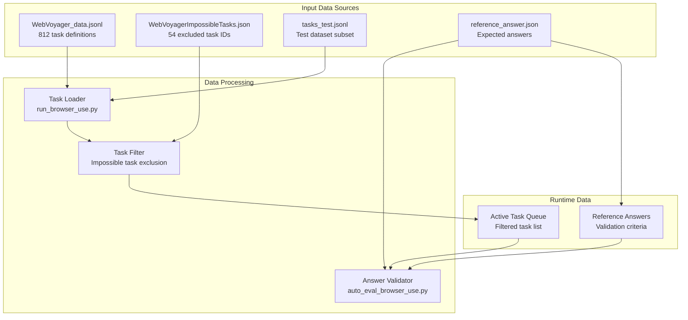
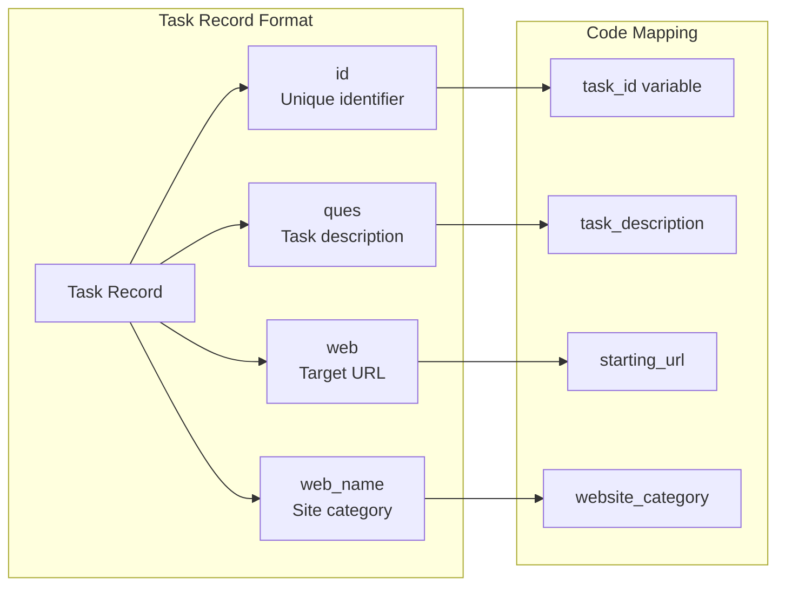
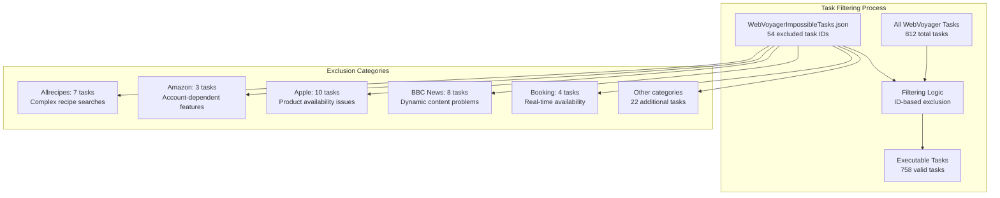
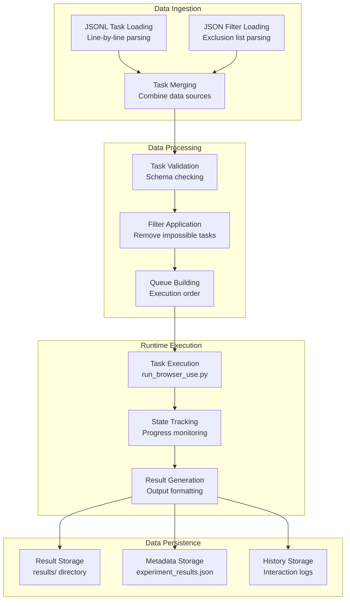
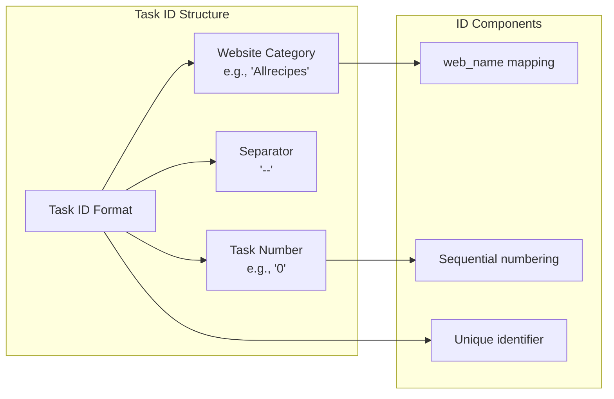
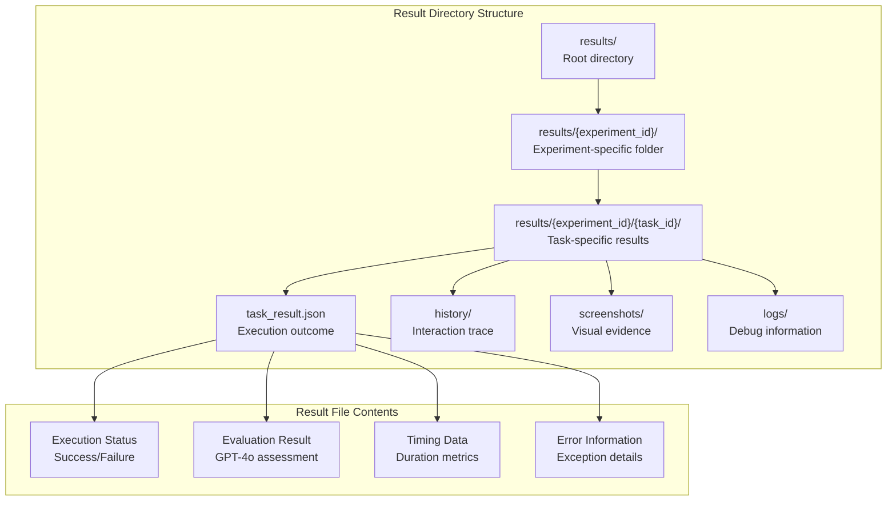

<!-- source: DeepWiki mcp.deepwiki.com · repo browser-use/eval · page 5 Data Management · fetched 2026-10-30 -->

# Data Management

Relevant source files

The following files were used as context for generating this wiki page:

- [data/WebVoyagerImpossibleTasks.json](data/WebVoyagerImpossibleTasks.json)
- [data/WebVoyager_data.jsonl](data/WebVoyager_data.jsonl)
- [data/reference_answer.json](data/reference_answer.json)

This document provides an overview of how task datasets, reference answers, and evaluation results are structured, stored, and processed throughout the browser-use evaluation pipeline. It covers the data formats used for WebVoyager tasks, the filtering mechanisms for impossible tasks, and the organization of results generated during evaluation runs.

For information about the core execution engine that processes this data, see [Core Execution Engine](#2). For details about the evaluation system that consumes task data and generates results, see [Evaluation System](#3). For analysis tools that process the stored results, see [Result Analysis and Scoring](#4).

## Data Sources and Input Formats

The evaluation system operates on structured datasets that define web automation tasks and validation criteria. The primary data sources include task definitions, exclusion lists, and reference answers that guide the evaluation process.

**Sources:** [data/WebVoyager_data.jsonl:1-812](), [data/WebVoyagerImpossibleTasks.json:1-57]()

## Task Data Structure

Each task in the WebVoyager dataset follows a standardized JSON format that defines the target website, task description, and unique identifier. The task structure maps directly to the execution parameters used by the browser automation system.

### WebVoyager Task Schema

Example task structure from the dataset:

| Field | Description | Example Value |
|-------|-------------|---------------|
| `web_name` | Website category | "Allrecipes" |
| `id` | Unique task identifier | "Allrecipes--0" |
| `ques` | Natural language task description | "Provide a recipe for vegetarian lasagna with more than 100 reviews and a rating of at least 4.5 stars suitable for 6 people." |
| `web` | Target website URL | "https://www.allrecipes.com/" |

**Sources:** [data/WebVoyager_data.jsonl:1-10]()

### Task Filtering and Exclusion

The system maintains a separate file for tasks that are deemed impossible or problematic for automated execution. This filtering prevents wasted computation resources and improves evaluation accuracy.

**Sources:** [data/WebVoyagerImpossibleTasks.json:1-57]()

## Data Flow Pipeline

The data management system orchestrates the flow of task definitions from static files through processing stages to final result storage. This pipeline ensures consistent data handling and maintains traceability throughout the evaluation process.

**Sources:** [data/WebVoyager_data.jsonl:1-812](), [data/WebVoyagerImpossibleTasks.json:1-57]()

## Data Transformation and Validation

The system transforms raw task data into structured formats suitable for browser automation and evaluation. This includes parsing natural language descriptions into executable parameters and maintaining data integrity throughout the process.

### Task ID Format Analysis

The task identification system uses a hierarchical naming convention that encodes both the target website and the task sequence number:

Common website categories and their task distributions:

| Website Category | Task Count Range | Example IDs |
|------------------|------------------|-------------|
| Allrecipes | 0-44 (45 tasks) | "Allrecipes--0", "Allrecipes--44" |
| Amazon | 0-40 (41 tasks) | "Amazon--0", "Amazon--40" |
| Apple | 0-42 (43 tasks) | "Apple--0", "Apple--42" |
| ArXiv | 0-42 (43 tasks) | "ArXiv--0", "ArXiv--42" |
| BBC News | 0-41 (42 tasks) | "BBC News--0", "BBC News--41" |

**Sources:** [data/WebVoyager_data.jsonl:1-100]()

## Result Data Organization

The evaluation system generates structured output data that maintains relationships between input tasks, execution traces, and evaluation outcomes. This organization supports both automated analysis and manual review of evaluation results.

The result organization enables efficient retrieval of evaluation data for aggregate analysis and supports the scoring calculations performed by downstream analysis tools.

**Sources:** [data/WebVoyager_data.jsonl:1-812](), [data/WebVoyagerImpossibleTasks.json:1-57]()

---

