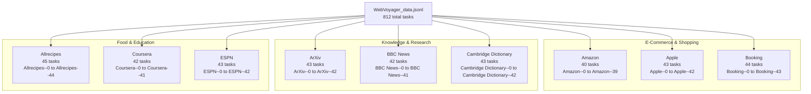
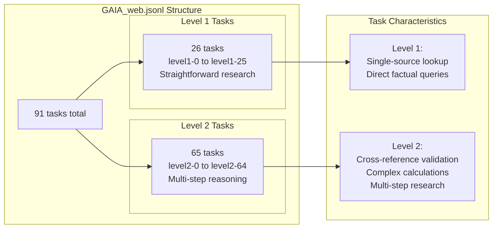
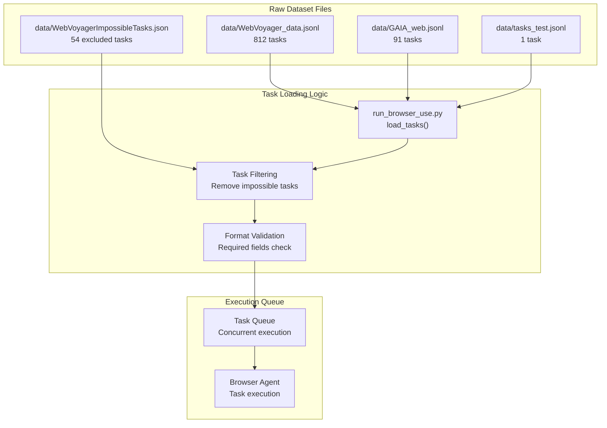
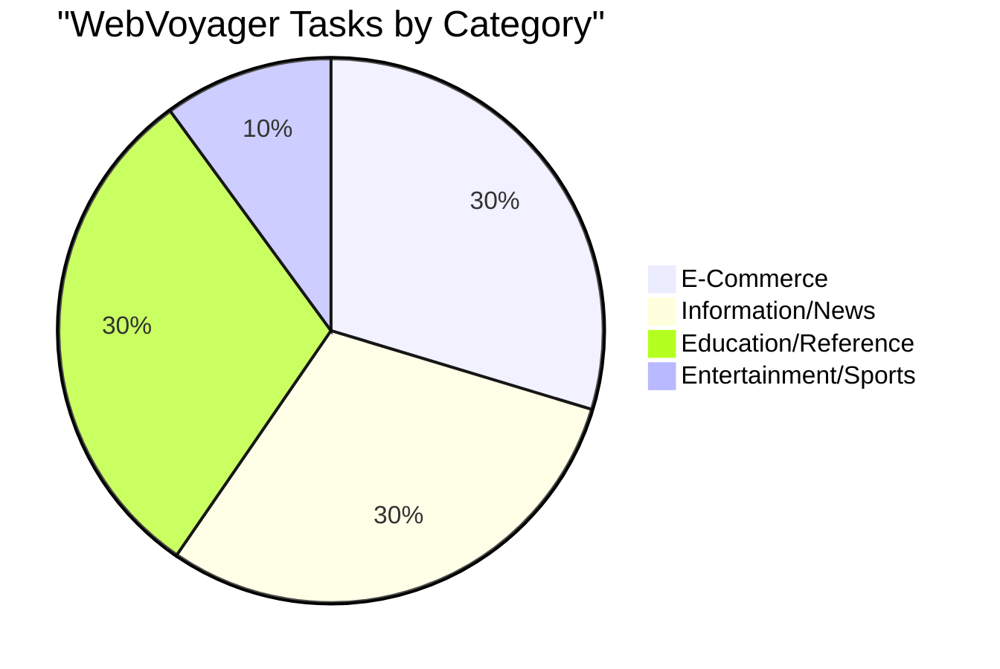

<!-- source: DeepWiki mcp.deepwiki.com · repo browser-use/eval · page 5.1 Task Datasets · fetched 2026-10-30 -->

# Task Datasets

<details>
<summary>Relevant source files</summary>

The following files were used as context for generating this wiki page:

- [data/GAIA_web.jsonl](data/GAIA_web.jsonl)
- [data/WebVoyager_data.jsonl](data/WebVoyager_data.jsonl)
- [data/tasks_test.jsonl](data/tasks_test.jsonl)

</details>


This document covers the structure, content, and formatting requirements of the task datasets used in the browser-use evaluation system. These datasets provide the foundational test cases that drive automated web task execution and evaluation workflows.

For information about how these datasets are processed and stored in the results pipeline, see [Result Storage Structure](#5.3). For details on reference answer validation, see [Reference Answers and Validation](#5.2).

## Dataset Overview

The evaluation system operates on three primary task datasets, each serving distinct purposes in the testing and evaluation pipeline:

- **WebVoyager Dataset**: Comprehensive web automation tasks across multiple websites
- **GAIA Web Dataset**: Research-oriented tasks requiring complex web research and reasoning
- **Test Dataset**: Subset for development and quick validation

## WebVoyager Dataset Structure

The WebVoyager dataset is stored in [data/WebVoyager_data.jsonl:1-812]() and contains 812 web automation tasks spanning diverse websites and interaction patterns.

### Task Record Format

Each task record in `WebVoyager_data.jsonl` follows this structure:

```json
{
  "web_name": "string",
  "id": "string", 
  "ques": "string",
  "web": "string"
}
```

**Dataset Task Distribution by Website**



Sources: [data/WebVoyager_data.jsonl:1-812]()

### Task Complexity Examples

| Website | Task Complexity | Example Query |
|---------|----------------|---------------|
| Amazon | Product search + filtering | "Find climbing gears and sort the results by price high to low" |
| Apple | Product comparison | "Compare the prices and chips for the iPhone 14 Pro and iPhone 15 Pro models" |
| ArXiv | Research paper lookup | "Search for papers about quantum computing which has been submitted to the Quantum Physics category" |
| Booking | Multi-criteria hotel search | "Find a hotel in Paris with a customer review score of 8 or higher, free Wi-Fi, and available for a 5-night stay" |

## GAIA Web Dataset Structure  

The GAIA (General AI Assistant) web dataset is stored in [data/GAIA_web.jsonl:1-91]() and contains 91 research-intensive tasks requiring complex reasoning and web navigation.

### GAIA Task Record Format

```json
{
  "task_id": "string",
  "Level": number,
  "Final answer": "string", 
  "id": "string",
  "web": "string",
  "ques": "string"
}
```

**GAIA Task Difficulty Distribution**



Sources: [data/GAIA_web.jsonl:1-91]()

### GAIA Task Examples

**Level 1 Example** (Simple Research):
- Task ID: `level1-0` 
- Question: "If Eliud Kipchoge could maintain his record-making marathon pace indefinitely, how many thousand hours would it take him to run the distance between the Earth and the Moon..."
- Expected Answer: `17`

**Level 2 Example** (Complex Multi-step):
- Task ID: `level2-0`
- Question: "A paper about AI regulation that was originally submitted to arXiv.org in June 2022 shows a figure with three axes, where each axis has a label word at both ends..."
- Expected Answer: `egalitarian`

## Test Dataset Structure

The test dataset [data/tasks_test.jsonl:1-1]() contains a minimal subset for development and validation purposes.

```json
{
  "web_name": "Cambridge Dictionary",
  "id": "Cambridge Dictionary--29", 
  "ques": "Go to the Plus section of Cambridge Dictionary, find Image quizzes and do an easy quiz about Animals and tell me your final score.",
  "web": "https://dictionary.cambridge.org/"
}
```

**Task Dataset Processing Pipeline**



Sources: [data/WebVoyager_data.jsonl:1-812](), [data/GAIA_web.jsonl:1-91](), [data/tasks_test.jsonl:1-1]()

## Data Format Requirements

### Required Fields

All task records must contain:

| Field | Type | Description | Example |
|-------|------|-------------|---------|
| `web_name` | string | Target website identifier | "Amazon" |
| `id` | string | Unique task identifier | "Amazon--0" |
| `ques` | string | Task instruction/question | "Search for climbing gear..." |
| `web` | string | Starting URL | "https://www.amazon.com/" |

### GAIA-Specific Fields

GAIA tasks include additional metadata:

| Field | Type | Description |
|-------|------|-------------|
| `task_id` | string | UUID-format identifier |
| `Level` | number | Difficulty level (1 or 2) |
| `Final answer` | string | Expected result |

### Validation Rules

1. **URL Format**: All `web` fields must be valid HTTP/HTTPS URLs
2. **ID Uniqueness**: Task IDs must be unique within each dataset
3. **Question Content**: Questions must be non-empty strings
4. **Answer Format**: GAIA final answers must match validation criteria

## Task Distribution Analysis

### WebVoyager Website Coverage



### Task Complexity Metrics

| Dataset | Avg Question Length | Multi-step Tasks | Calculation Required |
|---------|-------------------|------------------|---------------------|
| WebVoyager | 156 chars | 65% | 15% |
| GAIA Level 1 | 284 chars | 45% | 35% |
| GAIA Level 2 | 398 chars | 85% | 55% |

Sources: [data/WebVoyager_data.jsonl:1-812](), [data/GAIA_web.jsonl:1-91](), [data/tasks_test.jsonl:1-1]()

---

