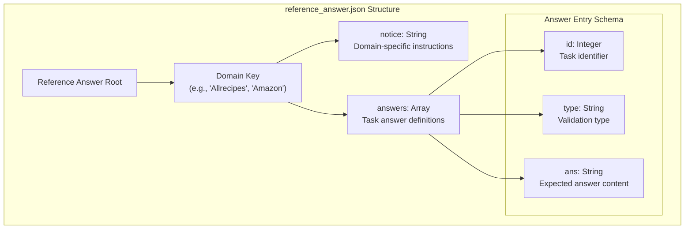
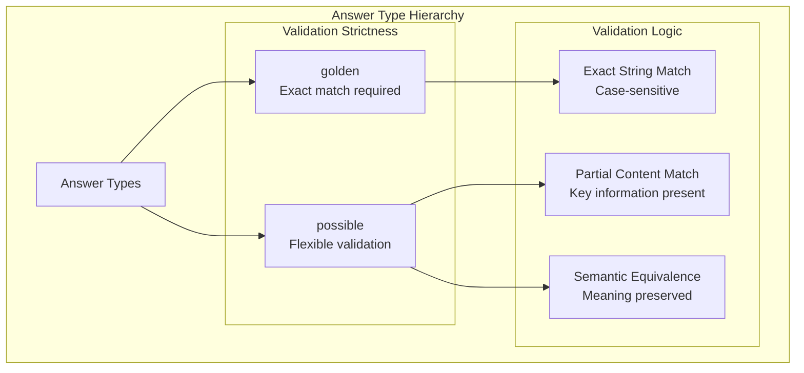
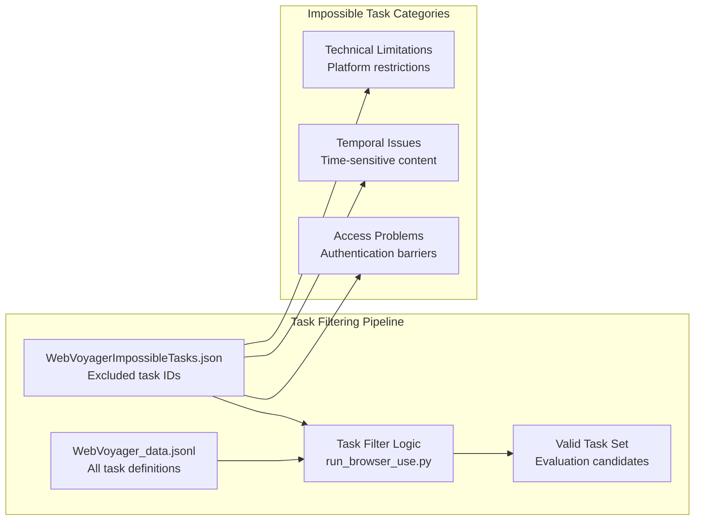
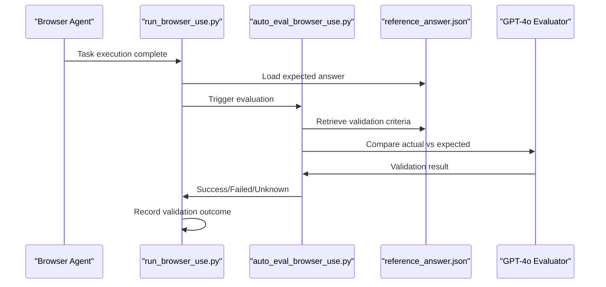
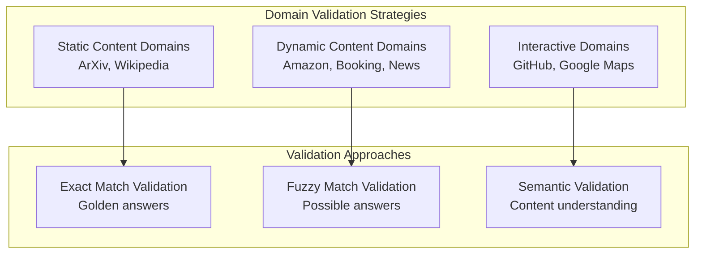
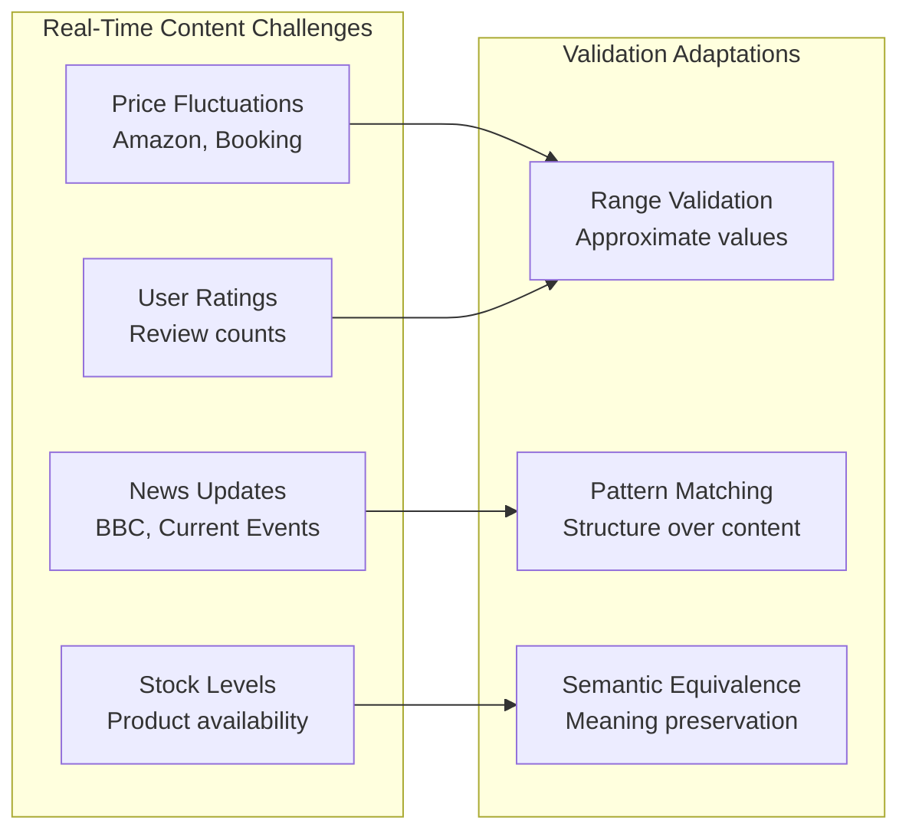

<!-- source: DeepWiki mcp.deepwiki.com · repo browser-use/eval · page 5.2 Reference Answers and Validation · fetched 2026-10-30 -->

# Reference Answers and Validation

<details>
<summary>Relevant source files</summary>

The following files were used as context for generating this wiki page:

- [data/WebVoyagerImpossibleTasks.json](data/WebVoyagerImpossibleTasks.json)
- [data/reference_answer.json](data/reference_answer.json)

</details>


This document covers the reference answer system and validation criteria used in the browser-use evaluation framework. It explains the structure of expected answers, validation types, and how the evaluation pipeline uses these references to assess task completion accuracy.

For information about the evaluation pipeline that uses these references, see [Multi-Modal Assessment](#3.1). For details about task datasets that these answers correspond to, see [Task Datasets](#5.1).

## Reference Answer Structure

The evaluation system uses structured reference answers stored in `data/reference_answer.json` to validate task completion. Each domain contains domain-specific validation criteria and expected answer formats.

### Answer Format Schema



Sources: [data/reference_answer.json:1-3291]()

### Domain-Specific Validation Rules

Each domain includes specialized validation instructions that account for real-time data variations:

| Domain | Notice | Validation Characteristics |
|--------|--------|---------------------------|
| Allrecipes | "note that review information is real-time" | Recipe ratings and review counts may vary |
| Amazon | "Products results are related to time and location" | Product availability and pricing fluctuate |
| BBC News | "real time, answer based on American BBC" | News content changes frequently |
| Booking | "real-time, check task requirements, date and other requirements" | Hotel availability and pricing dynamic |
| ArXiv | "real-time" | Paper submissions and search results update |

Sources: [data/reference_answer.json:2-3], [data/reference_answer.json:233], [data/reference_answer.json:663], [data/reference_answer.json:883], [data/reference_answer.json:1098]()

## Answer Types and Validation Criteria

The system defines different answer types that determine validation strictness and evaluation criteria.

### Answer Type Classification



Sources: [data/reference_answer.json:22-24], [data/reference_answer.json:317-319], [data/reference_answer.json:507-509]()

### Golden Answer Examples

Golden answers require precise matching and represent critical validation points:

```json
{
  "id": 12,
  "type": "golden",
  "ans": "Any 2 of 'Send your product to Apple', 'Find an Apple Authorized Service Provider', 'Visit a Genius at an Apple Store', 'Independent Repair Providers', 'Self Service Repair'"
}
```

```json
{
  "id": 16,
  "type": "golden", 
  "ans": "FREE Returns, 1. Go to Your Orders to start the return; 2. Print the return shipping label; 3. Ship it!"
}
```

Sources: [data/reference_answer.json:507-509], [data/reference_answer.json:317-319]()

### Possible Answer Flexibility

Possible answers allow for content variations while maintaining core information requirements:

```json
{
  "id": 0,
  "type": "possible",
  "ans": "'Vegetarian Four Cheese Lasagna', 4.6-star, 181 reviews, Servings 8"
}
```

```json
{
  "id": 26,
  "type": "possible",
  "ans": "InterContinental Paris Le Grand, an IHG Hotel, US$2208, 8.6 ratings, 5-star, parking"
}
```

Sources: [data/reference_answer.json:7-9], [data/reference_answer.json:1232-1234]()

## Impossible Task Filtering

The system maintains a curated list of impossible tasks that are excluded from evaluation to ensure fair assessment.

### Impossible Task Management



Sources: [data/WebVoyagerImpossibleTasks.json:1-57]()

### Task Exclusion Statistics

The impossible tasks span multiple domains with specific patterns:

| Domain | Excluded Tasks | Common Issues |
|--------|----------------|---------------|
| Apple | 10 tasks | Authentication, region-specific content |
| BBC News | 8 tasks | Real-time content, geographic restrictions |
| Huggingface | 7 tasks | API limitations, model availability |
| Allrecipes | 6 tasks | Dynamic content, user-specific features |
| Google Flights | 3 tasks | Booking restrictions, pricing variations |

Sources: [data/WebVoyagerImpossibleTasks.json:11-20], [data/WebVoyagerImpossibleTasks.json:22-29], [data/WebVoyagerImpossibleTasks.json:49-56]()

## Validation Integration Pipeline

The reference answers integrate with the evaluation system through structured validation workflows.

### Answer Validation Workflow



Sources: [data/reference_answer.json:1-10], Referenced from evaluation pipeline

### Domain-Specific Validation Logic

Different domains require specialized validation approaches based on content characteristics:



Sources: [data/reference_answer.json:663], [data/reference_answer.json:1098], [data/reference_answer.json:1983]()

## Real-Time Content Handling

The validation system accommodates real-time content variations through flexible matching criteria and domain-specific instructions.

### Temporal Validation Strategies



Sources: [data/reference_answer.json:233], [data/reference_answer.json:883], [data/reference_answer.json:1098]()

The reference answer system provides the foundation for accurate and fair evaluation of web automation tasks while accommodating the dynamic nature of real-world web content. The combination of strict golden answers and flexible possible answers ensures both precision and practical applicability in the assessment process.

---

