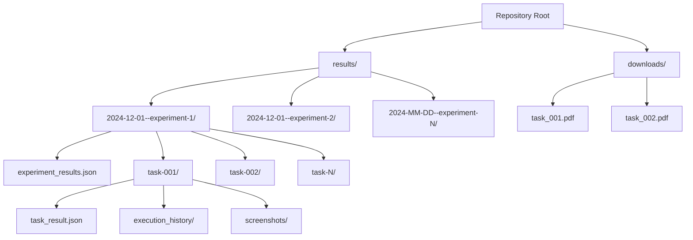
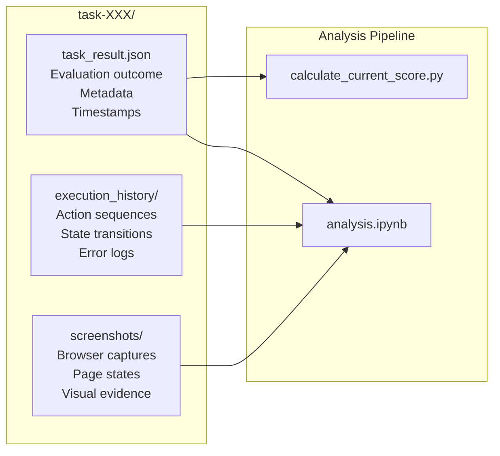
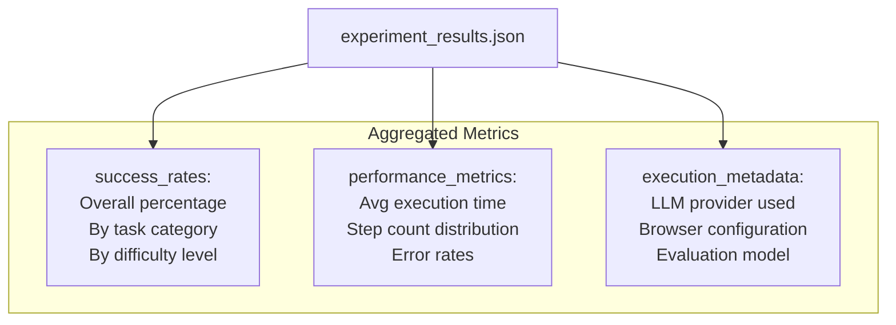
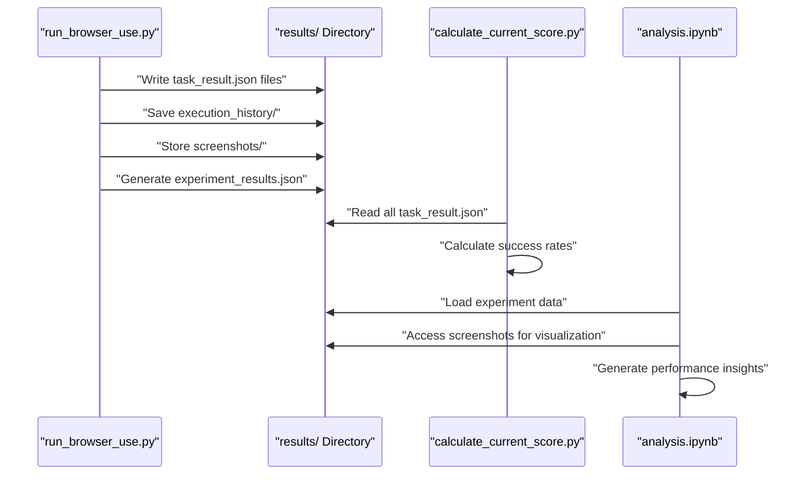
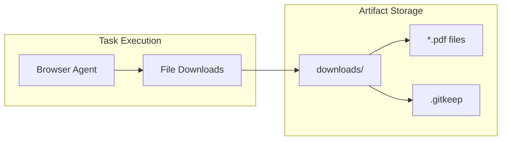

<!-- source: DeepWiki mcp.deepwiki.com · repo browser-use/eval · page 5.3 Result Storage Structure · fetched 2026-10-30 -->

# Result Storage Structure

<details>
<summary>Relevant source files</summary>

The following files were used as context for generating this wiki page:

- [.gitignore](.gitignore)
- [downloads/.gitkeep](downloads/.gitkeep)

</details>


This document describes how evaluation results are organized, stored, and accessed within the browser-use evaluation system. It covers the directory hierarchy, file formats, and storage patterns used to persist task execution data, evaluation outcomes, and analysis artifacts.

For information about how results are analyzed and scored, see [Performance Metrics](#4.1). For details about the evaluation process that generates these results, see [Multi-Modal Assessment](#3.1).

## Storage Directory Organization

The evaluation system organizes results in a hierarchical directory structure designed to support concurrent task execution, temporal organization, and efficient analysis workflows.

### Primary Storage Layout



Sources: [.gitignore:1-11]()

### Result Directory Naming Convention

Experiment directories follow the pattern `YYYY-MM-DD--experiment-description` to provide chronological ordering and descriptive context. This naming scheme supports:

- **Temporal Organization**: Date prefix enables chronological browsing
- **Experiment Identification**: Descriptive suffix distinguishes different evaluation runs  
- **Concurrent Execution**: Multiple experiments can run simultaneously without conflicts

| Pattern | Purpose | Example |
|---------|---------|---------|
| `2024-MM-DD--` | Date prefix for chronological ordering | `2024-12-01--` |
| `--experiment-N` | Experiment identifier | `--webvoyager-azure-gpt4` |
| `--baseline` | Baseline evaluation runs | `--baseline-claude-sonnet` |

## Task Result Storage Format

Each task execution generates a structured result package containing execution metadata, evaluation outcomes, and debugging artifacts.

### Task Result Schema



Sources: [.gitignore:1-11]()

### Core Result Components

#### task_result.json Structure

The primary result file contains standardized evaluation metadata:

```json
{
  "task_id": "string",
  "success": "boolean|string", 
  "evaluation_model": "string",
  "execution_time": "float",
  "step_count": "integer",
  "final_answer": "string",
  "reference_answer": "string",
  "evaluation_details": "object"
}
```

#### execution_history Directory

Contains chronological records of:
- **Browser actions**: Click, type, navigate operations
- **Page state**: DOM snapshots, URL changes
- **Agent decisions**: Reasoning traces, action planning
- **Error conditions**: Exception logs, recovery attempts

#### screenshots Directory  

Stores visual evidence including:
- **Initial state**: Starting page condition
- **Action moments**: Pre/post action captures  
- **Final state**: Task completion evidence
- **Error states**: Failure condition documentation

## Experiment-Level Aggregation

The system maintains experiment-wide metadata to support batch analysis and performance tracking.

### Experiment Results Schema



Sources: [.gitignore:1-11]()

### Experiment Metadata Fields

| Field Category | Contents | Purpose |
|----------------|----------|---------|
| `execution_config` | LLM provider, model parameters, browser settings | Reproducibility |
| `task_summary` | Total tasks, success counts, failure breakdown | Quick assessment |
| `timing_data` | Start time, end time, total duration | Performance tracking |
| `evaluation_config` | Assessment model, evaluation criteria | Result interpretation |

## Storage Management Patterns

### Git Ignore Strategy

The system implements selective result exclusion to manage repository size:

```
results/2024*     # Exclude timestamped experiments
downloads/*.pdf   # Exclude large task artifacts  
*.log            # Exclude execution logs
```

This pattern preserves:
- **Configuration files**: Task definitions, reference answers
- **Analysis code**: Scoring scripts, notebooks
- **Sample results**: Small result sets for testing

While excluding:
- **Large datasets**: Full evaluation runs
- **Binary artifacts**: PDFs, images, logs
- **Temporary files**: Cache, intermediate results

Sources: [.gitignore:1-11]()

### Access Patterns

#### Analysis Workflow Integration

The storage structure supports common analysis patterns:



Sources: [.gitignore:1-11]()

#### Concurrent Access Handling

The directory structure prevents conflicts during concurrent execution:
- **Unique task directories**: No shared file writes
- **Atomic result updates**: Complete task_result.json writes
- **Independent experiments**: Separate timestamp-based directories

## Downloads Directory Management

Task artifacts requiring persistent storage are managed separately from evaluation results.

### Artifact Storage Strategy



The `downloads/` directory:
- **Stores task artifacts**: PDFs, documents, media files
- **Maintains .gitkeep**: Preserves directory structure
- **Excludes from git**: Prevents repository bloat
- **Supports analysis**: Provides access to downloaded content

Sources: [downloads/.gitkeep:1](), [.gitignore:2]()

This storage architecture enables efficient result management while supporting the complex evaluation workflows required for browser automation assessment.

---

