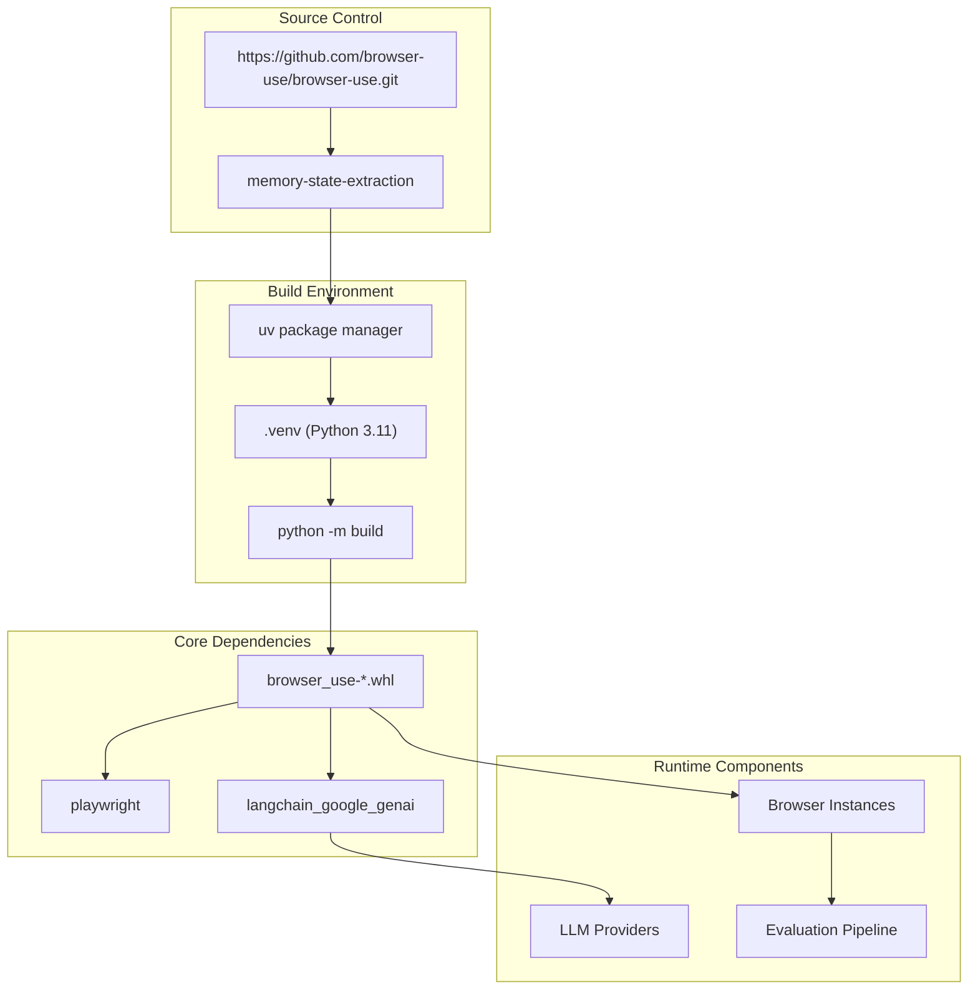
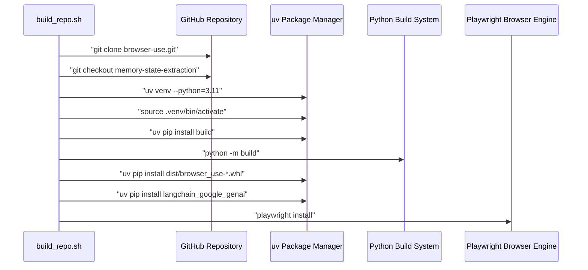
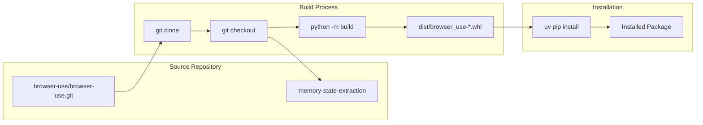
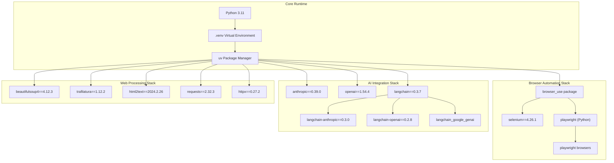

<!-- source: DeepWiki mcp.deepwiki.com · repo browser-use/eval · page 6 Development Environment · fetched 2026-10-30 -->

# Development Environment

Relevant source files

The following files were used as context for generating this wiki page:

- [build_repo.sh](build_repo.sh)
- [requirements_old.txt](requirements_old.txt)

This document covers the development environment setup for the browser-use evaluation system, including the build process, key dependencies, and integration with the browser-use package. This environment enables automated browser task execution and AI-powered evaluation of web interactions.

For step-by-step setup instructions, see [Environment Setup](#6.1). For detailed dependency analysis, see [Dependencies and Packages](#6.2). For development tooling and best practices, see [Development Tools](#6.3).

## Environment Overview

The development environment consists of a Python 3.11 virtual environment with the browser-use package built from source, along with supporting libraries for web automation, AI model integration, and data processing. The system uses `uv` for fast dependency management and virtual environment creation.

### Development Environment Architecture

Sources: [build_repo.sh:9-32]()

## Build Process Flow

The build process is orchestrated by the `build_repo.sh` script, which handles cloning, environment setup, building, and dependency installation in a specific sequence to ensure compatibility with the evaluation system.

### Build Process Sequence

Sources: [build_repo.sh:9-32]()

## Key Dependency Categories

The evaluation system requires several categories of dependencies that work together to enable web automation and AI evaluation capabilities.

| Category | Purpose | Key Packages |
|----------|---------|-------------|
| Browser Automation | Web interaction and control | `browser-use`, `selenium`, `playwright` |
| LLM Integration | AI model communication | `anthropic`, `openai`, `langchain-*` |
| Web Processing | Content extraction and parsing | `beautifulsoup4`, `trafilatura`, `html2text` |
| HTTP Clients | Network communication | `httpx`, `aiohttp`, `requests` |
| Data Processing | JSON/data manipulation | `pydantic`, `numpy`, `jsonpatch` |
| Async Runtime | Concurrent execution | `trio`, `anyio`, `asyncio` |

Sources: [requirements_old.txt:1-82]()

## Browser-Use Package Integration

The system builds and installs the `browser-use` package from a specific Git branch to ensure compatibility with the evaluation framework. This package provides the core browser automation capabilities used by the task execution engine.

### Browser-Use Build Configuration

Sources: [build_repo.sh:9-28]()

## Development Environment Components

The development environment provides the foundation for the entire evaluation pipeline, from task execution through result analysis.

### Environment Component Dependencies

Sources: [build_repo.sh:21-32](), [requirements_old.txt:10-82]()

## Environment Prerequisites

Before running the build script, ensure the following prerequisites are met:

- **Git**: For cloning the browser-use repository
- **Python 3.11**: Required Python version for compatibility
- **uv**: Fast Python package manager for dependency installation
- **Internet Access**: For downloading packages and browser binaries

The build script automatically handles virtual environment creation, dependency installation, and browser binary downloads through Playwright.

Sources: [build_repo.sh:21-32]()

---

