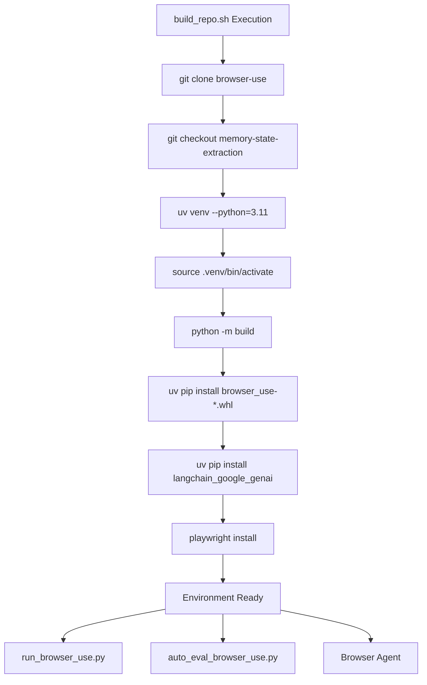
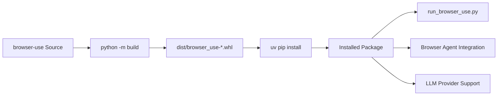

<!-- source: DeepWiki mcp.deepwiki.com · repo browser-use/eval · page 6.1 Environment Setup · fetched 2026-10-30 -->

# Environment Setup

<details>
<summary>Relevant source files</summary>

The following files were used as context for generating this wiki page:

- [build_repo.sh](build_repo.sh)

</details>


This document covers the step-by-step process for setting up the development environment for the browser-use evaluation system. The setup includes cloning and building the browser-use package from source, configuring the Python environment, and installing all necessary dependencies for web automation and AI evaluation.

For detailed information about the specific dependencies and their purposes, see [Dependencies and Packages](#6.2). For development tools and debugging configuration, see [Development Tools](#6.3).

## Purpose and Scope

The environment setup process establishes the foundational components required to run the browser-use evaluation system. This includes:

- Building the browser-use package from a specific Git branch
- Setting up a Python 3.11 virtual environment with `uv`
- Installing browser automation capabilities via Playwright
- Configuring dependencies for LLM integration and web scraping

The setup is automated through the `build_repo.sh` script, which handles the entire process from repository cloning to package installation.

## Setup Process Overview

The environment setup follows a sequential build process that ensures compatibility between the browser-use package and the evaluation system:

**Setup Process Flow**


Sources: [build_repo.sh:1-57]()

## Repository Cloning and Branch Selection

The setup begins by cloning the browser-use repository and checking out a specific development branch:

| Step | Command | Purpose |
|------|---------|---------|
| Clone | `git clone https://github.com/browser-use/browser-use.git` | Downloads the browser-use source code |
| Checkout | `git checkout memory-state-extraction` | Switches to the evaluation-compatible branch |

The `memory-state-extraction` branch contains enhancements specifically needed for the evaluation system, including improved state management and memory handling for browser automation tasks.

Sources: [build_repo.sh:9-15]()

## Virtual Environment Configuration

The script creates an isolated Python environment using `uv`, a fast Python package manager:

```bash
uv venv --python=3.11
source .venv/bin/activate
```

This ensures that all dependencies are installed in isolation and uses Python 3.11, which is required for compatibility with the browser-use package and modern LLM integration libraries.

Sources: [build_repo.sh:21-22]()

## Package Building and Installation

**Package Build Process**


The build process creates a wheel distribution of the browser-use package, which is then installed into the virtual environment:

1. **Build**: `python -m build` creates the package distribution
2. **Install**: `uv pip install dist/browser_use-*.whl` installs the locally built package
3. **Dependencies**: `uv pip install langchain_google_genai` adds LLM integration support

This approach ensures that the evaluation system uses the exact version of browser-use with the necessary modifications for the WebVoyager evaluation tasks.

Sources: [build_repo.sh:24-29]()

## Browser Automation Setup

The final step installs Playwright, which provides the browser automation capabilities:

```bash
playwright install
```

This command downloads the necessary browser binaries (Chromium, Firefox, WebKit) that the browser-use package will control during task execution. The installed browsers support the full range of web interactions needed for WebVoyager evaluation tasks.

Sources: [build_repo.sh:31-32]()

## Environment Validation

After successful setup, the environment provides access to these key components:

| Component | Purpose | Integration Point |
|-----------|---------|-------------------|
| `browser_use` package | Core browser automation | Used by `run_browser_use.py` |
| `langchain_google_genai` | Google LLM integration | Supports Gemini models in evaluation |
| Playwright browsers | Web automation engines | Controlled by Browser Agent |
| Python 3.11 environment | Runtime compatibility | Required for all system components |

The setup script activates the virtual environment at completion, making all installed components immediately available for running the evaluation system.

Sources: [build_repo.sh:38-39]()

## Common Setup Considerations

The build script includes several commented sections that indicate alternative configurations and previous setup approaches. The current configuration represents the stable setup process optimized for the WebVoyager evaluation system.

The script is designed to be idempotent - it can be run multiple times safely, though it will recreate the environment each time. For development workflows, the virtual environment can be reactivated using `source .venv/bin/activate` without re-running the entire build process.

Sources: [build_repo.sh:1-57]()

---

