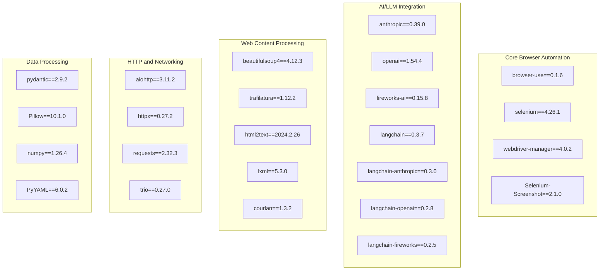
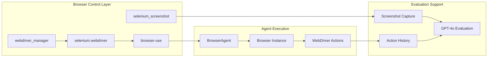
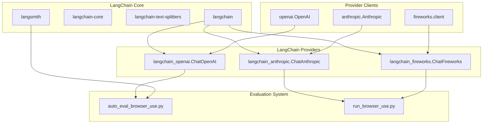
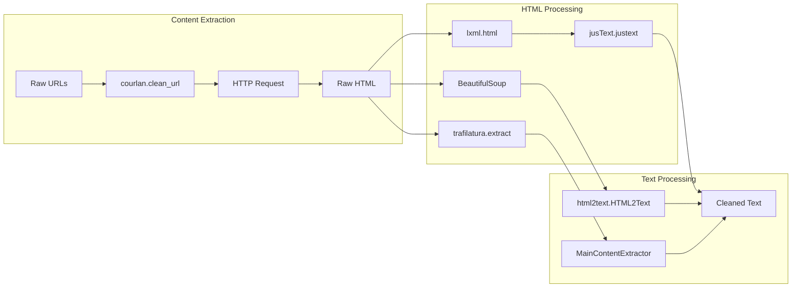
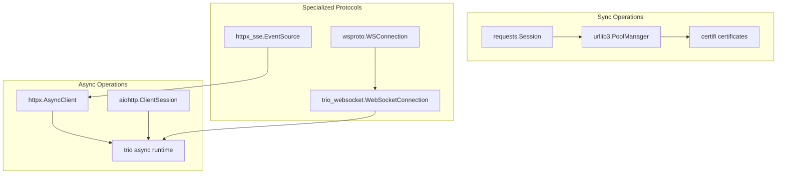
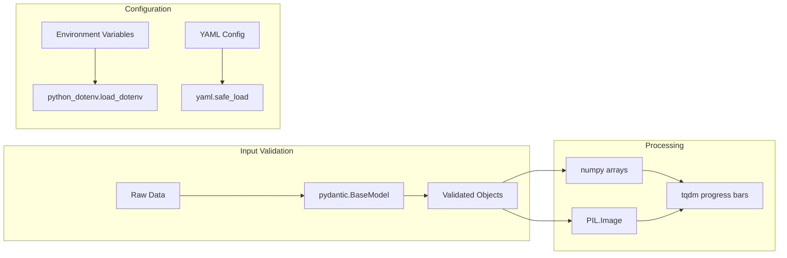

<!-- source: DeepWiki mcp.deepwiki.com · repo browser-use/eval · page 6.2 Dependencies and Packages · fetched 2026-10-30 -->

# Dependencies and Packages

Relevant source files

The following files were used as context for generating this wiki page:

- [requirements_old.txt](requirements_old.txt)

This document provides a comprehensive breakdown of the Python dependencies used in the browser-use evaluation system. It covers the core packages that enable browser automation, AI model integration, web content processing, and evaluation capabilities. For information about environment setup and installation procedures, see [Environment Setup](#6.1). For development tools and configurations, see [Development Tools](#6.3).

## Dependency Categories Overview

The evaluation system relies on several categories of dependencies that work together to enable automated web task execution and assessment. These dependencies support browser automation, AI model integration, web content processing, and concurrent task execution.

### Dependency Distribution by Function

Sources: [requirements_old.txt:1-83]()

## Browser Automation Stack

The browser automation capabilities are built on several key packages that handle web driver management, browser control, and screenshot capture.

### Core Browser Dependencies

| Package | Version | Purpose |
|---------|---------|---------|
| `browser-use` | 0.1.6 | Primary browser automation framework for AI agents |
| `selenium` | 4.26.1 | Web driver interface and browser control |
| `webdriver-manager` | 4.0.2 | Automatic web driver binary management |
| `Selenium-Screenshot` | 2.1.0 | Enhanced screenshot capabilities for evaluation |

The `browser-use` package serves as the primary interface for AI-controlled browser automation, while `selenium` provides the underlying web driver infrastructure. The `webdriver-manager` automatically handles browser driver binaries, eliminating manual setup requirements.

### Browser Integration Architecture

Sources: [requirements_old.txt:11,62-64]()

## AI/LLM Integration Stack

The system supports multiple LLM providers through a comprehensive set of AI-related dependencies that enable both task execution and evaluation.

### LLM Provider Dependencies

| Provider | Core Package | Version | LangChain Integration |
|----------|--------------|---------|----------------------|
| OpenAI | `openai` | 1.54.4 | `langchain-openai==0.2.8` |
| Anthropic | `anthropic` | 0.39.0 | `langchain-anthropic==0.3.0` |
| Fireworks | `fireworks-ai` | 0.15.8 | `langchain-fireworks==0.2.5` |

The `langchain` framework (version 0.3.7) provides unified interfaces for different LLM providers, while `langsmith` (0.1.143) enables monitoring and debugging of LLM interactions.

### LLM Provider Integration Flow

Sources: [requirements_old.txt:5,18,32-38,45]()

## Web Content Processing Stack

Web content extraction and processing capabilities are provided by specialized packages for HTML parsing, content extraction, and text processing.

### Content Processing Dependencies

| Package | Version | Functionality |
|---------|---------|--------------|
| `beautifulsoup4` | 4.12.3 | HTML parsing and DOM manipulation |
| `trafilatura` | 1.12.2 | Main content extraction from web pages |
| `html2text` | 2024.2.26 | HTML to plain text conversion |
| `lxml` | 5.3.0 | Fast XML/HTML processing engine |
| `courlan` | 1.3.2 | URL validation and cleaning |

Additional text processing is supported by `jusText` (3.0.1) for boilerplate removal and `MainContentExtractor` (0.0.4) for content isolation.

### Web Processing Pipeline

Sources: [requirements_old.txt:10,14,21-22,39-41,71]()

## HTTP and Networking Stack

The system uses multiple HTTP clients and networking libraries to support both synchronous and asynchronous web requests.

### Networking Dependencies

| Package | Version | Protocol Support |
|---------|---------|-----------------|
| `aiohttp` | 3.11.2 | Async HTTP client/server |
| `httpx` | 0.27.2 | Modern async/sync HTTP client |
| `requests` | 2.32.3 | Traditional synchronous HTTP client |
| `trio` | 0.27.0 | Async concurrency framework |

Additional networking support includes `httpx-sse` (0.4.0) for server-sent events and `httpx-ws` (0.5.1) for WebSocket connections. The `trio-websocket` (0.11.1) package provides WebSocket support for the async framework.

### HTTP Client Usage Pattern

Sources: [requirements_old.txt:2,12,24-26,60,73-74,78,80-81]()

## Data Processing and Validation

Core data processing capabilities are provided by packages for validation, serialization, and type safety.

### Data Processing Dependencies

| Package | Version | Purpose |
|---------|---------|---------|
| `pydantic` | 2.9.2 | Data validation and serialization |
| `numpy` | 1.26.4 | Numerical computing support |
| `Pillow` | 10.1.0 | Image processing for screenshots |
| `PyYAML` | 6.0.2 | YAML configuration parsing |

The `pydantic` framework ensures type safety and data validation throughout the system, while `numpy` provides numerical computing capabilities for data analysis. Image processing for screenshot evaluation is handled by `Pillow`.

### Support and Utility Libraries

Additional utility packages provide essential functionality:

- **Date/Time Processing**: `dateparser` (1.2.0), `python-dateutil` (2.9.0), `pytz` (2024.2)
- **Progress Tracking**: `tqdm` (4.67.0), `posthog` (3.7.2)
- **Configuration**: `python-dotenv` (1.0.1)
- **Retry Logic**: `backoff` (2.2.1), `tenacity` (9.0.0)
- **Token Processing**: `tiktoken` (0.8.0), `regex` (2024.11.6)

### Core Data Flow

Sources: [requirements_old.txt:15,44,49,52-53,56,58,69,72,76]()

## Dependency Management and Installation

The dependency management follows standard Python practices with pinned versions for reproducibility. All dependencies are specified in `requirements_old.txt` with exact version numbers to ensure consistent environments across deployments.

Critical version considerations:
- `browser-use==0.1.6` is the core automation framework
- `selenium==4.26.1` provides stable WebDriver support
- `openai==1.54.4` and `anthropic==0.39.0` support the latest API features
- LangChain packages are coordinated at 0.3.x versions for compatibility

The total dependency count is 82 packages, indicating a comprehensive but focused set of tools for browser automation and AI evaluation tasks.

Sources: [requirements_old.txt:1-83]()

---

