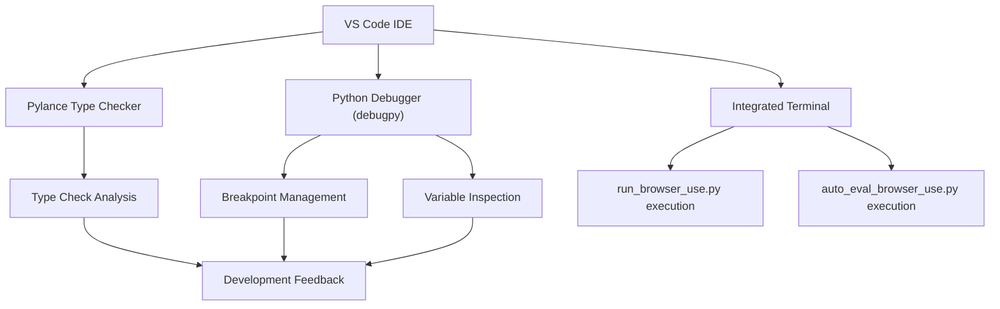
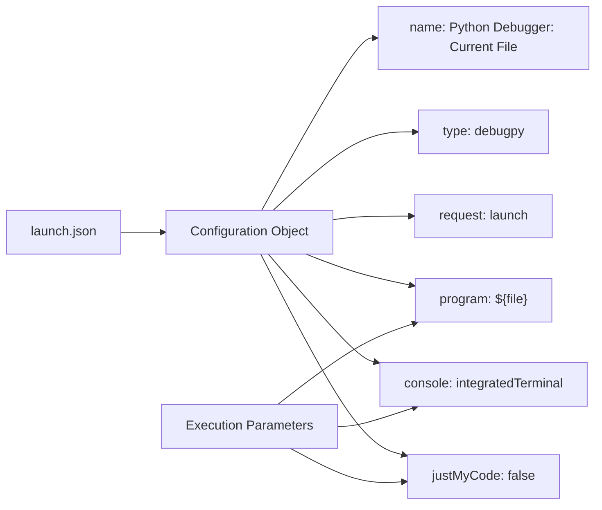
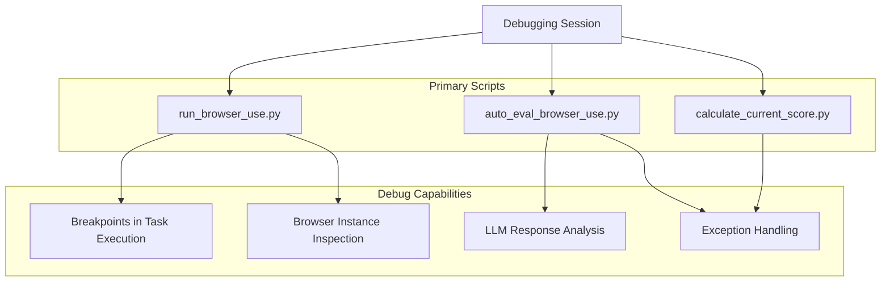

<!-- source: DeepWiki mcp.deepwiki.com · repo browser-use/eval · page 6.3 Development Tools · fetched 2026-10-30 -->

# Development Tools

<details>
<summary>Relevant source files</summary>

The following files were used as context for generating this wiki page:

- [.vscode/launch.json](.vscode/launch.json)
- [.vscode/settings.json](.vscode/settings.json)

</details>


This document covers the development environment setup and tools for working with the browser-use evaluation codebase. It focuses on VS Code configuration, debugging capabilities, and development best practices specific to this project. For environment setup and dependency management, see [Environment Setup](#6.1). For package dependencies, see [Dependencies and Packages](#6.2).

## VS Code Configuration

The repository includes pre-configured VS Code settings optimized for Python development and debugging browser automation tasks.

### Python Type Checking Configuration

The workspace is configured with basic Python type checking to catch common errors during development:

```json
{
    "python.analysis.typeCheckingMode": "basic"
}
```

This setting enables Pylance to perform basic type checking without being overly strict, which is appropriate for research and evaluation code that may include dynamic operations.

### Development Workflow Integration



Sources: [.vscode/settings.json:1-3]()

## Debugging Configuration

The repository provides a comprehensive debugging setup through VS Code's launch configuration, specifically designed for debugging Python scripts in this evaluation environment.

### Launch Configuration Structure



### Debugger Configuration Details

| Parameter | Value | Purpose |
|-----------|-------|---------|
| `name` | "Python Debugger: Current File" | Display name in VS Code debug dropdown |
| `type` | "debugpy" | Use Python debugger extension |
| `request` | "launch" | Start new debugging session |
| `program` | "${file}" | Debug currently active file |
| `console` | "integratedTerminal" | Output to VS Code integrated terminal |
| `justMyCode` | false | Enable debugging into library code |

The `justMyCode: false` setting is particularly important for this codebase because it allows debugging into the browser-use package and other dependencies, which is essential when troubleshooting browser automation issues.

### Key Debugging Scenarios



Sources: [.vscode/launch.json:1-13]()

## Development Best Practices

### Code Navigation and Analysis

With the current VS Code configuration, developers can effectively work with the complex browser automation codebase:

1. **Type Checking**: Basic type analysis helps catch errors without overwhelming strict checking
2. **Library Debugging**: Access to third-party code debugging for browser-use package issues
3. **Integrated Terminal**: Direct execution of evaluation scripts within the IDE

### Recommended Development Workflow

| Stage | Action | Tools Used |
|-------|--------|------------|
| Code Analysis | Review type hints and function signatures | Pylance type checker |
| Task Development | Modify task execution logic | Debugger with breakpoints |
| Evaluation Testing | Run single task evaluations | Integrated terminal |
| Issue Investigation | Debug browser automation failures | Full debugging with library access |

### Debugging Browser Automation

The debugging configuration is particularly valuable for investigating browser automation issues:

- **Browser State Inspection**: Debug browser interaction logic in real-time
- **LLM Response Analysis**: Step through model response processing
- **Task Execution Flow**: Trace execution through complex task workflows
- **Error Investigation**: Access stack traces in both project and library code

## Troubleshooting Common Development Issues

### Environment Integration

The VS Code configuration assumes proper environment setup as described in [Environment Setup](#6.1). Common issues include:

- Missing Python environment activation
- Incorrect browser-use package installation
- Environment variable configuration problems

### Debugging Performance

When debugging complex evaluation runs:

1. Use selective breakpoints to avoid stopping on every task
2. Leverage conditional breakpoints for specific task types
3. Monitor memory usage during concurrent task execution
4. Use the integrated terminal for script output monitoring

Sources: [.vscode/launch.json:1-13](), [.vscode/settings.json:1-3]()

---

