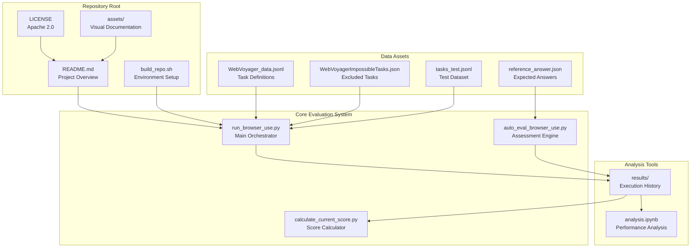
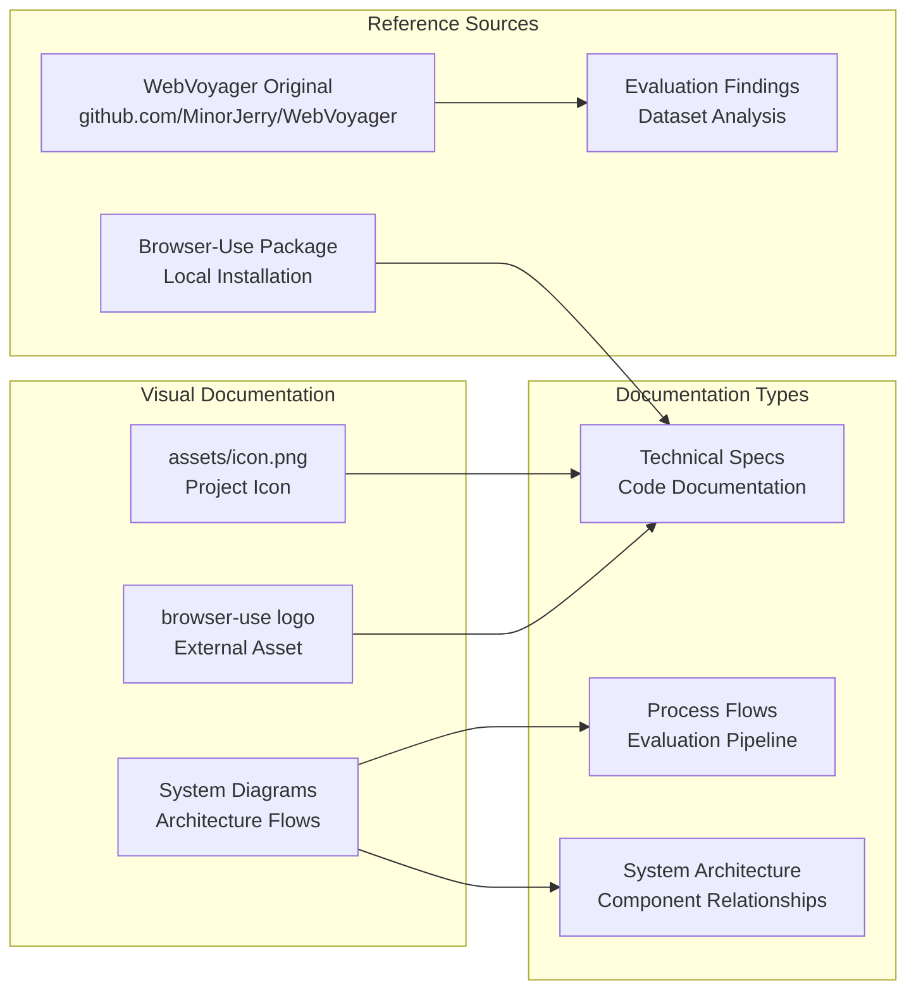
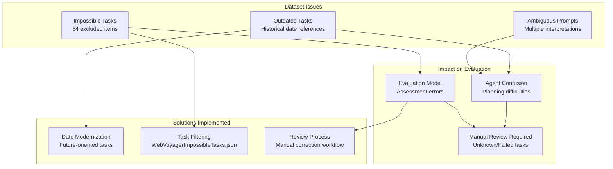
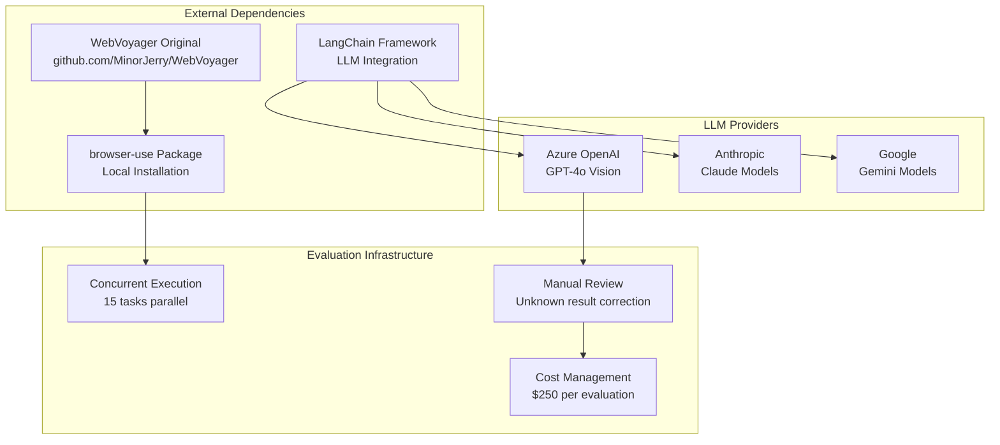

<!-- source: DeepWiki mcp.deepwiki.com · repo browser-use/eval · page 7 Reference Documentation · fetched 2026-10-30 -->

# Reference Documentation

Relevant source files

The following files were used as context for generating this wiki page:

- [LICENSE](LICENSE)
- [README.md](README.md)

This page provides comprehensive reference materials, assets, and contextual information for the browser-use evaluation repository. It covers project documentation structure, visual assets, licensing terms, and supplementary materials that support understanding of the system architecture and implementation details.

For information about setting up the development environment, see [Environment Setup](#6.1). For details about the evaluation system architecture, see [System Architecture](#1.1).

## Project Overview and Context

The browser-use evaluation repository is a specialized fork of the original WebVoyager evaluation system, modified to assess browser automation capabilities using the browser-use package. The system evaluates AI agents performing web-based tasks through automated browser interactions.

### Repository Structure and Key Assets

Sources: [README.md:1-51](), [LICENSE:1-201]()

### Project Scope and Modifications

The evaluation system extends the original WebVoyager framework with several key modifications:

| Component | Original WebVoyager | Browser-Use Fork |
|-----------|-------------------|------------------|
| Task Execution | Custom automation | `browser-use` package integration |
| Evaluation Model | Single image assessment | Multi-image evaluation capability |
| Concurrency | Limited parallelization | 15 concurrent tasks on 16GB RAM |
| Cost Management | Basic evaluation | $250 per full evaluation run |
| Manual Review | Minimal correction | Comprehensive `unknown` result review |

The system addresses critical limitations in the original WebVoyager dataset, including outdated tasks and ambiguous prompts that affect both agent and evaluation model performance.

Sources: [README.md:14-32]()

## Documentation Structure and Reference Materials

### Visual Assets and Diagrams

The repository includes visual assets located in the `assets/` directory, primarily the project icon that represents the integration between WebVoyager evaluation and browser-use automation capabilities.

Sources: [README.md:8-10]()

### Key Reference Documents

The repository maintains several critical reference documents:

**README.md**: Primary project documentation covering evaluation methodology, cost analysis, and research findings about the WebVoyager dataset limitations.

**LICENSE**: Apache 2.0 license terms governing usage, redistribution, and contribution requirements.

**build_repo.sh**: Environment setup script that configures dependencies and browser-use package installation.

Sources: [README.md:1-51](), [LICENSE:1-201]()

## Research Findings and Dataset Analysis

### WebVoyager Dataset Limitations

The evaluation process revealed significant issues with the original WebVoyager dataset:

The research identified that WebVoyager focuses primarily on planning and reasoning rather than actual website understanding, limiting its effectiveness for evaluating complex web agent capabilities.

Sources: [README.md:37-43]()

### Evaluation Methodology and Costs

The evaluation system operates with specific resource constraints and cost considerations:

- **Concurrent Execution**: 15 tasks running simultaneously on 16GB RAM
- **Evaluation Cost**: $250 per complete dataset evaluation using GPT-4o
- **Manual Review**: Required for `unknown` and `failed` classifications
- **Success Criteria**: Three-tier system (success/failed/unknown)

Sources: [README.md:21-35]()

## Licensing and Legal Considerations

### Apache 2.0 License Terms

The repository is licensed under Apache License Version 2.0, providing broad permissions for use, reproduction, and distribution subject to specific conditions:

**Granted Rights**:
- Perpetual, worldwide, non-exclusive copyright license
- Patent license for contributions
- Right to reproduce, modify, and distribute
- Right to create derivative works

**Requirements**:
- Include copy of license with distributions
- Provide attribution notices
- Mark modified files with change notices
- Retain copyright and attribution notices

**Limitations**:
- No trademark rights granted
- No warranty provided
- Limited liability for contributors
- Patent litigation terminates patent license

The license allows commercial use and modification while requiring proper attribution and license inclusion in derivative works.

Sources: [LICENSE:1-201]()

### Usage Rights and Redistribution

Users may freely use, modify, and redistribute the evaluation system provided they comply with Apache 2.0 license terms. The license explicitly permits commercial use and derivative work creation, making it suitable for research and commercial browser automation evaluation projects.

Key redistribution requirements include:
- Including license text with any distribution
- Maintaining copyright notices from original work
- Documenting modifications made to source files
- Providing attribution for original contributors

Sources: [LICENSE:89-137]()

## Integration with Browser-Use Ecosystem

### Package Dependencies and External Resources

The evaluation system integrates with the broader browser-use ecosystem through several key dependencies:

The system deliberately excludes `browser-use` from `requirements.txt` because it builds the package locally from source, ensuring compatibility with the latest development version.

Sources: [README.md:23-24]()

### Future Development Considerations

The repository documentation identifies several areas for future enhancement:

- **Transparency Improvements**: Making manually labeled evaluation items more visible
- **Proxy Support**: Adding proxy capability for scaled evaluation
- **Model Diversity**: Testing additional LLM providers and configurations
- **Setup Variations**: Evaluating single vs. multiple image processing approaches

These enhancements would improve the evaluation system's scalability, accuracy, and applicability across different browser automation scenarios.

Sources: [README.md:45-50]()

---

