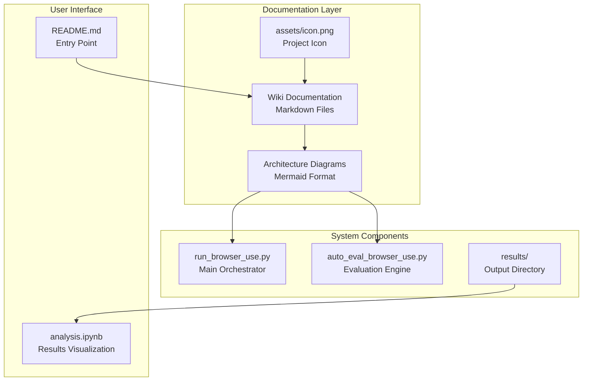
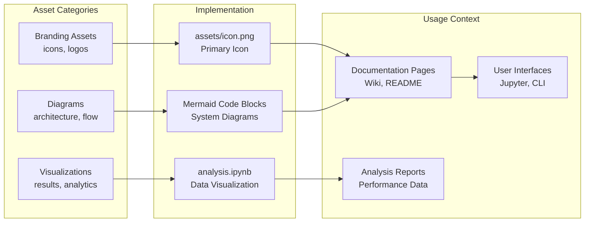
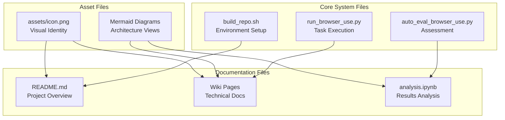

<!-- source: DeepWiki mcp.deepwiki.com · repo browser-use/eval · page 7.1 Project Assets · fetched 2026-10-30 -->

# Project Assets

<details>
<summary>Relevant source files</summary>

The following files were used as context for generating this wiki page:

- [assets/icon.png](assets/icon.png)
- [assets/overall_process_crop.png](assets/overall_process_crop.png)
- [assets/webvoyager_overall_res.png](assets/webvoyager_overall_res.png)

</details>


This document covers the visual documentation assets that support understanding of the browser-use evaluation system architecture. These assets include icons, diagrams, and visual elements used in documentation and system interfaces.

For information about the core system architecture, see [System Architecture](#1.1). For development environment setup, see [Development Environment](#6).

## Asset Inventory

The project maintains a focused collection of visual assets primarily used for documentation and system representation.

### Icon Assets

The primary visual identifier for the project is stored as a high-resolution screenshot-based icon:

| Asset | File Path | Dimensions | Type | Purpose |
|-------|-----------|------------|------|---------|
| Project Icon | `assets/icon.png` | 1356×1058 | PNG Screenshot | Primary project identifier |

The icon serves as the main visual representation of the browser-use evaluation system and appears to be derived from a browser screenshot, aligning with the project's focus on browser automation.

**Sources:** [assets/icon.png:1-47]()

## Visual Documentation Architecture

The project's visual documentation strategy integrates with the overall system architecture to provide clear understanding of complex evaluation workflows.

### Asset Integration Flow



### Documentation Asset Hierarchy



**Sources:** [assets/icon.png:32-46]()

## Asset Organization Structure

The project follows a simple, flat asset organization structure focused on maintainability and accessibility.

### Directory Structure

```
assets/
├── icon.png          # Primary project icon (1356×1058 PNG)
└── (future assets)    # Space for additional visual elements
```

### Asset Specifications

The current icon asset follows these specifications:

- **Format**: PNG with embedded metadata
- **Resolution**: High-resolution (1356×1058) suitable for various display contexts
- **Compression**: Standard PNG compression with ICC color profile
- **Metadata**: Includes XMP metadata indicating screenshot origin
- **Orientation**: Standard orientation (1) for consistent display

**Sources:** [assets/icon.png:37-44]()

## Integration with System Components

Visual assets integrate with key system components to enhance documentation and user experience.

### Asset Usage Mapping



**Sources:** [assets/icon.png:1-47]()

## Usage Guidelines

### Asset Reference Standards

When referencing project assets in documentation or code:

1. **Path References**: Use relative paths from repository root: `assets/icon.png`
2. **Size Considerations**: The primary icon is high-resolution; scale appropriately for different contexts
3. **Format Preservation**: Maintain PNG format for icons to preserve transparency and quality
4. **Metadata Handling**: Preserve embedded metadata when processing or converting assets

### Documentation Integration

Assets should be integrated into documentation following these patterns:

- **README Files**: Include primary icon for project identification
- **Wiki Pages**: Reference assets using relative paths with proper attribution
- **Analysis Reports**: Embed visualizations generated from system data
- **Architecture Docs**: Use consistent diagramming standards (Mermaid format)

**Sources:** [assets/icon.png:32-46]()

## Future Asset Development

The asset structure is designed to accommodate future visual documentation needs:

### Planned Asset Categories

- **System Flow Diagrams**: Visual representations of evaluation pipelines
- **Component Icons**: Individual icons for system components
- **Status Indicators**: Visual elements for system state representation
- **Export Formats**: Multiple format versions for different use cases

### Asset Naming Conventions

Future assets should follow these naming patterns:
- `icon-<component>.png` for component-specific icons
- `diagram-<system>.svg` for scalable diagrams
- `flow-<process>.png` for process illustrations

**Sources:** [assets/icon.png:1-47]()

---

