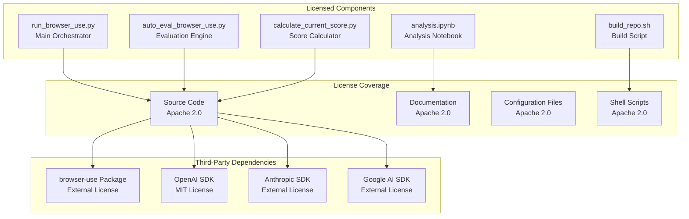
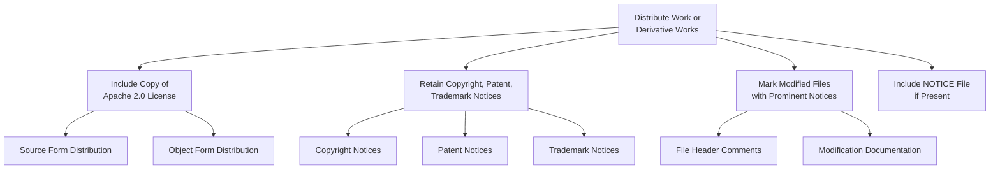
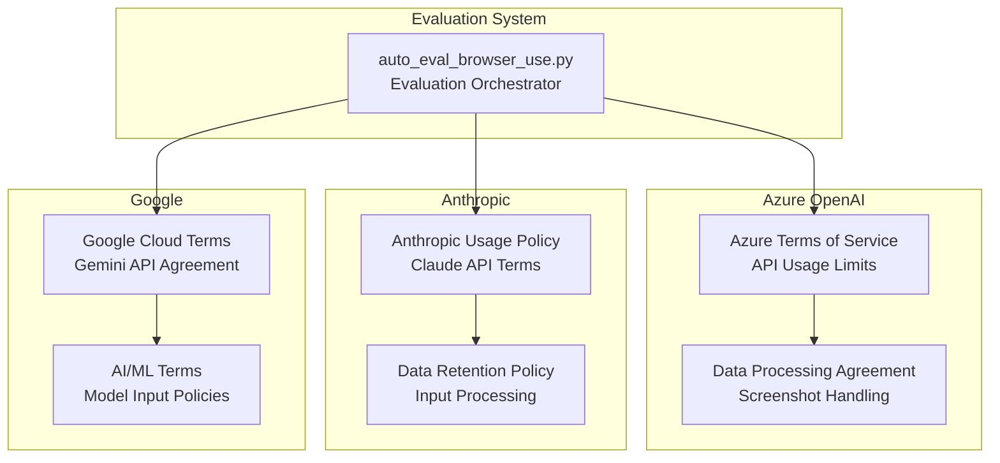
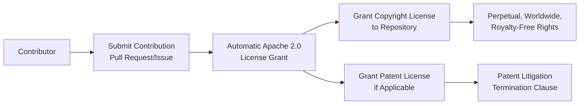
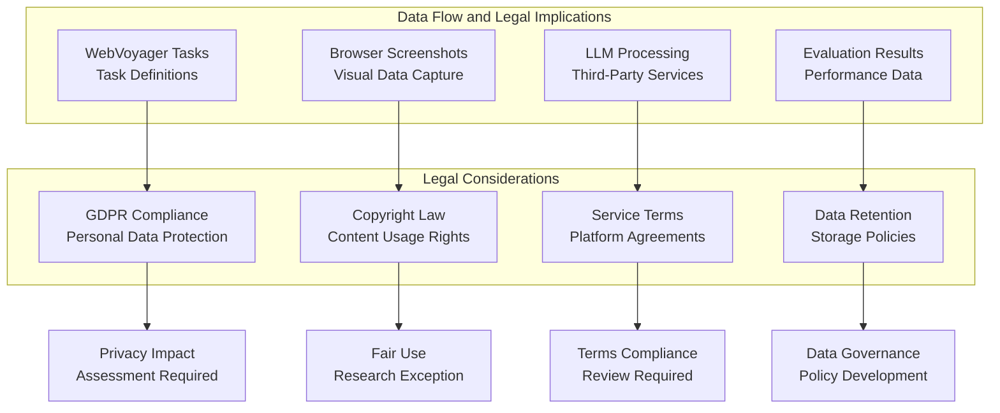

<!-- source: DeepWiki mcp.deepwiki.com · repo browser-use/eval · page 7.2 Licensing and Legal · fetched 2026-10-30 -->

# Licensing and Legal

Relevant source files

The following files were used as context for generating this wiki page:

- [LICENSE](LICENSE)

This document covers the licensing terms, legal considerations, and intellectual property rights for the browser-use evaluation repository. It outlines the Apache 2.0 license terms under which this project is distributed, usage rights for developers and researchers, and legal considerations for browser automation and AI model evaluation workflows.

For information about project assets and documentation, see [Project Assets](#7.1). For development environment setup and dependencies, see [Development Environment](#6).

## Apache 2.0 License Overview

The browser-use evaluation repository is distributed under the Apache License, Version 2.0, as specified in [LICENSE:1-201](). This license provides broad permissions for use, modification, and distribution while maintaining certain obligations and disclaimers.

### License Scope and Application

**Sources:** [LICENSE:1-201]()

## Usage Rights and Permissions

Under the Apache 2.0 license, users are granted comprehensive rights for both commercial and non-commercial use of the evaluation system.

### Granted Permissions

| Permission | Scope | Requirements |
|------------|-------|--------------|
| **Use** | Run evaluation scripts, analyze results | Include license notice |
| **Modify** | Adapt code for custom evaluation needs | Mark modified files |
| **Distribute** | Share original or modified versions | Include license copy |
| **Private Use** | Internal research and development | No additional requirements |
| **Commercial Use** | Production evaluation systems | Include license notice |
| **Patent License** | Use any patents covering the work | Maintain patent grant |

### Key License Terms

The license grants users a "perpetual, worldwide, non-exclusive, no-charge, royalty-free, irrevocable copyright license" as defined in [LICENSE:66-71](). This applies to:

- **Source Code**: All Python scripts, shell scripts, and configuration files
- **Documentation**: README files, analysis notebooks, and wiki content  
- **Derivative Works**: Modified versions of any licensed components

**Sources:** [LICENSE:66-71](), [LICENSE:89-128]()

## Distribution and Modification Requirements

When redistributing or modifying the evaluation system, specific obligations must be met according to [LICENSE:89-128]().

### Distribution Requirements

### Modification Guidelines

When modifying evaluation scripts such as `run_browser_use.py` or `auto_eval_browser_use.py`, you must:

1. **Mark Changes**: Add prominent notices stating modifications were made [LICENSE:97-98]()
2. **Retain Notices**: Keep all existing copyright and attribution notices [LICENSE:100-103]()
3. **License Compliance**: Ensure modifications remain under Apache 2.0 terms [LICENSE:123-128]()
4. **Attribution**: May add your own copyright statement for modifications [LICENSE:123-124]()

**Sources:** [LICENSE:89-128]()

## Third-Party Dependencies and Licenses

The evaluation system integrates with multiple third-party services and libraries, each with their own licensing terms.

### Dependency License Matrix

| Component | License Type | Usage in System | Legal Considerations |
|-----------|--------------|-----------------|---------------------|
| `browser-use` | External | Core browser automation | Must comply with package license |
| OpenAI SDK | MIT | Azure OpenAI integration | Permissive license, minimal restrictions |
| Anthropic SDK | External | Claude model access | Subject to Anthropic's terms |
| Google AI SDK | External | Gemini model integration | Subject to Google's API terms |
| Jupyter/IPython | BSD | Analysis notebooks | Permissive license |

### LLM Provider Service Terms

**Note**: Users must independently verify compliance with all third-party service terms when using this evaluation system.

**Sources:** Inferred from system architecture diagrams and LLM provider integrations

## Disclaimer and Liability

The Apache 2.0 license includes important disclaimers regarding warranties and liability limitations.

### Warranty Disclaimer

As stated in [LICENSE:143-151](), the work is provided on an "AS IS" BASIS, WITHOUT WARRANTIES OR CONDITIONS OF ANY KIND. This means:

- **No Fitness Guarantee**: No warranty that the evaluation system will meet your specific requirements
- **No Accuracy Promise**: Evaluation results are provided without guarantee of correctness
- **No Availability Assurance**: No guarantee of continuous operation or bug-free performance
- **User Responsibility**: You assume all risks associated with using the evaluation system

### Liability Limitations

The license limits contributor liability for damages as outlined in [LICENSE:153-163](). Contributors are not liable for:

- **Direct Damages**: Loss of data, failed evaluations, incorrect results
- **Indirect Damages**: Business interruption, lost profits, consequential losses
- **Special Damages**: Punitive damages, exemplary damages
- **Commercial Losses**: Revenue impact, competitive disadvantage

This is particularly relevant for:
- Browser automation failures that may affect target websites
- Evaluation inaccuracies that could impact research conclusions
- Resource consumption costs from LLM provider APIs

**Sources:** [LICENSE:143-151](), [LICENSE:153-163]()

## Contributing Guidelines

Contributions to the evaluation system are governed by the license terms in [LICENSE:130-136]().

### Contribution License Terms

When you submit contributions, they are automatically licensed under Apache 2.0 unless explicitly stated otherwise. This includes:

- **Code Contributions**: New evaluation methods, bug fixes, performance improvements
- **Documentation**: Wiki updates, code comments, usage examples  
- **Configuration**: New LLM provider integrations, evaluation templates
- **Test Cases**: Additional WebVoyager tasks, validation scenarios

### Contributor Rights and Obligations

### Intellectual Property Considerations

- **Original Work**: Ensure contributions are your original work or properly licensed
- **Patent Rights**: Be aware that patent licenses terminate if you initiate patent litigation [LICENSE:81-87]()
- **Third-Party Code**: Clearly identify any third-party code with appropriate attribution
- **Employer Rights**: Verify you have authority to contribute if working for an organization

**Sources:** [LICENSE:130-136](), [LICENSE:73-87]()

## Legal Considerations for Evaluation Use

Using this evaluation system raises specific legal considerations related to web scraping, data processing, and AI model evaluation.

### Browser Automation and Web Scraping

The evaluation system performs automated browser interactions through the `browser-use` package, which may be subject to:

- **Website Terms of Service**: Target websites may prohibit automated access
- **Rate Limiting**: Excessive requests may violate service agreements
- **Data Protection**: Screenshot capture may involve personal data processing
- **Intellectual Property**: Web content may be subject to copyright protection

### Data Processing and Privacy

### Research and Academic Use

The evaluation system is designed primarily for research purposes, which may provide certain legal protections:

- **Fair Use**: Academic research may qualify for fair use exceptions for copyrighted content
- **Research Ethics**: Institutional review board approval may be required for human subjects research
- **Publication Rights**: Results may be subject to academic publication and peer review standards
- **Data Sharing**: Research data sharing may require additional consent and compliance measures

**Sources:** Inferred from system functionality and common legal requirements for AI research

## Trademark and Attribution

The license includes specific provisions regarding trademark usage in [LICENSE:138-141]().

### Trademark Restrictions

- **No Trademark License**: The Apache 2.0 license does not grant rights to use contributor trademarks
- **Attribution Only**: Trademarks may only be used for attribution and describing origin
- **Reasonable Use**: Limited to customary use in describing the work's origin
- **NOTICE File**: Any trademark attributions should be included in distribution notices

### Proper Attribution

When referencing or distributing this evaluation system:
- Credit the original repository: `browser-use/eval`
- Include the Apache 2.0 license notice
- Maintain all existing copyright and attribution notices
- Do not imply endorsement by original contributors

**Sources:** [LICENSE:138-141](), [LICENSE:106-121]()