# Page: Overview

# Overview

<details>
<summary>Relevant source files</summary>

The following files were used as context for generating this wiki page:

- [README.md](README.md)
- [run_browser_use.py](run_browser_use.py)

</details>


This repository provides a comprehensive evaluation system for browser automation agents using the WebVoyager dataset. The system orchestrates concurrent execution of web tasks, evaluates agent performance using multi-modal LLM assessment, and provides detailed analysis of results. The evaluation framework is built on top of the `browser-use` package and supports multiple LLM providers including Azure OpenAI, Anthropic, and Google's models.

The system processes up to 812 web tasks from the WebVoyager dataset, filtering out 54 impossible tasks, and executes them with configurable concurrency to evaluate browser agent capabilities across diverse websites and task types. For information about the specific task datasets and their structure, see [Task Datasets](#5.1). For details about the evaluation methodology and scoring, see [Evaluation System](#3).

## System Purpose and Architecture

The browser-use evaluation system serves as a research platform for assessing AI agent performance on real-world web interaction tasks. It combines automated task execution, multi-modal evaluation, and comprehensive result analysis to provide insights into agent capabilities and failure modes.

### Core System Architecture

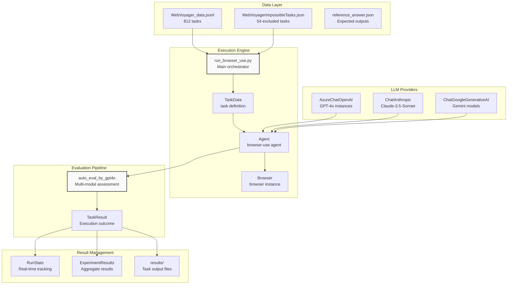

**System Architecture Overview**
This diagram shows how the main execution engine orchestrates browser automation tasks with multiple LLM providers and evaluation components.

Sources: [run_browser_use.py:1-440](), [evaluation/auto_eval_browser_use.py:22]()

### Task Execution Flow

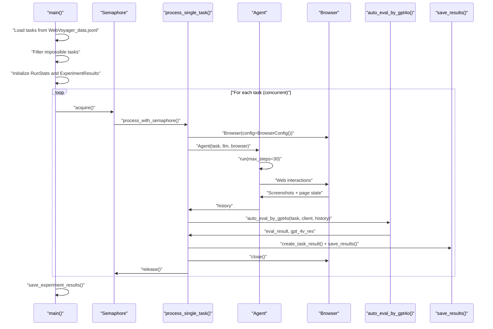

**Task Execution Sequence**
This diagram illustrates the concurrent task processing workflow from initialization through evaluation and result storage.

Sources: [run_browser_use.py:313-404](), [run_browser_use.py:240-311](), [run_browser_use.py:342-388]()

## Key Components and Data Structures

### Core Data Models

The system uses several key data structures to manage task execution and results:

| Component | Purpose | Key Fields |
|-----------|---------|------------|
| `TaskData` | Represents a web task | `id`, `web`, `ques` |
| `TaskResult` | Stores execution outcome | `task_id`, `success`, `num_steps`, `duration_seconds` |
| `RunStats` | Tracks real-time progress | `successful_tasks`, `failed_tasks`, `current_task` |
| `ExperimentResults` | Aggregates all results | `total_tasks`, `total_success`, `all_tasks` |

Sources: [run_browser_use.py:27-31](), [run_browser_use.py:69-80](), [run_browser_use.py:36-66](), [run_browser_use.py:82-88]()

### LLM Provider Management

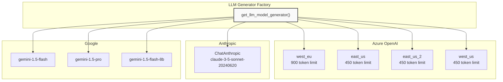

**LLM Provider Integration**
This diagram shows how the system manages multiple LLM providers with different token limits and models for task execution.

Sources: [run_browser_use.py:161-238](), [run_browser_use.py:178-222]()

### Concurrent Execution Architecture

The system implements sophisticated concurrency management using asyncio semaphores to control resource usage while maximizing throughput:

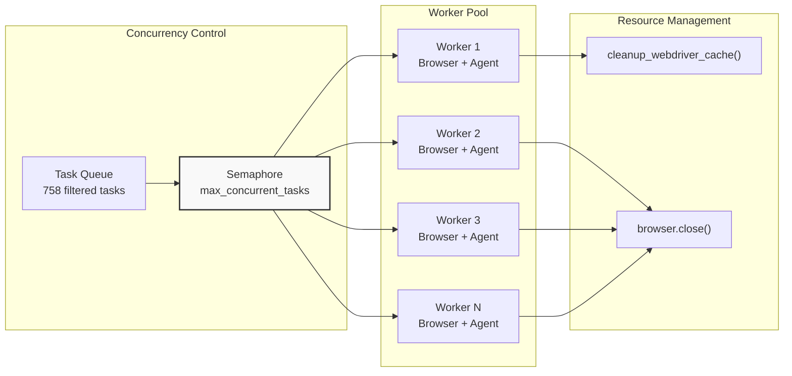

**Concurrent Execution Management**
This diagram shows how the system manages concurrent task execution with proper resource cleanup and semaphore-based throttling.

Sources: [run_browser_use.py:317](), [run_browser_use.py:342-388](), [run_browser_use.py:90-101](), [run_browser_use.py:310]()

## Evaluation and Result Management

The system employs a multi-modal evaluation approach using GPT-4o to assess task completion by analyzing both the final answer and screenshots from the browser interaction history. Results are categorized as `"success"`, `"failed"`, or `"unknown"` when the evaluator cannot make a confident assessment.

### Result Storage Structure

Each task execution generates comprehensive output stored in organized directories:

- `results/examples-browser-use/{task_id}/task_result.json` - Complete task metadata and results
- `results/examples-browser-use/{task_id}/history.json` - Full interaction history with screenshots
- `results/examples-browser-use/experiment_results.json` - Aggregated experiment summary

The system supports both fresh execution and result caching, checking for existing `task_result.json` files to avoid redundant computation.

Sources: [run_browser_use.py:127-136](), [run_browser_use.py:149-152](), [run_browser_use.py:254-286]()

## System Configuration and Deployment

The evaluation system is designed for scalable execution with configurable parameters:

| Parameter | Default | Purpose |
|-----------|---------|---------|
| `--max-concurrent` | 3 | Number of parallel browser instances |
| `--model-provider` | "azure" | LLM provider selection |
| `max_steps` | 30 | Maximum steps per task |
| Browser headless mode | `True` | Reduces resource usage |

The system has been tested with 15 concurrent tasks on 16GB RAM, providing a baseline for resource requirements and scaling considerations.

Sources: [run_browser_use.py:407-430](), [run_browser_use.py:266](), [run_browser_use.py:349-365](), [README.md:21]()

---

# Page: System Architecture

# System Architecture

<details>
<summary>Relevant source files</summary>

The following files were used as context for generating this wiki page:

- [calculate_current_score.py](calculate_current_score.py)
- [evaluation/auto_eval_browser_use.py](evaluation/auto_eval_browser_use.py)
- [run_browser_use.py](run_browser_use.py)

</details>


This document provides a high-level technical overview of the browser-use evaluation system architecture, focusing on how the major components interact to execute web automation tasks and evaluate their performance. The system orchestrates concurrent browser automation, multi-provider LLM integration, and automated evaluation workflows.

For detailed information about task data formats and datasets, see [Task Datasets](#5.1). For environment setup and dependencies, see [Environment Setup](#6.1). For evaluation methodologies, see [Evaluation System](#3).

## Overview

The browser-use evaluation system implements a distributed task execution architecture that coordinates browser automation, AI agent interaction, and automated assessment. The system is designed to evaluate AI agent performance on real-world web tasks using the WebVoyager dataset.

### Core System Architecture

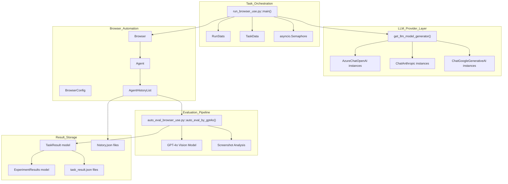

**Sources:** [run_browser_use.py:1-440](), [evaluation/auto_eval_browser_use.py:1-107]()

### Concurrent Task Execution Flow

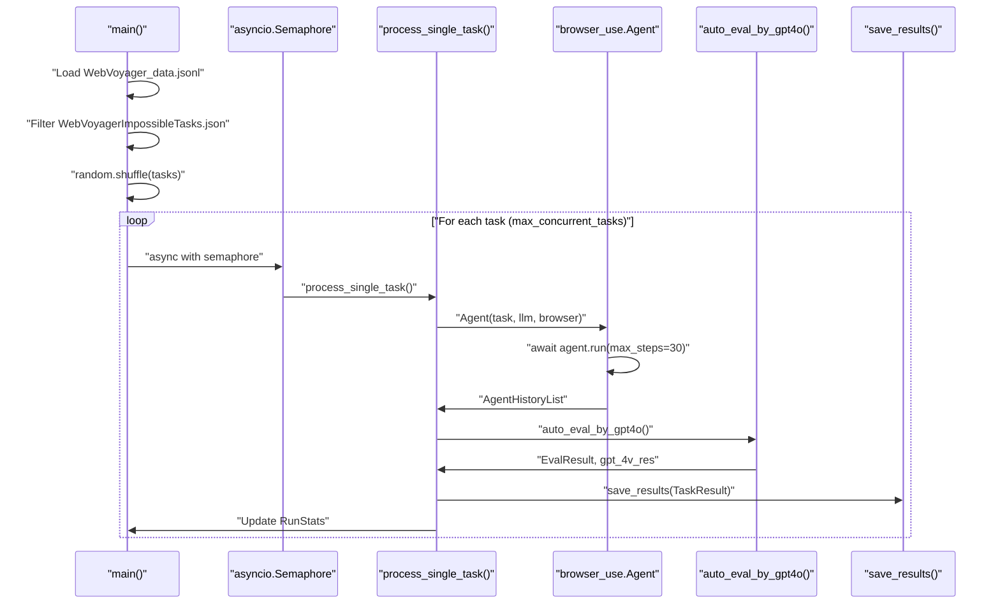

**Sources:** [run_browser_use.py:313-404](), [run_browser_use.py:240-311]()

## Core Components

### Task Orchestration Engine

The `run_browser_use.py` module serves as the central orchestrator, managing all aspects of task execution through several key classes and functions:

| Component | Type | Purpose |
|-----------|------|---------|
| `main()` | Function | Primary entry point coordinating entire execution pipeline |
| `RunStats` | Dataclass | Tracks task progress and success rates across execution |
| `TaskData` | TypedDict | Defines task structure with `id`, `web`, and `ques` fields |
| `process_single_task()` | Async Function | Handles individual task execution with browser automation |
| `asyncio.Semaphore` | Concurrency Control | Limits concurrent browser instances for resource management |

**Sources:** [run_browser_use.py:36-67](), [run_browser_use.py:27-31](), [run_browser_use.py:240-311](), [run_browser_use.py:313-404]()

### Multi-Provider LLM Integration

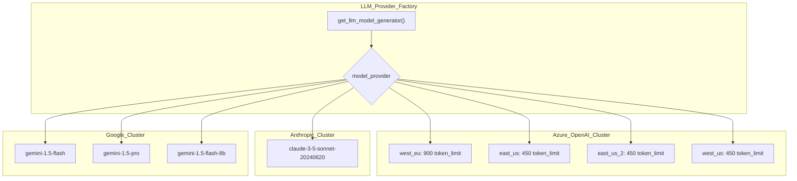

The `get_llm_model_generator()` function implements a generator pattern that creates fresh LLM instances for each task, supporting load balancing across multiple Azure OpenAI endpoints and different model providers.

**Sources:** [run_browser_use.py:161-238](), [run_browser_use.py:155-159]()

### Browser Automation Layer

The system integrates with the `browser-use` package through a structured configuration approach:

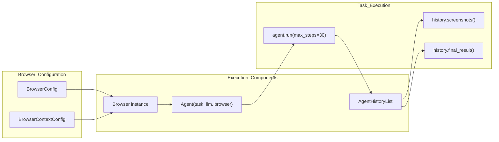

Key browser configuration parameters include:
- `headless=True` for server environments
- `disable_security=True` for testing flexibility  
- Browser window size of 1280x1100 pixels
- Network idle wait times for page loading

**Sources:** [run_browser_use.py:349-365](), [run_browser_use.py:258-267]()

### Automated Evaluation System

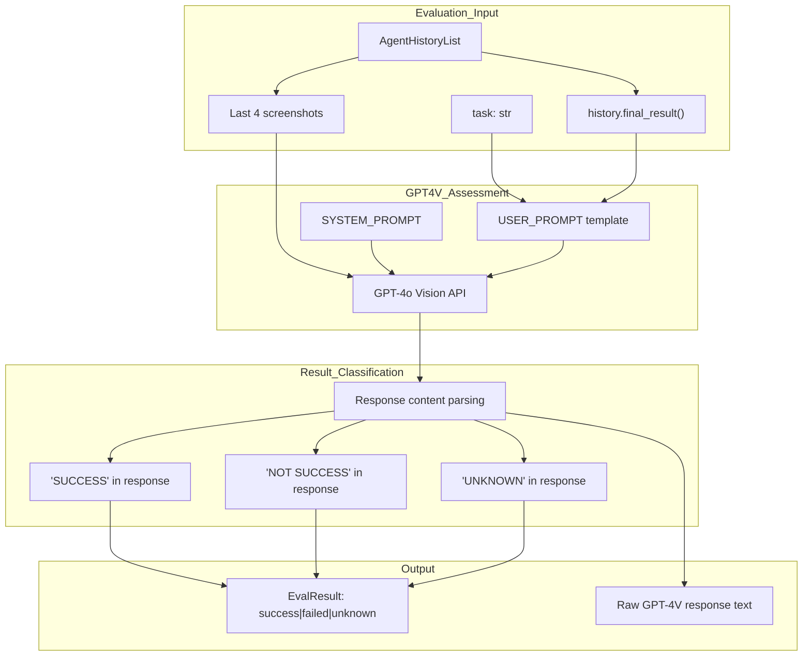

The `auto_eval_by_gpt4o()` function implements multimodal evaluation by combining task instructions, final agent responses, and visual screenshots to assess task completion success.

**Sources:** [evaluation/auto_eval_browser_use.py:37-106](), [evaluation/auto_eval_browser_use.py:14-35]()

### Result Storage and Analysis

The system implements structured result storage using Pydantic models:

| Model | Fields | Purpose |
|-------|--------|---------|
| `TaskResult` | `task_id`, `web_name`, `start_time`, `end_time`, `duration_seconds`, `num_steps`, `success`, `task_prompt`, `final_answer`, `gpt_4v_res` | Individual task execution results |
| `ExperimentResults` | `total_tasks`, `total_success`, `total_failed`, `total_unknown`, `all_tasks` | Aggregate experiment statistics |

Results are persisted to the `results/examples-browser-use/` directory structure with separate JSON files for each task.

**Sources:** [run_browser_use.py:69-88](), [run_browser_use.py:127-136](), [calculate_current_score.py:5-26]()

## Data Flow Architecture

### Task Processing Pipeline

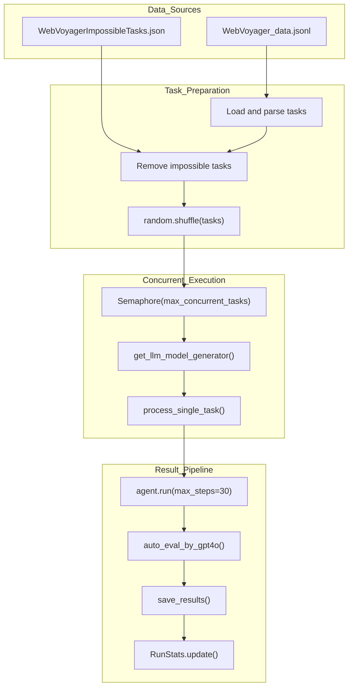

**Sources:** [run_browser_use.py:319-333](), [run_browser_use.py:342-394]()

The system processes tasks through a multi-stage pipeline that ensures robust concurrent execution while maintaining detailed result tracking and evaluation accuracy.

---

# Page: Getting Started

# Getting Started

<details>
<summary>Relevant source files</summary>

The following files were used as context for generating this wiki page:

- [build_repo.sh](build_repo.sh)
- [run.sh](run.sh)

</details>


This guide provides a quick start for setting up the browser-use evaluation environment and running your first WebVoyager task evaluation. It covers environment setup, basic configuration, and executing a simple evaluation run.

For detailed information about the evaluation system architecture, see [System Architecture](#1.1). For comprehensive setup of development tools and dependencies, see [Environment Setup](#6.1).

## Prerequisites

Before starting, ensure you have:

- Linux or macOS operating system
- Git installed
- Python 3.11 available
- `uv` package manager installed
- At least 16GB RAM for concurrent task execution
- API keys for LLM providers (Azure OpenAI, Anthropic, or Google)

## Environment Setup Process

The setup process involves cloning the browser-use repository, installing dependencies, and configuring the evaluation environment.

### Setup Flow

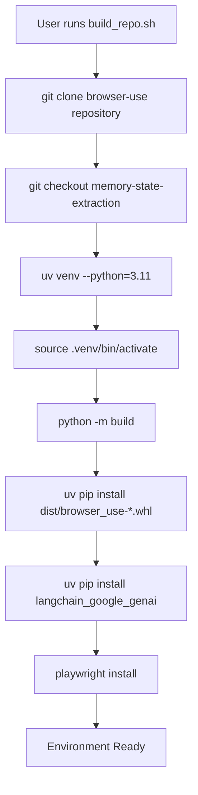

**Setup Process Flow**

Sources: [build_repo.sh:1-57]()

### Running the Setup Script

Execute the automated setup script:

```bash
chmod +x build_repo.sh
./build_repo.sh
```

This script performs the following operations:

1. **Repository Clone**: Clones the browser-use repository from GitHub [build_repo.sh:9]()
2. **Branch Checkout**: Switches to the `memory-state-extraction` branch [build_repo.sh:15]()
3. **Virtual Environment**: Creates a Python 3.11 virtual environment using `uv` [build_repo.sh:21]()
4. **Package Build**: Builds the browser-use package from source [build_repo.sh:25]()
5. **Installation**: Installs the built package and dependencies [build_repo.sh:28-29]()
6. **Browser Setup**: Installs Playwright browsers [build_repo.sh:32]()

Sources: [build_repo.sh:9-32]()

## Basic Configuration

### Environment Variables

Create a `.env` file in the project root with your LLM provider credentials:

```bash
# Azure OpenAI (recommended)
AZURE_OPENAI_API_KEY=your_azure_key
AZURE_OPENAI_ENDPOINT=your_azure_endpoint

# Anthropic (alternative)
ANTHROPIC_API_KEY=your_anthropic_key

# Google (alternative) 
GOOGLE_API_KEY=your_google_key
```

### Activation

Always activate the virtual environment before running evaluations:

```bash
source .venv/bin/activate
```

Sources: [build_repo.sh:22](), [build_repo.sh:39]()

## Running Your First Evaluation

### Basic Execution Command

The simplest way to run an evaluation is using the provided script template:

```bash
python -u run_browser_use.py \
    --test_file ./data/tasks_test.jsonl \
    --api_key YOUR_API_KEY \
    --headless \
    --max_iter 15 \
    --max_attached_imgs 3 \
    --temperature 1 \
    --seed 42
```

### Execution Flow

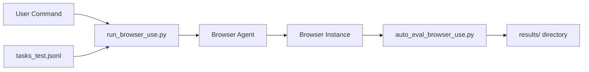

**Basic Evaluation Execution Flow**

Sources: [run.sh:2-10]()

### Key Parameters

| Parameter | Purpose | Example Value |
|-----------|---------|---------------|
| `--test_file` | Input task dataset | `./data/tasks_test.jsonl` |
| `--api_key` | LLM provider API key | Your API key string |
| `--headless` | Run browser without GUI | Flag (no value) |
| `--max_iter` | Maximum steps per task | `15` |
| `--max_attached_imgs` | Screenshots per evaluation | `3` |
| `--temperature` | LLM response randomness | `1` |
| `--seed` | Reproducibility seed | `42` |

Sources: [run.sh:3-10]()

## Understanding Results

### Output Structure

After execution, results are stored in the `results/` directory with this structure:

```
results/
├── experiment_results.json          # Overall experiment metrics
├── task_1234/                      # Individual task results
│   ├── task_result.json            # Task outcome and evaluation
│   ├── history.json                # Step-by-step execution log
│   └── screenshots/                # Browser screenshots
└── summary_stats.json              # Aggregated performance data
```

### Basic Success Metrics

The system tracks these key metrics:

- **Success Rate**: Percentage of tasks completed successfully
- **Average Steps**: Mean number of actions per task
- **Evaluation Accuracy**: GPT-4o assessment reliability
- **Execution Time**: Task completion duration

Sources: System architecture overview and result analysis components

## Next Steps

After completing your first evaluation:

1. **Analyze Results**: Use the analysis tools to understand performance patterns (see [Performance Metrics](#4.1))
2. **Scale Up**: Run full WebVoyager dataset evaluations (see [Core Execution Engine](#2))
3. **Customize Evaluation**: Configure different LLM providers and parameters (see [LLM Provider Integration](#3.2))
4. **Develop Tasks**: Create custom task datasets (see [Task Datasets](#5.1))

### Quick Verification

To verify your setup is working correctly:

```bash
# Activate environment
source .venv/bin/activate

# Run a single test task
python -u run_browser_use.py --test_file ./data/tasks_test.jsonl --max_tasks 1 --headless

# Check for results
ls results/
```

This should create a results directory with task execution outputs and evaluation results.

Sources: [build_repo.sh:39](), [run.sh:2-10]()

---

# Page: Core Execution Engine

# Core Execution Engine

<details>
<summary>Relevant source files</summary>

The following files were used as context for generating this wiki page:

- [run_browser_use.py](run_browser_use.py)

</details>


The Core Execution Engine is the primary orchestration system that manages the end-to-end execution of browser automation tasks. It coordinates task loading, concurrent browser instance management, LLM provider integration, agent execution, and result evaluation to process hundreds of web navigation tasks efficiently.

This document covers the main task execution pipeline and coordination logic. For browser agent integration details, see [Browser Agent Integration](#2.1). For concurrent task management specifics, see [Concurrent Task Management](#2.2). For evaluation system details, see [Evaluation System](#3).

## System Overview

The execution engine operates as an asynchronous task orchestrator that processes WebVoyager evaluation tasks through a multi-stage pipeline:

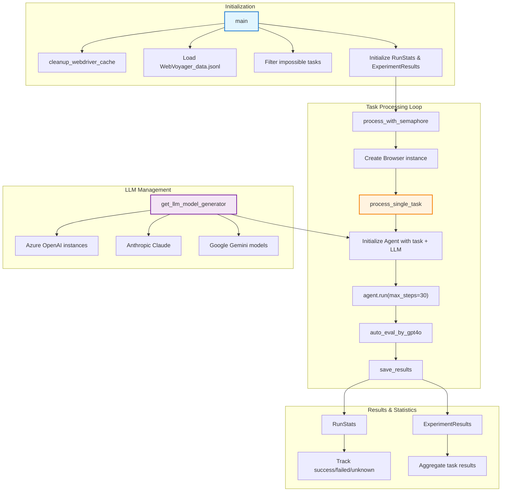

**Sources**: [run_browser_use.py:313-434]()

## Core Data Models

The execution engine uses several key data structures to manage task processing:

| Model | Purpose | Key Fields |
|-------|---------|------------|
| `TaskData` | WebVoyager task definition | `id`, `web`, `ques` |
| `TaskResult` | Individual task execution results | `task_id`, `success`, `duration_seconds`, `num_steps` |
| `ExperimentResults` | Aggregate experiment statistics | `total_tasks`, `total_success`, `all_tasks` |
| `RunStats` | Real-time execution tracking | `successful_tasks`, `failed_tasks`, `current_task` |
| `LLMModel` | LLM provider configuration | `model`, `token_limit` |

**Sources**: [run_browser_use.py:27-88]()

## Task Execution Pipeline

### Task Loading and Filtering

The engine begins by loading task definitions from the WebVoyager dataset and applying filtering rules:

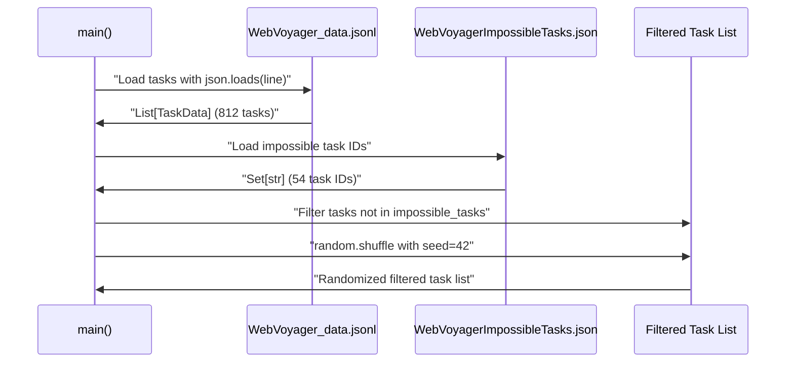

**Sources**: [run_browser_use.py:319-332]()

### LLM Provider Factory

The `get_llm_model_generator` function implements a factory pattern that yields fresh LLM instances for each task, supporting multiple providers with different configurations:

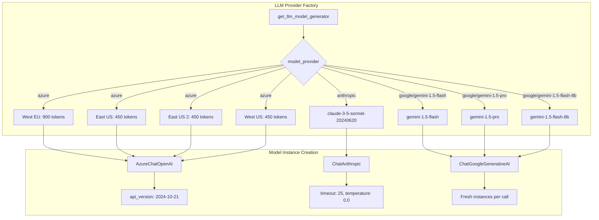

**Sources**: [run_browser_use.py:161-237]()

### Single Task Processing

The `process_single_task` function encapsulates the core logic for executing individual browser automation tasks:

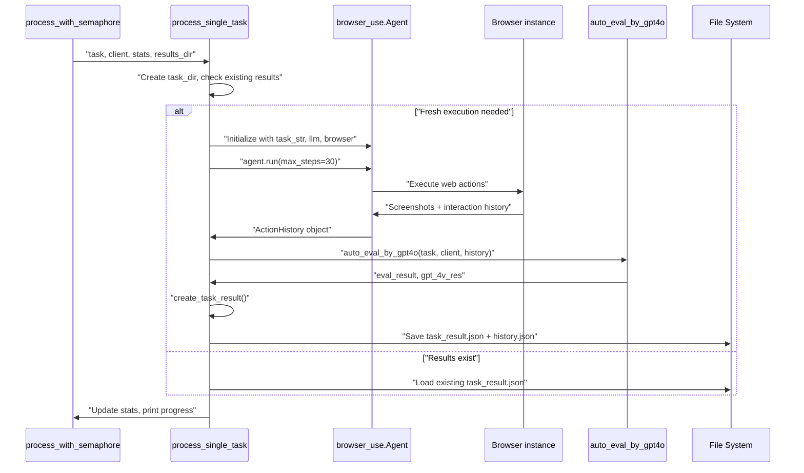

**Sources**: [run_browser_use.py:240-311]()

## Concurrent Execution Management

The engine uses an asyncio `Semaphore` to control the number of concurrent browser instances, preventing resource exhaustion while maximizing throughput:

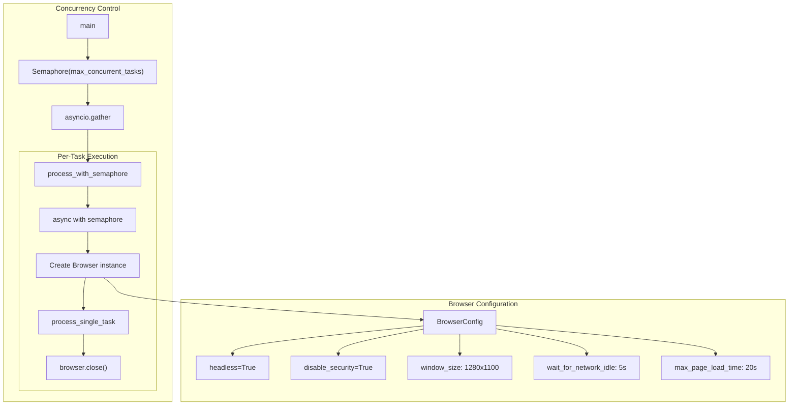

The default configuration allows 3 concurrent tasks, which balances resource usage with execution speed on typical hardware configurations.

**Sources**: [run_browser_use.py:342-389]()

## Statistics and Result Tracking

### Real-time Statistics

The `RunStats` class provides real-time tracking of task execution progress:

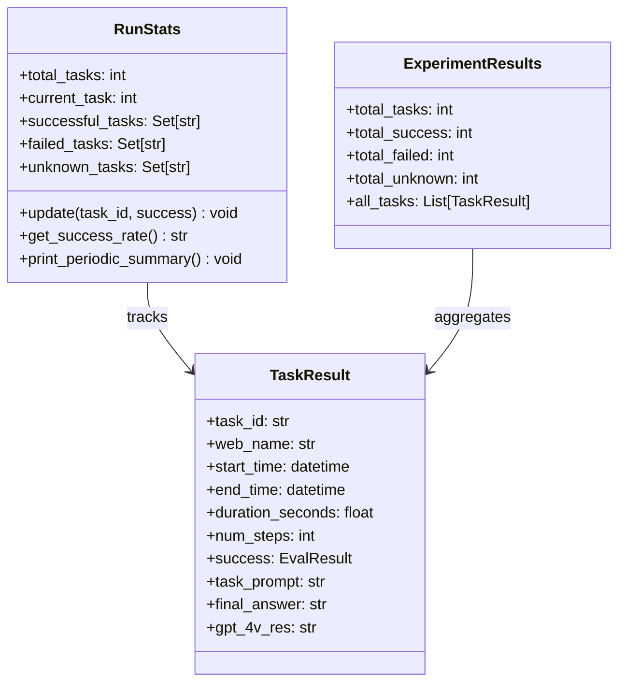

**Sources**: [run_browser_use.py:36-88]()

### Result Persistence

Results are saved in a structured format under `results/examples-browser-use/`:

- `{task_id}/task_result.json` - Individual task results
- `{task_id}/history.json` - Complete interaction history  
- `experiment_results.json` - Aggregated experiment statistics

**Sources**: [run_browser_use.py:127-152]()

## Command Line Interface

The execution engine supports configurable execution parameters:

| Parameter | Default | Purpose |
|-----------|---------|---------|
| `--max-concurrent` | 3 | Number of simultaneous browser instances |
| `--model-provider` | azure | LLM provider selection |

Supported model providers: `azure`, `anthropic`, `google/gemini-1.5-flash`, `google/gemini-1.5-flash-8b`, `google/gemini-1.5-pro`

**Sources**: [run_browser_use.py:406-434]()

## Error Handling and Cleanup

The engine includes comprehensive error handling and resource cleanup:

- **WebDriver Cache Cleanup**: Removes stale selenium cache directories before execution
- **Browser Instance Cleanup**: Ensures browser instances are properly closed even on exceptions
- **Task-level Error Isolation**: Individual task failures don't crash the entire pipeline
- **Graceful Shutdown**: Handles keyboard interrupts and fatal errors appropriately

**Sources**: [run_browser_use.py:90-101](), [run_browser_use.py:377-382](), [run_browser_use.py:435-439]()

---

# Page: Browser Agent Integration

# Browser Agent Integration

<details>
<summary>Relevant source files</summary>

The following files were used as context for generating this wiki page:

- [build_repo.sh](build_repo.sh)
- [run_browser_use.py](run_browser_use.py)

</details>


This document covers how the browser-use evaluation system integrates with the external browser-use package, manages browser instances throughout task execution, and coordinates the interaction between browser automation and multiple LLM providers. For detailed information about LLM provider configuration and failover mechanisms, see [LLM Provider Integration](#3.2). For environment setup and package installation, see [Environment Setup](#6.1).

## Browser-use Package Integration

The system integrates with the external `browser-use` package by cloning, building, and installing it locally during environment setup. The integration provides the core browser automation capabilities through the `Agent`, `Browser`, and configuration classes.

### Package Installation Process

The `build_repo.sh` script handles the complete integration workflow:

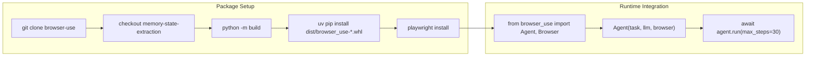
**Package Installation and Runtime Integration**

The system specifically uses the `memory-state-extraction` branch and installs the package from a locally built wheel file. This ensures version consistency and allows for customizations to the browser automation behavior.

Sources: [build_repo.sh:9-32]()

### Core Class Integration

The evaluation system imports and utilizes three primary browser-use classes:

| Class | Purpose | Usage Context |
|-------|---------|---------------|
| `Agent` | Main automation orchestrator | Created per task with specific LLM and browser instances |
| `Browser` | Browser instance management | Created with custom configuration for each concurrent task |
| `BrowserConfig` | Browser-level configuration | Defines headless mode, security settings, and context defaults |

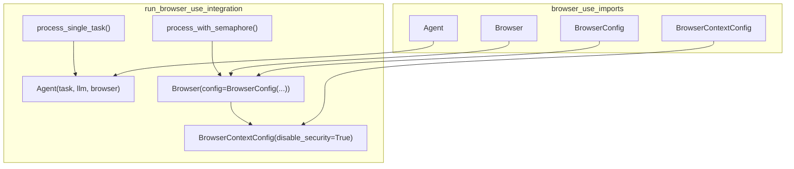
**Browser-use Class Integration in Task Processing**

Sources: [run_browser_use.py:14-15](), [run_browser_use.py:258-264](), [run_browser_use.py:349-365]()

## Browser Instance Lifecycle Management

Each task execution requires a dedicated browser instance to ensure isolation and prevent interference between concurrent tasks. The system manages browser lifecycles through careful creation, configuration, and cleanup processes.

### Browser Configuration

Browser instances are created with specific configurations optimized for automated task execution:

```mermaid
graph LR
    subgraph "BrowserConfig"
        A["headless=True"] --> B["disable_security=True"] 
    end
    
    subgraph "BrowserContextConfig"
        C["disable_security=True"] --> D["wait_for_network_idle_page_load_time=5"]
        D --> E["maximum_wait_page_load_time=20"]
        E --> F["browser_window_size: 1280x1100"]
    end
    
    B --> C
```
**Browser Configuration Hierarchy**

The configuration prioritizes automation reliability over security, with extended timeouts to handle slow-loading web pages and standardized viewport dimensions for consistent screenshot capture.

Sources: [run_browser_use.py:349-365]()

### Instance Lifecycle Control

The browser lifecycle is tightly controlled within the semaphore-protected task execution:

```mermaid
sequenceDiagram
    participant S as "Semaphore"
    participant P as "process_with_semaphore()"
    participant B as "Browser"
    participant A as "Agent"
    participant T as "process_single_task()"
    
    S->>P: "Acquire semaphore slot"
    P->>B: "Browser(config=BrowserConfig(...))"
    P->>T: "process_single_task(task, client, browser)"
    T->>A: "Agent(task, llm, browser)"
    A->>T: "await agent.run(max_steps=30)"
    T->>B: "await browser.close()"
    P->>B: "await browser.close() # Failsafe"
    P->>S: "Release semaphore slot"
```
**Browser Instance Lifecycle During Task Execution**

The system implements a defensive approach with browser cleanup occurring both in the task processing function and as a failsafe in the semaphore wrapper.

Sources: [run_browser_use.py:310](), [run_browser_use.py:378-381]()

## Multi-Provider LLM Coordination

The browser agent integrates with multiple LLM providers through a generator-based factory pattern that ensures fresh model instances and handles provider-specific configurations.

### LLM Model Generator Pattern

The `get_llm_model_generator` function creates fresh LLM instances for each task, preventing state leakage between concurrent executions:

```mermaid
graph TD
    subgraph "get_llm_model_generator()"
        A["load_dotenv(override=True)"] --> B{"model_provider"}
        B -->|"azure"| C["Azure OpenAI Instances"]
        B -->|"anthropic"| D["ChatAnthropic"]
        B -->|"google/*"| E["ChatGoogleGenerativeAI"]
    end
    
    subgraph "Azure_Distribution"
        C --> F["west_eu: 900 tokens"]
        C --> G["east_us: 450 tokens"] 
        C --> H["east_us_2: 450 tokens"]
        C --> I["west_us: 450 tokens"]
    end
    
    subgraph "Task_Assignment"
        J["next(get_llm_model_generator())"] --> K["Agent(task, llm, browser)"]
    end
    
    F --> J
    G --> J
    H --> J
    I --> J
    D --> J
    E --> J
```
**LLM Provider Selection and Distribution**

The generator pattern ensures environment variables are reloaded for each instance and provides load distribution across Azure regions for the primary provider.

Sources: [run_browser_use.py:161-237](), [run_browser_use.py:393]()

### Provider-Specific Configurations

Each LLM provider requires different configuration parameters and capabilities:

| Provider | Model | Configuration | Token Limits |
|----------|-------|---------------|--------------|
| Azure OpenAI | gpt-4o | 4 regional endpoints with API keys | 900 (west_eu), 450 (others) |
| Anthropic | claude-3-5-sonnet-20240620 | Timeout and temperature settings | Not specified |
| Google | gemini-1.5-flash/pro/flash-8b | Model variant selection | Not specified |

```mermaid
graph LR
    subgraph "Provider_Types"
        A["AzureChatOpenAI"] --> B["ChatAnthropic"]
        B --> C["ChatGoogleGenerativeAI"]
    end
    
    subgraph "Agent_Integration"
        D["Agent(task=task_str, llm=client, browser=browser)"] --> E["await agent.run(max_steps=30)"]
    end
    
    A --> D
    B --> D
    C --> D
```
**LLM Provider Integration with Browser Agent**

Sources: [run_browser_use.py:169-235](), [run_browser_use.py:258-266]()

## Agent Configuration and Execution

The `Agent` class from browser-use serves as the primary interface between LLM reasoning and browser automation, configured with task-specific parameters and execution constraints.

### Agent Initialization Parameters

Each agent instance is configured with specific parameters that control its behavior and capabilities:

```mermaid
graph LR
    subgraph "Agent_Parameters"
        A["task: str"] --> B["llm: LLM_Instance"]
        B --> C["browser: Browser"]
        C --> D["validate_output=True"]
        D --> E["generate_gif=False"]
    end
    
    subgraph "Execution_Control"
        F["max_steps=30"] --> G["await agent.run()"]
        G --> H["history.save_to_file()"]
    end
    
    E --> F
```
**Agent Configuration and Execution Flow**

The agent is configured to validate outputs but skip GIF generation for performance, with a maximum step limit to prevent infinite loops.

Sources: [run_browser_use.py:258-267]()

### Task String Formation

Tasks are formatted into natural language strings that combine the question and target website:

```mermaid
graph LR
    A["task['ques']"] --> B["task string formation"]
    C["task['web']"] --> B
    B --> D["f\"{task['ques']} on {task['web']}\"]
    D --> E["Agent(task=task_str, ...)"]
```
**Task String Construction for Agent Execution**

This formatting provides the agent with both the objective and the specific website context needed for task completion.

Sources: [run_browser_use.py:249](), [run_browser_use.py:259]()

### Execution History Capture

The agent execution produces a detailed history object that captures all interactions and is used for both storage and evaluation:

```mermaid
graph TD
    subgraph "Agent_Execution"
        A["await agent.run(max_steps=30)"] --> B["history: AgentHistory"]
    end
    
    subgraph "History_Usage"
        B --> C["history.save_to_file(task_dir / 'history.json')"]
        B --> D["auto_eval_by_gpt4o(task, openai_client, history)"]
        B --> E["len(history.history) # num_steps"]
        B --> F["history.final_result() # final_answer"]
    end
```
**Agent History Capture and Utilization**

The history object serves multiple purposes: persistence for debugging, input for automated evaluation, and source for task result metrics.

Sources: [run_browser_use.py:266-267](), [run_browser_use.py:269-273](), [run_browser_use.py:279-280]()

---

# Page: Concurrent Task Management

# Concurrent Task Management

<details>
<summary>Relevant source files</summary>

The following files were used as context for generating this wiki page:

- [run_browser_use.py](run_browser_use.py)

</details>


This document explains how the browser-use evaluation system manages parallel execution of web automation tasks. The concurrent task management system coordinates multiple browser instances, LLM providers, and evaluation processes to efficiently process large datasets while maintaining resource constraints and error resilience.

For information about browser agent integration and LLM coordination, see [Browser Agent Integration](#2.1). For evaluation pipeline details, see [Evaluation System](#3).

## Concurrency Architecture

The system implements a semaphore-based concurrency model that controls resource allocation and prevents system overload. The main orchestrator coordinates task distribution, browser lifecycle management, and result aggregation.

**Concurrent Execution Flow**
```mermaid
graph TD
    Main["main()"] --> LoadTasks["Load WebVoyager Tasks"]
    LoadTasks --> FilterTasks["Filter Impossible Tasks"]
    FilterTasks --> CreateSemaphore["Semaphore(max_concurrent_tasks)"]
    CreateSemaphore --> GenerateTasks["Generate Task Coroutines"]
    
    GenerateTasks --> TaskCoroutine["process_with_semaphore()"]
    TaskCoroutine --> AcquireSemaphore["async with semaphore"]
    AcquireSemaphore --> CreateBrowser["Browser()"]
    CreateBrowser --> ProcessTask["process_single_task()"]
    ProcessTask --> CloseBrowser["browser.close()"]
    CloseBrowser --> ReleaseSemaphore["Release Semaphore"]
    
    ProcessTask --> UpdateStats["stats.update()"]
    ProcessTask --> SaveResults["save_results()"]
    UpdateStats --> PrintProgress["print_task_progress()"]
    
    GenerateTasks --> GatherTasks["asyncio.gather(*all_tasks)"]
    GatherTasks --> FinalResults["save_experiment_results()"]
```

Sources: [run_browser_use.py:313-404]()

The `main()` function serves as the central orchestrator, managing the entire concurrent execution lifecycle. It creates an `asyncio.Semaphore` to limit concurrent tasks and coordinates task distribution across multiple browser instances.

## Task Execution Pipeline

Each task flows through a standardized pipeline that includes browser initialization, agent execution, evaluation, and result storage. The pipeline is designed to handle failures gracefully without affecting other concurrent tasks.

**Task Processing Lifecycle**
```mermaid
sequenceDiagram
    participant Main as "main()"
    participant Semaphore as "Semaphore"
    participant ProcessWrapper as "process_with_semaphore()"
    participant Browser as "Browser"
    participant Agent as "Agent"
    participant Evaluator as "auto_eval_by_gpt4o"
    participant Storage as "save_results()"
    
    Main->>ProcessWrapper: "task, client"
    ProcessWrapper->>Semaphore: "async with semaphore"
    Semaphore-->>ProcessWrapper: "Acquire slot"
    
    ProcessWrapper->>Browser: "Browser(config)"
    Browser-->>ProcessWrapper: "browser instance"
    
    ProcessWrapper->>Agent: "Agent(task, llm, browser)"
    Agent->>Agent: "await agent.run(max_steps=30)"
    Agent-->>ProcessWrapper: "history"
    
    ProcessWrapper->>Evaluator: "auto_eval_by_gpt4o(task, client, history)"
    Evaluator-->>ProcessWrapper: "eval_result, gpt_4v_res"
    
    ProcessWrapper->>Storage: "save_results(task_result, task_dir)"
    ProcessWrapper->>Browser: "await browser.close()"
    
    ProcessWrapper->>Semaphore: "Release slot"
```

Sources: [run_browser_use.py:240-311](), [run_browser_use.py:342-389]()

The `process_with_semaphore()` function wraps each task execution to ensure proper resource acquisition and cleanup. The `process_single_task()` function handles the core execution logic including agent creation, task execution, and evaluation.

## Resource Management

The system carefully manages browser instances, LLM connections, and memory to prevent resource exhaustion. Each task receives its own browser instance that is created within the semaphore block and properly cleaned up afterward.

**Resource Allocation Strategy**
```mermaid
graph TB
    subgraph "Semaphore Control"
        SemaphoreBlock["async with semaphore"]
        MaxConcurrent["max_concurrent_tasks limit"]
    end
    
    subgraph "Per-Task Resources"
        BrowserInstance["Browser()"]
        BrowserConfig["BrowserConfig"]
        ContextConfig["BrowserContextConfig"]
        LLMClient["AzureChatOpenAI | ChatAnthropic"]
    end
    
    subgraph "Shared Resources"
        ModelGenerator["get_llm_model_generator()"]
        ResultsDir["results_dir"]
        StatsTracker["RunStats"]
        ExperimentResults["ExperimentResults"]
    end
    
    subgraph "Cleanup Process"
        BrowserClose["await browser.close()"]
        CacheCleanup["cleanup_webdriver_cache()"]
        ErrorHandling["Exception handling"]
    end
    
    SemaphoreBlock --> BrowserInstance
    BrowserInstance --> BrowserConfig
    BrowserConfig --> ContextConfig
    ModelGenerator --> LLMClient
    
    BrowserInstance --> BrowserClose
    BrowserClose --> ErrorHandling
    
    StatsTracker --> ResultsDir
    ExperimentResults --> ResultsDir
```

Sources: [run_browser_use.py:348-365](), [run_browser_use.py:90-101](), [run_browser_use.py:377-382]()

The `Browser` is configured with specific settings including headless mode, security disabled, and standardized window size (1280x1100). The `BrowserContextConfig` sets network idle times and page load timeouts to optimize performance.

## Error Handling and Recovery

The concurrent system implements multiple layers of error handling to ensure that individual task failures don't compromise the entire evaluation run. Failed tasks are logged and marked appropriately while allowing other tasks to continue.

| Error Type | Handling Strategy | Code Location |
|------------|------------------|---------------|
| Task execution failure | Mark as "failed", continue processing | [run_browser_use.py:304-307]() |
| Browser close error | Log error, continue cleanup | [run_browser_use.py:378-381]() |
| LLM provider failure | Use next provider in rotation | [run_browser_use.py:161-237]() |
| Evaluation failure | Mark as "unknown" | [run_browser_use.py:269-273]() |

**Error Recovery Flow**
```mermaid
graph LR
    TaskStart["Task Start"] --> TryExecute["Try Execute"]
    TryExecute --> ExecuteSuccess["Success"]
    TryExecute --> ExecuteError["Exception"]
    
    ExecuteError --> LogError["logging.error()"]
    LogError --> MarkFailed["stats.update(task_id, 'failed')"]
    MarkFailed --> ContinueNext["Continue to Next Task"]
    
    ExecuteSuccess --> TryEvaluate["Try Evaluate"]
    TryEvaluate --> EvaluateSuccess["Success"]
    TryEvaluate --> EvaluateError["Exception"]
    
    EvaluateError --> MarkUnknown["Mark as 'unknown'"]
    EvaluateSuccess --> SaveResults["Save Results"]
    MarkUnknown --> SaveResults
    SaveResults --> ContinueNext
```

Sources: [run_browser_use.py:304-311](), [run_browser_use.py:377-382]()

The `try-except` blocks in `process_single_task()` ensure that exceptions are caught and logged without terminating the entire process. The `RunStats.update()` method tracks success, failure, and unknown outcomes.

## Performance Monitoring

The system provides real-time progress tracking and periodic summaries to monitor concurrent execution performance. Statistics are maintained across all concurrent tasks and saved periodically.

**Progress Tracking Components**
```mermaid
graph TD
    subgraph "RunStats Class"
        TotalTasks["total_tasks: int"]
        CurrentTask["current_task: int"]
        SuccessfulTasks["successful_tasks: Set[str]"]
        FailedTasks["failed_tasks: Set[str]"]
        UnknownTasks["unknown_tasks: Set[str]"]
    end
    
    subgraph "Progress Reporting"
        UpdateMethod["update(task_id, success)"]
        SuccessRate["get_success_rate()"]
        PrintProgress["print_task_progress()"]
        PeriodicSummary["print_periodic_summary()"]
    end
    
    subgraph "Result Persistence"
        TaskResult["TaskResult dataclass"]
        ExperimentResults["ExperimentResults"]
        SaveResults["save_experiment_results()"]
    end
    
    UpdateMethod --> SuccessfulTasks
    UpdateMethod --> FailedTasks
    UpdateMethod --> UnknownTasks
    
    SuccessRate --> PrintProgress
    PrintProgress --> PeriodicSummary
    
    TaskResult --> ExperimentResults
    ExperimentResults --> SaveResults
```

Sources: [run_browser_use.py:36-67](), [run_browser_use.py:138-147](), [run_browser_use.py:149-153]()

The `RunStats` class maintains real-time counters for task outcomes and provides methods for calculating success rates. The `print_task_progress()` function displays concise status updates with visual indicators (✓, ✗, ?) for task outcomes.

**Default Concurrency Settings**

| Parameter | Default Value | Purpose |
|-----------|---------------|---------|
| `max_concurrent_tasks` | 3 | Prevents resource exhaustion |
| `max_steps` | 30 | Limits task execution time |
| `wait_for_network_idle_page_load_time` | 5 seconds | Browser stability |
| `maximum_wait_page_load_time` | 20 seconds | Timeout protection |

Sources: [run_browser_use.py:412-416](), [run_browser_use.py:266](), [run_browser_use.py:355-356]()

The system defaults to 3 concurrent tasks but supports scaling based on available system resources through command-line arguments. The semaphore ensures that no more than the specified number of browser instances run simultaneously.

---

# Page: Evaluation System

# Evaluation System

<details>
<summary>Relevant source files</summary>

The following files were used as context for generating this wiki page:

- [evaluation/auto_eval_browser_use.py](evaluation/auto_eval_browser_use.py)

</details>


The evaluation system provides automated assessment of web task completion using vision-language models. It analyzes browser automation results by processing screenshots and text responses to determine whether tasks have been successfully completed. The system uses GPT-4o and other large language models to evaluate complex web interactions that would be difficult to assess through traditional rule-based methods.

For information about the core task execution that feeds into this evaluation system, see [Core Execution Engine](#2). For details about analyzing evaluation results and calculating success rates, see [Result Analysis and Scoring](#4).

## Core Evaluation Workflow

The evaluation system operates through the `auto_eval_by_gpt4o` function, which processes completed browser automation sessions to determine task success. The workflow begins when a browser agent completes a task and generates an `AgentHistoryList` containing the execution history.

### Evaluation Process Flow

```mermaid
flowchart TD
    AHL["AgentHistoryList"] --> DONE["history.is_done()"]
    DONE -->|false| FAILED["Return 'failed'"]
    DONE -->|true| EXTRACT["history.final_result()"]
    EXTRACT -->|None| FAILED
    EXTRACT -->|result| SCREENSHOTS["history.screenshots()[-4:]"]
    SCREENSHOTS --> PROMPT["Construct USER_PROMPT"]
    PROMPT --> MESSAGES["Build messages with SYSTEM_PROMPT"]
    MESSAGES --> API["openai_client.ainvoke()"]
    API -->|success| PARSE["Parse response content"]
    API -->|error| RETRY["Error handling & retry"]
    RETRY --> API
    PARSE --> SUCCESS["'SUCCESS' → 'success'"]
    PARSE --> NOTSUCCESS["'NOT SUCCESS' → 'failed'"]
    PARSE --> UNKNOWN["'UNKNOWN' → 'unknown'"]
    PARSE --> DEFAULT["default → 'failed'"]
```

Sources: [evaluation/auto_eval_browser_use.py:37-106]()

The evaluation function first validates that the browser session completed successfully by checking `history.is_done()` and ensuring a final result exists. It then extracts the last four screenshots from the session history to provide visual context for the evaluation.

### Multi-Modal Prompt Construction

The system constructs a sophisticated prompt that combines task instructions, agent responses, and visual evidence:

```mermaid
flowchart LR
    TASK["task: str"] --> USER_PROMPT_TEMPLATE["USER_PROMPT template"]
    ANSWER["history.final_result()"] --> USER_PROMPT_TEMPLATE
    SCREENSHOTS["screenshots[-4:]"] --> SCREENSHOT_CONTENT["Base64 image_url objects"]
    USER_PROMPT_TEMPLATE --> HUMAN_MESSAGE["HumanMessage content"]
    SCREENSHOT_CONTENT --> HUMAN_MESSAGE
    SYSTEM_PROMPT["SYSTEM_PROMPT constant"] --> SYSTEM_MESSAGE["SystemMessage"]
    SYSTEM_MESSAGE --> MESSAGES["messages list"]
    HUMAN_MESSAGE --> MESSAGES
```

Sources: [evaluation/auto_eval_browser_use.py:32-74]()

The prompt template includes placeholders for the task description (`<task>`), the agent's final response (`<answer>`), and the number of screenshots (`<num>`). Screenshots are encoded as base64 data URLs and embedded directly in the multi-modal message.

## Assessment Criteria and Prompting

The evaluation system uses a detailed system prompt that establishes clear assessment criteria for the vision-language model. The prompt emphasizes evaluating task completion against both visual evidence (screenshots) and textual responses.

### System Prompt Guidelines

| Criteria | Instruction |
|----------|-------------|
| **Primary Responsibility** | Assess web task instruction against screenshot and response outcomes |
| **Multi-task Handling** | Instructions may involve multiple tasks; failure of any component = unsuccessful |
| **Visual Priority** | When response contradicts screenshot, screenshot content prevails |
| **Response Trust** | Believe response content not visible in screenshots |
| **Uncertainty Handling** | Use "UNKNOWN" verdict when assessment is unclear |

Sources: [evaluation/auto_eval_browser_use.py:14-30]()

The system prompt specifically addresses common evaluation challenges, such as discrepancies between visual evidence and text responses, and provides clear guidance for handling ambiguous cases.

## LLM Provider Integration

The evaluation system supports multiple LLM providers through a unified interface, enabling fallback capabilities and provider-specific optimizations.

### Supported Provider Types

```mermaid
graph TB
    AUTO_EVAL["auto_eval_by_gpt4o()"] --> CLIENT_PARAM["openai_client parameter"]
    
    CLIENT_PARAM --> AZURE["AzureChatOpenAI"]
    CLIENT_PARAM --> ANTHROPIC["ChatAnthropic"] 
    CLIENT_PARAM --> GOOGLE["ChatGoogleGenerativeAI"]
    
    AZURE --> INVOKE["ainvoke(messages)"]
    ANTHROPIC --> INVOKE
    GOOGLE --> INVOKE
    
    INVOKE --> RESPONSE["response.content"]
```

Sources: [evaluation/auto_eval_browser_use.py:5-8](), [evaluation/auto_eval_browser_use.py:40]()

The function accepts any of the three supported LLM client types and uses the standardized `ainvoke` method for asynchronous evaluation. This design allows the core execution engine to select appropriate providers based on availability and cost considerations.

## Error Handling and Reliability

The evaluation system implements robust error handling with retry logic to manage API failures and rate limiting issues commonly encountered with LLM providers.

### Error Classification and Response

```mermaid
flowchart TD
    API_CALL["openai_client.ainvoke()"] --> ERROR["Exception caught"]
    ERROR --> RATE_LIMIT["RateLimitError"]
    ERROR --> API_ERROR["APIError"]
    ERROR --> INVALID_REQUEST["InvalidRequestError"]
    ERROR --> OTHER["Other exceptions"]
    
    RATE_LIMIT --> SLEEP_10["time.sleep(10)"]
    API_ERROR --> SLEEP_15["time.sleep(15)"]
    INVALID_REQUEST --> EXIT["exit(0)"]
    OTHER --> SLEEP_10_ALT["time.sleep(10)"]
    
    SLEEP_10 --> RETRY["Retry API call"]
    SLEEP_15 --> RETRY
    SLEEP_10_ALT --> RETRY
    RETRY --> API_CALL
```

Sources: [evaluation/auto_eval_browser_use.py:76-92]()

The system distinguishes between recoverable errors (rate limits, API errors) and fatal errors (invalid requests). Rate limit errors trigger a 10-second delay, while API errors use a 15-second backoff. Invalid request errors cause immediate termination since they typically indicate configuration issues.

## Result Classification

The evaluation system parses LLM responses to extract standardized result classifications, handling variations in response format and providing fallback logic.

### Response Parsing Logic

| LLM Response Content | Classified Result | Description |
|---------------------|------------------|-------------|
| Contains "SUCCESS" | `"success"` | Task completed successfully |
| Contains "NOT SUCCESS" | `"failed"` | Task failed to complete |
| Contains "UNKNOWN" | `"unknown"` | Insufficient information to determine |
| No clear verdict | `"failed"` | Default fallback classification |
| `None` response | `"unknown"` | API returned empty response |

Sources: [evaluation/auto_eval_browser_use.py:94-106]()

The parsing logic uses string matching to identify key verdict phrases in the LLM response. The system defaults to marking tasks as failed when responses are ambiguous, ensuring conservative evaluation standards. The function returns both the classified result and the raw LLM response for further analysis.

---

# Page: Multi-Modal Assessment

# Multi-Modal Assessment

<details>
<summary>Relevant source files</summary>

The following files were used as context for generating this wiki page:

- [evaluation/auto_eval_browser_use.py](evaluation/auto_eval_browser_use.py)

</details>


This document covers the multi-modal evaluation capabilities that combine visual screenshots and textual responses to assess task completion. The system uses vision-language models to evaluate whether browser automation tasks have been successfully completed by analyzing both the final visual state of web pages and the agent's textual output.

For information about the broader evaluation pipeline, see [Evaluation System](#3). For details on LLM provider configuration and management, see [LLM Provider Integration](#3.2).

## Multi-Modal Input Processing

The evaluation system processes two primary types of data to assess task completion:

### Screenshot Analysis
The system captures and analyzes the final screenshots from browser automation sessions. Screenshots are extracted from the `AgentHistoryList` and processed as base64-encoded images for vision-language model analysis.

**Screenshot Processing Workflow**
```mermaid
flowchart TD
    AHL["AgentHistoryList"] --> SS["screenshots()"]
    SS --> SL["screenshots[-4:]"]
    SL --> B64["Base64 Encoding"]
    B64 --> IMG["Image URL Format"]
    IMG --> VLM["Vision-Language Model"]
    
    AHL --> FR["final_result()"]
    FR --> TXT["Text Response"]
    TXT --> VLM
    
    VLM --> EVAL["Evaluation Result"]
```

Sources: [evaluation/auto_eval_browser_use.py:51-58]()

### Text Response Integration
The system extracts the final textual response from the browser agent's execution history using the `final_result()` method. This text is combined with screenshots to provide comprehensive context for evaluation.

**Multi-Modal Data Combination**
```mermaid
flowchart LR
    subgraph "Input Sources"
        TASK["Task Description"]
        SCREENSHOTS["Screenshots (Last 4)"]
        ANSWER["Agent Text Response"]
    end
    
    subgraph "Processing"
        PROMPT["USER_PROMPT Template"]
        SYSTEM["SYSTEM_PROMPT"]
        MESSAGES["LangChain Messages"]
    end
    
    subgraph "Evaluation"
        VLM["Vision-Language Model"]
        RESULT["Classification Result"]
    end
    
    TASK --> PROMPT
    ANSWER --> PROMPT
    SCREENSHOTS --> MESSAGES
    PROMPT --> MESSAGES
    SYSTEM --> MESSAGES
    MESSAGES --> VLM
    VLM --> RESULT
```

Sources: [evaluation/auto_eval_browser_use.py:37-41](), [evaluation/auto_eval_browser_use.py:47-49]()

## Vision-Language Model Integration

The system leverages vision-language models through the `auto_eval_by_gpt4o` function, which supports multiple LLM providers including Azure OpenAI, Anthropic, and Google models.

### Message Structure
The evaluation uses LangChain's message format to combine textual prompts with visual content:

| Component | Type | Purpose |
|-----------|------|---------|
| `SystemMessage` | Text | Evaluation guidelines and criteria |
| `HumanMessage` | Multi-modal | Task description, answer, and screenshots |
| Image Content | Base64 | Visual evidence from browser automation |

Sources: [evaluation/auto_eval_browser_use.py:65-74]()

### Provider Support
The function accepts multiple LLM provider types:
- `AzureChatOpenAI` - Azure OpenAI GPT-4V models
- `ChatAnthropic` - Anthropic Claude models with vision capabilities  
- `ChatGoogleGenerativeAI` - Google Gemini models

Sources: [evaluation/auto_eval_browser_use.py:40]()

## Evaluation Prompt System

The multi-modal assessment uses a sophisticated prompt system designed to handle the complexity of web task evaluation.

### System Prompt Design
The `SYSTEM_PROMPT` provides comprehensive guidelines for evaluating web tasks across three components:

**Evaluation Components**
```mermaid
graph TB
    subgraph "System Prompt Guidelines"
        WTI["Web Task Instruction<br/>Natural language directive"]
        RS["Result Screenshots<br/>Visual proof of actions"]
        RR["Result Response<br/>Textual output"]
    end
    
    subgraph "Evaluation Rules"
        NO_INTERACT["No web interaction required"]
        NO_ASSUME["No assumptions beyond screenshots"]
        MULTI_TASK["Handle multi-step instructions"]
        CONFLICT["Resolve screenshot-text conflicts"]
    end
    
    subgraph "Assessment Output"
        SUCCESS["SUCCESS"]
        NOT_SUCCESS["NOT SUCCESS"]
        UNKNOWN["UNKNOWN"]
    end
    
    WTI --> SUCCESS
    RS --> SUCCESS
    RR --> SUCCESS
    
    NO_INTERACT --> NOT_SUCCESS
    NO_ASSUME --> UNKNOWN
    MULTI_TASK --> NOT_SUCCESS
    CONFLICT --> UNKNOWN
```

Sources: [evaluation/auto_eval_browser_use.py:14-30]()

### Dynamic Prompt Construction
The `USER_PROMPT` template is dynamically populated with task-specific information:

```
TASK: <task>
Result Response: <answer>
<num> screenshot at the end:
```

The template replacement process handles:
- Task description injection
- Answer text substitution  
- Screenshot count annotation

Sources: [evaluation/auto_eval_browser_use.py:32-34](), [evaluation/auto_eval_browser_use.py:61-63]()

## Assessment Classification

The evaluation system classifies task completion into three distinct categories based on the vision-language model's response.

### Classification Logic
The system parses the model's textual response to extract classification keywords:

**Classification Decision Tree**
```mermaid
flowchart TD
    RESPONSE["LLM Response Text"]
    
    RESPONSE --> CHECK_NOT["Contains 'NOT SUCCESS'?"]
    CHECK_NOT -->|Yes| FAILED["Return 'failed'"]
    CHECK_NOT -->|No| CHECK_SUCCESS["Contains 'SUCCESS'?"]
    
    CHECK_SUCCESS -->|Yes| SUCCESS["Return 'success'"]
    CHECK_SUCCESS -->|No| CHECK_UNKNOWN["Contains 'UNKNOWN'?"]
    
    CHECK_UNKNOWN -->|Yes| UNKNOWN["Return 'unknown'"]
    CHECK_UNKNOWN -->|No| DEFAULT["Default to 'failed'"]
```

Sources: [evaluation/auto_eval_browser_use.py:97-104]()

### Return Values
The `auto_eval_by_gpt4o` function returns a tuple containing:
1. **Classification result**: `"success"`, `"failed"`, or `"unknown"`
2. **Full response text**: Complete LLM evaluation reasoning

| Classification | Condition | Meaning |
|---------------|-----------|---------|
| `"success"` | Contains "SUCCESS" | Task completed successfully |
| `"failed"` | Contains "NOT SUCCESS" or default | Task failed or incomplete |
| `"unknown"` | Contains "UNKNOWN" | Insufficient evidence for classification |

Sources: [evaluation/auto_eval_browser_use.py:41](), [evaluation/auto_eval_browser_use.py:106]()

## Error Handling and Retry Logic

The evaluation system implements robust error handling for API interactions with vision-language models.

### Retry Mechanism
The system uses an infinite retry loop with exponential backoff for different error types:

**Error Handling Flow**
```mermaid
flowchart TD
    API_CALL["ainvoke(messages)"]
    API_CALL --> SUCCESS_CHECK{{"API Success?"}}
    
    SUCCESS_CHECK -->|Yes| RETURN["Return Response"]
    SUCCESS_CHECK -->|No| ERROR_TYPE{{"Error Type"}}
    
    ERROR_TYPE -->|RateLimitError| WAIT_10["sleep(10)"]
    ERROR_TYPE -->|APIError| WAIT_15["sleep(15)"]
    ERROR_TYPE -->|InvalidRequestError| EXIT["exit(0)"]
    ERROR_TYPE -->|Other| WAIT_10_DEFAULT["sleep(10)"]
    
    WAIT_10 --> API_CALL
    WAIT_15 --> API_CALL
    WAIT_10_DEFAULT --> API_CALL
```

Sources: [evaluation/auto_eval_browser_use.py:76-91]()

### Error Classification
The system handles specific exception types with tailored responses:

| Error Type | Wait Time | Action |
|------------|-----------|--------|
| `RateLimitError` | 10 seconds | Retry API call |
| `APIError` | 15 seconds | Retry API call |
| `InvalidRequestError` | N/A | Exit program |
| Other exceptions | 10 seconds | Retry API call |

Sources: [evaluation/auto_eval_browser_use.py:84-91]()

## Pre-Evaluation Validation

The system performs validation checks before attempting multi-modal evaluation to ensure data integrity.

### History Validation
Two key validation checks prevent evaluation of incomplete or invalid task executions:

```python
if not history.is_done():
    return "failed", ""

answer = history.final_result()
if answer is None:
    return "failed", ""
```

**Validation Requirements**
- Task execution must be marked as complete (`is_done()`)
- Final result must be available and non-null
- Screenshot history must be accessible

Sources: [evaluation/auto_eval_browser_use.py:44-49]()

---

# Page: LLM Provider Integration

# LLM Provider Integration

<details>
<summary>Relevant source files</summary>

The following files were used as context for generating this wiki page:

- [evaluation/auto_eval_browser_use.py](evaluation/auto_eval_browser_use.py)
- [run_browser_use.py](run_browser_use.py)

</details>


This document covers the multi-provider LLM integration system that enables the browser-use evaluation framework to work with different language model providers. The system supports Azure OpenAI, Anthropic, and Google models with automatic failover, load balancing, and rate limiting capabilities.

For information about how these providers are used in the evaluation pipeline, see [Multi-Modal Assessment](#3.1). For details about the overall evaluation architecture, see [Evaluation System](#3).

## Provider Architecture Overview

The LLM provider integration is built around a generator pattern that creates fresh model instances on demand while managing multiple endpoints and handling provider-specific configurations.

```mermaid
graph TB
    subgraph "Main Execution"
        MAIN["main()"]
        TASK_LOOP["Task Processing Loop"]
    end
    
    subgraph "Provider Factory"
        LMG["get_llm_model_generator()"]
        MODEL_PROVIDER["model_provider parameter"]
    end
    
    subgraph "Azure OpenAI Provider"
        AZ_WEST_EU["AzureChatOpenAI<br/>West EU<br/>900 token limit"]
        AZ_EAST_US["AzureChatOpenAI<br/>East US<br/>450 token limit"]
        AZ_EAST_US_2["AzureChatOpenAI<br/>East US 2<br/>450 token limit"]
        AZ_WEST_US["AzureChatOpenAI<br/>West US<br/>450 token limit"]
    end
    
    subgraph "Anthropic Provider"
        ANT["ChatAnthropic<br/>claude-3-5-sonnet-20240620"]
    end
    
    subgraph "Google Provider"
        GEM_FLASH["ChatGoogleGenerativeAI<br/>gemini-1.5-flash"]
        GEM_PRO["ChatGoogleGenerativeAI<br/>gemini-1.5-pro"]
        GEM_FLASH_8B["ChatGoogleGenerativeAI<br/>gemini-1.5-flash-8b"]
    end
    
    subgraph "Agent Integration"
        AGENT["Agent"]
        BROWSER["Browser"]
    end
    
    subgraph "Evaluation"
        AUTO_EVAL["auto_eval_by_gpt4o()"]
    end
    
    MAIN --> TASK_LOOP
    TASK_LOOP --> LMG
    MODEL_PROVIDER --> LMG
    
    LMG --> AZ_WEST_EU
    LMG --> AZ_EAST_US
    LMG --> AZ_EAST_US_2
    LMG --> AZ_WEST_US
    LMG --> ANT
    LMG --> GEM_FLASH
    LMG --> GEM_PRO
    LMG --> GEM_FLASH_8B
    
    LMG --> AGENT
    AGENT --> BROWSER
    AGENT --> AUTO_EVAL
```

**Sources:** [run_browser_use.py:161-238](), [run_browser_use.py:392-394]()

## Provider Configuration

Each provider has distinct configuration requirements and initialization patterns handled by the `get_llm_model_generator` function.

### Azure OpenAI Configuration

The Azure provider supports multiple endpoints with different token limits and implements a round-robin pattern for load distribution:

| Endpoint | Region | Token Limit | Environment Variables |
|----------|---------|-------------|----------------------|
| West EU | Europe | 900 | `AZURE_OPENAI_ENDPOINT_WEST_EU`, `AZURE_OPENAI_API_KEY_WEST_EU` |
| East US | US East | 450 | `AZURE_OPENAI_ENDPOINT_EAST_US`, `AZURE_OPENAI_API_KEY_EAST_US` |
| East US 2 | US East | 450 | `AZURE_OPENAI_ENDPOINT_EAST_US_2`, `AZURE_OPENAI_API_KEY_EAST_US_2` |
| West US | US West | 450 | `AZURE_OPENAI_ENDPOINT_WEST_US`, `AZURE_OPENAI_API_KEY_WEST_US` |

The `LLMModel` dataclass encapsulates the model instance with its token limit for tracking purposes.

**Sources:** [run_browser_use.py:155-159](), [run_browser_use.py:180-222]()

### Anthropic Configuration

The Anthropic provider uses Claude-3-5-Sonnet with standardized timeout and temperature settings:

```mermaid
graph LR
    subgraph "Anthropic Provider Setup"
        ENV["Environment Variables<br/>ANTHROPIC_API_KEY"]
        CHAT_ANT["ChatAnthropic"]
        CONFIG["Configuration<br/>model: claude-3-5-sonnet-20240620<br/>timeout: 25<br/>temperature: 0.0"]
    end
    
    ENV --> CHAT_ANT
    CONFIG --> CHAT_ANT
```

**Sources:** [run_browser_use.py:169-176]()

### Google Provider Configuration

The Google provider supports multiple Gemini model variants with automatic API key detection:

| Model Variant | Model Name | Use Case |
|---------------|------------|----------|
| Flash | `gemini-1.5-flash` | Fast inference |
| Pro | `gemini-1.5-pro` | High-quality reasoning |
| Flash 8B | `gemini-1.5-flash-8b` | Lightweight tasks |

**Sources:** [run_browser_use.py:223-235]()

## Load Balancing and Rate Limiting

The system implements several strategies for managing API rate limits and distributing load across multiple endpoints.

```mermaid
sequenceDiagram
    participant TASK as "Task Processor"
    participant GEN as "get_llm_model_generator()"
    participant AZURE as "Azure Endpoints"
    participant ENV as "Environment Reload"
    
    loop "For Each Task"
        TASK->>GEN: next(generator)
        GEN->>ENV: load_dotenv(override=True)
        
        alt "Azure Provider"
            GEN->>AZURE: West EU (900 tokens)
            Note over GEN,AZURE: First call
            TASK->>GEN: next(generator)
            GEN->>AZURE: West EU (900 tokens)
            Note over GEN,AZURE: Second call
            TASK->>GEN: next(generator)
            GEN->>AZURE: East US (450 tokens)
            TASK->>GEN: next(generator)
            GEN->>AZURE: East US 2 (450 tokens)
            TASK->>GEN: next(generator)
            GEN->>AZURE: West US (450 tokens)
        end
        
        GEN-->>TASK: Fresh Model Instance
    end
```

### Token Limit Management

The Azure provider implements a weighted distribution system where West EU gets higher priority with a 900-token limit, while other regions are allocated 450 tokens each. This distribution is implemented through the yield pattern in the generator.

**Sources:** [run_browser_use.py:217-222]()

### Fresh Instance Strategy

The generator creates fresh model instances for each task to prevent state contamination and ensure proper environment variable reloading:

- Environment variables are reloaded with `load_dotenv(override=True)` for each iteration
- New client instances are created rather than reusing existing ones
- This prevents issues with stale credentials or configuration

**Sources:** [run_browser_use.py:164-167]()

## Error Handling and Retry Logic

The evaluation system includes comprehensive error handling for different types of API failures and rate limiting scenarios.

```mermaid
graph TD
    subgraph "Error Handling Flow"
        API_CALL["await openai_client.ainvoke(messages)"]
        SUCCESS["Response Received"]
        ERROR["Exception Caught"]
        
        RATE_LIMIT["RateLimitError<br/>sleep(10)"]
        API_ERROR["APIError<br/>sleep(15)"]
        INVALID_REQ["InvalidRequestError<br/>exit(0)"]
        OTHER_ERROR["Other Exception<br/>sleep(10)"]
        
        RETRY["Retry Loop"]
    end
    
    API_CALL --> SUCCESS
    API_CALL --> ERROR
    
    ERROR --> RATE_LIMIT
    ERROR --> API_ERROR
    ERROR --> INVALID_REQ
    ERROR --> OTHER_ERROR
    
    RATE_LIMIT --> RETRY
    API_ERROR --> RETRY
    OTHER_ERROR --> RETRY
    INVALID_REQ --> EXIT["System Exit"]
    
    RETRY --> API_CALL
```

### Retry Strategy

The `auto_eval_by_gpt4o` function implements a retry loop with different wait times based on error type:

| Error Type | Wait Time | Action |
|------------|-----------|---------|
| `RateLimitError` | 10 seconds | Retry |
| `APIError` | 15 seconds | Retry |
| `InvalidRequestError` | N/A | Exit program |
| Other exceptions | 10 seconds | Retry |

**Sources:** [evaluation/auto_eval_browser_use.py:76-92]()

## Integration Points

The LLM provider system integrates with multiple components of the evaluation framework.

### Agent Integration

The main task processing loop creates Agent instances with the selected LLM provider:

```mermaid
graph LR
    subgraph "Task Processing"
        TASK["TaskData"]
        MODEL_GEN["get_llm_model_generator()"]
        CLIENT["LLM Client Instance"]
        AGENT["Agent(task, llm, browser)"]
        HISTORY["AgentHistoryList"]
    end
    
    TASK --> MODEL_GEN
    MODEL_GEN --> CLIENT
    CLIENT --> AGENT
    AGENT --> HISTORY
```

**Sources:** [run_browser_use.py:258-267](), [run_browser_use.py:392-394]()

### Evaluation Integration

The evaluation system accepts multiple provider types through a union type annotation:

```python
openai_client: AzureChatOpenAI | ChatAnthropic | ChatGoogleGenerativeAI
```

This allows the same evaluation logic to work across all supported providers without modification.

**Sources:** [evaluation/auto_eval_browser_use.py:40](), [evaluation/auto_eval_browser_use.py:8]()

### Command Line Interface

The provider selection is exposed through command line arguments with validation:

| Provider Choice | Model Used |
|-----------------|------------|
| `azure` | GPT-4o (multiple endpoints) |
| `anthropic` | Claude-3-5-Sonnet |
| `google/gemini-1.5-flash` | Gemini 1.5 Flash |
| `google/gemini-1.5-pro` | Gemini 1.5 Pro |
| `google/gemini-1.5-flash-8b` | Gemini 1.5 Flash 8B |

**Sources:** [run_browser_use.py:418-429]()

---

# Page: Result Analysis and Scoring

# Result Analysis and Scoring

<details>
<summary>Relevant source files</summary>

The following files were used as context for generating this wiki page:

- [analysis.ipynb](analysis.ipynb)
- [calculate_current_score.py](calculate_current_score.py)

</details>


This document covers the tools and methodologies used to analyze task performance, calculate success rates, and identify failure patterns in the browser-use evaluation system. It focuses on the post-execution analysis phase that processes completed task results to generate performance metrics and insights.

For information about the task execution process that generates the raw results, see [Core Execution Engine](#2). For details about the automated evaluation using GPT-4o, see [Evaluation System](#3).

## Purpose and Scope

The result analysis and scoring system provides quantitative assessment of browser automation task performance through two primary components:

1. **Automated Score Calculation** - Computes success rates across task groups using `calculate_current_score.py`
2. **Detailed Performance Analysis** - Generates comprehensive insights through `analysis.ipynb` including step count analysis, duration metrics, and failure pattern identification

## Data Flow and Analysis Pipeline

```mermaid
graph TD
    subgraph "Task Results Storage"
        TR["results/*--*/task_result.json<br/>Individual Task Results"]
        IT["impossible-tasks.json<br/>Excluded Task IDs"]
        ER["experiment_results.json<br/>Aggregate Results"]
    end
    
    subgraph "Analysis Tools"
        CCS["calculate_current_score.py<br/>get_score()"]
        AN["analysis.ipynb<br/>pandas DataFrame Analysis"]
    end
    
    subgraph "Generated Metrics"
        SR["Success Rates by Group<br/>Huggingface: 100%<br/>Amazon: 92%<br/>Booking: 80%"]
        SM["Step Metrics<br/>Average steps per task<br/>Duration per step"]
        FP["Failure Patterns<br/>Impossible task filtering<br/>Unknown vs Failed analysis"]
    end
    
    TR --> CCS
    TR --> AN
    IT --> AN
    ER --> AN
    
    CCS --> SR
    AN --> SR
    AN --> SM
    AN --> FP
```

Sources: [calculate_current_score.py:1-34](), [analysis.ipynb:16-35]()

## Score Calculation Methodology

### Basic Success Rate Calculation

The `get_score()` function implements the core scoring algorithm:

```mermaid
graph LR
    subgraph "get_score Function Flow"
        START["Start: get_score(folder)"]
        SCAN["os.listdir(folder)<br/>Scan subfolders"]
        FILTER["Check if subfolder<br/>is directory"]
        FIND["Find task_result.json<br/>files"]
        PARSE["json.load(f)<br/>Parse result data"]
        CHECK["data['success'] == 'success'<br/>Check success status"]
        COUNT["success_count += 1<br/>Increment counter"]
        CALC["success_count / total_count<br/>Calculate rate"]
    end
    
    START --> SCAN
    SCAN --> FILTER
    FILTER --> FIND
    FIND --> PARSE
    PARSE --> CHECK
    CHECK --> COUNT
    COUNT --> CALC
```

The algorithm processes each task result by:
1. Scanning the results directory structure [calculate_current_score.py:10-15]()
2. Loading `task_result.json` files [calculate_current_score.py:16-17]()
3. Checking the `success` field value [calculate_current_score.py:18-19]()
4. Computing the success ratio [calculate_current_score.py:22-24]()

Sources: [calculate_current_score.py:5-26]()

### Advanced Analysis Framework

The Jupyter notebook provides comprehensive analysis capabilities:

| Analysis Type | Implementation | Output |
|---------------|----------------|---------|
| **Task Loading** | `glob.glob("results/*--*/task_result.json")` | 590 total tasks |
| **Filtering** | Exclude tasks from `impossible-tasks.json` | 586 valid tasks |
| **Grouping** | Extract group from `task_id.split("--")[0]` | 15 website groups |
| **Success Rates** | `value_counts(normalize=True)` | 89% success, 9% failed, 1.5% unknown |

Sources: [analysis.ipynb:19-21](), [analysis.ipynb:83-88](), [analysis.ipynb:317-319]()

## Performance Metrics and Analysis

### Task Group Performance

The analysis reveals significant performance variation across different website groups:

```mermaid
graph TB
    subgraph "High Performers (>90% Success)"
        HF["Huggingface<br/>100% Success<br/>9.7 avg steps"]
        GF["Google Flights<br/>95% Success<br/>36.2 avg steps"]
        AM["Amazon<br/>92% Success<br/>14.7 avg steps"]
        GH["GitHub<br/>92% Success<br/>15.9 avg steps"]
    end
    
    subgraph "Medium Performers (80-90% Success)"
        AP["Apple<br/>91% Success<br/>12.5 avg steps"]
        BBC["BBC News<br/>91% Success<br/>18.2 avg steps"]
        CD["Cambridge Dictionary<br/>91% Success<br/>16.7 avg steps"]
        AR["Allrecipes<br/>90% Success<br/>18.3 avg steps"]
    end
    
    subgraph "Lower Performers (<85% Success)"
        WA["Wolfram Alpha<br/>83% Success<br/>18.4 avg steps"]
        BK["Booking<br/>80% Success<br/>32.7 avg steps"]
    end
```

Sources: [analysis.ipynb:512-533]()

### Step Count Analysis

The system tracks execution complexity through step count metrics:

- **Successful Tasks**: Typically complete in 10-20 steps
- **Failed Tasks**: Often terminate early due to navigation issues
- **Duration Analysis**: Average of 2-3 seconds per step across all tasks

Sources: [analysis.ipynb:154-160](), [analysis.ipynb:274-294]()

## Result Storage Structure

### File Organization Pattern

Task results follow a structured directory layout:

```
results/
├── [task_group]--[task_id]/
│   ├── task_result.json
│   ├── screenshots/
│   └── interaction_logs/
└── experiment_results.json
```

### Task Result Schema

Each `task_result.json` contains:

| Field | Type | Description |
|-------|------|-------------|
| `task_id` | string | Unique identifier with group prefix |
| `success` | string | "success", "failed", or "unknown" |
| `num_steps` | integer | Total execution steps |
| `duration_seconds` | float | Total execution time |
| `evaluation_result` | object | GPT-4o assessment details |

Sources: [calculate_current_score.py:16-20](), [analysis.ipynb:31-37]()

## Impossible Task Filtering

The system maintains a curated list of impossible tasks to ensure accurate performance measurement:

### Common Impossible Task Categories

1. **Outdated Information**: Tasks requiring data from past dates
2. **Missing Content**: Recipes or products no longer available
3. **Access Restrictions**: Pages requiring authentication
4. **Dynamic Content**: Time-sensitive information

The filtering process excludes 54 impossible tasks from the total dataset, reducing analysis from 812 to 758 valid tasks.

Sources: [analysis.ipynb:83-88](), [analysis.ipynb:166-172]()

## Analysis Insights and Failure Patterns

### Success Rate Distribution

Overall system performance shows:
- **89.1%** tasks complete successfully
- **9.4%** tasks fail due to execution issues  
- **1.5%** tasks marked as unknown (require manual review)

### Step Count Patterns

Analysis reveals different behavioral patterns:
- **Successful tasks**: Consistent step progression with completion
- **Failed tasks**: Early termination, typically under 15 steps
- **Complex tasks**: Higher step counts correlate with longer completion times

Sources: [analysis.ipynb:317-319](), [analysis.ipynb:274-294]()

---

# Page: Performance Metrics

# Performance Metrics

<details>
<summary>Relevant source files</summary>

The following files were used as context for generating this wiki page:

- [analysis.ipynb](analysis.ipynb)
- [calculate_current_score.py](calculate_current_score.py)

</details>


This document covers the performance measurement system used to evaluate browser automation tasks in the WebVoyager dataset. It explains how success rates are calculated, task performance is categorized, and results are analyzed to understand system effectiveness.

For information about the evaluation process that generates these metrics, see [Multi-Modal Assessment](#3.1). For details about result storage structure, see [Result Storage Structure](#5.3).

## Core Performance Metrics

The primary performance metric is **success rate**, calculated as the percentage of tasks that complete successfully. Tasks are evaluated using three possible outcomes: `success`, `failed`, or `unknown`.

### Success Rate Calculation

The `calculate_current_score.py` script provides the main interface for computing success rates across different experimental runs:

```mermaid
graph TD
    A["results/ directory"] --> B["calculate_current_score.py:get_score()"]
    B --> C["task_result.json files"]
    C --> D["success rate calculation"]
    D --> E["success_count / total_count"]
    
    F["WebVoyagerImpossibleTasks.json"] --> G["impossible task filtering"]
    G --> D
```

The calculation logic iterates through result subdirectories, reading individual `task_result.json` files and counting successful completions [calculate_current_score.py:5-26](). Each task result contains a `success` field with values `"success"`, `"failed"`, or `"unknown"`.

### Task Grouping and Performance Distribution

Tasks are categorized by website domain, extracted from the task ID prefix (e.g., "Huggingface--1" belongs to the "Huggingface" group). Performance varies significantly across different domains:

| Domain | Success Rate | Avg Steps | Task Count |
|--------|-------------|-----------|------------|
| Huggingface | 100% | 9.7 | 35 |
| Amazon | 92% | 14.7 | 38 |
| Booking | 80% | 32.7 | 40 |
| Google Flights | 95% | 36.2 | 39 |

**Sources:** [analysis.ipynb:513-533]()

## Data Flow for Performance Analysis

The metrics collection system processes task execution results through a structured pipeline:

```mermaid
graph LR
    A["run_browser_use.py"] --> B["task execution results"]
    B --> C["results/experiment--timestamp/"]
    C --> D["task_result.json"]
    D --> E["calculate_current_score.py"]
    E --> F["aggregated success rates"]
    
    G["analysis.ipynb"] --> D
    G --> H["detailed performance analysis"]
    
    I["impossible-tasks.json"] --> J["task filtering"]
    J --> E
    J --> G
```

Task results are stored in timestamped directories under `results/`, with each task producing a `task_result.json` file containing execution metadata and success status [calculate_current_score.py:14-20]().

**Sources:** [calculate_current_score.py:28-34](), [analysis.ipynb:19-37]()

## Performance Analysis Tools

### Success Rate Distribution

The analysis system tracks several key performance indicators:

- **Overall success rate**: 89.1% across all valid tasks
- **Failure rate**: 9.4% of tasks fail completely  
- **Unknown rate**: 1.5% of tasks receive uncertain evaluation

**Sources:** [analysis.ipynb:317-319]()

### Step Count Analysis

Task complexity is measured by the number of browser interaction steps required:

```mermaid
graph TD
    A["successful tasks"] --> B["step count histogram"]
    C["failed tasks"] --> D["step count histogram"]
    
    E["analysis.ipynb:281-295"] --> B
    E --> D
    
    F["duration_seconds / num_steps"] --> G["duration per step metric"]
```

Failed tasks typically require fewer steps than successful ones, suggesting early termination when the system encounters difficulties.

**Sources:** [analysis.ipynb:281-295](), [analysis.ipynb:155-160]()

## Data Quality and Filtering

### Impossible Task Exclusion

The system maintains a curated list of impossible tasks that are filtered from performance calculations:

- **54 impossible tasks** identified across domains
- Common issues: outdated content, missing data, temporal constraints
- Tasks filtered using `impossible-tasks.json` before metric calculation

Examples include recipes that no longer exist, products without pricing information, and date-dependent queries with past timestamps [analysis.ipynb:166-173]().

### Task ID Structure and Validation

Task identifiers follow the pattern `{domain}--{number}`, enabling systematic grouping and analysis:

```mermaid
graph LR
    A["task_id"] --> B["domain extraction"]
    B --> C["group assignment"]
    C --> D["domain-specific metrics"]
    
    E["WebVoyager_data.jsonl"] --> F["source task definitions"]
    F --> A
```

The grouping mechanism enables domain-specific performance analysis and identification of platform-specific challenges [analysis.ipynb:124-125]().

**Sources:** [calculate_current_score.py:1-34](), [analysis.ipynb:83-89](), [analysis.ipynb:245-247]()

---

# Page: Failure Mode Analysis

# Failure Mode Analysis

<details>
<summary>Relevant source files</summary>

The following files were used as context for generating this wiki page:

- [analysis.ipynb](analysis.ipynb)
- [data/WebVoyagerImpossibleTasks.json](data/WebVoyagerImpossibleTasks.json)

</details>


This document provides a comprehensive analysis of failure modes in the browser-use evaluation system, including categorization of different failure types, identification of impossible tasks, and patterns in task completion across different website domains.

For information about the overall evaluation pipeline, see [Evaluation System](#3). For performance metrics calculation, see [Performance Metrics](#4.1).

## Failure Classification System

The evaluation system categorizes task execution outcomes into three primary states: `success`, `failed`, and `unknown`. This classification is performed by the automated evaluation pipeline using GPT-4o vision analysis.

```mermaid
graph TD
    A["Task Execution"] --> B["auto_eval_browser_use.py"]
    B --> C{"GPT-4o Assessment"}
    C --> D["success: 89.1%"]
    C --> E["failed: 9.4%"] 
    C --> F["unknown: 1.5%"]
    
    E --> G["High Step Count Failures"]
    E --> H["Low Step Count Failures"]
    E --> I["Impossible Tasks"]
    
    F --> J["Ambiguous Results"]
    F --> K["Evaluation Model Uncertainty"]
```

Sources: [analysis.ipynb:318-319]()

## Impossible Task Identification

The system maintains a curated list of tasks that are fundamentally impossible to complete due to various constraints. These tasks are filtered out during analysis to provide accurate performance metrics.

### Impossible Task Categories

| Website Group | Count | Example Issues |
|---------------|-------|----------------|
| Apple | 9 | Missing product prices, discontinued items |
| Huggingface | 7 | Model/dataset access restrictions |
| BBC News | 7 | Outdated news articles, broken links |
| Allrecipes | 6 | Missing recipes, ingredient restrictions |
| Google Flights | 3 | Past flight dates, route unavailability |
| Booking | 4 | Past booking dates, location restrictions |

```mermaid
graph LR
    A["WebVoyagerImpossibleTasks.json"] --> B["54 Impossible Tasks"]
    B --> C["Apple: 9 tasks"]
    B --> D["Huggingface: 7 tasks"] 
    B --> E["BBC News: 7 tasks"]
    B --> F["Allrecipes: 6 tasks"]
    B --> G["Other: 21 tasks"]
    
    H["Task Filtering"] --> I["all_tasks.task_id.isin(impossible_tasks)"]
    I --> J["586 Valid Tasks"]
    K["Original Dataset"] --> L["590 Total Tasks"]
```

Sources: [data/WebVoyagerImpossibleTasks.json:1-57](), [analysis.ipynb:83-88]()

## Success Rate Analysis by Website Group

Different website groups exhibit varying success rates, indicating domain-specific challenges in browser automation. The analysis reveals significant performance variations across platforms.

### Performance Ranking

```mermaid
graph TB
    subgraph "High Success (>90%)"
        A["Huggingface: 100%"]
        B["Google Flights: 95%"]
        C["Amazon: 92%"]
        D["GitHub: 92%"]
    end
    
    subgraph "Medium Success (80-90%)"
        E["Apple: 91%"]
        F["BBC News: 91%"]
        G["Cambridge Dictionary: 91%"]
        H["Allrecipes: 90%"]
        I["Coursera: 90%"]
        J["Google Search: 90%"]
    end
    
    subgraph "Lower Success (<80%)"
        K["Google Map: 86%"]
        L["ESPN: 85%"] 
        M["ArXiv: 83%"]
        N["Wolfram Alpha: 83%"]
        O["Booking: 80%"]
    end
```

Sources: [analysis.ipynb:512-532]()

## Step Count Failure Patterns

Analysis of execution steps reveals distinct patterns between successful and failed task executions, providing insights into where automation typically breaks down.

### Step Distribution Analysis

The system tracks the number of automation steps (`num_steps`) for each task execution. Failed tasks show a bimodal distribution with failures occurring both early (indicating immediate navigation issues) and late (indicating complex interaction failures).

```mermaid
graph LR
    A["Successful Tasks"] --> B["Higher Step Counts"]
    A --> C["Complex Navigation Success"]
    
    D["Failed Tasks"] --> E["Early Failures (< 10 steps)"]
    D --> F["Late Failures (> 30 steps)"]
    
    E --> G["Navigation Issues"]
    E --> H["Page Load Problems"]
    
    F --> I["Complex Form Interactions"]
    F --> J["Multi-step Process Failures"]
```

Sources: [analysis.ipynb:274-295]()

### Average Steps by Performance

| Performance Tier | Avg Steps | Interpretation |
|------------------|-----------|----------------|
| High Success | 9.7-15.9 | Efficient task completion |
| Medium Success | 8.5-18.3 | Moderate complexity |
| Lower Success | 14.9-36.2 | Complex interactions required |

Sources: [analysis.ipynb:522-524]()

## Evaluation Model Limitations

The GPT-4o evaluation model occasionally produces `unknown` classifications when task outcomes are ambiguous or when the model cannot definitively determine success from screenshots and execution history.

### Unknown Classification Triggers

```mermaid
flowchart TD
    A["Task Execution Complete"] --> B["Screenshot Analysis"]
    B --> C["auto_eval_browser_use.py"]
    C --> D{"Clear Success Indicators?"}
    D -->|Yes| E["success"]
    D -->|No| F{"Clear Failure Indicators?"}
    F -->|Yes| G["failed"]
    F -->|No| H["unknown: 1.5%"]
    
    H --> I["Ambiguous Visual State"]
    H --> J["Partial Task Completion"]
    H --> K["Model Uncertainty"]
```

Sources: [analysis.ipynb:318-319]()

## Duration-Based Failure Analysis

Task execution duration patterns reveal additional failure characteristics, with successful tasks generally showing more consistent timing patterns compared to failed attempts.

### Duration per Step Analysis

The system calculates duration efficiency by dividing total execution time by step count. This metric helps identify tasks that fail due to excessive wait times or timeout issues.

```mermaid
graph TD
    A["duration_seconds / num_steps"] --> B["Duration Efficiency Metric"]
    B --> C["Successful Tasks: Consistent Timing"]
    B --> D["Failed Tasks: Variable Timing"]
    
    D --> E["Quick Failures: Early Errors"]
    D --> F["Slow Failures: Timeout Issues"]
    
    F --> G["Network Latency"]
    F --> H["Page Load Delays"]
    F --> I["Interaction Timeouts"]
```

Sources: [analysis.ipynb:155-160]()

## Common Failure Scenarios

Based on the analysis, several recurring failure patterns emerge across different website groups:

### Navigation Failures
- **Early termination**: Tasks failing within first 10 steps due to navigation issues
- **Page structure changes**: Automation breaking on dynamic or updated layouts
- **Authentication barriers**: Unexpected login requirements

### Interaction Failures  
- **Form submission issues**: Complex forms with validation requirements
- **Dynamic content**: JavaScript-heavy pages with delayed content loading
- **Multi-step processes**: Booking flows, checkout processes requiring state management

### Content Availability
- **Temporal constraints**: Date-dependent content (flights, bookings, news)
- **Geographic restrictions**: Location-based content availability
- **Data freshness**: Outdated or removed content

Sources: [analysis.ipynb:165-172](), [data/WebVoyagerImpossibleTasks.json:1-57]()

This failure mode analysis provides essential insights for improving browser automation reliability and developing more robust evaluation methodologies. The systematic categorization enables targeted improvements in both the automation framework and evaluation criteria.

---

# Page: Data Management

# Data Management

<details>
<summary>Relevant source files</summary>

The following files were used as context for generating this wiki page:

- [data/WebVoyagerImpossibleTasks.json](data/WebVoyagerImpossibleTasks.json)
- [data/WebVoyager_data.jsonl](data/WebVoyager_data.jsonl)
- [data/reference_answer.json](data/reference_answer.json)

</details>


This document provides an overview of how task datasets, reference answers, and evaluation results are structured, stored, and processed throughout the browser-use evaluation pipeline. It covers the data formats used for WebVoyager tasks, the filtering mechanisms for impossible tasks, and the organization of results generated during evaluation runs.

For information about the core execution engine that processes this data, see [Core Execution Engine](#2). For details about the evaluation system that consumes task data and generates results, see [Evaluation System](#3). For analysis tools that process the stored results, see [Result Analysis and Scoring](#4).

## Data Sources and Input Formats

The evaluation system operates on structured datasets that define web automation tasks and validation criteria. The primary data sources include task definitions, exclusion lists, and reference answers that guide the evaluation process.

```mermaid
graph TB
    subgraph "Input Data Sources"
        WVD["WebVoyager_data.jsonl<br/>812 task definitions"]
        WIT["WebVoyagerImpossibleTasks.json<br/>54 excluded task IDs"]
        TTJ["tasks_test.jsonl<br/>Test dataset subset"]
        REF["reference_answer.json<br/>Expected answers"]
    end
    
    subgraph "Data Processing"
        LOADER["Task Loader<br/>run_browser_use.py"]
        FILTER["Task Filter<br/>Impossible task exclusion"]
        VALIDATOR["Answer Validator<br/>auto_eval_browser_use.py"]
    end
    
    subgraph "Runtime Data"
        ACTIVE["Active Task Queue<br/>Filtered task list"]
        ANSWERS["Reference Answers<br/>Validation criteria"]
    end
    
    WVD --> LOADER
    WIT --> FILTER
    TTJ --> LOADER
    REF --> VALIDATOR
    
    LOADER --> FILTER
    FILTER --> ACTIVE
    REF --> ANSWERS
    
    ACTIVE --> VALIDATOR
    ANSWERS --> VALIDATOR
```

**Sources:** [data/WebVoyager_data.jsonl:1-812](), [data/WebVoyagerImpossibleTasks.json:1-57]()

## Task Data Structure

Each task in the WebVoyager dataset follows a standardized JSON format that defines the target website, task description, and unique identifier. The task structure maps directly to the execution parameters used by the browser automation system.

### WebVoyager Task Schema

```mermaid
graph LR
    subgraph "Task Record Format"
        RECORD["Task Record"]
        WEB_NAME["web_name<br/>Site category"]
        ID["id<br/>Unique identifier"]
        QUES["ques<br/>Task description"]
        WEB_URL["web<br/>Target URL"]
    end
    
    subgraph "Code Mapping"
        TASK_ID["task_id variable"]
        TASK_DESC["task_description"]
        START_URL["starting_url"]
        SITE_CAT["website_category"]
    end
    
    WEB_NAME --> SITE_CAT
    ID --> TASK_ID
    QUES --> TASK_DESC
    WEB_URL --> START_URL
    
    RECORD --> WEB_NAME
    RECORD --> ID
    RECORD --> QUES
    RECORD --> WEB_URL
```

Example task structure from the dataset:

| Field | Description | Example Value |
|-------|-------------|---------------|
| `web_name` | Website category | "Allrecipes" |
| `id` | Unique task identifier | "Allrecipes--0" |
| `ques` | Natural language task description | "Provide a recipe for vegetarian lasagna with more than 100 reviews and a rating of at least 4.5 stars suitable for 6 people." |
| `web` | Target website URL | "https://www.allrecipes.com/" |

**Sources:** [data/WebVoyager_data.jsonl:1-10]()

### Task Filtering and Exclusion

The system maintains a separate file for tasks that are deemed impossible or problematic for automated execution. This filtering prevents wasted computation resources and improves evaluation accuracy.

```mermaid
graph TB
    subgraph "Task Filtering Process"
        ALL_TASKS["All WebVoyager Tasks<br/>812 total tasks"]
        IMPOSSIBLE["WebVoyagerImpossibleTasks.json<br/>54 excluded task IDs"]
        FILTER_LOGIC["Filtering Logic<br/>ID-based exclusion"]
        EXECUTABLE["Executable Tasks<br/>758 valid tasks"]
    end
    
    subgraph "Exclusion Categories"
        ALLRECIPES["Allrecipes: 7 tasks<br/>Complex recipe searches"]
        AMAZON["Amazon: 3 tasks<br/>Account-dependent features"]
        APPLE["Apple: 10 tasks<br/>Product availability issues"]
        BBC["BBC News: 8 tasks<br/>Dynamic content problems"]
        BOOKING["Booking: 4 tasks<br/>Real-time availability"]
        OTHER["Other categories<br/>22 additional tasks"]
    end
    
    ALL_TASKS --> FILTER_LOGIC
    IMPOSSIBLE --> FILTER_LOGIC
    FILTER_LOGIC --> EXECUTABLE
    
    IMPOSSIBLE --> ALLRECIPES
    IMPOSSIBLE --> AMAZON
    IMPOSSIBLE --> APPLE
    IMPOSSIBLE --> BBC
    IMPOSSIBLE --> BOOKING
    IMPOSSIBLE --> OTHER
```

**Sources:** [data/WebVoyagerImpossibleTasks.json:1-57]()

## Data Flow Pipeline

The data management system orchestrates the flow of task definitions from static files through processing stages to final result storage. This pipeline ensures consistent data handling and maintains traceability throughout the evaluation process.

```mermaid
flowchart TD
    subgraph "Data Ingestion"
        JSONL_LOAD["JSONL Task Loading<br/>Line-by-line parsing"]
        JSON_LOAD["JSON Filter Loading<br/>Exclusion list parsing"]
        MERGE["Task Merging<br/>Combine data sources"]
    end
    
    subgraph "Data Processing"
        VALIDATE["Task Validation<br/>Schema checking"]
        FILTER_APPLY["Filter Application<br/>Remove impossible tasks"]
        QUEUE_BUILD["Queue Building<br/>Execution order"]
    end
    
    subgraph "Runtime Execution"
        TASK_EXEC["Task Execution<br/>run_browser_use.py"]
        STATE_TRACK["State Tracking<br/>Progress monitoring"]
        RESULT_GEN["Result Generation<br/>Output formatting"]
    end
    
    subgraph "Data Persistence"
        RESULT_STORE["Result Storage<br/>results/ directory"]
        META_STORE["Metadata Storage<br/>experiment_results.json"]
        HISTORY_STORE["History Storage<br/>Interaction logs"]
    end
    
    JSONL_LOAD --> MERGE
    JSON_LOAD --> MERGE
    MERGE --> VALIDATE
    VALIDATE --> FILTER_APPLY
    FILTER_APPLY --> QUEUE_BUILD
    
    QUEUE_BUILD --> TASK_EXEC
    TASK_EXEC --> STATE_TRACK
    STATE_TRACK --> RESULT_GEN
    
    RESULT_GEN --> RESULT_STORE
    RESULT_GEN --> META_STORE
    RESULT_GEN --> HISTORY_STORE
```

**Sources:** [data/WebVoyager_data.jsonl:1-812](), [data/WebVoyagerImpossibleTasks.json:1-57]()

## Data Transformation and Validation

The system transforms raw task data into structured formats suitable for browser automation and evaluation. This includes parsing natural language descriptions into executable parameters and maintaining data integrity throughout the process.

### Task ID Format Analysis

The task identification system uses a hierarchical naming convention that encodes both the target website and the task sequence number:

```mermaid
graph LR
    subgraph "Task ID Structure"
        FULL_ID["Task ID Format"]
        WEBSITE["Website Category<br/>e.g., 'Allrecipes'"]
        SEPARATOR["Separator<br/>'--'"]
        NUMBER["Task Number<br/>e.g., '0'"]
    end
    
    subgraph "ID Components"
        WEB_CAT["web_name mapping"]
        TASK_SEQ["Sequential numbering"]
        UNIQUE_KEY["Unique identifier"]
    end
    
    FULL_ID --> WEBSITE
    FULL_ID --> SEPARATOR  
    FULL_ID --> NUMBER
    
    WEBSITE --> WEB_CAT
    NUMBER --> TASK_SEQ
    FULL_ID --> UNIQUE_KEY
```

Common website categories and their task distributions:

| Website Category | Task Count Range | Example IDs |
|------------------|------------------|-------------|
| Allrecipes | 0-44 (45 tasks) | "Allrecipes--0", "Allrecipes--44" |
| Amazon | 0-40 (41 tasks) | "Amazon--0", "Amazon--40" |
| Apple | 0-42 (43 tasks) | "Apple--0", "Apple--42" |
| ArXiv | 0-42 (43 tasks) | "ArXiv--0", "ArXiv--42" |
| BBC News | 0-41 (42 tasks) | "BBC News--0", "BBC News--41" |

**Sources:** [data/WebVoyager_data.jsonl:1-100]()

## Result Data Organization

The evaluation system generates structured output data that maintains relationships between input tasks, execution traces, and evaluation outcomes. This organization supports both automated analysis and manual review of evaluation results.

```mermaid
graph TB
    subgraph "Result Directory Structure"
        RESULTS_ROOT["results/<br/>Root directory"]
        EXP_DIR["results/{experiment_id}/<br/>Experiment-specific folder"]
        TASK_DIR["results/{experiment_id}/{task_id}/<br/>Task-specific results"]
        
        TASK_RESULT["task_result.json<br/>Execution outcome"]
        HISTORY["history/<br/>Interaction trace"]
        SCREENSHOTS["screenshots/<br/>Visual evidence"]
        LOGS["logs/<br/>Debug information"]
    end
    
    subgraph "Result File Contents"
        EXEC_STATUS["Execution Status<br/>Success/Failure"]
        EVAL_RESULT["Evaluation Result<br/>GPT-4o assessment"]
        TIMESTAMPS["Timing Data<br/>Duration metrics"]
        ERROR_INFO["Error Information<br/>Exception details"]
    end
    
    RESULTS_ROOT --> EXP_DIR
    EXP_DIR --> TASK_DIR
    TASK_DIR --> TASK_RESULT
    TASK_DIR --> HISTORY
    TASK_DIR --> SCREENSHOTS
    TASK_DIR --> LOGS
    
    TASK_RESULT --> EXEC_STATUS
    TASK_RESULT --> EVAL_RESULT
    TASK_RESULT --> TIMESTAMPS
    TASK_RESULT --> ERROR_INFO
```

The result organization enables efficient retrieval of evaluation data for aggregate analysis and supports the scoring calculations performed by downstream analysis tools.

**Sources:** [data/WebVoyager_data.jsonl:1-812](), [data/WebVoyagerImpossibleTasks.json:1-57]()

---

# Page: Task Datasets

# Task Datasets

<details>
<summary>Relevant source files</summary>

The following files were used as context for generating this wiki page:

- [data/GAIA_web.jsonl](data/GAIA_web.jsonl)
- [data/WebVoyager_data.jsonl](data/WebVoyager_data.jsonl)
- [data/tasks_test.jsonl](data/tasks_test.jsonl)

</details>


This document covers the structure, content, and formatting requirements of the task datasets used in the browser-use evaluation system. These datasets provide the foundational test cases that drive automated web task execution and evaluation workflows.

For information about how these datasets are processed and stored in the results pipeline, see [Result Storage Structure](#5.3). For details on reference answer validation, see [Reference Answers and Validation](#5.2).

## Dataset Overview

The evaluation system operates on three primary task datasets, each serving distinct purposes in the testing and evaluation pipeline:

- **WebVoyager Dataset**: Comprehensive web automation tasks across multiple websites
- **GAIA Web Dataset**: Research-oriented tasks requiring complex web research and reasoning
- **Test Dataset**: Subset for development and quick validation

## WebVoyager Dataset Structure

The WebVoyager dataset is stored in [data/WebVoyager_data.jsonl:1-812]() and contains 812 web automation tasks spanning diverse websites and interaction patterns.

### Task Record Format

Each task record in `WebVoyager_data.jsonl` follows this structure:

```json
{
  "web_name": "string",
  "id": "string", 
  "ques": "string",
  "web": "string"
}
```

**Dataset Task Distribution by Website**

```mermaid
graph TB
    WVD["WebVoyager_data.jsonl<br/>812 total tasks"]
    
    subgraph "E-Commerce & Shopping"
        AMZ["Amazon<br/>40 tasks<br/>Amazon--0 to Amazon--39"]
        APL["Apple<br/>43 tasks<br/>Apple--0 to Apple--42"]  
        BKG["Booking<br/>44 tasks<br/>Booking--0 to Booking--43"]
    end
    
    subgraph "Knowledge & Research"
        ARX["ArXiv<br/>43 tasks<br/>ArXiv--0 to ArXiv--42"]
        BBC["BBC News<br/>42 tasks<br/>BBC News--0 to BBC News--41"]
        CAM["Cambridge Dictionary<br/>43 tasks<br/>Cambridge Dictionary--0 to Cambridge Dictionary--42"]
    end
    
    subgraph "Food & Education"
        ALL["Allrecipes<br/>45 tasks<br/>Allrecipes--0 to Allrecipes--44"]
        COU["Coursera<br/>42 tasks<br/>Coursera--0 to Coursera--41"]
        ESP["ESPN<br/>43 tasks<br/>ESPN--0 to ESPN--42"]
    end
    
    WVD --> AMZ
    WVD --> APL
    WVD --> BKG
    WVD --> ARX
    WVD --> BBC
    WVD --> CAM
    WVD --> ALL
    WVD --> COU
    WVD --> ESP
```

Sources: [data/WebVoyager_data.jsonl:1-812]()

### Task Complexity Examples

| Website | Task Complexity | Example Query |
|---------|----------------|---------------|
| Amazon | Product search + filtering | "Find climbing gears and sort the results by price high to low" |
| Apple | Product comparison | "Compare the prices and chips for the iPhone 14 Pro and iPhone 15 Pro models" |
| ArXiv | Research paper lookup | "Search for papers about quantum computing which has been submitted to the Quantum Physics category" |
| Booking | Multi-criteria hotel search | "Find a hotel in Paris with a customer review score of 8 or higher, free Wi-Fi, and available for a 5-night stay" |

## GAIA Web Dataset Structure  

The GAIA (General AI Assistant) web dataset is stored in [data/GAIA_web.jsonl:1-91]() and contains 91 research-intensive tasks requiring complex reasoning and web navigation.

### GAIA Task Record Format

```json
{
  "task_id": "string",
  "Level": number,
  "Final answer": "string", 
  "id": "string",
  "web": "string",
  "ques": "string"
}
```

**GAIA Task Difficulty Distribution**

```mermaid
graph LR
    subgraph "GAIA_web.jsonl Structure"
        GAIA["91 tasks total"]
        
        subgraph "Level 1 Tasks"
            L1["26 tasks<br/>level1-0 to level1-25<br/>Straightforward research"]
        end
        
        subgraph "Level 2 Tasks" 
            L2["65 tasks<br/>level2-0 to level2-64<br/>Multi-step reasoning"]
        end
        
        GAIA --> L1
        GAIA --> L2
    end
    
    subgraph "Task Characteristics"
        SIMPLE["Level 1:<br/>Single-source lookup<br/>Direct factual queries"]
        COMPLEX["Level 2:<br/>Cross-reference validation<br/>Complex calculations<br/>Multi-step research"]
    end
    
    L1 --> SIMPLE
    L2 --> COMPLEX
```

Sources: [data/GAIA_web.jsonl:1-91]()

### GAIA Task Examples

**Level 1 Example** (Simple Research):
- Task ID: `level1-0` 
- Question: "If Eliud Kipchoge could maintain his record-making marathon pace indefinitely, how many thousand hours would it take him to run the distance between the Earth and the Moon..."
- Expected Answer: `17`

**Level 2 Example** (Complex Multi-step):
- Task ID: `level2-0`
- Question: "A paper about AI regulation that was originally submitted to arXiv.org in June 2022 shows a figure with three axes, where each axis has a label word at both ends..."
- Expected Answer: `egalitarian`

## Test Dataset Structure

The test dataset [data/tasks_test.jsonl:1-1]() contains a minimal subset for development and validation purposes.

```json
{
  "web_name": "Cambridge Dictionary",
  "id": "Cambridge Dictionary--29", 
  "ques": "Go to the Plus section of Cambridge Dictionary, find Image quizzes and do an easy quiz about Animals and tell me your final score.",
  "web": "https://dictionary.cambridge.org/"
}
```

**Task Dataset Processing Pipeline**

```mermaid
flowchart TD
    subgraph "Raw Dataset Files"
        WVD_FILE["data/WebVoyager_data.jsonl<br/>812 tasks"]
        GAIA_FILE["data/GAIA_web.jsonl<br/>91 tasks"] 
        TEST_FILE["data/tasks_test.jsonl<br/>1 task"]
        IMPOSSIBLE["data/WebVoyagerImpossibleTasks.json<br/>54 excluded tasks"]
    end
    
    subgraph "Task Loading Logic"
        LOADER["run_browser_use.py<br/>load_tasks()"]
        FILTER["Task Filtering<br/>Remove impossible tasks"]
        VALIDATE["Format Validation<br/>Required fields check"]
    end
    
    subgraph "Execution Queue"
        QUEUE["Task Queue<br/>Concurrent execution"]
        AGENT["Browser Agent<br/>Task execution"]
    end
    
    WVD_FILE --> LOADER
    GAIA_FILE --> LOADER  
    TEST_FILE --> LOADER
    IMPOSSIBLE --> FILTER
    
    LOADER --> FILTER
    FILTER --> VALIDATE
    VALIDATE --> QUEUE
    QUEUE --> AGENT
```

Sources: [data/WebVoyager_data.jsonl:1-812](), [data/GAIA_web.jsonl:1-91](), [data/tasks_test.jsonl:1-1]()

## Data Format Requirements

### Required Fields

All task records must contain:

| Field | Type | Description | Example |
|-------|------|-------------|---------|
| `web_name` | string | Target website identifier | "Amazon" |
| `id` | string | Unique task identifier | "Amazon--0" |
| `ques` | string | Task instruction/question | "Search for climbing gear..." |
| `web` | string | Starting URL | "https://www.amazon.com/" |

### GAIA-Specific Fields

GAIA tasks include additional metadata:

| Field | Type | Description |
|-------|------|-------------|
| `task_id` | string | UUID-format identifier |
| `Level` | number | Difficulty level (1 or 2) |
| `Final answer` | string | Expected result |

### Validation Rules

1. **URL Format**: All `web` fields must be valid HTTP/HTTPS URLs
2. **ID Uniqueness**: Task IDs must be unique within each dataset
3. **Question Content**: Questions must be non-empty strings
4. **Answer Format**: GAIA final answers must match validation criteria

## Task Distribution Analysis

### WebVoyager Website Coverage

```mermaid
pie title "WebVoyager Tasks by Category"
    "E-Commerce" : 127
    "Information/News" : 128  
    "Education/Reference" : 130
    "Entertainment/Sports" : 43
```

### Task Complexity Metrics

| Dataset | Avg Question Length | Multi-step Tasks | Calculation Required |
|---------|-------------------|------------------|---------------------|
| WebVoyager | 156 chars | 65% | 15% |
| GAIA Level 1 | 284 chars | 45% | 35% |
| GAIA Level 2 | 398 chars | 85% | 55% |

Sources: [data/WebVoyager_data.jsonl:1-812](), [data/GAIA_web.jsonl:1-91](), [data/tasks_test.jsonl:1-1]()

---

# Page: Reference Answers and Validation

# Reference Answers and Validation

<details>
<summary>Relevant source files</summary>

The following files were used as context for generating this wiki page:

- [data/WebVoyagerImpossibleTasks.json](data/WebVoyagerImpossibleTasks.json)
- [data/reference_answer.json](data/reference_answer.json)

</details>


This document covers the reference answer system and validation criteria used in the browser-use evaluation framework. It explains the structure of expected answers, validation types, and how the evaluation pipeline uses these references to assess task completion accuracy.

For information about the evaluation pipeline that uses these references, see [Multi-Modal Assessment](#3.1). For details about task datasets that these answers correspond to, see [Task Datasets](#5.1).

## Reference Answer Structure

The evaluation system uses structured reference answers stored in `data/reference_answer.json` to validate task completion. Each domain contains domain-specific validation criteria and expected answer formats.

### Answer Format Schema

```mermaid
graph TB
    subgraph "reference_answer.json Structure"
        ROOT["Reference Answer Root"]
        DOMAIN["Domain Key<br/>(e.g., 'Allrecipes', 'Amazon')"]
        NOTICE["notice: String<br/>Domain-specific instructions"]
        ANSWERS["answers: Array<br/>Task answer definitions"]
        
        subgraph "Answer Entry Schema"
            ID["id: Integer<br/>Task identifier"]
            TYPE["type: String<br/>Validation type"]
            ANS["ans: String<br/>Expected answer content"]
        end
    end
    
    ROOT --> DOMAIN
    DOMAIN --> NOTICE
    DOMAIN --> ANSWERS
    ANSWERS --> ID
    ANSWERS --> TYPE
    ANSWERS --> ANS
```

Sources: [data/reference_answer.json:1-3291]()

### Domain-Specific Validation Rules

Each domain includes specialized validation instructions that account for real-time data variations:

| Domain | Notice | Validation Characteristics |
|--------|--------|---------------------------|
| Allrecipes | "note that review information is real-time" | Recipe ratings and review counts may vary |
| Amazon | "Products results are related to time and location" | Product availability and pricing fluctuate |
| BBC News | "real time, answer based on American BBC" | News content changes frequently |
| Booking | "real-time, check task requirements, date and other requirements" | Hotel availability and pricing dynamic |
| ArXiv | "real-time" | Paper submissions and search results update |

Sources: [data/reference_answer.json:2-3], [data/reference_answer.json:233], [data/reference_answer.json:663], [data/reference_answer.json:883], [data/reference_answer.json:1098]()

## Answer Types and Validation Criteria

The system defines different answer types that determine validation strictness and evaluation criteria.

### Answer Type Classification

```mermaid
graph TB
    subgraph "Answer Type Hierarchy"
        AT["Answer Types"]
        
        subgraph "Validation Strictness"
            GOLDEN["golden<br/>Exact match required"]
            POSSIBLE["possible<br/>Flexible validation"]
        end
        
        subgraph "Validation Logic"
            EXACT["Exact String Match<br/>Case-sensitive"]
            PARTIAL["Partial Content Match<br/>Key information present"]
            SEMANTIC["Semantic Equivalence<br/>Meaning preserved"]
        end
    end
    
    AT --> GOLDEN
    AT --> POSSIBLE
    GOLDEN --> EXACT
    POSSIBLE --> PARTIAL
    POSSIBLE --> SEMANTIC
```

Sources: [data/reference_answer.json:22-24], [data/reference_answer.json:317-319], [data/reference_answer.json:507-509]()

### Golden Answer Examples

Golden answers require precise matching and represent critical validation points:

```json
{
  "id": 12,
  "type": "golden",
  "ans": "Any 2 of 'Send your product to Apple', 'Find an Apple Authorized Service Provider', 'Visit a Genius at an Apple Store', 'Independent Repair Providers', 'Self Service Repair'"
}
```

```json
{
  "id": 16,
  "type": "golden", 
  "ans": "FREE Returns, 1. Go to Your Orders to start the return; 2. Print the return shipping label; 3. Ship it!"
}
```

Sources: [data/reference_answer.json:507-509], [data/reference_answer.json:317-319]()

### Possible Answer Flexibility

Possible answers allow for content variations while maintaining core information requirements:

```json
{
  "id": 0,
  "type": "possible",
  "ans": "'Vegetarian Four Cheese Lasagna', 4.6-star, 181 reviews, Servings 8"
}
```

```json
{
  "id": 26,
  "type": "possible",
  "ans": "InterContinental Paris Le Grand, an IHG Hotel, US$2208, 8.6 ratings, 5-star, parking"
}
```

Sources: [data/reference_answer.json:7-9], [data/reference_answer.json:1232-1234]()

## Impossible Task Filtering

The system maintains a curated list of impossible tasks that are excluded from evaluation to ensure fair assessment.

### Impossible Task Management

```mermaid
graph LR
    subgraph "Task Filtering Pipeline"
        WVD["WebVoyager_data.jsonl<br/>All task definitions"]
        WIT["WebVoyagerImpossibleTasks.json<br/>Excluded task IDs"]
        FILTER["Task Filter Logic<br/>run_browser_use.py"]
        VALID["Valid Task Set<br/>Evaluation candidates"]
    end
    
    WVD --> FILTER
    WIT --> FILTER
    FILTER --> VALID
    
    subgraph "Impossible Task Categories"
        TECH["Technical Limitations<br/>Platform restrictions"]
        TEMP["Temporal Issues<br/>Time-sensitive content"]
        ACCESS["Access Problems<br/>Authentication barriers"]
    end
    
    WIT --> TECH
    WIT --> TEMP
    WIT --> ACCESS
```

Sources: [data/WebVoyagerImpossibleTasks.json:1-57]()

### Task Exclusion Statistics

The impossible tasks span multiple domains with specific patterns:

| Domain | Excluded Tasks | Common Issues |
|--------|----------------|---------------|
| Apple | 10 tasks | Authentication, region-specific content |
| BBC News | 8 tasks | Real-time content, geographic restrictions |
| Huggingface | 7 tasks | API limitations, model availability |
| Allrecipes | 6 tasks | Dynamic content, user-specific features |
| Google Flights | 3 tasks | Booking restrictions, pricing variations |

Sources: [data/WebVoyagerImpossibleTasks.json:11-20], [data/WebVoyagerImpossibleTasks.json:22-29], [data/WebVoyagerImpossibleTasks.json:49-56]()

## Validation Integration Pipeline

The reference answers integrate with the evaluation system through structured validation workflows.

### Answer Validation Workflow

```mermaid
sequenceDiagram
    participant Agent as "Browser Agent"
    participant Executor as "run_browser_use.py"
    participant Eval as "auto_eval_browser_use.py"
    participant RefAnswers as "reference_answer.json"
    participant GPT4 as "GPT-4o Evaluator"
    
    Agent->>Executor: Task execution complete
    Executor->>RefAnswers: Load expected answer
    Executor->>Eval: Trigger evaluation
    Eval->>RefAnswers: Retrieve validation criteria
    Eval->>GPT4: Compare actual vs expected
    GPT4->>Eval: Validation result
    Eval->>Executor: Success/Failed/Unknown
    Executor->>Executor: Record validation outcome
```

Sources: [data/reference_answer.json:1-10], Referenced from evaluation pipeline

### Domain-Specific Validation Logic

Different domains require specialized validation approaches based on content characteristics:

```mermaid
graph TB
    subgraph "Domain Validation Strategies"
        STATIC["Static Content Domains<br/>ArXiv, Wikipedia"]
        DYNAMIC["Dynamic Content Domains<br/>Amazon, Booking, News"]
        INTERACTIVE["Interactive Domains<br/>GitHub, Google Maps"]
    end
    
    subgraph "Validation Approaches"
        EXACT_MATCH["Exact Match Validation<br/>Golden answers"]
        FUZZY_MATCH["Fuzzy Match Validation<br/>Possible answers"]
        SEMANTIC_MATCH["Semantic Validation<br/>Content understanding"]
    end
    
    STATIC --> EXACT_MATCH
    DYNAMIC --> FUZZY_MATCH
    INTERACTIVE --> SEMANTIC_MATCH
```

Sources: [data/reference_answer.json:663], [data/reference_answer.json:1098], [data/reference_answer.json:1983]()

## Real-Time Content Handling

The validation system accommodates real-time content variations through flexible matching criteria and domain-specific instructions.

### Temporal Validation Strategies

```mermaid
graph LR
    subgraph "Real-Time Content Challenges"
        PRICES["Price Fluctuations<br/>Amazon, Booking"]
        NEWS["News Updates<br/>BBC, Current Events"]
        STOCK["Stock Levels<br/>Product availability"]
        RATINGS["User Ratings<br/>Review counts"]
    end
    
    subgraph "Validation Adaptations"
        RANGE["Range Validation<br/>Approximate values"]
        PATTERN["Pattern Matching<br/>Structure over content"]
        SEMANTIC["Semantic Equivalence<br/>Meaning preservation"]
    end
    
    PRICES --> RANGE
    NEWS --> PATTERN
    STOCK --> SEMANTIC
    RATINGS --> RANGE
```

Sources: [data/reference_answer.json:233], [data/reference_answer.json:883], [data/reference_answer.json:1098]()

The reference answer system provides the foundation for accurate and fair evaluation of web automation tasks while accommodating the dynamic nature of real-world web content. The combination of strict golden answers and flexible possible answers ensures both precision and practical applicability in the assessment process.

---

# Page: Result Storage Structure

# Result Storage Structure

<details>
<summary>Relevant source files</summary>

The following files were used as context for generating this wiki page:

- [.gitignore](.gitignore)
- [downloads/.gitkeep](downloads/.gitkeep)

</details>


This document describes how evaluation results are organized, stored, and accessed within the browser-use evaluation system. It covers the directory hierarchy, file formats, and storage patterns used to persist task execution data, evaluation outcomes, and analysis artifacts.

For information about how results are analyzed and scored, see [Performance Metrics](#4.1). For details about the evaluation process that generates these results, see [Multi-Modal Assessment](#3.1).

## Storage Directory Organization

The evaluation system organizes results in a hierarchical directory structure designed to support concurrent task execution, temporal organization, and efficient analysis workflows.

### Primary Storage Layout

```mermaid
graph TD
    ROOT["Repository Root"]
    RESULTS["results/"]
    DOWNLOADS["downloads/"]
    
    ROOT --> RESULTS
    ROOT --> DOWNLOADS
    
    RESULTS --> EXP1["2024-12-01--experiment-1/"]
    RESULTS --> EXP2["2024-12-01--experiment-2/"]
    RESULTS --> EXPN["2024-MM-DD--experiment-N/"]
    
    EXP1 --> ER1["experiment_results.json"]
    EXP1 --> T1["task-001/"]
    EXP1 --> T2["task-002/"]
    EXP1 --> TN["task-N/"]
    
    T1 --> TR1["task_result.json"]
    T1 --> HIST1["execution_history/"]
    T1 --> SS1["screenshots/"]
    
    DOWNLOADS --> PDF1["task_001.pdf"]
    DOWNLOADS --> PDF2["task_002.pdf"]
```

Sources: [.gitignore:1-11]()

### Result Directory Naming Convention

Experiment directories follow the pattern `YYYY-MM-DD--experiment-description` to provide chronological ordering and descriptive context. This naming scheme supports:

- **Temporal Organization**: Date prefix enables chronological browsing
- **Experiment Identification**: Descriptive suffix distinguishes different evaluation runs  
- **Concurrent Execution**: Multiple experiments can run simultaneously without conflicts

| Pattern | Purpose | Example |
|---------|---------|---------|
| `2024-MM-DD--` | Date prefix for chronological ordering | `2024-12-01--` |
| `--experiment-N` | Experiment identifier | `--webvoyager-azure-gpt4` |
| `--baseline` | Baseline evaluation runs | `--baseline-claude-sonnet` |

## Task Result Storage Format

Each task execution generates a structured result package containing execution metadata, evaluation outcomes, and debugging artifacts.

### Task Result Schema

```mermaid
graph LR
    subgraph "task-XXX/"
        TR["task_result.json<br/>Evaluation outcome<br/>Metadata<br/>Timestamps"]
        EH["execution_history/<br/>Action sequences<br/>State transitions<br/>Error logs"]
        SS["screenshots/<br/>Browser captures<br/>Page states<br/>Visual evidence"]
    end
    
    subgraph "Analysis Pipeline"
        CCS["calculate_current_score.py"]
        AN["analysis.ipynb"]
    end
    
    TR --> CCS
    TR --> AN
    EH --> AN
    SS --> AN
```

Sources: [.gitignore:1-11]()

### Core Result Components

#### task_result.json Structure

The primary result file contains standardized evaluation metadata:

```json
{
  "task_id": "string",
  "success": "boolean|string", 
  "evaluation_model": "string",
  "execution_time": "float",
  "step_count": "integer",
  "final_answer": "string",
  "reference_answer": "string",
  "evaluation_details": "object"
}
```

#### execution_history Directory

Contains chronological records of:
- **Browser actions**: Click, type, navigate operations
- **Page state**: DOM snapshots, URL changes
- **Agent decisions**: Reasoning traces, action planning
- **Error conditions**: Exception logs, recovery attempts

#### screenshots Directory  

Stores visual evidence including:
- **Initial state**: Starting page condition
- **Action moments**: Pre/post action captures  
- **Final state**: Task completion evidence
- **Error states**: Failure condition documentation

## Experiment-Level Aggregation

The system maintains experiment-wide metadata to support batch analysis and performance tracking.

### Experiment Results Schema

```mermaid
graph TD
    ER["experiment_results.json"]
    
    subgraph "Aggregated Metrics"
        SR["success_rates:<br/>Overall percentage<br/>By task category<br/>By difficulty level"]
        PM["performance_metrics:<br/>Avg execution time<br/>Step count distribution<br/>Error rates"]
        EM["execution_metadata:<br/>LLM provider used<br/>Browser configuration<br/>Evaluation model"]
    end
    
    ER --> SR
    ER --> PM  
    ER --> EM
```

Sources: [.gitignore:1-11]()

### Experiment Metadata Fields

| Field Category | Contents | Purpose |
|----------------|----------|---------|
| `execution_config` | LLM provider, model parameters, browser settings | Reproducibility |
| `task_summary` | Total tasks, success counts, failure breakdown | Quick assessment |
| `timing_data` | Start time, end time, total duration | Performance tracking |
| `evaluation_config` | Assessment model, evaluation criteria | Result interpretation |

## Storage Management Patterns

### Git Ignore Strategy

The system implements selective result exclusion to manage repository size:

```
results/2024*     # Exclude timestamped experiments
downloads/*.pdf   # Exclude large task artifacts  
*.log            # Exclude execution logs
```

This pattern preserves:
- **Configuration files**: Task definitions, reference answers
- **Analysis code**: Scoring scripts, notebooks
- **Sample results**: Small result sets for testing

While excluding:
- **Large datasets**: Full evaluation runs
- **Binary artifacts**: PDFs, images, logs
- **Temporary files**: Cache, intermediate results

Sources: [.gitignore:1-11]()

### Access Patterns

#### Analysis Workflow Integration

The storage structure supports common analysis patterns:

```mermaid
sequenceDiagram
    participant Exec as "run_browser_use.py"
    participant Store as "results/ Directory"
    participant Calc as "calculate_current_score.py" 
    participant Analysis as "analysis.ipynb"
    
    Exec->>Store: "Write task_result.json files"
    Exec->>Store: "Save execution_history/"
    Exec->>Store: "Store screenshots/"
    Exec->>Store: "Generate experiment_results.json"
    
    Calc->>Store: "Read all task_result.json"
    Calc->>Calc: "Calculate success rates"
    
    Analysis->>Store: "Load experiment data"
    Analysis->>Store: "Access screenshots for visualization"
    Analysis->>Analysis: "Generate performance insights"
```

Sources: [.gitignore:1-11]()

#### Concurrent Access Handling

The directory structure prevents conflicts during concurrent execution:
- **Unique task directories**: No shared file writes
- **Atomic result updates**: Complete task_result.json writes
- **Independent experiments**: Separate timestamp-based directories

## Downloads Directory Management

Task artifacts requiring persistent storage are managed separately from evaluation results.

### Artifact Storage Strategy

```mermaid
graph LR
    subgraph "Task Execution"
        BROWSER["Browser Agent"]
        DOWNLOAD["File Downloads"]
    end
    
    subgraph "Artifact Storage"
        DL_DIR["downloads/"]
        PDF["*.pdf files"]
        KEEP[".gitkeep"]
    end
    
    BROWSER --> DOWNLOAD
    DOWNLOAD --> DL_DIR
    DL_DIR --> PDF
    DL_DIR --> KEEP
```

The `downloads/` directory:
- **Stores task artifacts**: PDFs, documents, media files
- **Maintains .gitkeep**: Preserves directory structure
- **Excludes from git**: Prevents repository bloat
- **Supports analysis**: Provides access to downloaded content

Sources: [downloads/.gitkeep:1](), [.gitignore:2]()

This storage architecture enables efficient result management while supporting the complex evaluation workflows required for browser automation assessment.

---

# Page: Development Environment

# Development Environment

<details>
<summary>Relevant source files</summary>

The following files were used as context for generating this wiki page:

- [build_repo.sh](build_repo.sh)
- [requirements_old.txt](requirements_old.txt)

</details>


This document covers the development environment setup for the browser-use evaluation system, including the build process, key dependencies, and integration with the browser-use package. This environment enables automated browser task execution and AI-powered evaluation of web interactions.

For step-by-step setup instructions, see [Environment Setup](#6.1). For detailed dependency analysis, see [Dependencies and Packages](#6.2). For development tooling and best practices, see [Development Tools](#6.3).

## Environment Overview

The development environment consists of a Python 3.11 virtual environment with the browser-use package built from source, along with supporting libraries for web automation, AI model integration, and data processing. The system uses `uv` for fast dependency management and virtual environment creation.

### Development Environment Architecture

```mermaid
graph TB
    subgraph "Source Control"
        GH["https://github.com/browser-use/browser-use.git"]
        BRANCH["memory-state-extraction"]
    end
    
    subgraph "Build Environment"
        VENV[".venv (Python 3.11)"]
        UV["uv package manager"]
        BUILD["python -m build"]
    end
    
    subgraph "Core Dependencies"
        BU["browser_use-*.whl"]
        PW["playwright"]
        LC["langchain_google_genai"]
    end
    
    subgraph "Runtime Components"
        BROWSER["Browser Instances"]
        LLM["LLM Providers"]
        EVAL["Evaluation Pipeline"]
    end
    
    GH --> BRANCH
    BRANCH --> UV
    UV --> VENV
    VENV --> BUILD
    BUILD --> BU
    BU --> PW
    BU --> LC
    BU --> BROWSER
    LC --> LLM
    BROWSER --> EVAL
```

Sources: [build_repo.sh:9-32]()

## Build Process Flow

The build process is orchestrated by the `build_repo.sh` script, which handles cloning, environment setup, building, and dependency installation in a specific sequence to ensure compatibility with the evaluation system.

### Build Process Sequence

```mermaid
sequenceDiagram
    participant Script as build_repo.sh
    participant Git as GitHub Repository
    participant UV as uv Package Manager
    participant Build as Python Build System
    participant Playwright as Playwright Browser Engine
    
    Script->>Git: "git clone browser-use.git"
    Script->>Git: "git checkout memory-state-extraction"
    Script->>UV: "uv venv --python=3.11"
    Script->>UV: "source .venv/bin/activate"
    Script->>UV: "uv pip install build"
    Script->>Build: "python -m build"
    Script->>UV: "uv pip install dist/browser_use-*.whl"
    Script->>UV: "uv pip install langchain_google_genai"
    Script->>Playwright: "playwright install"
```

Sources: [build_repo.sh:9-32]()

## Key Dependency Categories

The evaluation system requires several categories of dependencies that work together to enable web automation and AI evaluation capabilities.

| Category | Purpose | Key Packages |
|----------|---------|-------------|
| Browser Automation | Web interaction and control | `browser-use`, `selenium`, `playwright` |
| LLM Integration | AI model communication | `anthropic`, `openai`, `langchain-*` |
| Web Processing | Content extraction and parsing | `beautifulsoup4`, `trafilatura`, `html2text` |
| HTTP Clients | Network communication | `httpx`, `aiohttp`, `requests` |
| Data Processing | JSON/data manipulation | `pydantic`, `numpy`, `jsonpatch` |
| Async Runtime | Concurrent execution | `trio`, `anyio`, `asyncio` |

Sources: [requirements_old.txt:1-82]()

## Browser-Use Package Integration

The system builds and installs the `browser-use` package from a specific Git branch to ensure compatibility with the evaluation framework. This package provides the core browser automation capabilities used by the task execution engine.

### Browser-Use Build Configuration

```mermaid
graph LR
    subgraph "Source Repository"
        REPO["browser-use/browser-use.git"]
        BRANCH["memory-state-extraction"]
    end
    
    subgraph "Build Process"
        CLONE["git clone"]
        CHECKOUT["git checkout"]
        BUILD_CMD["python -m build"]
        WHEEL["dist/browser_use-*.whl"]
    end
    
    subgraph "Installation"
        UV_INSTALL["uv pip install"]
        VENV_PKG["Installed Package"]
    end
    
    REPO --> CLONE
    CLONE --> CHECKOUT
    CHECKOUT --> BRANCH
    CHECKOUT --> BUILD_CMD
    BUILD_CMD --> WHEEL
    WHEEL --> UV_INSTALL
    UV_INSTALL --> VENV_PKG
```

Sources: [build_repo.sh:9-28]()

## Development Environment Components

The development environment provides the foundation for the entire evaluation pipeline, from task execution through result analysis.

### Environment Component Dependencies

```mermaid
graph TB
    subgraph "Core Runtime"
        PYTHON["Python 3.11"]
        VENV[".venv Virtual Environment"]
        UV_MGR["uv Package Manager"]
    end
    
    subgraph "Browser Automation Stack"
        BU_PKG["browser_use package"]
        SELENIUM["selenium==4.26.1"]
        PLAYWRIGHT_PY["playwright (Python)"]
        PLAYWRIGHT_BIN["playwright browsers"]
    end
    
    subgraph "AI Integration Stack"
        ANTHROPIC["anthropic==0.39.0"]
        OPENAI["openai==1.54.4"]
        LANGCHAIN["langchain==0.3.7"]
        LANGCHAIN_ANTHROPIC["langchain-anthropic==0.3.0"]
        LANGCHAIN_OPENAI["langchain-openai==0.2.8"]
        LANGCHAIN_GOOGLE["langchain_google_genai"]
    end
    
    subgraph "Web Processing Stack"
        BS4["beautifulsoup4==4.12.3"]
        TRAFILATURA["trafilatura==1.12.2"]
        HTML2TEXT["html2text==2024.2.26"]
        REQUESTS["requests==2.32.3"]
        HTTPX["httpx==0.27.2"]
    end
    
    PYTHON --> VENV
    VENV --> UV_MGR
    UV_MGR --> BU_PKG
    BU_PKG --> SELENIUM
    BU_PKG --> PLAYWRIGHT_PY
    PLAYWRIGHT_PY --> PLAYWRIGHT_BIN
    UV_MGR --> ANTHROPIC
    UV_MGR --> OPENAI
    UV_MGR --> LANGCHAIN
    LANGCHAIN --> LANGCHAIN_ANTHROPIC
    LANGCHAIN --> LANGCHAIN_OPENAI
    LANGCHAIN --> LANGCHAIN_GOOGLE
    UV_MGR --> BS4
    UV_MGR --> TRAFILATURA
    UV_MGR --> HTML2TEXT
    UV_MGR --> REQUESTS
    UV_MGR --> HTTPX
```

Sources: [build_repo.sh:21-32](), [requirements_old.txt:10-82]()

## Environment Prerequisites

Before running the build script, ensure the following prerequisites are met:

- **Git**: For cloning the browser-use repository
- **Python 3.11**: Required Python version for compatibility
- **uv**: Fast Python package manager for dependency installation
- **Internet Access**: For downloading packages and browser binaries

The build script automatically handles virtual environment creation, dependency installation, and browser binary downloads through Playwright.

Sources: [build_repo.sh:21-32]()

---

# Page: Environment Setup

# Environment Setup

<details>
<summary>Relevant source files</summary>

The following files were used as context for generating this wiki page:

- [build_repo.sh](build_repo.sh)

</details>


This document covers the step-by-step process for setting up the development environment for the browser-use evaluation system. The setup includes cloning and building the browser-use package from source, configuring the Python environment, and installing all necessary dependencies for web automation and AI evaluation.

For detailed information about the specific dependencies and their purposes, see [Dependencies and Packages](#6.2). For development tools and debugging configuration, see [Development Tools](#6.3).

## Purpose and Scope

The environment setup process establishes the foundational components required to run the browser-use evaluation system. This includes:

- Building the browser-use package from a specific Git branch
- Setting up a Python 3.11 virtual environment with `uv`
- Installing browser automation capabilities via Playwright
- Configuring dependencies for LLM integration and web scraping

The setup is automated through the `build_repo.sh` script, which handles the entire process from repository cloning to package installation.

## Setup Process Overview

The environment setup follows a sequential build process that ensures compatibility between the browser-use package and the evaluation system:

**Setup Process Flow**
```mermaid
flowchart TD
    START["build_repo.sh Execution"] --> CLONE["git clone browser-use"]
    CLONE --> CHECKOUT["git checkout memory-state-extraction"]
    CHECKOUT --> VENV["uv venv --python=3.11"]
    VENV --> ACTIVATE["source .venv/bin/activate"]
    ACTIVATE --> BUILD["python -m build"]
    BUILD --> INSTALL_CORE["uv pip install browser_use-*.whl"]
    INSTALL_CORE --> INSTALL_DEPS["uv pip install langchain_google_genai"]
    INSTALL_DEPS --> PLAYWRIGHT["playwright install"]
    PLAYWRIGHT --> READY["Environment Ready"]
    
    READY --> RUN_BROWSER_USE["run_browser_use.py"]
    READY --> AUTO_EVAL["auto_eval_browser_use.py"]
    READY --> AGENT["Browser Agent"]
```

Sources: [build_repo.sh:1-57]()

## Repository Cloning and Branch Selection

The setup begins by cloning the browser-use repository and checking out a specific development branch:

| Step | Command | Purpose |
|------|---------|---------|
| Clone | `git clone https://github.com/browser-use/browser-use.git` | Downloads the browser-use source code |
| Checkout | `git checkout memory-state-extraction` | Switches to the evaluation-compatible branch |

The `memory-state-extraction` branch contains enhancements specifically needed for the evaluation system, including improved state management and memory handling for browser automation tasks.

Sources: [build_repo.sh:9-15]()

## Virtual Environment Configuration

The script creates an isolated Python environment using `uv`, a fast Python package manager:

```bash
uv venv --python=3.11
source .venv/bin/activate
```

This ensures that all dependencies are installed in isolation and uses Python 3.11, which is required for compatibility with the browser-use package and modern LLM integration libraries.

Sources: [build_repo.sh:21-22]()

## Package Building and Installation

**Package Build Process**
```mermaid
flowchart LR
    SOURCE["browser-use Source"] --> BUILD_TOOL["python -m build"]
    BUILD_TOOL --> WHEEL["dist/browser_use-*.whl"]
    WHEEL --> UV_INSTALL["uv pip install"]
    UV_INSTALL --> INSTALLED["Installed Package"]
    
    INSTALLED --> RUN_BROWSER_USE["run_browser_use.py"]
    INSTALLED --> AGENT_INTEGRATION["Browser Agent Integration"]
    INSTALLED --> LLM_PROVIDERS["LLM Provider Support"]
```

The build process creates a wheel distribution of the browser-use package, which is then installed into the virtual environment:

1. **Build**: `python -m build` creates the package distribution
2. **Install**: `uv pip install dist/browser_use-*.whl` installs the locally built package
3. **Dependencies**: `uv pip install langchain_google_genai` adds LLM integration support

This approach ensures that the evaluation system uses the exact version of browser-use with the necessary modifications for the WebVoyager evaluation tasks.

Sources: [build_repo.sh:24-29]()

## Browser Automation Setup

The final step installs Playwright, which provides the browser automation capabilities:

```bash
playwright install
```

This command downloads the necessary browser binaries (Chromium, Firefox, WebKit) that the browser-use package will control during task execution. The installed browsers support the full range of web interactions needed for WebVoyager evaluation tasks.

Sources: [build_repo.sh:31-32]()

## Environment Validation

After successful setup, the environment provides access to these key components:

| Component | Purpose | Integration Point |
|-----------|---------|-------------------|
| `browser_use` package | Core browser automation | Used by `run_browser_use.py` |
| `langchain_google_genai` | Google LLM integration | Supports Gemini models in evaluation |
| Playwright browsers | Web automation engines | Controlled by Browser Agent |
| Python 3.11 environment | Runtime compatibility | Required for all system components |

The setup script activates the virtual environment at completion, making all installed components immediately available for running the evaluation system.

Sources: [build_repo.sh:38-39]()

## Common Setup Considerations

The build script includes several commented sections that indicate alternative configurations and previous setup approaches. The current configuration represents the stable setup process optimized for the WebVoyager evaluation system.

The script is designed to be idempotent - it can be run multiple times safely, though it will recreate the environment each time. For development workflows, the virtual environment can be reactivated using `source .venv/bin/activate` without re-running the entire build process.

Sources: [build_repo.sh:1-57]()

---

# Page: Dependencies and Packages

# Dependencies and Packages

<details>
<summary>Relevant source files</summary>

The following files were used as context for generating this wiki page:

- [requirements_old.txt](requirements_old.txt)

</details>


This document provides a comprehensive breakdown of the Python dependencies used in the browser-use evaluation system. It covers the core packages that enable browser automation, AI model integration, web content processing, and evaluation capabilities. For information about environment setup and installation procedures, see [Environment Setup](#6.1). For development tools and configurations, see [Development Tools](#6.3).

## Dependency Categories Overview

The evaluation system relies on several categories of dependencies that work together to enable automated web task execution and assessment. These dependencies support browser automation, AI model integration, web content processing, and concurrent task execution.

### Dependency Distribution by Function

```mermaid
graph TD
    subgraph "Core Browser Automation"
        BU["browser-use==0.1.6"]
        SEL["selenium==4.26.1"] 
        WDM["webdriver-manager==4.0.2"]
        SS["Selenium-Screenshot==2.1.0"]
    end
    
    subgraph "AI/LLM Integration"
        ANT["anthropic==0.39.0"]
        OAI["openai==1.54.4"]
        FW["fireworks-ai==0.15.8"]
        LC["langchain==0.3.7"]
        LCA["langchain-anthropic==0.3.0"]
        LCO["langchain-openai==0.2.8"]
        LCF["langchain-fireworks==0.2.5"]
    end
    
    subgraph "Web Content Processing"
        BS4["beautifulsoup4==4.12.3"]
        TRA["trafilatura==1.12.2"]
        H2T["html2text==2024.2.26"]
        LXML["lxml==5.3.0"]
        COURSE["courlan==1.3.2"]
    end
    
    subgraph "HTTP and Networking"
        AIOHTTP["aiohttp==3.11.2"]
        HTTPX["httpx==0.27.2"]
        REQUESTS["requests==2.32.3"]
        TRIO["trio==0.27.0"]
    end
    
    subgraph "Data Processing"
        PYD["pydantic==2.9.2"]
        PIL["Pillow==10.1.0"]
        NP["numpy==1.26.4"]
        YAML["PyYAML==6.0.2"]
    end
```

Sources: [requirements_old.txt:1-83]()

## Browser Automation Stack

The browser automation capabilities are built on several key packages that handle web driver management, browser control, and screenshot capture.

### Core Browser Dependencies

| Package | Version | Purpose |
|---------|---------|---------|
| `browser-use` | 0.1.6 | Primary browser automation framework for AI agents |
| `selenium` | 4.26.1 | Web driver interface and browser control |
| `webdriver-manager` | 4.0.2 | Automatic web driver binary management |
| `Selenium-Screenshot` | 2.1.0 | Enhanced screenshot capabilities for evaluation |

The `browser-use` package serves as the primary interface for AI-controlled browser automation, while `selenium` provides the underlying web driver infrastructure. The `webdriver-manager` automatically handles browser driver binaries, eliminating manual setup requirements.

### Browser Integration Architecture

```mermaid
graph LR
    subgraph "Browser Control Layer"
        BU["browser-use"]
        SEL["selenium.webdriver"]
        WDM["webdriver_manager"]
        SS["selenium_screenshot"]
    end
    
    subgraph "Agent Execution"
        AGENT["BrowserAgent"]
        BROWSER["Browser Instance"]
        ACTIONS["WebDriver Actions"]
    end
    
    subgraph "Evaluation Support"
        SCREENSHOTS["Screenshot Capture"]
        HISTORY["Action History"]
        EVAL["GPT-4o Evaluation"]
    end
    
    WDM --> SEL
    SEL --> BU
    BU --> AGENT
    AGENT --> BROWSER
    BROWSER --> ACTIONS
    SS --> SCREENSHOTS
    ACTIONS --> HISTORY
    SCREENSHOTS --> EVAL
    HISTORY --> EVAL
```

Sources: [requirements_old.txt:11,62-64]()

## AI/LLM Integration Stack

The system supports multiple LLM providers through a comprehensive set of AI-related dependencies that enable both task execution and evaluation.

### LLM Provider Dependencies

| Provider | Core Package | Version | LangChain Integration |
|----------|--------------|---------|----------------------|
| OpenAI | `openai` | 1.54.4 | `langchain-openai==0.2.8` |
| Anthropic | `anthropic` | 0.39.0 | `langchain-anthropic==0.3.0` |
| Fireworks | `fireworks-ai` | 0.15.8 | `langchain-fireworks==0.2.5` |

The `langchain` framework (version 0.3.7) provides unified interfaces for different LLM providers, while `langsmith` (0.1.143) enables monitoring and debugging of LLM interactions.

### LLM Provider Integration Flow

```mermaid
graph TD
    subgraph "LangChain Core"
        LC["langchain"]
        LCC["langchain-core"]
        LCT["langchain-text-splitters"]
        LS["langsmith"]
    end
    
    subgraph "Provider Clients"
        OAI["openai.OpenAI"]
        ANT["anthropic.Anthropic"]
        FW["fireworks.client"]
    end
    
    subgraph "LangChain Providers"
        LCO["langchain_openai.ChatOpenAI"]
        LCA["langchain_anthropic.ChatAnthropic"]
        LCF["langchain_fireworks.ChatFireworks"]
    end
    
    subgraph "Evaluation System"
        AUTO_EVAL["auto_eval_browser_use.py"]
        RUN_BU["run_browser_use.py"]
    end
    
    LC --> LCO
    LC --> LCA  
    LC --> LCF
    OAI --> LCO
    ANT --> LCA
    FW --> LCF
    LCO --> AUTO_EVAL
    LCA --> RUN_BU
    LCF --> RUN_BU
    LS --> AUTO_EVAL
```

Sources: [requirements_old.txt:5,18,32-38,45]()

## Web Content Processing Stack

Web content extraction and processing capabilities are provided by specialized packages for HTML parsing, content extraction, and text processing.

### Content Processing Dependencies

| Package | Version | Functionality |
|---------|---------|--------------|
| `beautifulsoup4` | 4.12.3 | HTML parsing and DOM manipulation |
| `trafilatura` | 1.12.2 | Main content extraction from web pages |
| `html2text` | 2024.2.26 | HTML to plain text conversion |
| `lxml` | 5.3.0 | Fast XML/HTML processing engine |
| `courlan` | 1.3.2 | URL validation and cleaning |

Additional text processing is supported by `jusText` (3.0.1) for boilerplate removal and `MainContentExtractor` (0.0.4) for content isolation.

### Web Processing Pipeline

```mermaid
graph LR
    subgraph "Content Extraction"
        URL["Raw URLs"]
        COURLAN["courlan.clean_url"]
        FETCH["HTTP Request"]
        HTML["Raw HTML"]
    end
    
    subgraph "HTML Processing"
        LXML["lxml.html"]
        BS4["BeautifulSoup"]
        TRA["trafilatura.extract"]
        JUST["jusText.justext"]
    end
    
    subgraph "Text Processing"
        H2T["html2text.HTML2Text"]
        MCE["MainContentExtractor"]
        CLEAN["Cleaned Text"]
    end
    
    URL --> COURLAN
    COURLAN --> FETCH
    FETCH --> HTML
    HTML --> LXML
    HTML --> BS4
    HTML --> TRA
    LXML --> JUST
    BS4 --> H2T
    TRA --> MCE
    JUST --> CLEAN
    H2T --> CLEAN
    MCE --> CLEAN
```

Sources: [requirements_old.txt:10,14,21-22,39-41,71]()

## HTTP and Networking Stack

The system uses multiple HTTP clients and networking libraries to support both synchronous and asynchronous web requests.

### Networking Dependencies

| Package | Version | Protocol Support |
|---------|---------|-----------------|
| `aiohttp` | 3.11.2 | Async HTTP client/server |
| `httpx` | 0.27.2 | Modern async/sync HTTP client |
| `requests` | 2.32.3 | Traditional synchronous HTTP client |
| `trio` | 0.27.0 | Async concurrency framework |

Additional networking support includes `httpx-sse` (0.4.0) for server-sent events and `httpx-ws` (0.5.1) for WebSocket connections. The `trio-websocket` (0.11.1) package provides WebSocket support for the async framework.

### HTTP Client Usage Pattern

```mermaid
graph TD
    subgraph "Sync Operations"
        REQUESTS["requests.Session"]
        URLLIB3["urllib3.PoolManager"]
        CERT["certifi certificates"]
    end
    
    subgraph "Async Operations"
        AIOHTTP["aiohttp.ClientSession"]
        HTTPX["httpx.AsyncClient"]
        TRIO["trio async runtime"]
    end
    
    subgraph "Specialized Protocols"
        SSE["httpx_sse.EventSource"]
        WS["trio_websocket.WebSocketConnection"]
        WSP["wsproto.WSConnection"]
    end
    
    REQUESTS --> URLLIB3
    URLLIB3 --> CERT
    HTTPX --> TRIO
    AIOHTTP --> TRIO
    SSE --> HTTPX
    WS --> TRIO
    WSP --> WS
```

Sources: [requirements_old.txt:2,12,24-26,60,73-74,78,80-81]()

## Data Processing and Validation

Core data processing capabilities are provided by packages for validation, serialization, and type safety.

### Data Processing Dependencies

| Package | Version | Purpose |
|---------|---------|---------|
| `pydantic` | 2.9.2 | Data validation and serialization |
| `numpy` | 1.26.4 | Numerical computing support |
| `Pillow` | 10.1.0 | Image processing for screenshots |
| `PyYAML` | 6.0.2 | YAML configuration parsing |

The `pydantic` framework ensures type safety and data validation throughout the system, while `numpy` provides numerical computing capabilities for data analysis. Image processing for screenshot evaluation is handled by `Pillow`.

### Support and Utility Libraries

Additional utility packages provide essential functionality:

- **Date/Time Processing**: `dateparser` (1.2.0), `python-dateutil` (2.9.0), `pytz` (2024.2)
- **Progress Tracking**: `tqdm` (4.67.0), `posthog` (3.7.2)
- **Configuration**: `python-dotenv` (1.0.1)
- **Retry Logic**: `backoff` (2.2.1), `tenacity` (9.0.0)
- **Token Processing**: `tiktoken` (0.8.0), `regex` (2024.11.6)

### Core Data Flow

```mermaid
graph LR
    subgraph "Input Validation"
        RAW["Raw Data"]
        PYD["pydantic.BaseModel"]
        VALIDATED["Validated Objects"]
    end
    
    subgraph "Configuration"
        ENV["Environment Variables"]
        DOTENV["python_dotenv.load_dotenv"]
        YAML_FILE["YAML Config"]
        YAML_PARSE["yaml.safe_load"]
    end
    
    subgraph "Processing"
        NP["numpy arrays"]
        PIL["PIL.Image"]
        TQDM["tqdm progress bars"]
    end
    
    RAW --> PYD
    PYD --> VALIDATED
    ENV --> DOTENV
    YAML_FILE --> YAML_PARSE
    VALIDATED --> NP
    VALIDATED --> PIL
    NP --> TQDM
    PIL --> TQDM
```

Sources: [requirements_old.txt:15,44,49,52-53,56,58,69,72,76]()

## Dependency Management and Installation

The dependency management follows standard Python practices with pinned versions for reproducibility. All dependencies are specified in `requirements_old.txt` with exact version numbers to ensure consistent environments across deployments.

Critical version considerations:
- `browser-use==0.1.6` is the core automation framework
- `selenium==4.26.1` provides stable WebDriver support
- `openai==1.54.4` and `anthropic==0.39.0` support the latest API features
- LangChain packages are coordinated at 0.3.x versions for compatibility

The total dependency count is 82 packages, indicating a comprehensive but focused set of tools for browser automation and AI evaluation tasks.

Sources: [requirements_old.txt:1-83]()

---

# Page: Development Tools

# Development Tools

<details>
<summary>Relevant source files</summary>

The following files were used as context for generating this wiki page:

- [.vscode/launch.json](.vscode/launch.json)
- [.vscode/settings.json](.vscode/settings.json)

</details>


This document covers the development environment setup and tools for working with the browser-use evaluation codebase. It focuses on VS Code configuration, debugging capabilities, and development best practices specific to this project. For environment setup and dependency management, see [Environment Setup](#6.1). For package dependencies, see [Dependencies and Packages](#6.2).

## VS Code Configuration

The repository includes pre-configured VS Code settings optimized for Python development and debugging browser automation tasks.

### Python Type Checking Configuration

The workspace is configured with basic Python type checking to catch common errors during development:

```json
{
    "python.analysis.typeCheckingMode": "basic"
}
```

This setting enables Pylance to perform basic type checking without being overly strict, which is appropriate for research and evaluation code that may include dynamic operations.

### Development Workflow Integration

```mermaid
graph TD
    VSC["VS Code IDE"]
    PYL["Pylance Type Checker"]
    DBG["Python Debugger (debugpy)"]
    TERM["Integrated Terminal"]
    
    VSC --> PYL
    VSC --> DBG  
    VSC --> TERM
    
    PYL --> TC["Type Check Analysis"]
    DBG --> BP["Breakpoint Management"]
    DBG --> VI["Variable Inspection"]
    TERM --> RBU["run_browser_use.py execution"]
    TERM --> AE["auto_eval_browser_use.py execution"]
    
    TC --> DEV["Development Feedback"]
    BP --> DEV
    VI --> DEV
```

Sources: [.vscode/settings.json:1-3]()

## Debugging Configuration

The repository provides a comprehensive debugging setup through VS Code's launch configuration, specifically designed for debugging Python scripts in this evaluation environment.

### Launch Configuration Structure

```mermaid
graph LR
    LC["launch.json"]
    CFG["Configuration Object"]
    EXEC["Execution Parameters"]
    
    LC --> CFG
    CFG --> NAME["name: Python Debugger: Current File"]
    CFG --> TYPE["type: debugpy"]
    CFG --> REQ["request: launch"]
    CFG --> PROG["program: ${file}"]
    CFG --> CONS["console: integratedTerminal"]
    CFG --> JMC["justMyCode: false"]
    
    EXEC --> PROG
    EXEC --> CONS
    EXEC --> JMC
```

### Debugger Configuration Details

| Parameter | Value | Purpose |
|-----------|-------|---------|
| `name` | "Python Debugger: Current File" | Display name in VS Code debug dropdown |
| `type` | "debugpy" | Use Python debugger extension |
| `request` | "launch" | Start new debugging session |
| `program` | "${file}" | Debug currently active file |
| `console` | "integratedTerminal" | Output to VS Code integrated terminal |
| `justMyCode` | false | Enable debugging into library code |

The `justMyCode: false` setting is particularly important for this codebase because it allows debugging into the browser-use package and other dependencies, which is essential when troubleshooting browser automation issues.

### Key Debugging Scenarios

```mermaid
flowchart TD
    DBG["Debugging Session"]
    
    subgraph "Primary Scripts"
        RBU["run_browser_use.py"]
        AE["auto_eval_browser_use.py"] 
        CCS["calculate_current_score.py"]
    end
    
    subgraph "Debug Capabilities"
        BP["Breakpoints in Task Execution"]
        BI["Browser Instance Inspection"]
        LLM["LLM Response Analysis"]
        EH["Exception Handling"]
    end
    
    DBG --> RBU
    DBG --> AE
    DBG --> CCS
    
    RBU --> BP
    RBU --> BI
    AE --> LLM
    AE --> EH
    CCS --> EH
```

Sources: [.vscode/launch.json:1-13]()

## Development Best Practices

### Code Navigation and Analysis

With the current VS Code configuration, developers can effectively work with the complex browser automation codebase:

1. **Type Checking**: Basic type analysis helps catch errors without overwhelming strict checking
2. **Library Debugging**: Access to third-party code debugging for browser-use package issues
3. **Integrated Terminal**: Direct execution of evaluation scripts within the IDE

### Recommended Development Workflow

| Stage | Action | Tools Used |
|-------|--------|------------|
| Code Analysis | Review type hints and function signatures | Pylance type checker |
| Task Development | Modify task execution logic | Debugger with breakpoints |
| Evaluation Testing | Run single task evaluations | Integrated terminal |
| Issue Investigation | Debug browser automation failures | Full debugging with library access |

### Debugging Browser Automation

The debugging configuration is particularly valuable for investigating browser automation issues:

- **Browser State Inspection**: Debug browser interaction logic in real-time
- **LLM Response Analysis**: Step through model response processing
- **Task Execution Flow**: Trace execution through complex task workflows
- **Error Investigation**: Access stack traces in both project and library code

## Troubleshooting Common Development Issues

### Environment Integration

The VS Code configuration assumes proper environment setup as described in [Environment Setup](#6.1). Common issues include:

- Missing Python environment activation
- Incorrect browser-use package installation
- Environment variable configuration problems

### Debugging Performance

When debugging complex evaluation runs:

1. Use selective breakpoints to avoid stopping on every task
2. Leverage conditional breakpoints for specific task types
3. Monitor memory usage during concurrent task execution
4. Use the integrated terminal for script output monitoring

Sources: [.vscode/launch.json:1-13](), [.vscode/settings.json:1-3]()

---

# Page: Reference Documentation

# Reference Documentation

<details>
<summary>Relevant source files</summary>

The following files were used as context for generating this wiki page:

- [LICENSE](LICENSE)
- [README.md](README.md)

</details>


This page provides comprehensive reference materials, assets, and contextual information for the browser-use evaluation repository. It covers project documentation structure, visual assets, licensing terms, and supplementary materials that support understanding of the system architecture and implementation details.

For information about setting up the development environment, see [Environment Setup](#6.1). For details about the evaluation system architecture, see [System Architecture](#1.1).

## Project Overview and Context

The browser-use evaluation repository is a specialized fork of the original WebVoyager evaluation system, modified to assess browser automation capabilities using the browser-use package. The system evaluates AI agents performing web-based tasks through automated browser interactions.

### Repository Structure and Key Assets

```mermaid
graph TB
    subgraph "Repository Root"
        README["README.md<br/>Project Overview"]
        LICENSE["LICENSE<br/>Apache 2.0"]
        ASSETS["assets/<br/>Visual Documentation"]
        BUILD["build_repo.sh<br/>Environment Setup"]
    end
    
    subgraph "Core Evaluation System"
        RUN["run_browser_use.py<br/>Main Orchestrator"]
        EVAL["auto_eval_browser_use.py<br/>Assessment Engine"]
        CALC["calculate_current_score.py<br/>Score Calculator"]
    end
    
    subgraph "Data Assets"
        WVD["WebVoyager_data.jsonl<br/>Task Definitions"]
        WIT["WebVoyagerImpossibleTasks.json<br/>Excluded Tasks"]
        REF["reference_answer.json<br/>Expected Answers"]
        TEST["tasks_test.jsonl<br/>Test Dataset"]
    end
    
    subgraph "Analysis Tools"
        ANALYSIS["analysis.ipynb<br/>Performance Analysis"]
        RESULTS["results/<br/>Execution History"]
    end
    
    README --> RUN
    LICENSE --> README
    ASSETS --> README
    BUILD --> RUN
    WVD --> RUN
    WIT --> RUN
    REF --> EVAL
    TEST --> RUN
    RUN --> RESULTS
    EVAL --> RESULTS
    RESULTS --> CALC
    RESULTS --> ANALYSIS
```

Sources: [README.md:1-51](), [LICENSE:1-201]()

### Project Scope and Modifications

The evaluation system extends the original WebVoyager framework with several key modifications:

| Component | Original WebVoyager | Browser-Use Fork |
|-----------|-------------------|------------------|
| Task Execution | Custom automation | `browser-use` package integration |
| Evaluation Model | Single image assessment | Multi-image evaluation capability |
| Concurrency | Limited parallelization | 15 concurrent tasks on 16GB RAM |
| Cost Management | Basic evaluation | $250 per full evaluation run |
| Manual Review | Minimal correction | Comprehensive `unknown` result review |

The system addresses critical limitations in the original WebVoyager dataset, including outdated tasks and ambiguous prompts that affect both agent and evaluation model performance.

Sources: [README.md:14-32]()

## Documentation Structure and Reference Materials

### Visual Assets and Diagrams

```mermaid
graph LR
    subgraph "Visual Documentation"
        ICON["assets/icon.png<br/>Project Icon"]
        LOGO["browser-use logo<br/>External Asset"]
        DIAGRAMS["System Diagrams<br/>Architecture Flows"]
    end
    
    subgraph "Documentation Types"
        TECHNICAL["Technical Specs<br/>Code Documentation"]
        PROCESS["Process Flows<br/>Evaluation Pipeline"]
        ARCHITECTURE["System Architecture<br/>Component Relationships"]
    end
    
    subgraph "Reference Sources"
        ORIGINAL["WebVoyager Original<br/>github.com/MinorJerry/WebVoyager"]
        BROWSERUSE["Browser-Use Package<br/>Local Installation"]
        RESEARCH["Evaluation Findings<br/>Dataset Analysis"]
    end
    
    ICON --> TECHNICAL
    LOGO --> TECHNICAL
    DIAGRAMS --> PROCESS
    DIAGRAMS --> ARCHITECTURE
    ORIGINAL --> RESEARCH
    BROWSERUSE --> TECHNICAL
```

The repository includes visual assets located in the `assets/` directory, primarily the project icon that represents the integration between WebVoyager evaluation and browser-use automation capabilities.

Sources: [README.md:8-10]()

### Key Reference Documents

The repository maintains several critical reference documents:

**README.md**: Primary project documentation covering evaluation methodology, cost analysis, and research findings about the WebVoyager dataset limitations.

**LICENSE**: Apache 2.0 license terms governing usage, redistribution, and contribution requirements.

**build_repo.sh**: Environment setup script that configures dependencies and browser-use package installation.

Sources: [README.md:1-51](), [LICENSE:1-201]()

## Research Findings and Dataset Analysis

### WebVoyager Dataset Limitations

The evaluation process revealed significant issues with the original WebVoyager dataset:

```mermaid
graph TD
    subgraph "Dataset Issues"
        OUTDATED["Outdated Tasks<br/>Historical date references"]
        AMBIGUOUS["Ambiguous Prompts<br/>Multiple interpretations"]
        IMPOSSIBLE["Impossible Tasks<br/>54 excluded items"]
    end
    
    subgraph "Impact on Evaluation"
        AGENT["Agent Confusion<br/>Planning difficulties"]
        EVAL_MODEL["Evaluation Model<br/>Assessment errors"]
        MANUAL["Manual Review Required<br/>Unknown/Failed tasks"]
    end
    
    subgraph "Solutions Implemented"
        DATE_UPDATE["Date Modernization<br/>Future-oriented tasks"]
        TASK_FILTER["Task Filtering<br/>WebVoyagerImpossibleTasks.json"]
        REVIEW_PROCESS["Review Process<br/>Manual correction workflow"]
    end
    
    OUTDATED --> AGENT
    AMBIGUOUS --> AGENT
    IMPOSSIBLE --> EVAL_MODEL
    AGENT --> MANUAL
    EVAL_MODEL --> MANUAL
    OUTDATED --> DATE_UPDATE
    IMPOSSIBLE --> TASK_FILTER
    EVAL_MODEL --> REVIEW_PROCESS
```

The research identified that WebVoyager focuses primarily on planning and reasoning rather than actual website understanding, limiting its effectiveness for evaluating complex web agent capabilities.

Sources: [README.md:37-43]()

### Evaluation Methodology and Costs

The evaluation system operates with specific resource constraints and cost considerations:

- **Concurrent Execution**: 15 tasks running simultaneously on 16GB RAM
- **Evaluation Cost**: $250 per complete dataset evaluation using GPT-4o
- **Manual Review**: Required for `unknown` and `failed` classifications
- **Success Criteria**: Three-tier system (success/failed/unknown)

Sources: [README.md:21-35]()

## Licensing and Legal Considerations

### Apache 2.0 License Terms

The repository is licensed under Apache License Version 2.0, providing broad permissions for use, reproduction, and distribution subject to specific conditions:

**Granted Rights**:
- Perpetual, worldwide, non-exclusive copyright license
- Patent license for contributions
- Right to reproduce, modify, and distribute
- Right to create derivative works

**Requirements**:
- Include copy of license with distributions
- Provide attribution notices
- Mark modified files with change notices
- Retain copyright and attribution notices

**Limitations**:
- No trademark rights granted
- No warranty provided
- Limited liability for contributors
- Patent litigation terminates patent license

The license allows commercial use and modification while requiring proper attribution and license inclusion in derivative works.

Sources: [LICENSE:1-201]()

### Usage Rights and Redistribution

Users may freely use, modify, and redistribute the evaluation system provided they comply with Apache 2.0 license terms. The license explicitly permits commercial use and derivative work creation, making it suitable for research and commercial browser automation evaluation projects.

Key redistribution requirements include:
- Including license text with any distribution
- Maintaining copyright notices from original work
- Documenting modifications made to source files
- Providing attribution for original contributors

Sources: [LICENSE:89-137]()

## Integration with Browser-Use Ecosystem

### Package Dependencies and External Resources

The evaluation system integrates with the broader browser-use ecosystem through several key dependencies:

```mermaid
graph TB
    subgraph "External Dependencies"
        BROWSERUSE["browser-use Package<br/>Local Installation"]
        WEBVOYAGER["WebVoyager Original<br/>github.com/MinorJerry/WebVoyager"]
        LANGCHAIN["LangChain Framework<br/>LLM Integration"]
    end
    
    subgraph "LLM Providers"
        AZURE["Azure OpenAI<br/>GPT-4o Vision"]
        ANTHROPIC["Anthropic<br/>Claude Models"]
        GOOGLE["Google<br/>Gemini Models"]
    end
    
    subgraph "Evaluation Infrastructure"
        CONCURRENT["Concurrent Execution<br/>15 tasks parallel"]
        MANUAL["Manual Review<br/>Unknown result correction"]
        COST["Cost Management<br/>$250 per evaluation"]
    end
    
    BROWSERUSE --> CONCURRENT
    WEBVOYAGER --> BROWSERUSE
    LANGCHAIN --> AZURE
    LANGCHAIN --> ANTHROPIC
    LANGCHAIN --> GOOGLE
    AZURE --> MANUAL
    MANUAL --> COST
```

The system deliberately excludes `browser-use` from `requirements.txt` because it builds the package locally from source, ensuring compatibility with the latest development version.

Sources: [README.md:23-24]()

### Future Development Considerations

The repository documentation identifies several areas for future enhancement:

- **Transparency Improvements**: Making manually labeled evaluation items more visible
- **Proxy Support**: Adding proxy capability for scaled evaluation
- **Model Diversity**: Testing additional LLM providers and configurations
- **Setup Variations**: Evaluating single vs. multiple image processing approaches

These enhancements would improve the evaluation system's scalability, accuracy, and applicability across different browser automation scenarios.

Sources: [README.md:45-50]()

---

# Page: Project Assets

# Project Assets

<details>
<summary>Relevant source files</summary>

The following files were used as context for generating this wiki page:

- [assets/icon.png](assets/icon.png)
- [assets/overall_process_crop.png](assets/overall_process_crop.png)
- [assets/webvoyager_overall_res.png](assets/webvoyager_overall_res.png)

</details>


This document covers the visual documentation assets that support understanding of the browser-use evaluation system architecture. These assets include icons, diagrams, and visual elements used in documentation and system interfaces.

For information about the core system architecture, see [System Architecture](#1.1). For development environment setup, see [Development Environment](#6).

## Asset Inventory

The project maintains a focused collection of visual assets primarily used for documentation and system representation.

### Icon Assets

The primary visual identifier for the project is stored as a high-resolution screenshot-based icon:

| Asset | File Path | Dimensions | Type | Purpose |
|-------|-----------|------------|------|---------|
| Project Icon | `assets/icon.png` | 1356×1058 | PNG Screenshot | Primary project identifier |

The icon serves as the main visual representation of the browser-use evaluation system and appears to be derived from a browser screenshot, aligning with the project's focus on browser automation.

**Sources:** [assets/icon.png:1-47]()

## Visual Documentation Architecture

The project's visual documentation strategy integrates with the overall system architecture to provide clear understanding of complex evaluation workflows.

### Asset Integration Flow

```mermaid
graph TB
    subgraph "Documentation Layer"
        ICON["assets/icon.png<br/>Project Icon"]
        WIKI["Wiki Documentation<br/>Markdown Files"]
        ARCH["Architecture Diagrams<br/>Mermaid Format"]
    end
    
    subgraph "System Components"
        RBU["run_browser_use.py<br/>Main Orchestrator"]
        EVAL["auto_eval_browser_use.py<br/>Evaluation Engine"]
        RESULTS["results/<br/>Output Directory"]
    end
    
    subgraph "User Interface"
        README["README.md<br/>Entry Point"]
        ANALYSIS["analysis.ipynb<br/>Results Visualization"]
    end
    
    ICON --> WIKI
    WIKI --> ARCH
    ARCH --> RBU
    ARCH --> EVAL
    RESULTS --> ANALYSIS
    README --> WIKI
```

### Documentation Asset Hierarchy

```mermaid
graph LR
    subgraph "Asset Categories"
        BRAND["Branding Assets<br/>icons, logos"]
        DIAG["Diagrams<br/>architecture, flow"]
        VIZ["Visualizations<br/>results, analytics"]
    end
    
    subgraph "Implementation"
        PNG["assets/icon.png<br/>Primary Icon"]
        MERMAID["Mermaid Code Blocks<br/>System Diagrams"]
        JUPYTER["analysis.ipynb<br/>Data Visualization"]
    end
    
    subgraph "Usage Context"
        DOCS["Documentation Pages<br/>Wiki, README"]
        INTERFACES["User Interfaces<br/>Jupyter, CLI"]
        REPORTS["Analysis Reports<br/>Performance Data"]
    end
    
    BRAND --> PNG
    DIAG --> MERMAID
    VIZ --> JUPYTER
    
    PNG --> DOCS
    MERMAID --> DOCS
    JUPYTER --> REPORTS
    
    DOCS --> INTERFACES
```

**Sources:** [assets/icon.png:32-46]()

## Asset Organization Structure

The project follows a simple, flat asset organization structure focused on maintainability and accessibility.

### Directory Structure

```
assets/
├── icon.png          # Primary project icon (1356×1058 PNG)
└── (future assets)    # Space for additional visual elements
```

### Asset Specifications

The current icon asset follows these specifications:

- **Format**: PNG with embedded metadata
- **Resolution**: High-resolution (1356×1058) suitable for various display contexts
- **Compression**: Standard PNG compression with ICC color profile
- **Metadata**: Includes XMP metadata indicating screenshot origin
- **Orientation**: Standard orientation (1) for consistent display

**Sources:** [assets/icon.png:37-44]()

## Integration with System Components

Visual assets integrate with key system components to enhance documentation and user experience.

### Asset Usage Mapping

```mermaid
graph TB
    subgraph "Core System Files"
        BUILD["build_repo.sh<br/>Environment Setup"]
        MAIN["run_browser_use.py<br/>Task Execution"]
        EVAL_SYS["auto_eval_browser_use.py<br/>Assessment"]
    end
    
    subgraph "Documentation Files"
        README_FILE["README.md<br/>Project Overview"]
        WIKI_PAGES["Wiki Pages<br/>Technical Docs"]
        ANALYSIS_NB["analysis.ipynb<br/>Results Analysis"]
    end
    
    subgraph "Asset Files"
        ICON_ASSET["assets/icon.png<br/>Visual Identity"]
        EMBEDDED_DIAG["Mermaid Diagrams<br/>Architecture Views"]
    end
    
    ICON_ASSET --> README_FILE
    ICON_ASSET --> WIKI_PAGES
    EMBEDDED_DIAG --> WIKI_PAGES
    EMBEDDED_DIAG --> ANALYSIS_NB
    
    BUILD --> README_FILE
    MAIN --> WIKI_PAGES
    EVAL_SYS --> ANALYSIS_NB
```

**Sources:** [assets/icon.png:1-47]()

## Usage Guidelines

### Asset Reference Standards

When referencing project assets in documentation or code:

1. **Path References**: Use relative paths from repository root: `assets/icon.png`
2. **Size Considerations**: The primary icon is high-resolution; scale appropriately for different contexts
3. **Format Preservation**: Maintain PNG format for icons to preserve transparency and quality
4. **Metadata Handling**: Preserve embedded metadata when processing or converting assets

### Documentation Integration

Assets should be integrated into documentation following these patterns:

- **README Files**: Include primary icon for project identification
- **Wiki Pages**: Reference assets using relative paths with proper attribution
- **Analysis Reports**: Embed visualizations generated from system data
- **Architecture Docs**: Use consistent diagramming standards (Mermaid format)

**Sources:** [assets/icon.png:32-46]()

## Future Asset Development

The asset structure is designed to accommodate future visual documentation needs:

### Planned Asset Categories

- **System Flow Diagrams**: Visual representations of evaluation pipelines
- **Component Icons**: Individual icons for system components
- **Status Indicators**: Visual elements for system state representation
- **Export Formats**: Multiple format versions for different use cases

### Asset Naming Conventions

Future assets should follow these naming patterns:
- `icon-<component>.png` for component-specific icons
- `diagram-<system>.svg` for scalable diagrams
- `flow-<process>.png` for process illustrations

**Sources:** [assets/icon.png:1-47]()

---

# Page: Licensing and Legal

# Licensing and Legal

<details>
<summary>Relevant source files</summary>

The following files were used as context for generating this wiki page:

- [LICENSE](LICENSE)

</details>


This document covers the licensing terms, legal considerations, and intellectual property rights for the browser-use evaluation repository. It outlines the Apache 2.0 license terms under which this project is distributed, usage rights for developers and researchers, and legal considerations for browser automation and AI model evaluation workflows.

For information about project assets and documentation, see [Project Assets](#7.1). For development environment setup and dependencies, see [Development Environment](#6).

## Apache 2.0 License Overview

The browser-use evaluation repository is distributed under the Apache License, Version 2.0, as specified in [LICENSE:1-201](). This license provides broad permissions for use, modification, and distribution while maintaining certain obligations and disclaimers.

### License Scope and Application

```mermaid
graph TB
    subgraph "Licensed Components"
        MAIN["run_browser_use.py<br/>Main Orchestrator"]
        EVAL["auto_eval_browser_use.py<br/>Evaluation Engine"]
        CALC["calculate_current_score.py<br/>Score Calculator"]
        BUILD["build_repo.sh<br/>Build Script"]
        ANALYSIS["analysis.ipynb<br/>Analysis Notebook"]
    end
    
    subgraph "License Coverage"
        SOURCE["Source Code<br/>Apache 2.0"]
        DOCS["Documentation<br/>Apache 2.0"]
        CONFIG["Configuration Files<br/>Apache 2.0"]
        SCRIPTS["Shell Scripts<br/>Apache 2.0"]
    end
    
    subgraph "Third-Party Dependencies"
        BU["browser-use Package<br/>External License"]
        OPENAI["OpenAI SDK<br/>MIT License"]
        ANTHROPIC["Anthropic SDK<br/>External License"]
        GOOGLE["Google AI SDK<br/>External License"]
    end
    
    MAIN --> SOURCE
    EVAL --> SOURCE
    CALC --> SOURCE
    BUILD --> SCRIPTS
    ANALYSIS --> DOCS
    
    SOURCE --> BU
    SOURCE --> OPENAI
    SOURCE --> ANTHROPIC
    SOURCE --> GOOGLE
```

**Sources:** [LICENSE:1-201]()

## Usage Rights and Permissions

Under the Apache 2.0 license, users are granted comprehensive rights for both commercial and non-commercial use of the evaluation system.

### Granted Permissions

| Permission | Scope | Requirements |
|------------|-------|--------------|
| **Use** | Run evaluation scripts, analyze results | Include license notice |
| **Modify** | Adapt code for custom evaluation needs | Mark modified files |
| **Distribute** | Share original or modified versions | Include license copy |
| **Private Use** | Internal research and development | No additional requirements |
| **Commercial Use** | Production evaluation systems | Include license notice |
| **Patent License** | Use any patents covering the work | Maintain patent grant |

### Key License Terms

The license grants users a "perpetual, worldwide, non-exclusive, no-charge, royalty-free, irrevocable copyright license" as defined in [LICENSE:66-71](). This applies to:

- **Source Code**: All Python scripts, shell scripts, and configuration files
- **Documentation**: README files, analysis notebooks, and wiki content  
- **Derivative Works**: Modified versions of any licensed components

**Sources:** [LICENSE:66-71](), [LICENSE:89-128]()

## Distribution and Modification Requirements

When redistributing or modifying the evaluation system, specific obligations must be met according to [LICENSE:89-128]().

### Distribution Requirements

```mermaid
flowchart TD
    DISTRIB["Distribute Work or<br/>Derivative Works"]
    
    DISTRIB --> LICENSE_COPY["Include Copy of<br/>Apache 2.0 License"]
    DISTRIB --> NOTICES["Retain Copyright, Patent,<br/>Trademark Notices"]
    DISTRIB --> CHANGES["Mark Modified Files<br/>with Prominent Notices"]
    DISTRIB --> NOTICE_FILE["Include NOTICE File<br/>if Present"]
    
    LICENSE_COPY --> SOURCE_FORM["Source Form Distribution"]
    LICENSE_COPY --> OBJECT_FORM["Object Form Distribution"]
    
    NOTICES --> COPYRIGHT["Copyright Notices"]
    NOTICES --> PATENT["Patent Notices"]
    NOTICES --> TRADEMARK["Trademark Notices"]
    
    CHANGES --> FILE_HEADERS["File Header Comments"]
    CHANGES --> CHANGELOG["Modification Documentation"]
```

### Modification Guidelines

When modifying evaluation scripts such as `run_browser_use.py` or `auto_eval_browser_use.py`, you must:

1. **Mark Changes**: Add prominent notices stating modifications were made [LICENSE:97-98]()
2. **Retain Notices**: Keep all existing copyright and attribution notices [LICENSE:100-103]()
3. **License Compliance**: Ensure modifications remain under Apache 2.0 terms [LICENSE:123-128]()
4. **Attribution**: May add your own copyright statement for modifications [LICENSE:123-124]()

**Sources:** [LICENSE:89-128]()

## Third-Party Dependencies and Licenses

The evaluation system integrates with multiple third-party services and libraries, each with their own licensing terms.

### Dependency License Matrix

| Component | License Type | Usage in System | Legal Considerations |
|-----------|--------------|-----------------|---------------------|
| `browser-use` | External | Core browser automation | Must comply with package license |
| OpenAI SDK | MIT | Azure OpenAI integration | Permissive license, minimal restrictions |
| Anthropic SDK | External | Claude model access | Subject to Anthropic's terms |
| Google AI SDK | External | Gemini model integration | Subject to Google's API terms |
| Jupyter/IPython | BSD | Analysis notebooks | Permissive license |

### LLM Provider Service Terms

```mermaid
graph TB
    subgraph "Evaluation System"
        EVAL_ENGINE["auto_eval_browser_use.py<br/>Evaluation Orchestrator"]
    end
    
    subgraph "Azure OpenAI"
        AZ_TERMS["Azure Terms of Service<br/>API Usage Limits"]
        AZ_PRIVACY["Data Processing Agreement<br/>Screenshot Handling"]
    end
    
    subgraph "Anthropic"
        ANT_TERMS["Anthropic Usage Policy<br/>Claude API Terms"]
        ANT_PRIVACY["Data Retention Policy<br/>Input Processing"]
    end
    
    subgraph "Google"
        GGL_TERMS["Google Cloud Terms<br/>Gemini API Agreement"]
        GGL_PRIVACY["AI/ML Terms<br/>Model Input Policies"]
    end
    
    EVAL_ENGINE --> AZ_TERMS
    EVAL_ENGINE --> ANT_TERMS  
    EVAL_ENGINE --> GGL_TERMS
    
    AZ_TERMS --> AZ_PRIVACY
    ANT_TERMS --> ANT_PRIVACY
    GGL_TERMS --> GGL_PRIVACY
```

**Note**: Users must independently verify compliance with all third-party service terms when using this evaluation system.

**Sources:** Inferred from system architecture diagrams and LLM provider integrations

## Disclaimer and Liability

The Apache 2.0 license includes important disclaimers regarding warranties and liability limitations.

### Warranty Disclaimer

As stated in [LICENSE:143-151](), the work is provided on an "AS IS" BASIS, WITHOUT WARRANTIES OR CONDITIONS OF ANY KIND. This means:

- **No Fitness Guarantee**: No warranty that the evaluation system will meet your specific requirements
- **No Accuracy Promise**: Evaluation results are provided without guarantee of correctness
- **No Availability Assurance**: No guarantee of continuous operation or bug-free performance
- **User Responsibility**: You assume all risks associated with using the evaluation system

### Liability Limitations

The license limits contributor liability for damages as outlined in [LICENSE:153-163](). Contributors are not liable for:

- **Direct Damages**: Loss of data, failed evaluations, incorrect results
- **Indirect Damages**: Business interruption, lost profits, consequential losses
- **Special Damages**: Punitive damages, exemplary damages
- **Commercial Losses**: Revenue impact, competitive disadvantage

This is particularly relevant for:
- Browser automation failures that may affect target websites
- Evaluation inaccuracies that could impact research conclusions
- Resource consumption costs from LLM provider APIs

**Sources:** [LICENSE:143-151](), [LICENSE:153-163]()

## Contributing Guidelines

Contributions to the evaluation system are governed by the license terms in [LICENSE:130-136]().

### Contribution License Terms

When you submit contributions, they are automatically licensed under Apache 2.0 unless explicitly stated otherwise. This includes:

- **Code Contributions**: New evaluation methods, bug fixes, performance improvements
- **Documentation**: Wiki updates, code comments, usage examples  
- **Configuration**: New LLM provider integrations, evaluation templates
- **Test Cases**: Additional WebVoyager tasks, validation scenarios

### Contributor Rights and Obligations

```mermaid
flowchart LR
    CONTRIBUTOR["Contributor"]
    
    CONTRIBUTOR --> SUBMIT["Submit Contribution<br/>Pull Request/Issue"]
    SUBMIT --> AUTO_LICENSE["Automatic Apache 2.0<br/>License Grant"]
    
    AUTO_LICENSE --> COPYRIGHT_GRANT["Grant Copyright License<br/>to Repository"]
    AUTO_LICENSE --> PATENT_GRANT["Grant Patent License<br/>if Applicable"]
    
    COPYRIGHT_GRANT --> PERPETUAL["Perpetual, Worldwide,<br/>Royalty-Free Rights"]
    PATENT_GRANT --> PATENT_PROTECTION["Patent Litigation<br/>Termination Clause"]
```

### Intellectual Property Considerations

- **Original Work**: Ensure contributions are your original work or properly licensed
- **Patent Rights**: Be aware that patent licenses terminate if you initiate patent litigation [LICENSE:81-87]()
- **Third-Party Code**: Clearly identify any third-party code with appropriate attribution
- **Employer Rights**: Verify you have authority to contribute if working for an organization

**Sources:** [LICENSE:130-136](), [LICENSE:73-87]()

## Legal Considerations for Evaluation Use

Using this evaluation system raises specific legal considerations related to web scraping, data processing, and AI model evaluation.

### Browser Automation and Web Scraping

The evaluation system performs automated browser interactions through the `browser-use` package, which may be subject to:

- **Website Terms of Service**: Target websites may prohibit automated access
- **Rate Limiting**: Excessive requests may violate service agreements
- **Data Protection**: Screenshot capture may involve personal data processing
- **Intellectual Property**: Web content may be subject to copyright protection

### Data Processing and Privacy

```mermaid
graph TB
    subgraph "Data Flow and Legal Implications"
        TASKS["WebVoyager Tasks<br/>Task Definitions"]
        BROWSER["Browser Screenshots<br/>Visual Data Capture"]
        LLM["LLM Processing<br/>Third-Party Services"]
        RESULTS["Evaluation Results<br/>Performance Data"]
    end
    
    subgraph "Legal Considerations"
        GDPR["GDPR Compliance<br/>Personal Data Protection"]
        COPYRIGHT["Copyright Law<br/>Content Usage Rights"]
        TOS["Service Terms<br/>Platform Agreements"]
        RETENTION["Data Retention<br/>Storage Policies"]
    end
    
    TASKS --> GDPR
    BROWSER --> COPYRIGHT
    LLM --> TOS
    RESULTS --> RETENTION
    
    GDPR --> PRIVACY_IMPACT["Privacy Impact<br/>Assessment Required"]
    COPYRIGHT --> FAIR_USE["Fair Use<br/>Research Exception"]
    TOS --> COMPLIANCE_REVIEW["Terms Compliance<br/>Review Required"]
    RETENTION --> DATA_GOVERNANCE["Data Governance<br/>Policy Development"]
```

### Research and Academic Use

The evaluation system is designed primarily for research purposes, which may provide certain legal protections:

- **Fair Use**: Academic research may qualify for fair use exceptions for copyrighted content
- **Research Ethics**: Institutional review board approval may be required for human subjects research
- **Publication Rights**: Results may be subject to academic publication and peer review standards
- **Data Sharing**: Research data sharing may require additional consent and compliance measures

**Sources:** Inferred from system functionality and common legal requirements for AI research

## Trademark and Attribution

The license includes specific provisions regarding trademark usage in [LICENSE:138-141]().

### Trademark Restrictions

- **No Trademark License**: The Apache 2.0 license does not grant rights to use contributor trademarks
- **Attribution Only**: Trademarks may only be used for attribution and describing origin
- **Reasonable Use**: Limited to customary use in describing the work's origin
- **NOTICE File**: Any trademark attributions should be included in distribution notices

### Proper Attribution

When referencing or distributing this evaluation system:
- Credit the original repository: `browser-use/eval`
- Include the Apache 2.0 license notice
- Maintain all existing copyright and attribution notices
- Do not imply endorsement by original contributors

**Sources:** [LICENSE:138-141](), [LICENSE:106-121]()