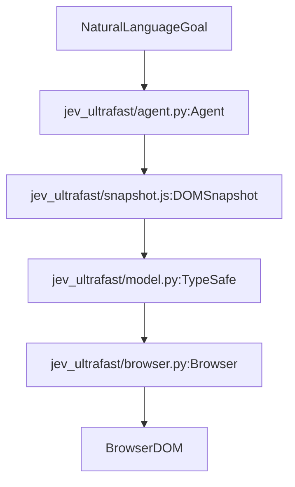

<!-- source: DeepWiki mcp.deepwiki.com · repo browser-use/jev-ultrafast · page 1 Overview · fetched 2026-10-30 -->

# Overview

Relevant source files

The following files were used as context for generating this wiki page:

- [README.md](README.md)
- [docs/banner.svg](docs/banner.svg)
- [docs/design.md](docs/design.md)
- [jev_ultrafast/__init__.py](jev_ultrafast/__init__.py)

`jev-ultrafast` is a high-performance natural-language browser agent designed to execute complex web workflows rapidly using a dynamic indexed action space and speculative fan-out [README.md:3-5](). Given a single natural-language goal, the agent resolves an operation and a target element simultaneously in a single model round trip, invoking a text-generation helper only when required [README.md:7-9]().

*Sources: [README.md:7-11](), [jev_ultrafast/agent.py:1-78](), [jev_ultrafast/snapshot.js:1-1]()*, [jev_ultrafast/model.py:1-1](), [jev_ultrafast/browser.py:1-1]()

## Getting Started & Configuration

The agent environment is set up and managed via `uv` and configured through environment variables [README.md:51-64](). Users clone the repository, run dependency synchronization, configure API keys such as `TYPESAFE_API_KEY` and `TEXT_MODEL_API_KEY` in a `.env` file, and execute the command-line interface or example scripts [README.md:51-89](). 

For full details on installation steps, required environment variables, running the CLI inspector, and executing example scripts like the Google Flights workflow, see [Getting Started & Configuration](#1.1).

*Sources: [README.md:51-89]()*, [jev_ultrafast/__init__.py:1-6]()

## Design Principles

The core design separates operation selection from target selection, utilizing code-owned node identities instead of brittle CDP backend IDs or raw coordinate clicks [README.md:91-101](), [docs/design.md:1-14](). Freshness guards continuously validate semantic state, document properties, and click occlusion before executing any state-mutating actions [README.md:95-96](), [docs/design.md:16-18]().

For a complete walkthrough of the design specifications, operation/target separation models, code-owned identity mechanics, freshness guarantees, execution budgets, and framework limits, see [Design Principles](#1.2).

*Sources: [README.md:91-101](), [docs/design.md:1-33]()*

---

