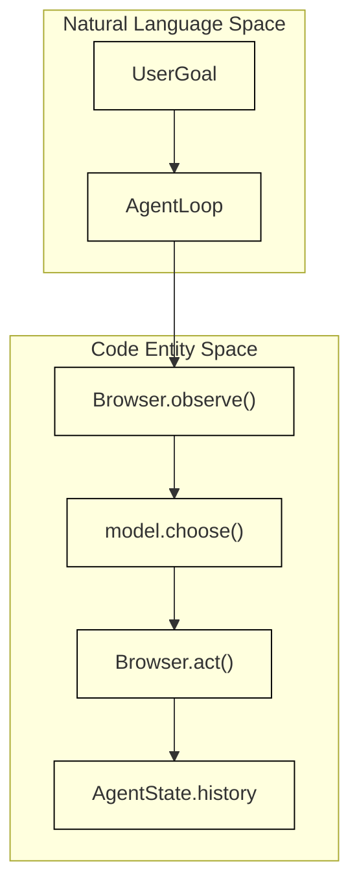
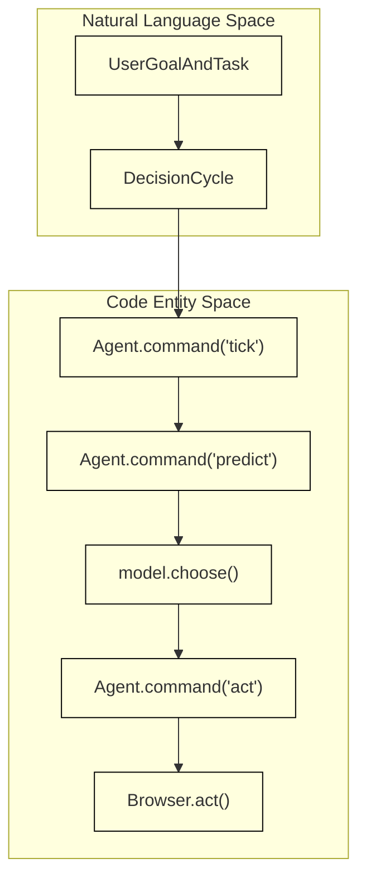

<!-- source: DeepWiki mcp.deepwiki.com · repo browser-use/jev-ultrafast · page 2 Core Agent Runtime · fetched 2026-10-30 -->

# Core Agent Runtime

Relevant source files

The following files were used as context for generating this wiki page:

- [README.md](README.md)
- [jev_ultrafast/agent.py](jev_ultrafast/agent.py)

The Core Agent Runtime governs the continuous execution loop of `jev-ultrafast`, coordinating page observation, model prediction via speculative fan-out, and atomic action dispatch [jev_ultrafast/agent.py:1-145](). It maintains state transparency, freshness enforcement, and bounded step budgeting.

This page serves as a high-level parent overview of the runtime architecture. For granular implementation details, refer to the respective child sections:
- Agent Execution Loop: See [Agent Execution Loop](#2.1) (covering `Agent` state dict, command hooks, StalePage recovery, and history recording) [jev_ultrafast/agent.py:12-145]().
- Browser Harness & CDP Layer: See [Browser Harness & CDP Layer](#2.2) (covering `Browser`, CDP session setup, observation dispatch, and freshness guards) [jev_ultrafast/browser.py:1-120]().
- Model Layer & Decision Questions: See [Model Layer & Decision Questions](#2.3) (covering `model.py` action spaces, TypeSafe speculative heads, and text generation) [jev_ultrafast/model.py:1-150]().

---

## The Observe → Predict → Act Loop

The runtime operates through a strictly ordered synchronization cycle. At each step, the agent reads the page's visible interactive elements, evaluates model probabilities across separated operation and target heads, validates preconditions, and executes the chosen primitive against the Chrome DevTools Protocol (CDP).

*Figure 1: Mapping natural-language goal progression to core runtime methods in `jev_ultrafast/agent.py` and `jev_ultrafast/browser.py`.*

Sources: [jev_ultrafast/agent.py:12-145](), [jev_ultrafast/browser.py:1-50]()

---

## Architectural Components

The runtime is split across three primary cooperating domains:

1. **State Management & Control (`Agent`)**: Instantiated with a target URL and a natural-language goal [jev_ultrafast/agent.py:12-41](). The `Agent` class manages the central `self.state` dictionary tracking session timing, history arrays, step counters, and pending text transformations [jev_ultrafast/agent.py:27-41]().
2. **Browser Interfacing (`Browser`)**: Establishes the CDP session, captures atomic DOM snapshots via `snapshot.js`, enforces page freshness using structural fingerprints, and emulates focus [jev_ultrafast/browser.py:1-120]().
3. **Decision & Inference (`model.py`)**: Computes atomic action spaces, issues TypeSafe requests with speculative fan-out across operation and target heads, and queries the text helper model when `TYPE_TEXT` is selected [jev_ultrafast/model.py:1-150]().

*Figure 2: Execution pipeline mapping runtime decisions to `Agent` command routing.*

Sources: [jev_ultrafast/agent.py:52-145](), [jev_ultrafast/model.py:1-100]()

---

## Sub-Topic References

- **Agent Execution Loop**: Detailed in [Agent Execution Loop](#2.1). Covers tick/predict/act commands, StalePage recovery blocks, history appends, and step limits (`MAX_STEPS`) [jev_ultrafast/agent.py:52-145]().
- **Browser Harness & CDP Layer**: Detailed in [Browser Harness & CDP Layer](#2.2). Covers direct CDP command dispatch, element indexing, freshness hashes, and atomic snapshot extraction [jev_ultrafast/browser.py:1-120]().
- **Model Layer & Decision Questions**: Detailed in [Model Layer & Decision Questions](#2.3). Covers TypeSafe decision structures, confidence propagation, and JSON text-helper parsing [jev_ultrafast/model.py:1-150]().

Sources: [jev_ultrafast/agent.py:12-145](), [jev_ultrafast/browser.py:1-120](), [jev_ultrafast/model.py:1-150]()

---

