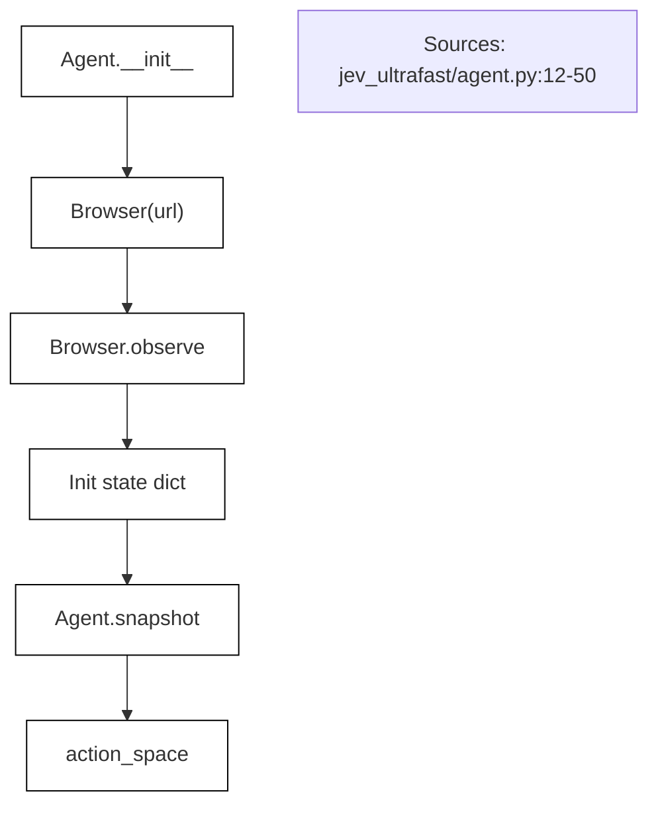

<!-- source: DeepWiki mcp.deepwiki.com · repo browser-use/jev-ultrafast · page 2.1 Agent Execution Loop · fetched 2026-10-30 -->

# Agent Execution Loop

<details>
<summary>Relevant source files</summary>

The following files were used as context for generating this wiki page:

- [jev_ultrafast/agent.py](jev_ultrafast/agent.py)

</details>


The `Agent` class coordinates the core autonomous execution loop of `jev-ultrafast`. It manages browser observation state, step-by-step decision making via the model layer, action dispatch, error recovery (`StalePage`), resource budgets (`MAX_STEPS`), and execution history recording.

Sources: [jev_ultrafast/agent.py:1-174]()

---

## Agent State Initialization & Snapshotting

When an `Agent` is instantiated, it parses the task goals, initializes a `Browser` instance, performs the initial page observation, and constructs the runtime state dictionary [jev_ultrafast/agent.py:12-45]().

### State Dictionary Structure

| Key | Type | Description |
| :--- | :--- | :--- |
| `browser` | `Browser` | Underlying browser automation wrapper instance [jev_ultrafast/agent.py:28]() |
| `goal` | `str` | Newline-joined string of task goals [jev_ultrafast/agent.py:29]() |
| `page` | `dict` | Current page metadata, actions, fingerprint, and optional screenshot [jev_ultrafast/agent.py:30]() |
| `decision` | `dict` \| `None` | The active model prediction awaiting execution [jev_ultrafast/agent.py:31]() |
| `history` | `list` | Log of executed steps and metadata [jev_ultrafast/agent.py:32]() |
| `status` | `str` | Execution state (`"ready"`, `"predicted"`, `"done"`, `"blocked"`) [jev_ultrafast/agent.py:33]() |
| `decisions` | `list` | Raw history of all model predictions made [jev_ultrafast/agent.py:36]() |
| `text_calls` | `list` | Log of text generation helper calls for form filling [jev_ultrafast/agent.py:37]() |
| `elapsed_ms` | `int` | Total elapsed execution time in milliseconds [jev_ultrafast/agent.py:38]() |
| `started_at` | `float` \| `None` | High-resolution performance counter start timestamp [jev_ultrafast/agent.py:39]() |

The `snapshot()` method serializes the agent state (excluding the live browser handle) and appends the dynamic indexed action space elements derived from `action_space()` [jev_ultrafast/agent.py:46-50]().


Sources: [jev_ultrafast/agent.py:12-50]()

---

## Command Dispatcher (`tick`, `predict`, `act`)

The agent exposes a unified `command(name, body)` interface to drive execution [jev_ultrafast/agent.py:52-145](). It supports three primary commands:

1. **`tick`**: Executes a full atomic step by sequentially invoking `predict` and `act`. Automatically catches `StalePage` exceptions, re-observes the browser, resets the pending decision, and returns a fresh snapshot [jev_ultrafast/agent.py:55-64]().
2. **`predict`**: Validates browser freshness, checks model-call and step budgets, queries `choose()` from `model.py`, and logs the decision into `state["decisions"]` [jev_ultrafast/agent.py:65-85]().
3. **`act`**: Consumes the active `decision`, validates the page fingerprint, performs form-filling text generation (`field_text()` / `field_context()`) if required, dispatches execution via `Browser.act()`, and records the step outcome to `state["history"]` [jev_ultrafast/agent.py:86-145]().

```mermaid
graph TD
    Command["Agent.command(name, body)"] -->|name == tick| Tick["Tick Command"]
    Command -->|name == predict| Predict["Predict Command"]
    Command -->|name == act| Act["Act Command"]

    Tick -->|Calls| Predict
    Tick -->|Calls| Act
    Tick -->|Catches StalePage| Reobserve["Browser.observe"]

    Predict -->|Calls choose()| Model["model.choose"]
    Act -->|Checks fingerprint| Verify["Fingerprint Check"]
    Verify -->|Executes action| BrowserAct["Browser.act"]

    sub6["Sources: jev_ultrafast/agent.py:52-145"]
    style Command fill:none,stroke:#000,stroke-width:1px
    style Tick fill:none,stroke:#000,stroke-width:1px
    style Predict fill:none,stroke:#000,stroke-width:1px
    style Act fill:none,stroke:#000,stroke-width:1px
    style Reobserve fill:none,stroke:#000,stroke-width:1px
    style Model fill:none,stroke:#000,stroke-width:1px
    style Verify fill:none,stroke:#000,stroke-width:1px
    style BrowserAct fill:none,stroke:#000,stroke-width:1px
```
Sources: [jev_ultrafast/agent.py:52-145]()

---

## StalePage Recovery & Freshness Guards

To prevent race conditions where a page mutates between model prediction and action execution, the agent relies on freshness guarantees provided by `Browser.fresh()` and raises `StalePage` when discrepancies occur [jev_ultrafast/agent.py:70](), [jev_ultrafast/agent.py:94-96](), [jev_ultrafast/agent.py:107-108]().

- Before prediction, if `Browser.fresh()` returns false, the agent re-observes the page [jev_ultrafast/agent.py:70-71]().
- Before executing a `DONE` or `BLOCKED` command, or prior to text generation for `fill` actions, page freshness is verified [jev_ultrafast/agent.py:94](), [jev_ultrafast/agent.py:107]().
- If a `StalePage` exception is thrown during `tick`, the agent recovers gracefully by updating its state and re-observing [jev_ultrafast/agent.py:59-64]().

Sources: [jev_ultrafast/agent.py:59-71](), [jev_ultrafast/agent.py:94-108]()

---

## Budgets & Blocked Detection

The agent enforces strict execution limits defined by `MAX_STEPS` (imported from `questions.py`) [jev_ultrafast/agent.py:9]():

- **Model Call Budget**: `len(state["decisions"]) >= MAX_STEPS * 2` raises a `ValueError` to prevent infinite inference loops [jev_ultrafast/agent.py:75-76]().
- **Action Step Budget**: `len(state["history"]) >= MAX_STEPS` marks the agent status as `"blocked"` and raises a budget-exceeded error [jev_ultrafast/agent.py:102-104]().
- **Terminal Actions**: When the model selects `DONE` or `BLOCKED`, the agent updates `state["status"]` accordingly, halting further execution [jev_ultrafast/agent.py:93-100]().

Sources: [jev_ultrafast/agent.py:73-76](), [jev_ultrafast/agent.py:93-104](), [jev_ultrafast/questions.py]()

---

## Recording & History Logging

Every executed action is immutably recorded in `state["history"]` immediately after browser execution and prior to the post-action observation [jev_ultrafast/agent.py:120-141](). This ensures that even if a post-action observation becomes stale or fails, the execution record remains intact. 

Logged metrics include:
- Step index, action label, kind, and chosen identifier [jev_ultrafast/agent.py:122-126]()
- Model probabilities, confidence scores, latency, and token usage [jev_ultrafast/agent.py:127-129](), [jev_ultrafast/agent.py:137]()
- Text generation helper metadata and latency (if a `fill` action occurred) [jev_ultrafast/agent.py:130-132]()
- Operation and target classification [jev_ultrafast/agent.py:133-134]()
- Execution timing (`executed_ms`, `elapsed_ms`) and page change boolean flags [jev_ultrafast/agent.py:138-145]()

Sources: [jev_ultrafast/agent.py:120-145]()

---

