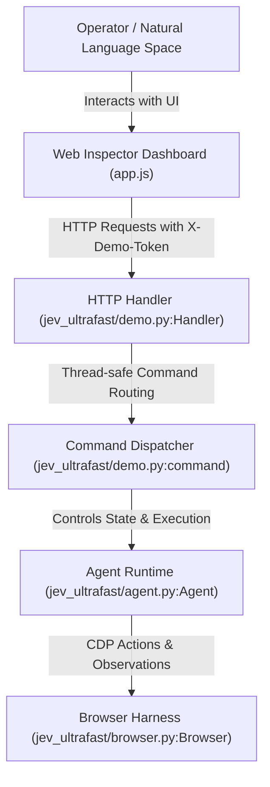
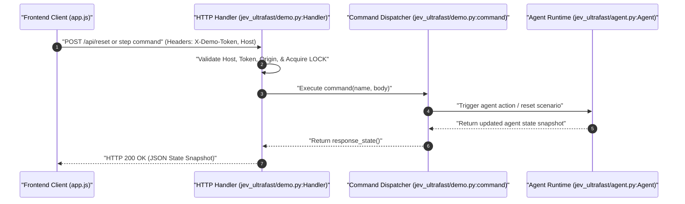

<!-- source: DeepWiki mcp.deepwiki.com · repo browser-use/jev-ultrafast · page 3 Inspector UI · fetched 2026-10-30 -->

# Inspector UI

Relevant source files

The following files were used as context for generating this wiki page:

- [docs/inspector.png](docs/inspector.png)
- [jev_ultrafast/demo.py](jev_ultrafast/demo.py)

The Inspector UI provides a local web-based interface for observing, debugging, and controlling the Jev ultrafast browser agent in real time. It bridges human operators with the core agent runtime via a loopback HTTP server and an interactive dashboard.

This is a parent page. For deep technical implementation details, refer to the child pages:
- [Inspector Server (demo.py)](#3.1) — Loopback HTTP server, request token/Host/Origin checks, command endpoints, step control.
- [Frontend Assets](#3.2) — index.html, app.js, style.css and the offline fixture.html used for local testing.

Sources: [jev_ultrafast/demo.py:1-21]()

---

## Architecture Overview

The inspector architecture connects the browser UI interface to the Python backend agent through a restricted loopback HTTP server (`jev_ultrafast/demo.py`). Concurrency is managed via a thread lock (`threading.Lock`) to prevent overlapping browser step execution.

Title: Inspector Architecture and Component Mapping

Sources: [jev_ultrafast/demo.py:18-68](), [jev_ultrafast/demo.py:70-126]()

---

## Inspector Server (`demo.py`)

The backend server is implemented as a lightweight multi-threaded HTTP server (`ThreadingHTTPServer`) defined in `jev_ultrafast/demo.py`. It runs strictly on the loopback interface (`127.0.0.1`) and enforces strict security checks including `Host` header validation, single-use token verification (`X-Demo-Token`), and `Origin` checks on POST requests. It maintains global execution state and coordinates scenario resets, step executions, and state polling.

For deep technical implementation details, see [Inspector Server (demo.py)](#3.1).

Sources: [jev_ultrafast/demo.py:7-142]()

---

## Frontend Assets

The frontend comprises a collection of static web assets served directly by the loopback server, including an interactive dashboard script (`app.js`), layout styling (`style.css`), the main application view (`index.html`), and a local testing fixture (`fixture.html`). The frontend polls or receives state snapshots and renders the agent's live browser view, step history, model selections, and decision trees.

For deep technical implementation details, see [Frontend Assets](#3.2).

Sources: [jev_ultrafast/demo.py:81-102]()

---

## Command Dispatch and State Synchronization Flow

State updates and agent instructions are processed synchronously through a request lifecycle managed by the HTTP handler and command dispatcher.

Title: Command Dispatch Sequence

Sources: [jev_ultrafast/demo.py:32-68](), [jev_ultrafast/demo.py:104-126]()

---

