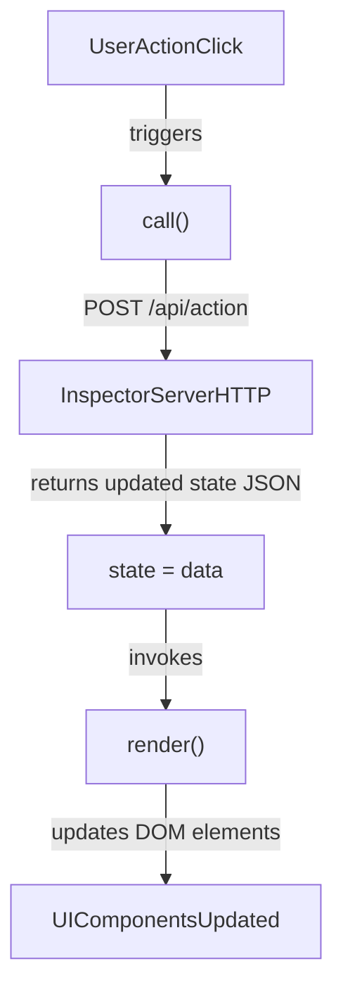
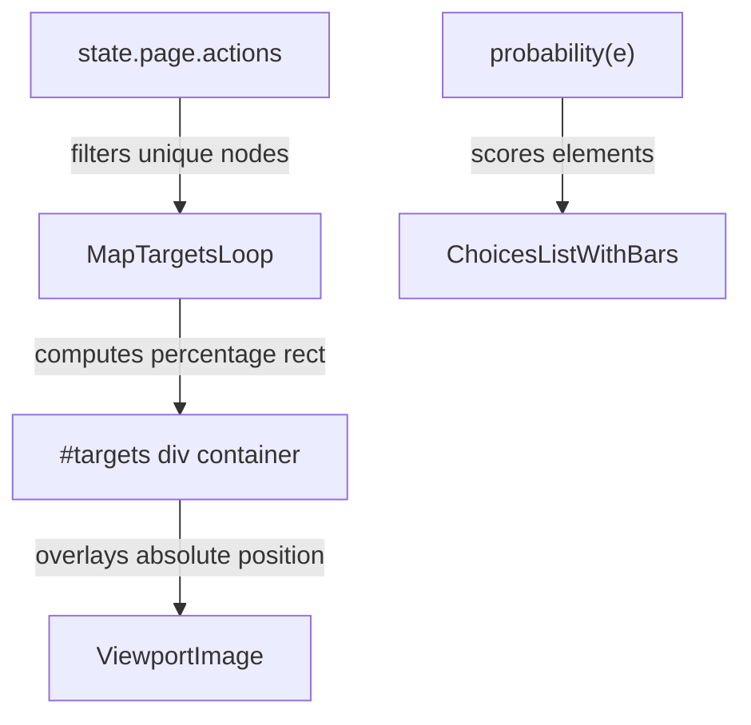

<!-- source: DeepWiki mcp.deepwiki.com · repo browser-use/jev-ultrafast · page 3.2 Frontend Assets · fetched 2026-10-30 -->

# Frontend Assets

Relevant source files

The following files were used as context for generating this wiki page:

- [jev_ultrafast/static/app.js](jev_ultrafast/static/app.js)
- [jev_ultrafast/static/fixture.html](jev_ultrafast/static/fixture.html)
- [jev_ultrafast/static/index.html](jev_ultrafast/static/index.html)
- [jev_ultrafast/static/style.css](jev_ultrafast/static/style.css)

## Purpose and Scope
This page details the implementation and architecture of the frontend assets for the `jev-ultrafast` local web inspector. Served by the inspector server (`demo.py`), these assets provide an interactive dashboard for monitoring agent execution, inspecting live browser screenshots, visualizing target overlays, managing step-by-step or automated execution, and working with offline testing fixtures.

Sources: `[jev_ultrafast/static/index.html:1-144]`, `[jev_ultrafast/static/app.js:1-160]`, `[jev_ultrafast/static/style.css:1-338]`, `[jev_ultrafast/static/fixture.html:1-278]`

---

## Asset Component Layout
The frontend static directory comprises four core files:
*   `index.html`: The primary HTML shell containing the task configuration form, toolbar controls, browser viewport container, side panel for choices/metrics, and decision trace log. It embeds a security token via the meta tag `[jev_ultrafast/static/index.html:1-6]()`.
*   `app.js`: The client-side application logic handling asynchronous API communication, state rendering, DOM manipulation, target overlay mapping, and event listeners.
*   `style.css`: The layout and theme stylesheet defining the CSS variables, grid structures for the workspace, traffic light browser bars, probability distribution bars, and target element pins.
*   `fixture.html`: An offline HTML fixture ("Forma") used for local testing and deterministic scenario validation without relying on live external networks.

Sources: `[jev_ultrafast/static/index.html:1-144]`, `[jev_ultrafast/static/app.js:1-160]`, `[jev_ultrafast/static/style.css:1-338]`, `[jev_ultrafast/static/fixture.html:1-278]`

---

## UI State Management and API Integration (`app.js`)
Client-state synchronization relies on asynchronous HTTP requests made to backend API routes (`/api/...`). The helper function `call(name, body)` appends the security token in the `X-Demo-Token` header, parses the JSON response, updates the global `state` variable, and triggers a full UI re-render [jev_ultrafast/static/app.js:21-32]().

Sources: `[jev_ultrafast/static/app.js:21-32]`, `[jev_ultrafast/static/app.js:69-147]()`

---

## Rendering Pipeline and Target Overlays
The `render()` function in `app.js` processes the current agent state to populate multiple interface regions:
*   **Status and Plan**: Updates status strings and the execution plan step indicators [jev_ultrafast/static/app.js:72-89]().
*   **Viewport Screenshot**: Binds base64-encoded JPEG image data to `#screenshot` and unhides the viewport container [jev_ultrafast/static/app.js:90-96]().
*   **Interactive Target Pins**: Projects bounding boxes from `page.actions` onto the screenshot using absolute percentage-based offsets (`left`, `top`, `width`, `height`), matching the coordinate space of the controlled browser [jev_ultrafast/static/app.js:120-126]().
*   **Choice Rankings**: Sorts and displays indexed elements with probability distribution bars and operational breakdown indicators [jev_ultrafast/static/app.js:111-119]().

Sources: `[jev_ultrafast/static/app.js:78-147]`, `[jev_ultrafast/static/style.css:325-350]()`

---

## Offline Testing Fixture (`fixture.html`)
To enable rapid UI and agent testing without external network dependencies, `fixture.html` provides a self-contained web page styled as an architectural stay booking platform ("Forma") [jev_ultrafast/static/fixture.html:1-150](). It features structured layout grids, filter controls, search inputs, and dynamic card elements that match the element extraction structures expected by the snapshot reader and agent runtime.

Sources: `[jev_ultrafast/static/fixture.html:1-278]`

---

