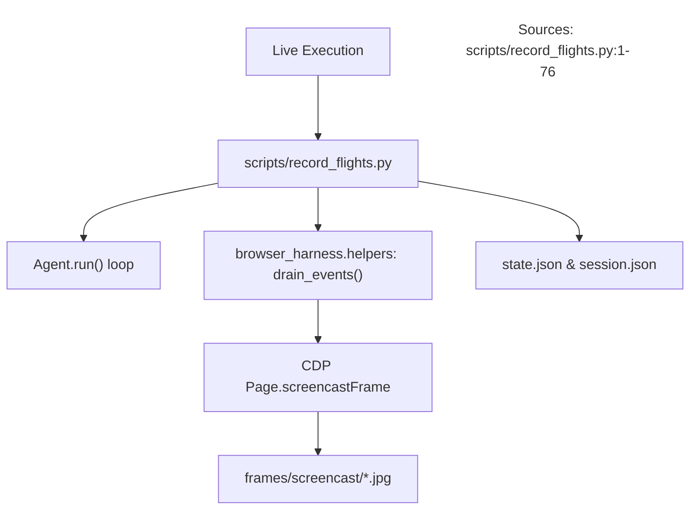
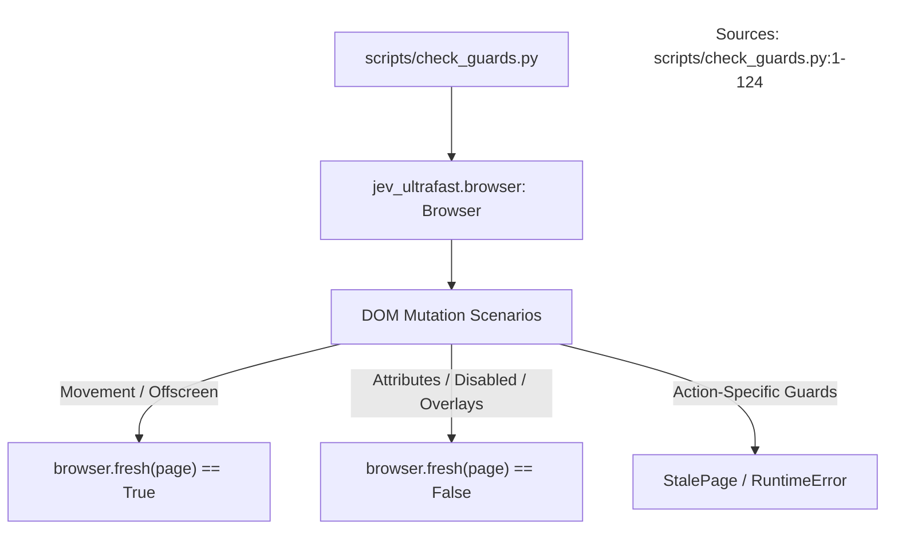

<!-- source: DeepWiki mcp.deepwiki.com · repo browser-use/jev-ultrafast · page 4.1 Measurement Scripts · fetched 2026-10-30 -->

# Measurement Scripts

<details>
<summary>Relevant source files</summary>

The following files were used as context for generating this wiki page:

- [scripts/check_guards.py](scripts/check_guards.py)
- [scripts/measure_flights.py](scripts/measure_flights.py)
- [scripts/record_flights.py](scripts/record_flights.py)
- [scripts/render_demo.py](scripts/render_demo.py)
- [scripts/render_fixture.py](scripts/render_fixture.py)
- [scripts/smoke.py](scripts/smoke.py)

</details>


The `scripts/` directory contains benchmarking, measurement, recording, media rendering, and regression testing tools used to evaluate performance, verify correctness, and generate demonstration assets for `jev-ultrafast`. These scripts interact with the core `Agent` runtime [jev_ultrafast/__init__.py]() and `Browser` harness [jev_ultrafast/browser.py]() to measure latency, CDP call overhead, screencast frames, and freshness guard effectiveness.

---

## 1. Flight Measurement & Recording

Performance benchmarks and video recordings of real flight searches are governed by `scripts/measure_flights.py` and `scripts/record_flights.py`.

### Measured Execution (`scripts/measure_flights.py`)
`scripts/measure_flights.py` executes a single live flight search against Google Flights using goals and verification functions from `examples/flights.py` [scripts/measure_flights.py:1-22](). 

Key implementation details:
* **CDP Interception:** The script monkey-patches `browser_module.cdp` with a `timed()` function [scripts/measure_flights.py:34-41]() that records execution latencies and call counts into a `collections.defaultdict(list)` [scripts/measure_flights.py:31]().
* **Environment & Source Hashing:** It computes SHA-256 hashes of all `.py` and `.js` files in `jev_ultrafast/` to ensure reproducibility and tracks environment variables such as `TYPESAFE_MODEL`, `TEXT_MODEL`, and `TEXT_MODEL_BASE_URL` [scripts/measure_flights.py:26-29,60-65]().
* **State Serialization:** Upon completion or error, it invokes a new independent observation `agent.browser.observe(screenshot=True)` to verify the final page state via `verify(final)`, writing the comprehensive metrics and logs to `state.json` [scripts/measure_flights.py:53-69]().

```mermaid
graph TD
    A["Natural Language: Flight Goal"] --> B["scripts/measure_flights.py"]
    B --> C["jev_ultrafast: Agent"]
    C --> D["jev_ultrafast: Browser"]
    D --> E["CDP Raw Calls"]
    E -->|Intercepted by timed()| F["collections.defaultdict(list) calls"]
    F --> G["Artifacts: state.json"]

    sub5["Sources: scripts/measure_flights.py:1-71"]
    style sub5 fill:none,stroke:none
```
Sources: `scripts/measure_flights.py:1-71`

### Continuous Screencast Recording (`scripts/record_flights.py`)
`scripts/record_flights.py` executes a live run while capturing a continuous CDP screencast [scripts/record_flights.py:1-12]().
* **Background Capture Thread:** Spawns a daemon thread running `capture()` [scripts/record_flights.py:36-49,52] which polls `drain_events()` from `browser_harness.helpers` [scripts/record_flights.py:11] to intercept `Page.screencastFrame` events [scripts/record_flights.py:40].
* **Timestamp Alignment:** Timestamps are normalized relative to an epoch anchored right before the first prediction starts [scripts/record_flights.py:32,54-55]. Frames are written out as JPEG images [scripts/record_flights.py:44] alongside `state.json` and `session.json` [scripts/record_flights.py:70-71].


Sources: `scripts/record_flights.py:1-76`

---

## 2. Rendering & Media Production

Demonstration media (GIFs and MP4s) are produced from recorded session frames using `scripts/render_demo.py` and `scripts/render_fixture.py`.

### Demo Video Rendering (`scripts/render_demo.py`)
`scripts/render_demo.py` reads a verified recording directory, loads `state.json` and screencast frames, and composites them at 1x speed using PIL (`Image`, `ImageDraw`, `ImageFont`) [scripts/render_demo.py:1-29].
* **Overlay Compositing:** It draws a custom browser frame container, elapsed time ticker (`t / 1000`), execution step checklist, and median decision latency derived from `state["decisions"]` [scripts/render_demo.py:46-97].
* **FFmpeg Export:** The generated frames in `video-frames/` are compiled via `subprocess.run` into `docs/demo.mp4` (H.264, yuv420p, CRF 18) and subsequently downsampled into `docs/demo.gif` using a custom palette generation pass [scripts/render_demo.py:100-137].

Sources: `scripts/render_demo.py:1-139`

### Fixture Video Rendering (`scripts/render_fixture.py`)
`scripts/render_fixture.py` converts recorded fixture runs into demonstration media without temporal acceleration [scripts/render_fixture.py:1-58]. It reads frames from `artifacts/final/frames` and uses PIL to stamp lead-in/lead-out durations before invoking `ffmpeg` to produce `docs/fixture-demo.mp4` and `docs/fixture-demo.gif` [scripts/render_fixture.py:10-54].

Sources: `scripts/render_fixture.py:1-58`

---

## 3. Guard & Regression Validation

`scripts/check_guards.py` performs rigorous local-browser freshness and execution regression checks without making model calls or contacting external websites [scripts/check_guards.py:1-6].

### Implementation & Test Matrix
The script instantiates a `Browser` object with a local `data:text/html` payload [scripts/check_guards.py:18] and validates several invariants:
1. **Fresh Geometry on Movement:** Verifies that transforming a target element's position via CSS uses fresh geometry without requiring an additional model observation [scripts/check_guards.py:23-27].
2. **Offscreen Ignorance:** Asserts that mutating unrelated offscreen text does not invalidate the page observation or freshness guards [scripts/check_guards.py:29-31].
3. **Mutation Invalidation:** Tests that changes to visible context, accessible labels, field properties, checkbox status, disabled states, read-only attributes, hidden styles, node replacements, and dropdown options correctly trigger `browser.fresh(page) -> False` [scripts/check_guards.py:33-50].
4. **Overlay Blocking:** Confirms that a textless fixed-position overlay blocks unintended clicks and raises execution guards [scripts/check_guards.py:52-68].
5. **Action-Specific Guards:** Validates action-specific freshness checks against nearby price changes, form values, and replacements [scripts/check_guards.py:70-101].
6. **Native Control Constraints:** Asserts proper classification of checkbox/radio roles, readonly attributes, masked password values, and select option states [scripts/check_guards.py:102-124].


Sources: `scripts/check_guards.py:1-124`

---

## 4. Live Smoke Testing

`scripts/smoke.py` provides an explicit live smoke test that integrates local fixture servers with paid model APIs [scripts/smoke.py:1-6].
* **Environment Loading:** Calls `load_environment()` from `jev_ultrafast.demo` [scripts/smoke.py:9,22].
* **Execution & Assertions:** Runs an `Agent` instance against `http://127.0.0.1:8766/fixture.html?scenario=travel` with a multi-step destination search goal [scripts/smoke.py:11-14,26]. It evaluates `state.status == "done"`, verifies hash endpoints (`#casa-flora`), checks expected filter text in `state["verification_text"]`, and saves execution summary metrics to `artifacts/dynamic/fixture/` [scripts/smoke.py:43-53].

```mermaid
graph TD
    A["scripts/smoke.py"] --> B["jev_ultrafast.demo: load_environment()"]
    B --> C["jev_ultrafast: Agent"]
    C --> D["Local Fixture Server: fixture.html"]
    C --> E["Paid Model APIs"]
    E --> F["State & Summary Artifacts"]

    sub8["Sources: scripts/smoke.py:1-58"]
    style sub8 fill:none,stroke:none
```


Sources: `scripts/smoke.py:1-58`

---

