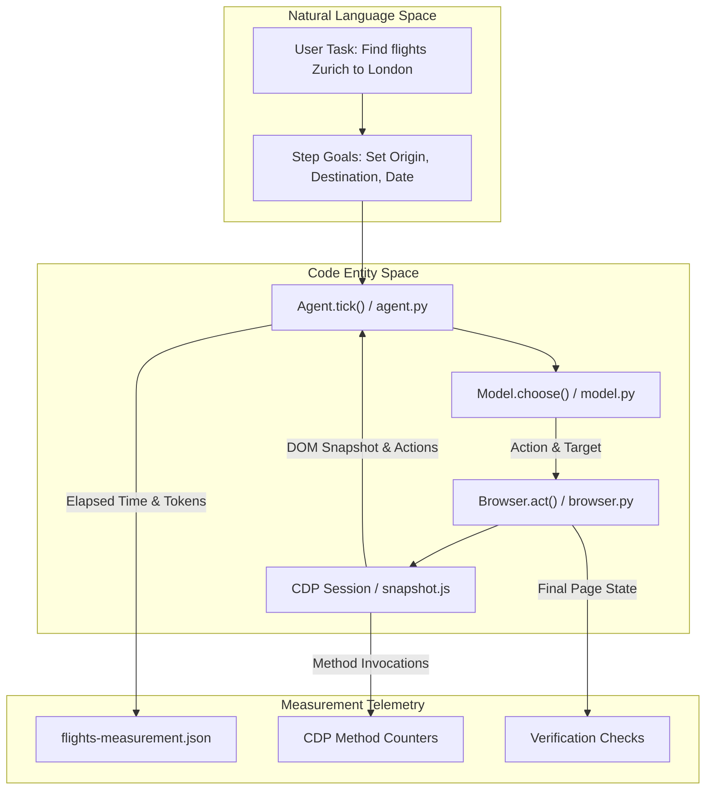
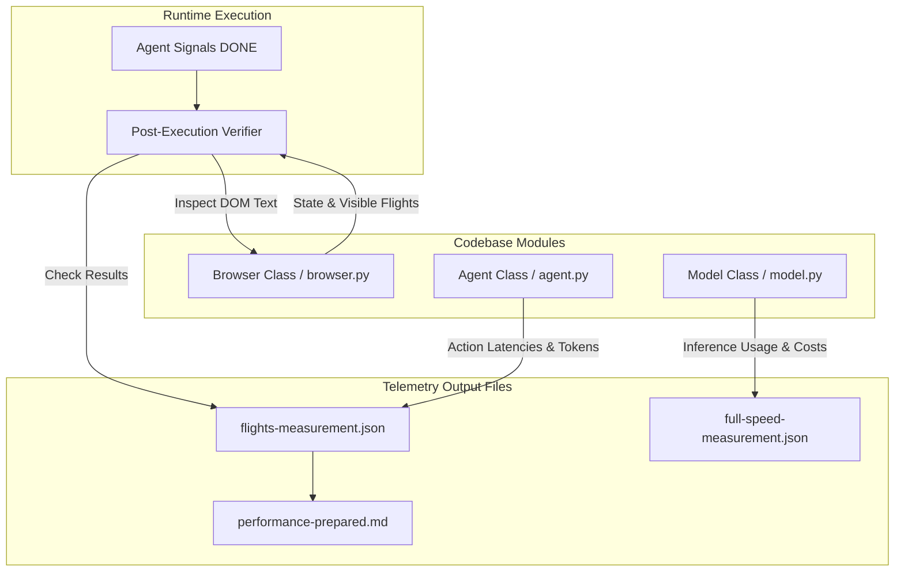

<!-- source: DeepWiki mcp.deepwiki.com · repo browser-use/jev-ultrafast · page 4.2 Results & Measurement Reports · fetched 2026-10-30 -->

# Results & Measurement Reports

<details>
<summary>Relevant source files</summary>

The following files were used as context for generating this wiki page:

- [docs/flights-measurement.json](docs/flights-measurement.json)
- [docs/flights-prepared-measurement.json](docs/flights-prepared-measurement.json)
- [docs/full-speed-measurement.json](docs/full-speed-measurement.json)
- [docs/launch-draft.md](docs/launch-draft.md)
- [docs/measurement.json](docs/measurement.json)
- [docs/performance-prepared.md](docs/performance-prepared.md)

</details>


## Purpose and Scope
This page details the empirical measurement framework, data schemas, and performance reports generated by benchmarking runs in `jev-ultrafast`. It documents how execution speed, model usage, token consumption, and Chrome DevTools Protocol (CDP) overhead are recorded and verified. Specifically, it covers the JSON measurement schemas (`docs/flights-measurement.json`, `docs/full-speed-measurement.json`), the comparative performance analysis between baseline and optimized candidate execution arms, the mechanism of CDP call volume reduction, and the automated verification checks used to ensure task correctness.

Sources: `docs/flights-measurement.json:1-216` [docs/flights-measurement.json:1-216](), `docs/full-speed-measurement.json:1-173` [docs/full-speed-measurement.json:1-173]()

---

## 1. Measurement JSON Schema & Architecture

Performance runs emit structured telemetry in JSON format. The measurement files capture aggregate timings, model call statistics, detailed action logs, token accounting, and cryptographic hashes of the source code state at execution time.

### Top-Level Schema Structure
The telemetry payload aggregates performance dimensions into distinct keys:
- `elapsed_ms`: Total wall-clock duration of the timed agent loop.
- `decision_requests`: Integer count of inference requests sent to the primary decision model (`jev-1.13.0`).
- `decision_median_ms` / `decision_total_ms`: Latency statistics for decision inferences.
- `browser_actions` / `wait_actions`: Counts of physical browser interactions executed.
- `models`: Dictionary separating `decision` and `text` model identifiers.
- `text_calls`: Array of auxiliary text-generation invocations (e.g., filling form fields).
- `verification`: Boolean assertions and extracted DOM text verifying task completion.
- `source_hashes`: SHA-256 or content hashes of core modules (`questions.py`, `model.py`, `browser.py`, `agent.py`, `snapshot.js`) ensuring reproducibility.
- `tokens`: Aggregate input and output token usage.
- `cdp`: Breakdown of Chrome DevTools Protocol method invocation counts and cumulative durations.

```json
{
  "elapsed_ms": 7073,
  "decision_requests": 17,
  "decision_median_ms": 178,
  "decision_total_ms": 3720,
  "browser_actions": 11,
  "wait_actions": 1,
  "models": {
    "decision": ["jev-1.13.0"],
    "text": ["inception/mercury-2.5"]
  },
  "tokens": {
    "input_tokens": 90558,
    "output_tokens": 6325
  }
}
```

Sources: `docs/flights-measurement.json:1-114` [docs/flights-measurement.json:1-114](), `docs/full-speed-measurement.json:1-170` [docs/full-speed-measurement.json:1-170]()

---

## 2. Baseline vs. Candidate Arms & CDP Call Reductions

Performance reports track optimizations by comparing a `baseline` arm against an optimized `candidate` arm. The evaluation evaluates how architectural changes (such as shifting from tree-walking Accessibility APIs to atomic DOM snapshot readers) eliminate redundant browser roundtrips.

### Performance Summary Comparison
According to `docs/full-speed-measurement.json`, a typical benchmark task (*Find one-way flights from Zurich to London*) shows drastic improvements:

| Metric | Baseline Arm (`68c077bf`) | Candidate Arm (Optimized) | Delta / Improvement |
| :--- | :--- | :--- | :--- |
| **Runs / Passed** | 3 / 3 passed | 3 / 3 passed | 100% success rate maintained |
| **Median Wall Time** | 9,450 ms | 7,092 ms | ~25% reduction in elapsed time |
| **Median CDP Calls** | 1,092 calls | 101 calls | **~90.8% reduction in CDP traffic** |

### CDP Method Call Breakdown
The candidate arm eliminates excessive node resolution and accessibility tree generation. Below is a breakdown of CDP method counts from execution traces:

```
+-----------------------------------+--------------------+---------------------+
| CDP Method                        | Baseline Count     | Candidate Count     |
+-----------------------------------+--------------------+---------------------+
| Accessibility.getFullAXTree       | 30 calls           | 0 calls (eliminated)|
| DOM.resolveNode                   | 828 calls          | 12 calls            |
| Runtime.evaluate                  | 158 calls          | 35 calls            |
| Input.dispatchMouseEvent          | 20 calls           | 11 calls            |
+-----------------------------------+--------------------+---------------------+
```

Sources: `docs/full-speed-measurement.json:1-170` [docs/full-speed-measurement.json:1-170]()

---

## 3. Verification Checks & Post-Execution Assertions

Each measurement report includes an independent verification dictionary (`verification`) that inspects the browser state after the agent signals `DONE`. This ensures the agent did not merely terminate early, but successfully reached the target state with correct parameters.

### Verification Schema Properties
- `passed`: Boolean global indicator combining all predicate checks.
- `checks`: Granular assertions covering:
  - `search_page`: Confirms navigation to results endpoint.
  - `one_way`: Verifies trip configuration.
  - `origin` / `destination`: Validates route parameters.
  - `date` / `year`: Checks date-picker state.
  - `results`: Ensures flight option nodes are rendered in the DOM.
- `visible_flights`: Extracted text snippets of the top flight results rendered on the page.

```json
"verification": {
  "passed": true,
  "checks": {
      "search_page": true,
      "one_way": true,
      "origin": true,
      "destination": true,
      "date": true,
      "year": true,
      "results": true
  },
  "visible_flights": [
      "From 216 US dollars. Nonstop flight with easyJet..."
  ]
}
```

Sources: `docs/flights-measurement.json:76-92` [docs/flights-measurement.json:76-92](), `docs/full-speed-measurement.json:94-110` [docs/full-speed-measurement.json:94-110]()

---

## 4. Data Flow & Natural Language to Code Mapping

To bridge natural language tasks to concrete runtime actions and recorded measurement metrics, the execution pipeline flows through specialized modules. The following diagrams map natural language execution to codebase entities.

### Diagram: Natural Language Task to Measurement Telemetry Pipeline



Sources: `docs/flights-measurement.json:1-216` [docs/flights-measurement.json:1-216](), `docs/full-speed-measurement.json:1-173` [docs/full-speed-measurement.json:1-173]()

### Diagram: Verification and Telemetry Recording Architecture



Sources: `docs/flights-measurement.json:76-105` [docs/flights-measurement.json:76-105](), `docs/full-speed-measurement.json:1-173` [docs/full-speed-measurement.json:1-173](), `docs/performance-prepared.md:1-28` [docs/performance-prepared.md:1-28]()

---

