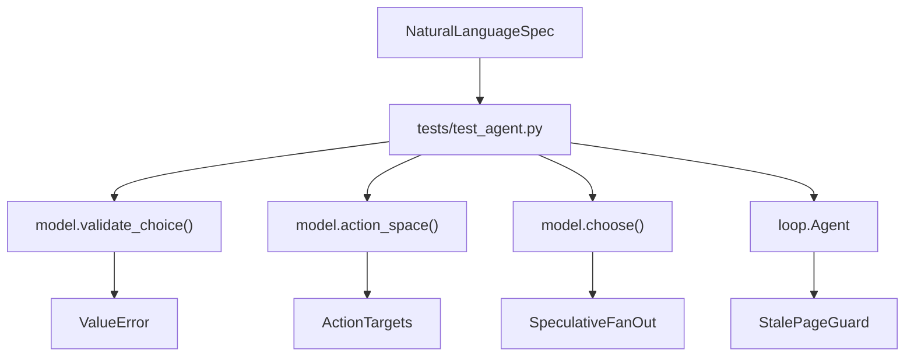
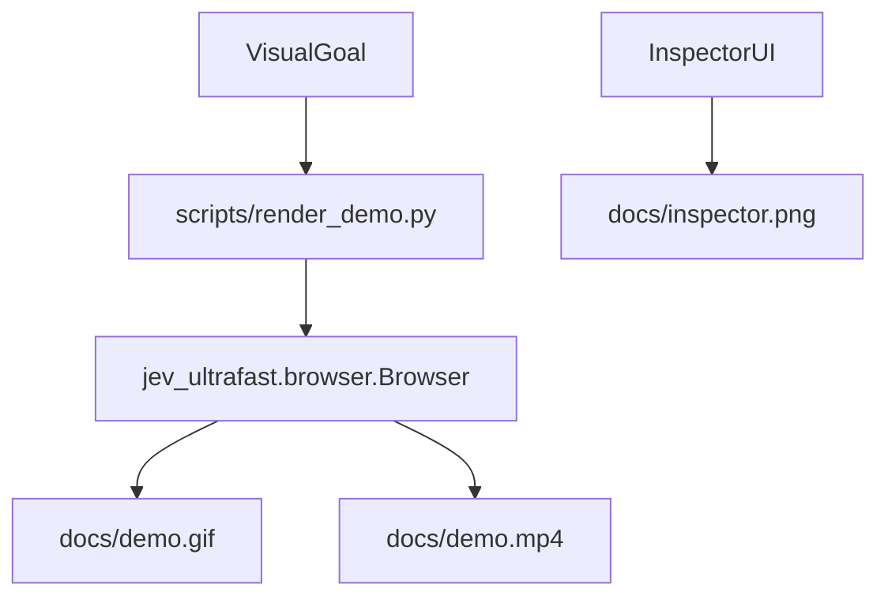

<!-- source: DeepWiki mcp.deepwiki.com · repo browser-use/jev-ultrafast · page 5 Testing & Media Assets · fetched 2026-10-30 -->

# Testing & Media Assets

Relevant source files

The following files were used as context for generating this wiki page:

- [docs/demo.gif](docs/demo.gif)
- [tests/test_agent.py](tests/test_agent.py)

## Purpose and Scope
This page provides a high-level overview of the testing infrastructure, verification contracts, and media assets for `jev-ultrafast`. The testing suite ensures strict conformance to TypeSafe validation rules, action space transformations, and page freshness guards, while media assets document the agent's execution behavior. 

For deep technical details, see the child pages:
- [Test Suite](#5.1)
- [Demo Media & Docs Assets](#5.2)

---

## 5.1 Test Suite

The test suite, primarily rooted in `tests/test_agent.py`, verifies the offline contracts of the dynamic operation/target policy [tests/test_agent.py:1-1]. It runs without paid APIs by mocking network requests and utilizing local fixtures. Key verification areas include:
- **TypeSafe Validation**: Ensures invalid model outputs (such as `NaN` probabilities, missing keys, or out-of-bounds choices) are correctly intercepted by `model.validate_choice()` [tests/test_agent.py:48-64].
- **Action Space Reduction**: Validates that `model.action_space()` maps DOM nodes to unique index tokens with operation-specific targets [tests/test_agent.py:67-75].
- **Speculative Fan-Out**: Tests single-request multi-head dispatch in `model.choose()` and ensures constraints prevent cross-operation consumption (e.g., clicking a text target) [tests/test_agent.py:77-114].
- **Freshness & Stale Recovery**: Verifies that `StalePage` exceptions are raised and consumed before any state mutation occurs if the browser fingerprint shifts [tests/test_agent.py:181-187].

For a complete breakdown of test structures, fakes, fixtures, and guard checks, see [Test Suite](#5.1).

### Test Validation Architecture

Sources: [tests/test_agent.py:1-187]()

---

## 5.2 Demo Media & Docs Assets

Documentation and demonstration assets capture the real-time interaction loop of the browser agent. These include animated captures such as `docs/demo.gif` [docs/demo.gif:1-42], recorded session MP4s, benchmark result screenshots, and inspector UI layouts. 

These assets are generated via measurement and rendering scripts in the repository, bridging visual documentation with automated test harnesses.

For details on how GIFs, videos, and UI layout captures are produced, see [Demo Media & Docs Assets](#5.2).

### Media Asset Pipeline

Sources: [docs/demo.gif:1-42]()

---

