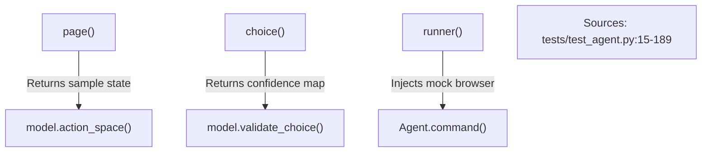
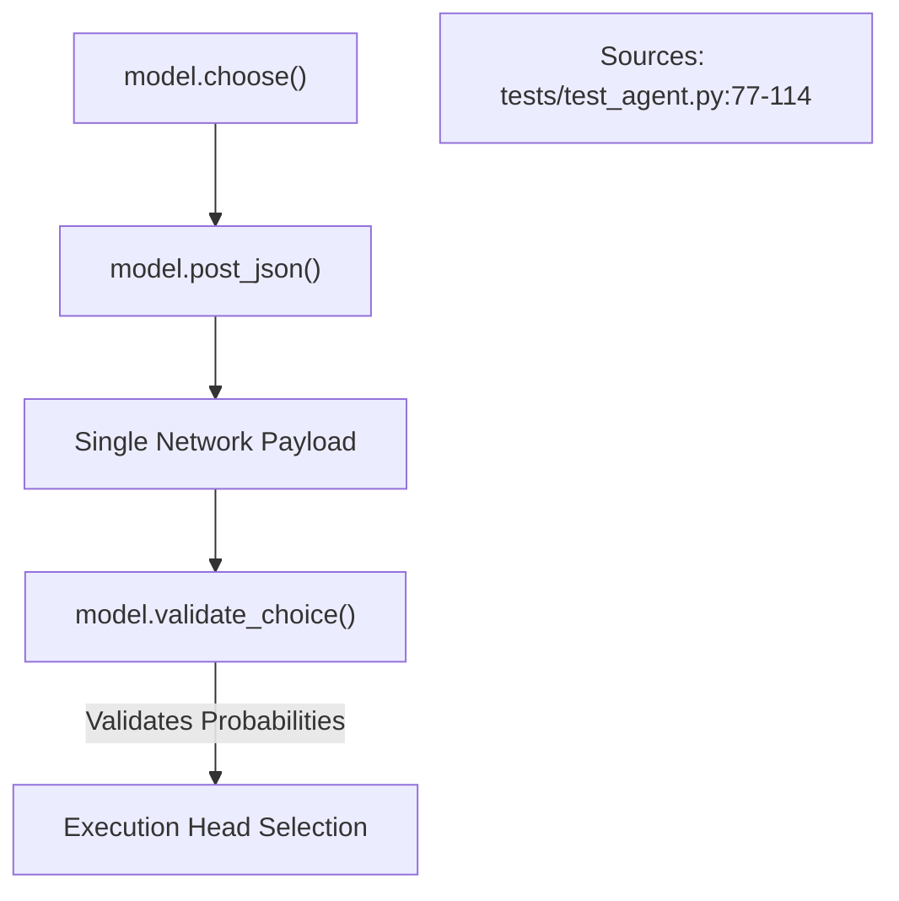
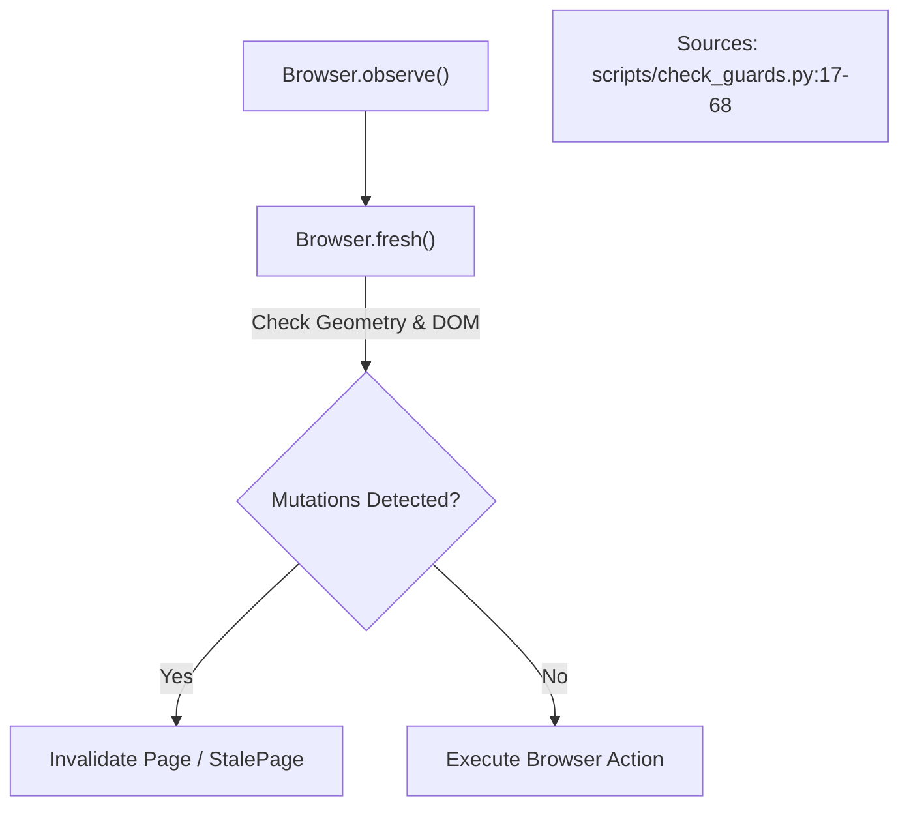

<!-- source: DeepWiki mcp.deepwiki.com · repo browser-use/jev-ultrafast · page 5.1 Test Suite · fetched 2026-10-30 -->

# Test Suite

Relevant source files

The following files were used as context for generating this wiki page:

- [scripts/check_guards.py](scripts/check_guards.py)
- [tests/test_agent.py](tests/test_agent.py)

The test suite provides offline contracts and regression checks for the `jev-ultrafast` execution loop, validating dynamic operation/target policies, speculative fan-out, action space formatting, and freshness guards without requiring paid external APIs or live LLM credentials. The testing architecture is split between unit/contract tests (`tests/test_agent.py`) and local browser integration regression checks (`scripts/check_guards.py`).

---

## 1. Offline Contract Tests (`tests/test_agent.py`)

The file `tests/test_agent.py` defines mocked page states, deterministic choice structures, and contract verifications for the `model` and `agent` modules.

### Fixtures and Mock Generators

The test suite establishes mock browser environments using helper functions:
* `page()`: Generates a sample DOM state dictionary containing URL, title, scroll position, and a list of interactive action elements with node identifiers (`[tests/test_agent.py:15-29]()`).
* `choice()`: Returns a standardized TypeSafe choice dictionary mapping selected options and confidence probabilities (`[tests/test_agent.py:32-34]()`).
* `decision()`: Constructs a baseline decision tuple specifying operation, target node, confidence, and latency metrics (`[tests/test_agent.py:36-45]()`).
* `runner()`: A pytest fixture that instantiates an `Agent` loop instance via `loop.Agent.__new__(loop.Agent)` with mocked browser state and an empty history log (`[tests/test_agent.py:160-178]`).

Sources: `tests/test_agent.py:15-189`

### TypeSafe Validation and Speculative Fan-Out

Model choices undergo rigorous boundary validation. `test_invalid_choice_is_rejected` parameterizes various structural violations—such as unknown choices, `NaN` probabilities, missing probability keys, negative probabilities, non-maximum choices, and invalid confidence values—asserting that `model.validate_choice()` raises a `ValueError` with `Invalid TypeSafe` [tests/test_agent.py:48-64]().

Speculative fan-out guarantees that all heads are evaluated in a single network request. `test_all_heads_are_one_request_and_only_matching_head_executes` intercepts `model.post_json()` via `monkeypatch`, verifies that exactly one HTTP request is dispatched containing all criteria questions, and ensures only the matching operation head executes [tests/test_agent.py:77-96](). Additionally, `test_click_cannot_consume_a_text_target` ensures cross-head contamination (such as a `CLICK` operation consuming a `TYPE_TEXT` target ID) is rejected by `model.choose()` [tests/test_agent.py:99-114]().

Sources: `tests/test_agent.py:77-114`

---

## 2. Freshness Guards & Browser Regressions (`scripts/check_guards.py`)

The script `scripts/check_guards.py` performs empirical regression tests against a local browser instance using data-URI HTML strings. It validates that page mutations correctly invalidate cached element geometries while unrelated offscreen modifications do not trigger unnecessary model re-observations [scripts/check_guards.py:1-24]().

### Mutation Invalidation Checks

The test sequence in `main()` constructs an HTML fixture with buttons, text fields, checkboxes, and select elements [scripts/check_guards.py:7-14](). It tests the following assertions:
* Moving targets update their geometry without requiring model re-observation if the structural fingerprint remains valid [scripts/check_guards.py:21-24]().
* Unrelated offscreen text modifications do not invalidate page freshness (`browser.fresh(page)`) [scripts/check_guards.py:29-31]().
* DOM mutations affecting visible context, accessible labels, field properties, checkbox states, disabled flags, read-only attributes, hidden styles, outer HTML replacements, and dropdown options correctly trigger invalidation (`not browser.fresh(page)`) [scripts/check_guards.py:33-50]().
* Textless screen overlays block click execution by throwing `RuntimeError` or `StalePage` even when the underlying action's structural fingerprint is marked fresh [scripts/check_guards.py:52-68]().

Sources: `scripts/check_guards.py:17-68`

---

