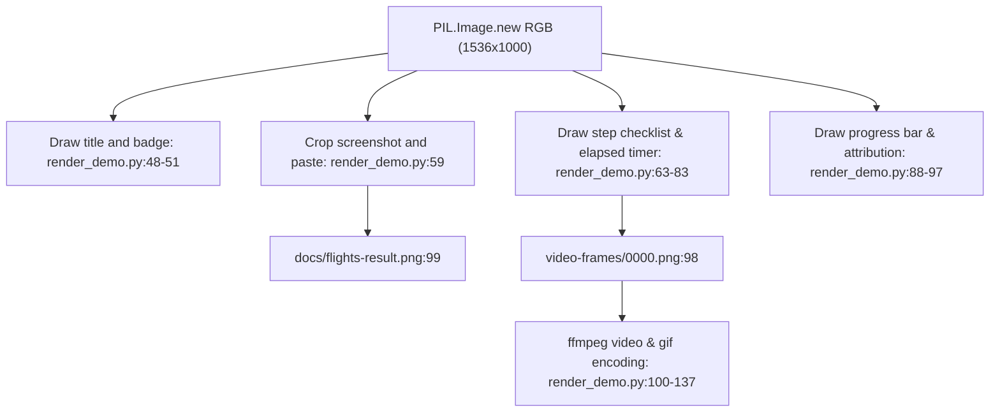

<!-- source: DeepWiki mcp.deepwiki.com · repo browser-use/jev-ultrafast · page 5.2 Demo Media & Docs Assets · fetched 2026-10-30 -->

# Demo Media & Docs Assets

<details>
<summary>Relevant source files</summary>

The following files were used as context for generating this wiki page:

- [docs/banner.svg](docs/banner.svg)
- [docs/demo.gif](docs/demo.gif)
- [docs/demo.mp4](docs/demo.mp4)
- [docs/flights-result.png](docs/flights-result.png)
- [docs/inspector.png](docs/inspector.png)
- [scripts/render_demo.py](scripts/render_demo.py)

</details>


## Purpose and Scope

This page details the documentation media and visual assets included in the `jev-ultrafast` repository (`docs/demo.gif`, `docs/demo.mp4`, `docs/flights-result.png`, `docs/inspector.png`, and `docs/banner.svg`). It covers their design, composition parameters, and the automation scripts used to generate them from verified agent execution runs.

Sources: `scripts/render_demo.py:1-139`, `docs/banner.svg:1-8`

---

## Asset Inventory

The repository contains several pre-rendered media artifacts used in README files, wikis, and performance demonstrations:

| Asset Path | Type | Description | Generation Method |
| :--- | :--- | :--- | :--- |
| `docs/demo.mp4` | Video (H.264) | Full-speed screencast of a Google Flights booking task with real loading waits. | `scripts/render_demo.py` + `ffmpeg` encoding [`scripts/render_demo.py:100-121`]() |
| `docs/demo.gif` | Animated GIF | Loopable preview generated from `demo.mp4` via custom palette generation. | `ffmpeg` palette filter [`scripts/render_demo.py:122-137`]() |
| `docs/flights-result.png` | Static Image | High-resolution composite layout showing final metrics, steps, and browser view. | `PIL` canvas rendering [`scripts/render_demo.py:46-99`]() |
| `docs/inspector.png` | Static Image | Screenshot of the local web inspector interface served by `demo.py`. | Manual / Inspector UI export |
| `docs/banner.svg` | Vector Graphic | Repository header banner featuring branding and mock UI elements. | Hand-crafted SVG markup [`docs/banner.svg:1-8`]() |

Sources: `scripts/render_demo.py:46-137`, `docs/banner.svg:1-8`

---

## The Rendering Pipeline (`scripts/render_demo.py`)

Media assets like `demo.mp4`, `demo.gif`, and `flights-result.png` are deterministically generated from verified execution recordings using `scripts/render_demo.py`. 

### Data Flow and Execution

The script ingests an exact verified recording directory containing `state.json` and a sequence of screencast frames (`scripts/render_demo.py:16-19`). It validates that `state["verification"]["passed"]` is true and `state["recording_errors"]` is empty before proceeding (`scripts/render_demo.py:17`).

```mermaid
graph TD
    SourceDir["Directory: state.json + screencast/"] --> LoadState[json.loads state.json]
    LoadState --> VerifyCheck{state["verification"]["passed"]}
    VerifyCheck -- "True" --> LoadFrames["PIL.Image.open screencast/*.jpg"]
    LoadFrames --> FrameLoop["Loop over 30 FPS timeline (0 to end + 500ms)"]
    FrameLoop --> DrawCanvas["PIL ImageDraw & Canvas Layout"]
    DrawCanvas --> SavePNG["Save individual video-frames/*.png"]
    SavePNG --> FfmpegMP4["subprocess.run(ffmpeg libx264) -> docs/demo.mp4"]
    FfmpegMP4 --> FfmpegGIF["subprocess.run(ffmpeg palettegen) -> docs/demo.gif"]
    DrawCanvas --> SaveResult["Save final composite -> docs/flights-result.png"]
```

Sources: `scripts/render_demo.py:12-139`

### Canvas Compositing and Layout

For every frame in the 30 FPS timeline, a `1536x1000` RGB canvas is constructed using Pillow (`PIL.Image.new`) with background `#f3f4ec` (`scripts/render_demo.py:46`). The layout incorporates:
- **Branding Header**: Typography rendered via system fonts (`Arial.ttf`, `Arial Bold.ttf`, `Menlo.ttc`) [`scripts/render_demo.py:23-33`].
- **Browser Window Frame**: A cropped region of the raw screencast pasted at coordinate `(36, 226)` inside a styled dark window container (`#202124`) with OS-style control dots (`scripts/render_demo.py:54-59`).
- **Execution Sidebar**: Real-time progress tracker verifying completed steps (`state["history"]`) alongside elapsed time (`t / 1000`) and median decision latency (`statistics.median`) (`scripts/render_demo.py:60-87`).
- **Timeline Footer**: A progress bar tracking the overall completion percentage (`37 + (1498 - 37) * t / end`) (`scripts/render_demo.py:88-96`).



Sources: `scripts/render_demo.py:46-137`

---

## Vector Documentation Assets (`banner.svg`)

The repository header banner (`docs/banner.svg`) is a self-contained SVG asset that illustrates the system's identity and architectural focus (`docs/banner.svg:1-8`). It embeds structured vector markup representing:
- **Typography**: Monospace and sans-serif headers (`BROWSER USE × TYPESAFE`, `JEV ULTRAFAST`, `CHOOSE. CLICK. GONE.`) (`docs/banner.svg:3`).
- **Mock Inspector Card**: A rotated container (`rotate(-4 240 140)`) styled with a white background (`#fff`), border (`#263c2a`), and interactive UI elements such as action index badge `e7`, input field placeholders, and selection markers (`docs/banner.svg:4-5`).
- **Accent Lines**: SVG path markers highlighting control flow and focus elements (`docs/banner.svg:6`).

Sources: `docs/banner.svg:1-8`

---

