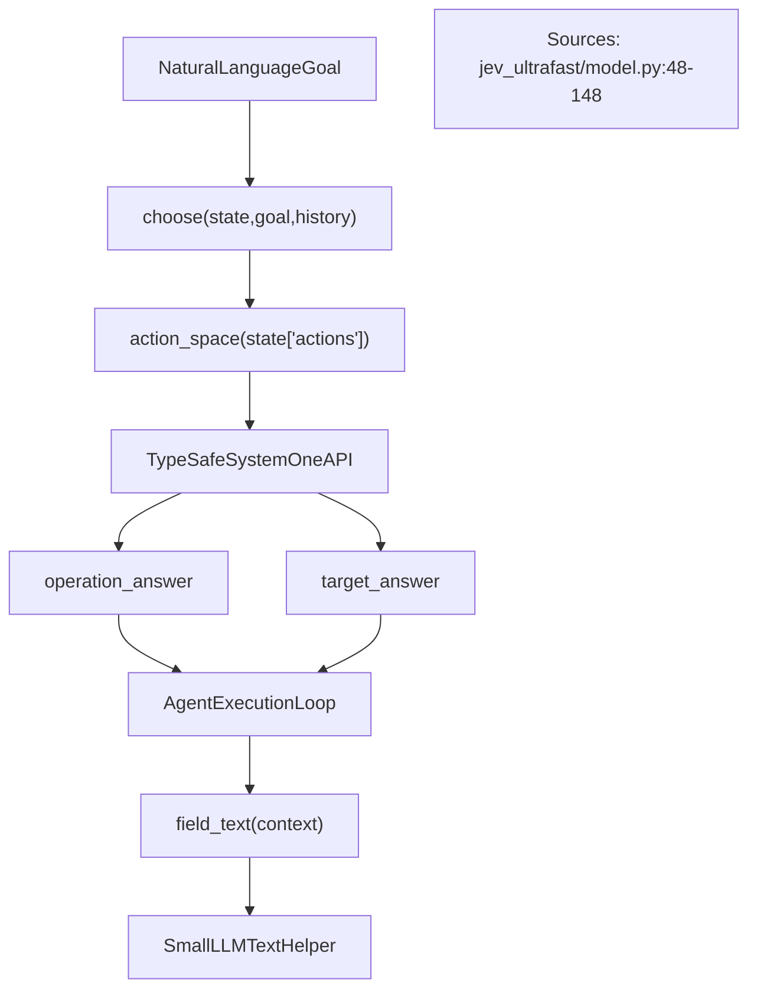
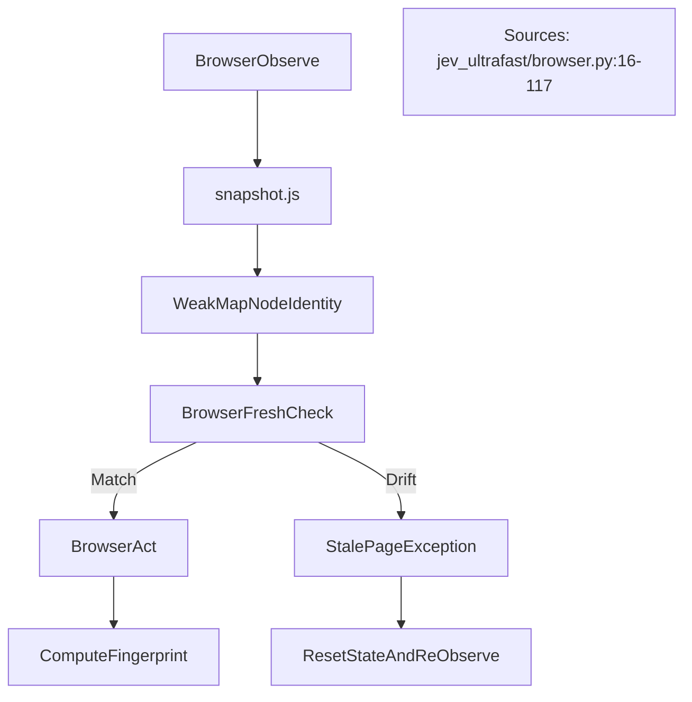

<!-- source: DeepWiki mcp.deepwiki.com · repo browser-use/jev-ultrafast · page 6 Glossary · fetched 2026-10-30 -->

# Glossary

Relevant source files

The following files were used as context for generating this wiki page:

- [docs/design.md](docs/design.md)
- [jev_ultrafast/agent.py](jev_ultrafast/agent.py)
- [jev_ultrafast/browser.py](jev_ultrafast/browser.py)
- [jev_ultrafast/model.py](jev_ultrafast/model.py)
- [jev_ultrafast/questions.py](jev_ultrafast/questions.py)

## Purpose and Scope
This page provides precise technical definitions for codebase-specific terms, architectural concepts, and runtime primitives used throughout `jev-ultrafast`. Each term is linked to its primary implementation file and line ranges to assist developers in navigating the codebase.

Sources: [docs/design.md:1-33](), [jev_ultrafast/agent.py:1-174]()

---

## Core Architecture & Model Terms

### TypeSafe
A structured decision-making engine and remote model service interface utilized for selecting browser operations and targets [jev_ultrafast/model.py:1-27](). It takes a normalized state payload containing page metadata, element attributes, and historical actions, returning validated probabilities and confidence metrics [jev_ultrafast/model.py:107-148]().

Sources: [jev_ultrafast/model.py:1-148]()

### Speculative Fan-out
A query architecture where a single model request evaluates both the high-level operation (`operation`) and multiple conditional target selections (`click_target`, `fill_target`, `select_target`) simultaneously [jev_ultrafast/model.py:91-106](). This avoids sequential round-trips by requesting target distributions for all candidate heads upfront.

Sources: [jev_ultrafast/model.py:91-106](), [docs/design.md:5-7]()

### Action Space
An indexed mapping of accessible interactive DOM elements converted into model-compatible structures [jev_ultrafast/model.py:48-78](). Each unique DOM node receives a single string index (`1`, `2`, `3`), consolidating multiple potential capabilities (such as clicking and typing) under code-owned identifiers [docs/design.md:3-5]().

Sources: [jev_ultrafast/model.py:48-78](), [docs/design.md:3-5]()

### TYPE_TEXT
An operation kind and secondary text-generation model pipeline that supplies exact string inputs for editable fields based on the user's natural language goal [docs/design.md:9](), current page context, and recent history [jev_ultrafast/model.py:151-160]().

Sources: [docs/design.md:9](), [jev_ultrafast/model.py:151-160]()

*Title: Natural-Language-to-Code Entity Mapping: Model and Action Space*

Sources: [jev_ultrafast/model.py:48-148](), [docs/design.md:9]()

---

## Browser & Execution State Terms

### Code-Owned Identity
An internal mapping mechanism utilizing a JavaScript `WeakMap` in `snapshot.js` where actual DOM nodes are assigned application-managed keys rather than volatile CDP backend node IDs [docs/design.md:13](). Disconnected references are pruned automatically, and replaced elements receive new identities.

Sources: [docs/design.md:13](), [jev_ultrafast/browser.py:12-14]()

### StalePage
A custom exception (`StalePage`) raised when the document mutates, navigates, or fails semantic freshness verification between the time a decision is made and when the action is executed [jev_ultrafast/browser.py:16-17](), [jev_ultrafast/browser.py:41]().

Sources: [jev_ultrafast/browser.py:16-17](), [jev_ultrafast/browser.py:41]()

### Freshness Guard
Semantic validation logic that compares document state, full URLs, viewports, safe form values, selected targets, and contextual elements to ensure the DOM has not drifted before executing an interaction [docs/design.md:17](). Implemented via `Browser.fresh()` [jev_ultrafast/browser.py:88-99]().

Sources: [jev_ultrafast/browser.py:88-99](), [docs/design.md:17]()

### Marker
An evaluation string injected by the browser harness to extract the current snapshot state marker and verify basic document continuity [jev_ultrafast/browser.py:13-14]().

Sources: [jev_ultrafast/browser.py:13-14]()

### Fingerprint
A cryptographic SHA-256 hash calculated over core page attributes (`url`, `text`, `actions`, `scroll`) to detect structural changes between observation ticks [jev_ultrafast/browser.py:115-117]().

Sources: [jev_ultrafast/browser.py:115-117]()

*Title: Browser Harness State Flow: Freshness Guards and StalePage Recovery*

Sources: [jev_ultrafast/browser.py:16-117](), [docs/design.md:17]()

---

## Transport, Configuration & Limits

### CDP (Chrome DevTools Protocol)
The low-level browser automation protocol used to establish a single persistent debugging session, dispatch input events, evaluate expressions, and manage device metrics without spawning per-step subproceses [jev_ultrafast/browser.py:1-28]().

Sources: [jev_ultrafast/browser.py:1-28]()

### Focus Emulation
A CDP emulation flag (`Emulation.setFocusEmulationEnabled`) enabled during initialization to maintain requestAnimationFrame execution and menu rendering inside an owned background tab without stealing active focus from the host user's Chrome window [jev_ultrafast/browser.py:27](), [docs/design.md:15]().

Sources: [jev_ultrafast/browser.py:27](), [docs/design.md:15]()

### Arm
An experimental configuration variant (such as baseline vs. candidate policy arms) evaluated during benchmarking and regression measurement runs [docs/design.md:19-25]().

Sources: [docs/design.md:19-25]()

### MAX_STEPS
A global execution constraint and safety limit bounded at `60` actions per run, restricting runaway agent loops and capping model-call budgets [jev_ultrafast/questions.py:26](), [jev_ultrafast/agent.py:75-104]().

Sources: [jev_ultrafast/questions.py:26](), [jev_ultrafast/agent.py:75-104]()