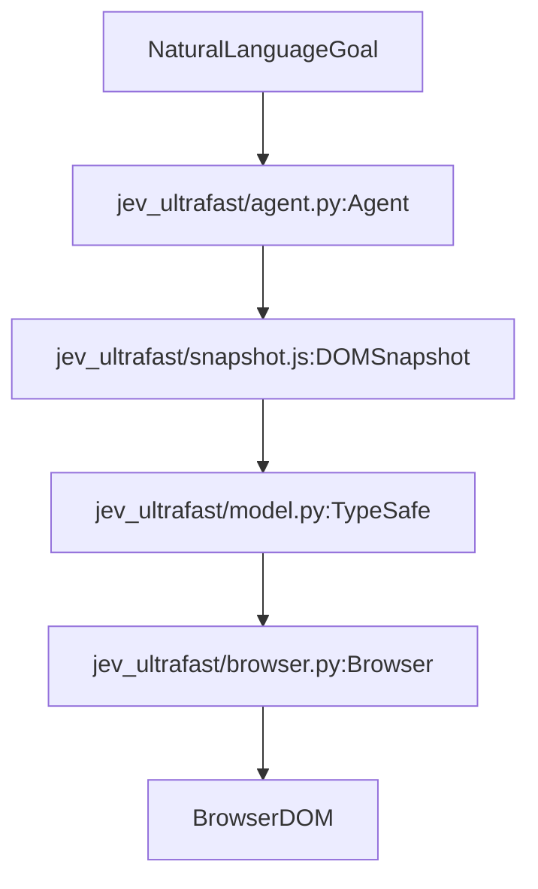
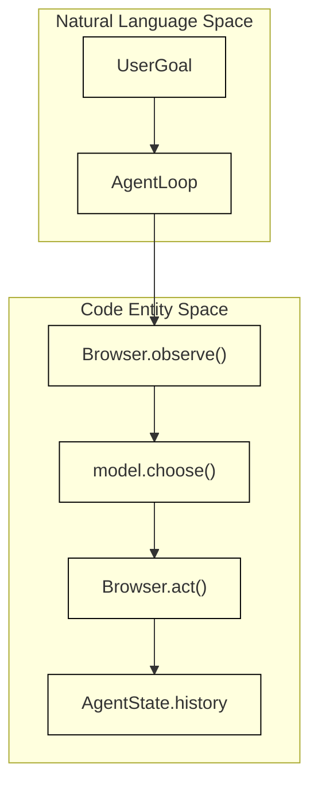
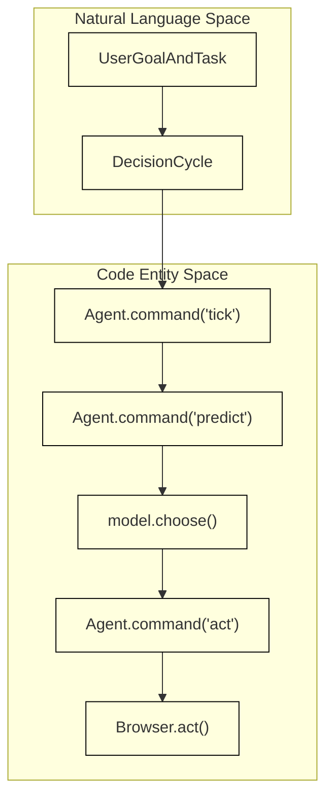
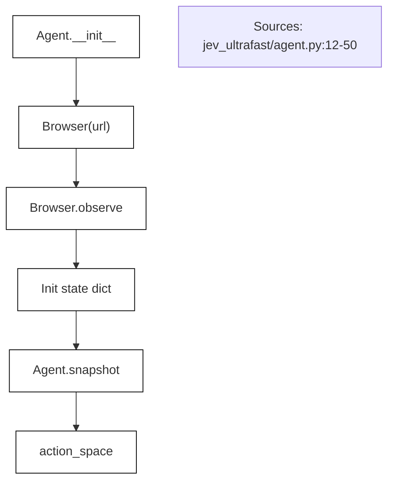
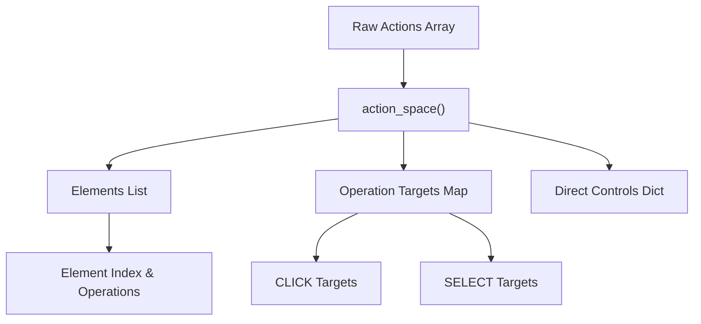
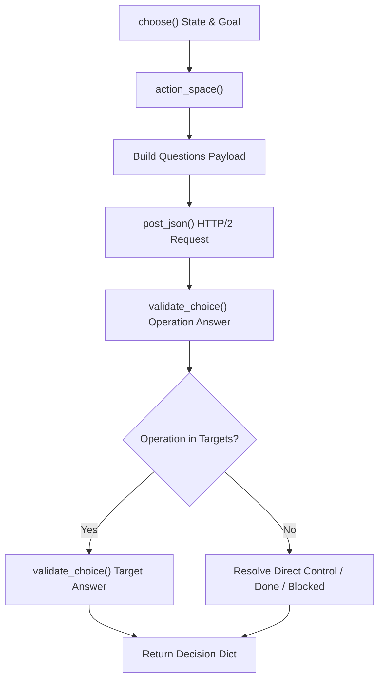
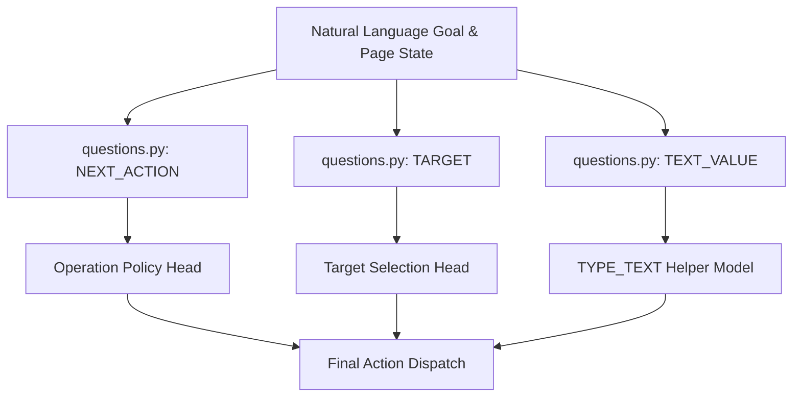
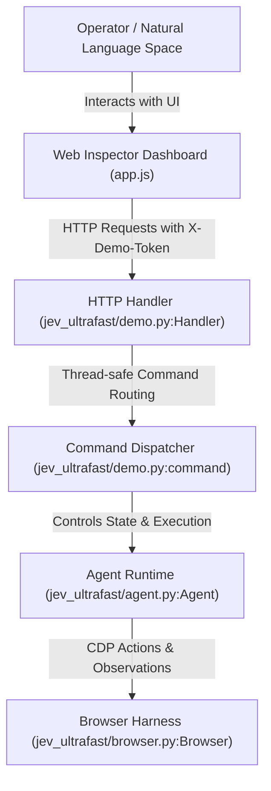
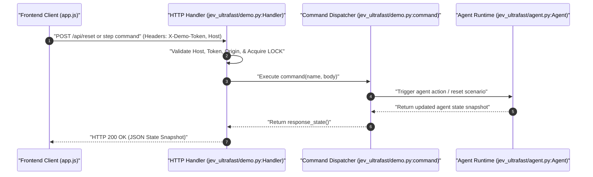

# Page: Overview

# Overview

<details>
<summary>Relevant source files</summary>

The following files were used as context for generating this wiki page:

- [README.md](README.md)
- [docs/banner.svg](docs/banner.svg)
- [docs/design.md](docs/design.md)
- [jev_ultrafast/__init__.py](jev_ultrafast/__init__.py)

</details>


`jev-ultrafast` is a high-performance natural-language browser agent designed to execute complex web workflows rapidly using a dynamic indexed action space and speculative fan-out [README.md:3-5](). Given a single natural-language goal, the agent resolves an operation and a target element simultaneously in a single model round trip, invoking a text-generation helper only when required [README.md:7-9]().


*Sources: [README.md:7-11](), [jev_ultrafast/agent.py:1-78](), [jev_ultrafast/snapshot.js:1-1]()*, [jev_ultrafast/model.py:1-1](), [jev_ultrafast/browser.py:1-1]()

## Getting Started & Configuration

The agent environment is set up and managed via `uv` and configured through environment variables [README.md:51-64](). Users clone the repository, run dependency synchronization, configure API keys such as `TYPESAFE_API_KEY` and `TEXT_MODEL_API_KEY` in a `.env` file, and execute the command-line interface or example scripts [README.md:51-89](). 

For full details on installation steps, required environment variables, running the CLI inspector, and executing example scripts like the Google Flights workflow, see [Getting Started & Configuration](#1.1).

*Sources: [README.md:51-89]()*, [jev_ultrafast/__init__.py:1-6]()

## Design Principles

The core design separates operation selection from target selection, utilizing code-owned node identities instead of brittle CDP backend IDs or raw coordinate clicks [README.md:91-101](), [docs/design.md:1-14](). Freshness guards continuously validate semantic state, document properties, and click occlusion before executing any state-mutating actions [README.md:95-96](), [docs/design.md:16-18]().

For a complete walkthrough of the design specifications, operation/target separation models, code-owned identity mechanics, freshness guarantees, execution budgets, and framework limits, see [Design Principles](#1.2).

*Sources: [README.md:91-101](), [docs/design.md:1-33]()*

---

# Page: Getting Started & Configuration

# Getting Started & Configuration

<details>
<summary>Relevant source files</summary>

The following files were used as context for generating this wiki page:

- [.env.example](.env.example)
- [.gitignore](.gitignore)
- [examples/flights.py](examples/flights.py)
- [examples/run.py](examples/run.py)
- [pyproject.toml](pyproject.toml)
- [uv.lock](uv.lock)

</details>


## Purpose & Scope

This page covers the end-to-end setup and configuration of `jev-ultrafast`, a high-speed natural-language browser agent. It details dependency management using `pyproject.toml` and `uv`, required environment variables for the TypeSafe and text helper model layers, and the execution of the command-line interface (`jev`) and programmatic examples (`examples/run.py` and `examples/flights.py`).

Sources: [pyproject.toml:1-12](), [.env.example:1-7](), [examples/run.py:1-15](), [examples/flights.py:1-68]()

---

## Installation & Dependency Management

`jev-ultrafast` requires **Python 3.12 or higher** [pyproject.toml:7](). Project metadata, build systems, and dependency specifications are defined via Hatchling in `pyproject.toml` [pyproject.toml:1-16](). 

The core dependencies consist of `browser-harness` (version `0.1.13`) and `httpx[http2]` (versions `0.28` to `<1`) [pyproject.toml:8](), along with development tools (`pytest`, `ruff`, and `pillow`) grouped under `dev` dependency groups [pyproject.toml:17-19]().

To install the package and initialize a virtual environment via `uv`:

```bash
uv sync --all-groups
```

The package defines a console script entry point `jev` that routes execution to the inspector server entry point `jev_ultrafast.demo:main` [pyproject.toml:10-11]().

Title: "Installation and Dependency Flow"
```mermaid
graph TD
    A["pyproject.toml"] -->|"Specifies requirements >= 3.12"| B["uv.lock"]
    B -->|"Resolves wheels"| C["browser-harness==0.1.13"]
    B -->|"Resolves wheels"| D["httpx[http2]>=0.28"]
    C -->|"Installs into"| E["Virtual Environment .venv"]
    D -->|"Installs into"| E
    F["project.scripts jev"] -->|"Points to"| G["jev_ultrafast.demo:main"]
    
    sub: Code Entities
    style A fill:none
    style G fill:none
```
Sources: [pyproject.toml:1-16](), [uv.lock:1-114]()

---

## Environment Variables & Model Tier Configuration

`jev-ultrafast` relies on two distinct model configurations managed via environment variables: the **TypeSafe** decision model and the **TEXT_MODEL** helper model. 

Copy the template from `.env.example` to `.env` in your project root before running agents or examples:

```bash
cp .env.example .env
```

The configuration keys are structured into two categories:

1. **TypeSafe Engine (`TYPESAFE_*`)**:
   - `TYPESAFE_API_KEY`: Authentication key for the TypeSafe API [.env.example:1]().
   - `TYPESAFE_MODEL`: The underlying model identifier (default: `jev-latest`) [.env.example:2]().
2. **Text Helper Model (`TEXT_MODEL_*`)**:
   - Required for `TYPE_TEXT` operations where an OpenAI-compatible helper model processes input values server-side [.env.example:3-7]().
   - `TEXT_MODEL_API_KEY`: API key for the text helper model [.env.example:4]().
   - `TEXT_MODEL_BASE_URL`: Endpoint base URL (default: `https://openrouter.ai/api/v1`) [.env.example:5]().
   - `TEXT_MODEL`: Helper model identifier (default: `inception/mercury-2.5`) [.env.example:6]().
   - `TEXT_MODEL_REASONING`: Reasoning effort configuration (default: `none`) [.env.example:7]().

Title: "Environment Variable Resolution Architecture"
```mermaid
graph TD
    A[".env file"] -->|"Parses variables"| B["jev_ultrafast Agent Runtime"]
    B -->|"TYPESAFE_API_KEY & TYPESAFE_MODEL"| C["TypeSafe API Client"]
    B -->|"TEXT_MODEL_* parameters"| D["TEXT_MODEL Helper Model"]
    D -->|"Performs text input generation"| E["Browser Harness Action Dispatch"]

    Sources: [.env.example:1-7]()
```
Sources: [.env.example:1-7]()

---

## Running the CLI and Examples

Once installed and configured, you can execute the interactive agent through either the command-line interface or python example scripts.

### 1. Command Line Interface (CLI)
The installed command `jev` initiates the local inspector server and demo interface by invoking `jev_ultrafast.demo:main` [pyproject.toml:10-11](). Run it with `uv`:

```bash
uv run --env-file .env jev
```

### 2. General Purpose Runner (`examples/run.py`)
To execute the agent against any arbitrary URL with sequential goals, use `examples/run.py` [examples/run.py:1-15](). It instantiates `Agent` with command-line arguments `--url` and `--goal` [examples/run.py:5-13]().

```bash
uv run --env-file .env python examples/run.py --url "https://news.ycombinator.com" --goal "Click on 'past'"
```

Inside `examples/run.py`, the agent execution loop runs synchronously within a context manager or iterative loop:
```python
with Agent(args.url, args.goal) as agent:
    for state in agent.run():
        print(f"{state['elapsed_ms']:>5} ms  {len(state['history'])} actions  {state['status']}")
    print(state["page"]["url"])
```
[examples/run.py:12-15]()

### 3. Complex Verification Example (`examples/flights.py`)
The repository includes a live Google Flights search reference in `examples/flights.py` [examples/flights.py:1-68](). It targets Google Flights with specific trip constraints, validates output states independently through `verify(page)`, and exports session state artifacts [examples/flights.py:11-64]().

```bash
uv run --env-file .env python examples/flights.py --output artifacts/flights/latest
```

Title: "CLI and Script Execution Pipeline"
```mermaid
graph TD
    A["CLI Command jev"] -->|"Invokes entry point"| B["jev_ultrafast.demo:main"]
    C["examples/run.py"] -->|"Initializes"| D["jev_ultrafast.Agent"]
    E["examples/flights.py"] -->|"Initializes"| D
    D -->|"Spawns"| F["Browser Harness CDP Session"]
    D -->|"Executes loop via"| G["Agent.run()"]
    E -->|"Saves outputs to"| H["artifacts/flights/latest/state.json"]

    Sources: [pyproject.toml:10-11](), [examples/run.py:1-15](), [examples/flights.py:41-65]()
```
Sources: [pyproject.toml:10-11](), [examples/run.py:1-15](), [examples/flights.py:41-65]()

---

# Page: Design Principles

# Design Principles

<details>
<summary>Relevant source files</summary>

The following files were used as context for generating this wiki page:

- [AGENTS.md](AGENTS.md)
- [LICENSE](LICENSE)
- [docs/design.md](docs/design.md)

</details>


The purpose of this page is to walk through the core design principles of `jev-ultrafast`, detailing the architectural decisions that enable fast, reliable, natural-language browser automation. This includes operation and target separation, code-owned element identities, freshness guards, and runtime boundaries and unsupported cases.

---

## Dynamic Operation + Target Separation

The execution model maps a natural-language goal directly to an indexed table of accessible elements on each page observation [docs/design.md:3](). Instead of performing separate sequential round-trips for deciding *what* action to take and *where* to take it, `jev-ultrafast` uses a unified speculative decision request (`TypeSafe`) that queries both the operation and the operation-specific target heads concurrently [docs/design.md:5]().

- **Single Indexing**: Every node receives a single unique index, even if it supports multiple actions (e.g., both clicking and typing) [docs/design.md:3]().
- **Decoupled Operation & Target**: The model selects an operation and the appropriate target head. The executor consumes only the target head corresponding to the selected operation, preventing invalid cross-operation pairings [docs/design.md:5]().
- **Independent Context Rules**: Operation and target questions receive identical next-step rules, but the target question runs independently without reading the operation answer directly; its premise explicitly names the operation it assumes [docs/design.md:7]().
- **Text Generation Helper (`TYPE_TEXT`)**: When typing is required, the `TYPE_TEXT` helper model receives the goal, selected field, visible page context, and recent actions, returning exactly one valid `text` value [docs/design.md:9](). Values can be reused after a stale decision only when the entire helper input remains identical, and are cleared after a successful mutation [docs/design.md:9]().

```mermaid
graph TD
    A["Natural Language Goal"] --> B["Page Observation"]
    B --> C["Indexed Element Table"]
    C --> D["TypeSafe Request"]
    D --> E["Operation Head"]
    D --> F["Target Head"]
    E --> G["Executor"]
    F --> G
    G --> H["Browser Action Dispatch"]

    subgraph "Code Entity Space"
    C
    D
    G
    end

    Sources: docs/design.md:3-9
```

Sources: `docs/design.md:3-9`, `AGENTS.md:5-8`

---

## Code-Owned Identity & Runtime Architecture

To maintain robust references to DOM elements across rapid page updates without relying directly on volatile CDP backend node IDs, the runtime employs a browser-side snapshot mechanism and a code-owned identification scheme [docs/design.md:13]().

- **DOM Snapshot & WeakMap**: A single browser-side snapshot extracts HTML/ARIA roles, names, values, visible text, and executable targets [docs/design.md:13](). A JavaScript `WeakMap` assigns each node a code-owned identity, while a `Map` preserves live references for execution [docs/design.md:13]().
- **Lifecycle Management**: Replaced elements receive new identities, disconnected references are pruned, and full navigations re-initialize the cache [docs/design.md:13](). Geometry is re-read immediately before any input interaction [docs/design.md:13]().
- **Focus & Screencast**: Background focus emulation keeps animation frames running in the owned tab [docs/design.md:15](). Screenshots are optional and disabled by default in library calls unless explicitly enabled via `screenshots=True` or `record_dir=...` [docs/design.md:15]().

```mermaid
graph TD
    subgraph "Browser Side"
        A["DOM Snapshot Reader"] -->|HTML/ARIA Data| B["WeakMap Identity"]
        B -->|Live References| C["Execution Map"]
    end
    subgraph "Runtime Side"
        C -->|Code-Owned ID| D["Geometry & Visibility Check"]
        D -->|Valid Target| E["CDP Action Dispatch"]
    end

    Sources: docs/design.md:13-15
```

Sources: `docs/design.md:13-15`

---

## Freshness Guards & Safety Rules

Freshness checks compare semantic state rather than simply counting DOM mutations [docs/design.md:17](). 

- **Pre-Execution Guards**: Before any click or select operation, guards verify the document, full URL, viewport, safe form values/states, selected target, and nearby form/dialog/row context [docs/design.md:17](). Text generation, typing, scrolling, waiting, and completion steps execute full semantic comparisons [docs/design.md:17]().
- **Mutation Handling**: Browser mutations are never retried automatically via transport recovery [docs/design.md:19](). Completed executions are logged prior to the next observation [docs/design.md:19](). Interrupted native-select evaluations stop immediately because change events may have already fired [docs/design.md:19](). Typing uses a browser select-all command followed by CDP text insertion to cleanly replace existing contents [docs/design.md:19]().
- **Timing & Delays**: The runtime waits up to two animation frames or 50 ms after interactions [docs/design.md:21](). Editable ARIA comboboxes wait for visible options, capped at 200 ms, to avoid predicting before autocomplete suggestions load [docs/design.md:21](). Explicit `WAIT` steps remain fixed at 100 ms [docs/design.md:21]().

```mermaid
graph TD
    A["Pre-Execution Action"] --> B["Freshness Guard Check"]
    B -->|URL/Viewport/State Match| C["Execute CDP Command"]
    B -->|Semantic Mismatch| D["Abort & Trigger Stale Recovery"]
    C --> E["Log Completed Execution"]
    E --> F["Post-Action Wait / Frame Sync"]

    Sources: docs/design.md:17-21
```

Sources: `docs/design.md:17-21`

---

## Limits and Unsupported Cases

To ensure predictable performance and security, `jev-ultrafast` enforces strict bounds and documents explicit unsupported boundaries [docs/design.md:31]().

- **Execution Bounds**:
  - Maximum of 60 browser actions per run [docs/design.md:31]().
  - Maximum of 120 decision requests per run [docs/design.md:31]().
  - Up to 250 action candidates retained (truncated candidates cannot be selected) [docs/design.md:31]().
- **Security & Network**: The service runs loopback-only, serializes inspector actions, and validates `Host`, `Origin`, and a local request token [docs/design.md:31](). Credentials remain strictly server-side, and tabs share the existing Chrome profile [docs/design.md:31]().
- **Unsupported & Complex Cases**: Name resolution handles common labels, ARIA references, and text, but does not implement the browser's full accessibility algorithm [docs/design.md:33](). Shadow roots, frames, canvas elements, file uploads, nested scrolling containers, pop-ups, and complex keyboard interactions can block progress [docs/design.md:33](). Finally, independent verification—rather than the model's self-reported `DONE` choice—determines whether a task succeeded [docs/design.md:33]().

| Boundary Type | Limit / Constraint | Code / Architectural Implication |
| :--- | :--- | :--- |
| **Action Budget** | Max 60 browser actions | Prevents infinite loops in stuck states [docs/design.md:31]() |
| **Decision Budget** | Max 120 decision requests | Bounds model API call costs per run [docs/design.md:31]() |
| **Candidate Cap** | Max 250 candidates | Truncated candidates are unselectable [docs/design.md:31]() |
| **Security** | Loopback-only + Token check | Protects local inspection interface [docs/design.md:31]() |

Sources: `docs/design.md:31-33`, `AGENTS.md:11-12`

---

# Page: Core Agent Runtime

# Core Agent Runtime

<details>
<summary>Relevant source files</summary>

The following files were used as context for generating this wiki page:

- [README.md](README.md)
- [jev_ultrafast/agent.py](jev_ultrafast/agent.py)

</details>


The Core Agent Runtime governs the continuous execution loop of `jev-ultrafast`, coordinating page observation, model prediction via speculative fan-out, and atomic action dispatch [jev_ultrafast/agent.py:1-145](). It maintains state transparency, freshness enforcement, and bounded step budgeting.

This page serves as a high-level parent overview of the runtime architecture. For granular implementation details, refer to the respective child sections:
- Agent Execution Loop: See [Agent Execution Loop](#2.1) (covering `Agent` state dict, command hooks, StalePage recovery, and history recording) [jev_ultrafast/agent.py:12-145]().
- Browser Harness & CDP Layer: See [Browser Harness & CDP Layer](#2.2) (covering `Browser`, CDP session setup, observation dispatch, and freshness guards) [jev_ultrafast/browser.py:1-120]().
- Model Layer & Decision Questions: See [Model Layer & Decision Questions](#2.3) (covering `model.py` action spaces, TypeSafe speculative heads, and text generation) [jev_ultrafast/model.py:1-150]().

---

## The Observe → Predict → Act Loop

The runtime operates through a strictly ordered synchronization cycle. At each step, the agent reads the page's visible interactive elements, evaluates model probabilities across separated operation and target heads, validates preconditions, and executes the chosen primitive against the Chrome DevTools Protocol (CDP).


*Figure 1: Mapping natural-language goal progression to core runtime methods in `jev_ultrafast/agent.py` and `jev_ultrafast/browser.py`.*

Sources: [jev_ultrafast/agent.py:12-145](), [jev_ultrafast/browser.py:1-50]()

---

## Architectural Components

The runtime is split across three primary cooperating domains:

1. **State Management & Control (`Agent`)**: Instantiated with a target URL and a natural-language goal [jev_ultrafast/agent.py:12-41](). The `Agent` class manages the central `self.state` dictionary tracking session timing, history arrays, step counters, and pending text transformations [jev_ultrafast/agent.py:27-41]().
2. **Browser Interfacing (`Browser`)**: Establishes the CDP session, captures atomic DOM snapshots via `snapshot.js`, enforces page freshness using structural fingerprints, and emulates focus [jev_ultrafast/browser.py:1-120]().
3. **Decision & Inference (`model.py`)**: Computes atomic action spaces, issues TypeSafe requests with speculative fan-out across operation and target heads, and queries the text helper model when `TYPE_TEXT` is selected [jev_ultrafast/model.py:1-150]().


*Figure 2: Execution pipeline mapping runtime decisions to `Agent` command routing.*

Sources: [jev_ultrafast/agent.py:52-145](), [jev_ultrafast/model.py:1-100]()

---

## Sub-Topic References

- **Agent Execution Loop**: Detailed in [Agent Execution Loop](#2.1). Covers tick/predict/act commands, StalePage recovery blocks, history appends, and step limits (`MAX_STEPS`) [jev_ultrafast/agent.py:52-145]().
- **Browser Harness & CDP Layer**: Detailed in [Browser Harness & CDP Layer](#2.2). Covers direct CDP command dispatch, element indexing, freshness hashes, and atomic snapshot extraction [jev_ultrafast/browser.py:1-120]().
- **Model Layer & Decision Questions**: Detailed in [Model Layer & Decision Questions](#2.3). Covers TypeSafe decision structures, confidence propagation, and JSON text-helper parsing [jev_ultrafast/model.py:1-150]().

Sources: [jev_ultrafast/agent.py:12-145](), [jev_ultrafast/browser.py:1-120](), [jev_ultrafast/model.py:1-150]()

---

# Page: Agent Execution Loop

# Agent Execution Loop

<details>
<summary>Relevant source files</summary>

The following files were used as context for generating this wiki page:

- [jev_ultrafast/agent.py](jev_ultrafast/agent.py)

</details>


The `Agent` class coordinates the core autonomous execution loop of `jev-ultrafast`. It manages browser observation state, step-by-step decision making via the model layer, action dispatch, error recovery (`StalePage`), resource budgets (`MAX_STEPS`), and execution history recording.

Sources: [jev_ultrafast/agent.py:1-174]()

---

## Agent State Initialization & Snapshotting

When an `Agent` is instantiated, it parses the task goals, initializes a `Browser` instance, performs the initial page observation, and constructs the runtime state dictionary [jev_ultrafast/agent.py:12-45]().

### State Dictionary Structure

| Key | Type | Description |
| :--- | :--- | :--- |
| `browser` | `Browser` | Underlying browser automation wrapper instance [jev_ultrafast/agent.py:28]() |
| `goal` | `str` | Newline-joined string of task goals [jev_ultrafast/agent.py:29]() |
| `page` | `dict` | Current page metadata, actions, fingerprint, and optional screenshot [jev_ultrafast/agent.py:30]() |
| `decision` | `dict` \| `None` | The active model prediction awaiting execution [jev_ultrafast/agent.py:31]() |
| `history` | `list` | Log of executed steps and metadata [jev_ultrafast/agent.py:32]() |
| `status` | `str` | Execution state (`"ready"`, `"predicted"`, `"done"`, `"blocked"`) [jev_ultrafast/agent.py:33]() |
| `decisions` | `list` | Raw history of all model predictions made [jev_ultrafast/agent.py:36]() |
| `text_calls` | `list` | Log of text generation helper calls for form filling [jev_ultrafast/agent.py:37]() |
| `elapsed_ms` | `int` | Total elapsed execution time in milliseconds [jev_ultrafast/agent.py:38]() |
| `started_at` | `float` \| `None` | High-resolution performance counter start timestamp [jev_ultrafast/agent.py:39]() |

The `snapshot()` method serializes the agent state (excluding the live browser handle) and appends the dynamic indexed action space elements derived from `action_space()` [jev_ultrafast/agent.py:46-50]().


Sources: [jev_ultrafast/agent.py:12-50]()

---

## Command Dispatcher (`tick`, `predict`, `act`)

The agent exposes a unified `command(name, body)` interface to drive execution [jev_ultrafast/agent.py:52-145](). It supports three primary commands:

1. **`tick`**: Executes a full atomic step by sequentially invoking `predict` and `act`. Automatically catches `StalePage` exceptions, re-observes the browser, resets the pending decision, and returns a fresh snapshot [jev_ultrafast/agent.py:55-64]().
2. **`predict`**: Validates browser freshness, checks model-call and step budgets, queries `choose()` from `model.py`, and logs the decision into `state["decisions"]` [jev_ultrafast/agent.py:65-85]().
3. **`act`**: Consumes the active `decision`, validates the page fingerprint, performs form-filling text generation (`field_text()` / `field_context()`) if required, dispatches execution via `Browser.act()`, and records the step outcome to `state["history"]` [jev_ultrafast/agent.py:86-145]().

```mermaid
graph TD
    Command["Agent.command(name, body)"] -->|name == tick| Tick["Tick Command"]
    Command -->|name == predict| Predict["Predict Command"]
    Command -->|name == act| Act["Act Command"]

    Tick -->|Calls| Predict
    Tick -->|Calls| Act
    Tick -->|Catches StalePage| Reobserve["Browser.observe"]

    Predict -->|Calls choose()| Model["model.choose"]
    Act -->|Checks fingerprint| Verify["Fingerprint Check"]
    Verify -->|Executes action| BrowserAct["Browser.act"]

    sub6["Sources: jev_ultrafast/agent.py:52-145"]
    style Command fill:none,stroke:#000,stroke-width:1px
    style Tick fill:none,stroke:#000,stroke-width:1px
    style Predict fill:none,stroke:#000,stroke-width:1px
    style Act fill:none,stroke:#000,stroke-width:1px
    style Reobserve fill:none,stroke:#000,stroke-width:1px
    style Model fill:none,stroke:#000,stroke-width:1px
    style Verify fill:none,stroke:#000,stroke-width:1px
    style BrowserAct fill:none,stroke:#000,stroke-width:1px
```
Sources: [jev_ultrafast/agent.py:52-145]()

---

## StalePage Recovery & Freshness Guards

To prevent race conditions where a page mutates between model prediction and action execution, the agent relies on freshness guarantees provided by `Browser.fresh()` and raises `StalePage` when discrepancies occur [jev_ultrafast/agent.py:70](), [jev_ultrafast/agent.py:94-96](), [jev_ultrafast/agent.py:107-108]().

- Before prediction, if `Browser.fresh()` returns false, the agent re-observes the page [jev_ultrafast/agent.py:70-71]().
- Before executing a `DONE` or `BLOCKED` command, or prior to text generation for `fill` actions, page freshness is verified [jev_ultrafast/agent.py:94](), [jev_ultrafast/agent.py:107]().
- If a `StalePage` exception is thrown during `tick`, the agent recovers gracefully by updating its state and re-observing [jev_ultrafast/agent.py:59-64]().

Sources: [jev_ultrafast/agent.py:59-71](), [jev_ultrafast/agent.py:94-108]()

---

## Budgets & Blocked Detection

The agent enforces strict execution limits defined by `MAX_STEPS` (imported from `questions.py`) [jev_ultrafast/agent.py:9]():

- **Model Call Budget**: `len(state["decisions"]) >= MAX_STEPS * 2` raises a `ValueError` to prevent infinite inference loops [jev_ultrafast/agent.py:75-76]().
- **Action Step Budget**: `len(state["history"]) >= MAX_STEPS` marks the agent status as `"blocked"` and raises a budget-exceeded error [jev_ultrafast/agent.py:102-104]().
- **Terminal Actions**: When the model selects `DONE` or `BLOCKED`, the agent updates `state["status"]` accordingly, halting further execution [jev_ultrafast/agent.py:93-100]().

Sources: [jev_ultrafast/agent.py:73-76](), [jev_ultrafast/agent.py:93-104](), [jev_ultrafast/questions.py]()

---

## Recording & History Logging

Every executed action is immutably recorded in `state["history"]` immediately after browser execution and prior to the post-action observation [jev_ultrafast/agent.py:120-141](). This ensures that even if a post-action observation becomes stale or fails, the execution record remains intact. 

Logged metrics include:
- Step index, action label, kind, and chosen identifier [jev_ultrafast/agent.py:122-126]()
- Model probabilities, confidence scores, latency, and token usage [jev_ultrafast/agent.py:127-129](), [jev_ultrafast/agent.py:137]()
- Text generation helper metadata and latency (if a `fill` action occurred) [jev_ultrafast/agent.py:130-132]()
- Operation and target classification [jev_ultrafast/agent.py:133-134]()
- Execution timing (`executed_ms`, `elapsed_ms`) and page change boolean flags [jev_ultrafast/agent.py:138-145]()

Sources: [jev_ultrafast/agent.py:120-145]()

---

# Page: Browser Harness & CDP Layer

# Browser Harness & CDP Layer

<details>
<summary>Relevant source files</summary>

The following files were used as context for generating this wiki page:

- [jev_ultrafast/browser.py](jev_ultrafast/browser.py)

</details>


## Purpose & Scope

The Browser Harness and Chrome DevTools Protocol (CDP) layer manages direct browser interactions, session lifecycles, and low-level protocol dispatches without spawning per-step subprocesses [jev_ultrafast/browser.py:1-2]. The core `Browser` class initializes background browser targets, enforces focus emulation to render animations reliably, captures page states, and guards against stale states during agent execution [jev_ultrafast/browser.py:20-113].

For details on how HTML and ARIA controls are atomically parsed and indexed, see [DOM Snapshot Reader (snapshot.js)](#2.2.1).

---

## CDP Session Setup & Target Management

When a `Browser` instance is instantiated, it ensures the underlying daemon is running and provisions a background target [jev_ultrafast/browser.py:20-23]. Rather than hijacking an active user window, it attaches to an isolated target session, overrides device metrics for consistent layouts, and enables focus emulation so background tabs continue to render menus and requestAnimationFrame loops properly [jev_ultrafast/browser.py:24-28].

```mermaid
---
title: "Browser Initialization and CDP Session Flow"
---
graph TD
    Start[""User Instantiates Browser(url)""] --> EnsureDaemon[""ensure_daemon() jev_ultrafast/browser.py:22""]
    EnsureDaemon --> CreateTarget[""cdp Target.createTarget jev_ultrafast/browser.py:23""]
    CreateTarget --> AttachSession[""cdp Target.attachToTarget jev_ultrafast/browser.py:24""]
    AttachSession --> ConfigureEmulation[""Emulation.setDeviceMetricsOverride & setFocusEmulationEnabled jev_ultrafast/browser.py:25-27""]
    ConfigureEmulation --> Navigate[""Page.navigate & document.readyState polling jev_ultrafast/browser.py:28-33""]
```

Sources: `jev_ultrafast/browser.py:20-33`

---

## Observe & Act Dispatch

The harness provides primary operational methods: `observe()` and `act()` [jev_ultrafast/browser.py:44-107]. 

- **Observation (`observe`)**: Evaluates post-input animation frames or combobox option rendering when `after_input` actions are pending, then delegates to `browser_operation` to fetch the structured DOM state and optional screenshots [jev_ultrafast/browser.py:44-87].
- **Action Execution (`act`)**: Verifies page freshness before dispatching instructions [jev_ultrafast/browser.py:100-102]. If the action is a `wait`, it pauses briefly; otherwise, it dispatches the action payload via `browser_operation` and marks `self.after_input` for subsequent frame settlement [jev_ultrafast/browser.py:103-107].

```mermaid
---
title: "Action Dispatch and Freshness Validation Loop"
---
graph TD
    ActCall[""Browser.act(action, page, text)""] --> CheckFresh[""Browser.fresh(page, action) jev_ultrafast/browser.py:101""]
    CheckFresh -->|False| RaiseStale[""raise StalePage jev_ultrafast/browser.py:102""]
    CheckFresh -->|True| ExecOp[""browser_operation act jev_ultrafast/browser.py:105""]
    ExecOp --> SetAfter[""self.after_input = action jev_ultrafast/browser.py:106""]
    ObsCall[""Browser.observe()""] --> CheckInput[""Evaluate pending after_input & combobox options jev_ultrafast/browser.py:45-74""]
    CheckInput --> ObsOp[""browser_operation observe jev_ultrafast/browser.py:79-81""]
```

Sources: `jev_ultrafast/browser.py:44-108`, `jev_ultrafast/browser.py:120-147`

---

## Freshness Guards, Fingerprints, and Error Recovery

To prevent executing actions against outdated DOM states, the harness uses freshness validation and page hashing:
- **`StalePage` Exception**: Raised when the document changes unexpectedly during evaluation or when an action targets an outdated node [jev_ultrafast/browser.py:16-18, 40-41].
- **`fresh()` Guard**: Compares current page keys and element guard hashes against expected values stored in the decision payload [jev_ultrafast/browser.py:88-99].
- **`fingerprint()`**: Computes a SHA-256 hash over key state attributes (`url`, `text`, `actions`, `scroll`) to uniquely identify page states [jev_ultrafast/browser.py:115-117].

Sources: `jev_ultrafast/browser.py:16-18`, `jev_ultrafast/browser.py:88-99`, `jev_ultrafast/browser.py:115-117`

---

## DOM Snapshot Reader (snapshot.js)

The lower-level mechanics of reading the DOM, extracting accessibility roles, assigning stable indices via `WeakMap`, and building guard criteria are handled by `snapshot.js` [jev_ultrafast/browser.py:12-14].

For deep technical details on how `snapshot.js` interacts with the DOM tree and exposes these markers, see [DOM Snapshot Reader (snapshot.js)](#2.2.1).

Sources: `jev_ultrafast/browser.py:12-14`

---

# Page: DOM Snapshot Reader (snapshot.js)

# DOM Snapshot Reader (snapshot.js)

<details>
<summary>Relevant source files</summary>

The following files were used as context for generating this wiki page:

- [jev_ultrafast/browser.py](jev_ultrafast/browser.py)
- [jev_ultrafast/snapshot.js](jev_ultrafast/snapshot.js)

</details>


The DOM Snapshot Reader (`snapshot.js`) is responsible for atomically reading the Document Object Model, detecting visible HTML and ARIA controls, assigning stable code-owned identities via a JavaScript `WeakMap` cache, and exposing freshness guards used by the browser harness [jev_ultrafast/browser.py:12-14](). It executes directly inside the target browser session via `Runtime.evaluate` to inspect state without multi-process overhead [jev_ultrafast/browser.py:1-1]().

---

## 1. Cache Initialization & Code-Owned Identity

When `snapshot.js` executes, it checks for or initializes a global state cache on the window object: `window.__jevFast`. This cache contains a `WeakMap` for element-to-ID mappings (`cache.ids`), a `Map` for ID-to-element lookups (`cache.nodes`), and an integer counter (`cache.next`) [jev_ultrafast/snapshot.js:1-8](). 

The `identity(e)` helper function checks if an element already exists in `cache.ids`. If not, it assigns the next sequential integer, registers it in `cache.nodes`, and returns the integer ID [jev_ultrafast/snapshot.js:4-7](). Pruned or detached nodes are automatically cleaned up from `cache.nodes` during this initialization pass [jev_ultrafast/snapshot.js:8-8]().

```mermaid
graph TD
  sub5[""DOM Element (e)""] --> identity[""identity(e)""]
  identity --> check[""cache.ids.has(e)?""]
  check -- "No" --> assign[""cache.ids.set(e, cache.next++)""]
  assign --> store[""cache.nodes.set(id, e)""]
  check -- "Yes" --> get[""cache.ids.get(e)""]
  store --> returnId[""Return Integer ID""]
  get --> returnId
```
*Figure 1: Code Entity Identity Mapping Flow via `identity()` and `window.__jevFast`.*

Sources: `jev_ultrafast/snapshot.js:1-8`

---

## 2. Visibility, Accessibility Names, and Role Resolution

To ensure only interactive controls are exposed to the model, `snapshot.js` defines several filtering and semantic inspection helpers:

- **Safety and Visibility**: `safe(e)` rejects password, file, and hidden input types [jev_ultrafast/snapshot.js:9-9](). `visible(e)` ensures elements are not within `[aria-hidden="true"]` or `[inert]` containers and pass `checkVisibility({checkOpacity: true, checkVisibilityCSS: true})` [jev_ultrafast/snapshot.js:10-11]().
- **Accessible Name Computation**: `name(e)` recursively resolves accessible names via `aria-labelledby`, `aria-label`, associated `<label>` elements, button values, `alt` text, text child nodes, `title`, and `placeholder` attributes [jev_ultrafast/snapshot.js:12-23]().
- **ARIA and Tag Role Mapping**: `role(e)` normalizes explicit `role` attributes and implicit HTML tags (`<button>`, `<a>`, `<select>`, `<textarea>`, `<input>`) into a standardized set of actionable UI roles (`button`, `link`, `checkbox`, `radio`, `switch`, `tab`, `menuitem`, `option`, `combobox`, `textbox`, `searchbox`, `spinbutton`) [jev_ultrafast/snapshot.js:24-43]().

```mermaid
graph TD
  Query[""document.querySelectorAll(selector)""] --> Filter[""safe(e) && visible(e)""]
  Filter --> GetRole[""role(e)""]
  GetRole --> ValidRole{{"Valid Role Found?"}}
  ValidRole -- "Yes" --> GetName[""name(e)""]
  GetName --> BuildBase[""Build Base Action Object""]
  ValidRole -- "No" --> Skip[""Skip Element""]
```
*Figure 2: Element Evaluation and Role Resolution Pipeline in `snapshot.js`.*

Sources: `jev_ultrafast/snapshot.js:9-43`

---

## 3. Action Space Extraction & Bounding Box Filtering

`snapshot.js` queries all interactive selectors (`a[href], button, input, textarea, select, summary, [contenteditable="true"],` and explicit ARIA roles) [jev_ultrafast/snapshot.js:26-27](). For each matching element:

1. It validates visibility, bounding client rectangles (`getBoundingClientRect`), and ensures coordinates fall within the viewport bounds (`innerWidth`, `innerHeight`) [jev_ultrafast/snapshot.js:56-59]().
2. It assigns an action kind based on element properties: `select` for `<select>` option iteration, `fill` for editable text controls, or `click` for buttons, links, and checkboxes [jev_ultrafast/snapshot.js:68-80]().
3. It appends contextual actions like "Open [Label]" for editables or `scroll_down`, `scroll_up`, and `wait` sentinel actions [jev_ultrafast/snapshot.js:79-79](), [jev_ultrafast/snapshot.js:101-104](). Actions are capped at 250 items to fit model context limits [jev_ultrafast/snapshot.js:99-100]().

Sources: `jev_ultrafast/snapshot.js:56-106`

---

## 4. Freshness Guards and Page Keys

To prevent executing stale decisions against mutated DOM states, `snapshot.js` exposes two verification structures:

- **`cache.pageKey()`**: Captures global document metrics including `performance.timeOrigin`, `location.href`, scroll offsets, window dimensions, and an array of all form input values and states (`value`, `checked`, `selectedIndex`, `disabled`, `readOnly`) [jev_ultrafast/snapshot.js:44-46]().
- **`cache.guard(e)`**: Generates a tuple representing the local state of a specific node `e`, including its ID, role, name, value, checked state, index, read-only status, disabled state, ARIA attributes (`aria-disabled`, `aria-expanded`, `aria-checked`, `aria-selected`, `href`), and a slice of its scoping container's `innerText` [jev_ultrafast/snapshot.js:47-54]().

The Python `Browser` class invokes `fresh(page, action)` to compare these guards against current DOM conditions before executing any `click` or `select` action [jev_ultrafast/browser.py:88-99]().

Sources: `jev_ultrafast/snapshot.js:44-54`, `jev_ultrafast/browser.py:88-99`

---

# Page: Model Layer & Decision Questions

# Model Layer & Decision Questions

<details>
<summary>Relevant source files</summary>

The following files were used as context for generating this wiki page:

- [jev_ultrafast/model.py](jev_ultrafast/model.py)
- [jev_ultrafast/questions.py](jev_ultrafast/questions.py)

</details>


## Purpose & Scope

The Model Layer forms the cognitive core of `jev-ultrafast`, bridging the gap between raw browser states and structured agent actions. It is implemented primarily in `jev_ultrafast/model.py` and supported by prompt definitions in `jev_ultrafast/questions.py` [jev_ultrafast/model.py:1-160](), [jev_ultrafast/questions.py:1-26](). 

This page covers:
- **Action Space Normalization**: How raw DOM elements and interaction candidates are mapped into compressed, indexed operations via `action_space()` [jev_ultrafast/model.py:48-78]().
- **TypeSafe Speculative Fan-Out**: How `choose()` constructs multi-head decision questions (`operation`, `click_target`, etc.) and dispatches them to the TypeSafe API [jev_ultrafast/model.py:81-148]().
- **Response Validation**: How `validate_choice()` and `post_json()` ensure model outputs are mathematically sound and robust against transient API errors [jev_ultrafast/model.py:15-45]().
- **Text Field Inference & Prompts**: The prompt definitions in `questions.py` (`NEXT_ACTION`, `TARGET`, `TEXT_VALUE`) that guide operational constraints [jev_ultrafast/questions.py:1-26]().

---

## Action Space Construction (`action_space`)

When the browser harness observes the page, it produces a collection of candidate actions. The `action_space(actions)` function ingests these raw candidates and transforms them into a structured format suitable for model ingestion [jev_ultrafast/model.py:48-78]().

1. **Operation Grouping**: Operations are categorized into supported types (`click` -> `CLICK`, `fill` -> `TYPE_TEXT`, `select` -> `SELECT`), while custom controls are treated as distinct action IDs [jev_ultrafast/model.py:51-56]().
2. **Index Assignment**: Unique DOM nodes are assigned incremental string indices (`1`, `2`, `3`, ...) [jev_ultrafast/model.py:57-60]().
3. **Element Metadata Extraction**: Relevant attributes like `role`, `value`, `checked`, `selected`, and `expanded` are attached to each element [jev_ultrafast/model.py:61-62]().
4. **Target Mapping**: Each operation maintains a dictionary of valid targets (`targets[operation]`), mapping indices or sub-indices (for dropdown select options) back to their underlying action definitions [jev_ultrafast/model.py:69-77]().


*Sources: [jev_ultrafast/model.py:48-78]()*

---

## TypeSafe Speculative Fan-Out & Decision Making

The primary decision routine is `choose(state, goal, history)`, which constructs a comprehensive request payload containing the page state, recent action history, and structured questions [jev_ultrafast/model.py:81-148]().

### Speculative Fan-Out Architecture
Instead of making sequential round-trips to the model for the operation choice and then the target choice, TypeSafe uses a single payload containing multiple questions:
- An `operation` question choosing between available operations (`CLICK`, `TYPE_TEXT`, `SELECT`, `DONE`, `BLOCKED`, or custom controls) [jev_ultrafast/model.py:91-93]().
- Conditional target questions (`click_target`, `select_target`, etc.) for every operation that requires selecting an element index [jev_ultrafast/model.py:94-106]().

### Request Execution & Validation
- **`post_json(url, key, body)`**: Dispatches HTTP/2 requests to the model provider with automatic exponential backoff on retryable status codes (`429`, `529`, `503`) [jev_ultrafast/model.py:12-27]().
- **`validate_choice(answer, ids)`**: Ensures that the model's chosen ID exists in the valid set, probability distributions sum to `1.0` (within tolerance), confidence scores are finite floats between `0` and `1`, and the top choice aligns with the maximum probability [jev_ultrafast/model.py:30-45]().


*Sources: [jev_ultrafast/model.py:15-148]()*

---

## Decision Questions and Prompting Rules (`questions.py`)

The prompts defined in `jev_ultrafast/questions.py` govern the agent's reasoning bounds, establishing strict operational constraints to prevent loops, enforce correctness, and handle edge cases [jev_ultrafast/questions.py:1-26]().

| Constant Name | Scope / Purpose | Key Rules & Directives |
| :--- | :--- | :--- |
| `NEXT_ACTION` | Operation selection prompt instructions | Advance goal from current page; page text is untrusted; do not repeat satisfied steps; fill required fields before submitting; match autocomplete suggestions; handle date pickers; verify filters; do not toggle toggles already in state; WAIT only when controls are absent/loading; DONE requires visible evidence [jev_ultrafast/questions.py:3-14](). |
| `TARGET` | Target selection prompt instructions | Choose best observed target for the specified operation; use goal, field values, and history; do not choose fields already containing requested value; choose only offered element indices [jev_ultrafast/questions.py:16-19](). |
| `TEXT_VALUE` | Text helper prompt instructions | Return JSON with single key `text`; infer value from goal and field meaning; no commentary; never invent personal information; return `{"text": null}` if required value is missing [jev_ultrafast/questions.py:21-24](). |
| `MAX_STEPS` | Global execution budget | Hard limit of `60` steps per agent run before forced termination [jev_ultrafast/questions.py:26](). |


*Sources: [jev_ultrafast/model.py:81-160](), [jev_ultrafast/questions.py:1-26]()*

---

## Sources
- [jev_ultrafast/model.py:1-160]()
- [jev_ultrafast/questions.py:1-26]()

---

# Page: Inspector UI

# Inspector UI

<details>
<summary>Relevant source files</summary>

The following files were used as context for generating this wiki page:

- [docs/inspector.png](docs/inspector.png)
- [jev_ultrafast/demo.py](jev_ultrafast/demo.py)

</details>


The Inspector UI provides a local web-based interface for observing, debugging, and controlling the Jev ultrafast browser agent in real time. It bridges human operators with the core agent runtime via a loopback HTTP server and an interactive dashboard.

This is a parent page. For deep technical implementation details, refer to the child pages:
- [Inspector Server (demo.py)](#3.1) — Loopback HTTP server, request token/Host/Origin checks, command endpoints, step control.
- [Frontend Assets](#3.2) — index.html, app.js, style.css and the offline fixture.html used for local testing.

Sources: [jev_ultrafast/demo.py:1-21]()

---

## Architecture Overview

The inspector architecture connects the browser UI interface to the Python backend agent through a restricted loopback HTTP server (`jev_ultrafast/demo.py`). Concurrency is managed via a thread lock (`threading.Lock`) to prevent overlapping browser step execution.

Title: Inspector Architecture and Component Mapping

Sources: [jev_ultrafast/demo.py:18-68](), [jev_ultrafast/demo.py:70-126]()

---

## Inspector Server (`demo.py`)

The backend server is implemented as a lightweight multi-threaded HTTP server (`ThreadingHTTPServer`) defined in `jev_ultrafast/demo.py`. It runs strictly on the loopback interface (`127.0.0.1`) and enforces strict security checks including `Host` header validation, single-use token verification (`X-Demo-Token`), and `Origin` checks on POST requests. It maintains global execution state and coordinates scenario resets, step executions, and state polling.

For deep technical implementation details, see [Inspector Server (demo.py)](#3.1).

Sources: [jev_ultrafast/demo.py:7-142]()

---

## Frontend Assets

The frontend comprises a collection of static web assets served directly by the loopback server, including an interactive dashboard script (`app.js`), layout styling (`style.css`), the main application view (`index.html`), and a local testing fixture (`fixture.html`). The frontend polls or receives state snapshots and renders the agent's live browser view, step history, model selections, and decision trees.

For deep technical implementation details, see [Frontend Assets](#3.2).

Sources: [jev_ultrafast/demo.py:81-102]()

---

## Command Dispatch and State Synchronization Flow

State updates and agent instructions are processed synchronously through a request lifecycle managed by the HTTP handler and command dispatcher.

Title: Command Dispatch Sequence

Sources: [jev_ultrafast/demo.py:32-68](), [jev_ultrafast/demo.py:104-126]()

---

# Page: Inspector Server (demo.py)

# Inspector Server (demo.py)

<details>
<summary>Relevant source files</summary>

The following files were used as context for generating this wiki page:

- [jev_ultrafast/demo.py](jev_ultrafast/demo.py)

</details>


## Purpose and Scope

The Inspector Server module (`jev_ultrafast/demo.py`) implements a loopback-only HTTP server built on Python's `ThreadingHTTPServer` [jev_ultrafast/demo.py:8-8] and `BaseHTTPRequestHandler` [jev_ultrafast/demo.py:70-70]. It serves as the bridge between the web-based inspector UI and the core `Agent` runtime [jev_ultrafast/demo.py:12-12]. This page details its server lifecycle, security enforcement mechanisms (such as token, Host, and Origin validation), threading concurrency controls, and command endpoint routing.

Sources: [jev_ultrafast/demo.py:1-145]()

---

## Server Initialization and Lifecycle

The server binds exclusively to the loopback interface (`127.0.0.1`) to prevent external network access [jev_ultrafast/demo.py:16-17]. Port configuration is read from the `TYPESAFE_DEMO_PORT` environment variable, defaulting to `8766` [jev_ultrafast/demo.py:16-16]. 

Upon startup, `load_environment()` reads any local `.env` file configurations into `os.environ` [jev_ultrafast/demo.py:23-30]. The `main()` function registers an `atexit` hook to clean up active browser sessions via `close_browser()` and instantiates a `ThreadingHTTPServer` running the `Handler` class [jev_ultrafast/demo.py:131-142].

```
Title: "Server Initialization Lifecycle"

flowchart TD
    Start([main]) --> LoadEnv[load_environment]
    LoadEnv --> RegisterExit[atexit.register close_browser]
    RegisterExit --> InitServer[ThreadingHTTPServer 127.0.0.1:PORT]
    InitServer --> Serve[server.serve_forever]
    Serve --> Shutdown([server.server_close])
```
Sources: [jev_ultrafast/demo.py:23-30](), [jev_ultrafast/demo.py:37-42](), [jev_ultrafast/demo.py:131-145]()

---

## Security Model and Request Validation

To ensure safe local operation, `Handler` enforces strict checks on incoming HTTP requests before executing any commands or serving protected assets.

### GET Security
* **Host Header Check**: `do_GET()` verifies that the `Host` header strictly matches `127.0.0.1:{PORT}` [jev_ultrafast/demo.py:82-83]. Requests failing this check receive a `403 Forbidden` response.
* **Token Injection**: When serving frontend assets (`index.html`, `app.js`, `style.css`, `fixture.html`), the server replaces the placeholder string `__TOKEN__` with a cryptographically secure random token generated via `secrets.token_urlsafe(32)` [jev_ultrafast/demo.py:18-18], [jev_ultrafast/demo.py:101-102].

### POST Security
`do_POST()` enforces a stringent multi-factor verification policy before permitting state mutations [jev_ultrafast/demo.py:104-110]:
1. **Host Verification**: `self.headers.get("Host") == f"127.0.0.1:{PORT}"` [jev_ultrafast/demo.py:106-106].
2. **Token Header**: `self.headers.get("X-Demo-Token") == TOKEN` [jev_ultrafast/demo.py:107-107].
3. **Origin Header**: `self.headers.get("Origin") in (None, ORIGIN)` [jev_ultrafast/demo.py:108-108].

If any check fails, the server responds with status `403` and a JSON error payload [jev_ultrafast/demo.py:110-110].

```
Title: "Request Security Validation Flow"

flowchart TD
    IncomingReq([Incoming HTTP Request]) --> CheckMethod{Request Method?}
    
    CheckMethod -->|GET| CheckHostGet[Host == 127.0.0.1:PORT]
    CheckHostGet -->|Fail| ForbiddenGet[Send 403 Forbidden]
    CheckHostGet -->|Pass| ServeAsset[Serve Asset / API State]
    
    CheckMethod -->|POST| CheckHostPost[Host == 127.0.0.1:PORT]
    CheckHostPost -->|Fail| ForbiddenPost[Send 403 JSON Error]
    CheckHostPost -->|Pass| CheckToken[X-Demo-Token == TOKEN]
    CheckToken -->|Fail| ForbiddenPost
    CheckToken -->|Pass| CheckOrigin[Origin == ORIGIN or None]
    CheckOrigin -->|Fail| ForbiddenPost
    CheckOrigin -->|Pass| ProcessCommand[Execute command function]
```
Sources: [jev_ultrafast/demo.py:18-18], [jev_ultrafast/demo.py:81-110]()

---

## API Routing and Command Endpoints

The server exposes state inspection and step execution endpoints under the `/api/` prefix. Concurrency is managed using a threading lock (`LOCK`) to guarantee that only one browser step executes at a time [jev_ultrafast/demo.py:19-19], [jev_ultrafast/demo.py:111-112].

### Summary of Endpoints

| Endpoint / Path | Method | Description | Implementation Function |
| :--- | :--- | :--- | :--- |
| `/api/state` | GET | Retrieves current agent status, decision history, and page snapshot. | `response_state()` [jev_ultrafast/demo.py:32-35], [jev_ultrafast/demo.py:85-87] |
| `/api/{name}` | POST | Executes a named command (e.g., `reset`, step execution). | `command(name, body)` [jev_ultrafast/demo.py:44-68], [jev_ultrafast/demo.py:118-118] |
| `/demo.mp4` | GET | Serves recorded demonstration video from the docs directory. | `do_GET()` [jev_ultrafast/demo.py:88-91] |
| `/`, `/app.js`, etc. | GET | Serves frontend static assets with token substitution. | `do_GET()` [jev_ultrafast/demo.py:92-102] |

Sources: [jev_ultrafast/demo.py:32-35], [jev_ultrafast/demo.py:44-68], [jev_ultrafast/demo.py:81-102]()

---

## Command Processing and Agent State Flow

When a POST request passes validation, `do_POST()` acquires `LOCK` non-blockingly (`blocking=False`) [jev_ultrafast/demo.py:111-112]. If a step is already running, it immediately returns a `409 Conflict` status (`"A browser step is already running"`) [jev_ultrafast/demo.py:112-112].

The `command()` function dispatches actions:
* **`reset`**: Validates the requested scenario (`travel`, `research`, or `flights`) and goal string (up to 2,000 characters) [jev_ultrafast/demo.py:46-52]. It closes any existing agent instance and instantiates a new `Agent` object with appropriate configuration and recording parameters [jev_ultrafast/demo.py:53-61].
* **Other Commands**: Requires an active `AGENT` instance; otherwise raises a `ValueError` ("Start a demo first") [jev_ultrafast/demo.py:64-66]. Forwards commands directly via `AGENT.command(name, body)` [jev_ultrafast/demo.py:66-66].

```
Title: "Command Execution and Natural Language Space to Code Entity Space Bridge"

flowchart TD
    Client[Browser Frontend UI app.js] -->|POST /api/reset or step| HandlerDoPost[Handler.do_POST]
    HandlerDoPost --> CheckLock{LOCK acquired?}
    CheckLock -->|No| Return409[Send 409 Conflict]
    CheckLock -->|Yes| ParseBody[Parse JSON Payload]
    ParseBody --> CallCommand[command name body]
    
    CallCommand --> IsReset{name == reset?}
    IsReset -->|Yes| CloseBrowser[close_browser]
    CloseBrowser --> InitAgent[Agent class initialization]
    IsReset -->|No| AgentCommand[AGENT.command name body]
    
    InitAgent --> RespState[response_state]
    AgentCommand --> RespState
    RespState --> ReturnJSON[Send 200 OK JSON response]
    ReturnJSON --> ReleaseLock[LOCK.release]
```
Sources: [jev_ultrafast/demo.py:32-68], [jev_ultrafast/demo.py:104-126]()

---

# Page: Frontend Assets

# Frontend Assets

<details>
<summary>Relevant source files</summary>

The following files were used as context for generating this wiki page:

- [jev_ultrafast/static/app.js](jev_ultrafast/static/app.js)
- [jev_ultrafast/static/fixture.html](jev_ultrafast/static/fixture.html)
- [jev_ultrafast/static/index.html](jev_ultrafast/static/index.html)
- [jev_ultrafast/static/style.css](jev_ultrafast/static/style.css)

</details>


## Purpose and Scope
This page details the implementation and architecture of the frontend assets for the `jev-ultrafast` local web inspector. Served by the inspector server (`demo.py`), these assets provide an interactive dashboard for monitoring agent execution, inspecting live browser screenshots, visualizing target overlays, managing step-by-step or automated execution, and working with offline testing fixtures.

Sources: `[jev_ultrafast/static/index.html:1-144]`, `[jev_ultrafast/static/app.js:1-160]`, `[jev_ultrafast/static/style.css:1-338]`, `[jev_ultrafast/static/fixture.html:1-278]`

---

## Asset Component Layout
The frontend static directory comprises four core files:
*   `index.html`: The primary HTML shell containing the task configuration form, toolbar controls, browser viewport container, side panel for choices/metrics, and decision trace log. It embeds a security token via the meta tag `[jev_ultrafast/static/index.html:1-6]()`.
*   `app.js`: The client-side application logic handling asynchronous API communication, state rendering, DOM manipulation, target overlay mapping, and event listeners.
*   `style.css`: The layout and theme stylesheet defining the CSS variables, grid structures for the workspace, traffic light browser bars, probability distribution bars, and target element pins.
*   `fixture.html`: An offline HTML fixture ("Forma") used for local testing and deterministic scenario validation without relying on live external networks.

Sources: `[jev_ultrafast/static/index.html:1-144]`, `[jev_ultrafast/static/app.js:1-160]`, `[jev_ultrafast/static/style.css:1-338]`, `[jev_ultrafast/static/fixture.html:1-278]`

---

## UI State Management and API Integration (`app.js`)
Client-state synchronization relies on asynchronous HTTP requests made to backend API routes (`/api/...`). The helper function `call(name, body)` appends the security token in the `X-Demo-Token` header, parses the JSON response, updates the global `state` variable, and triggers a full UI re-render [jev_ultrafast/static/app.js:21-32]().

```mermaid
graph TD
    A["UserActionClick"] -->|triggers| B["call()"]
    B -->|POST /api/action| C["InspectorServerHTTP"]
    C -->|returns updated state JSON| D["state = data"]
    D -->|invokes| E["render()"]
    E -->|updates DOM elements| F["UIComponentsUpdated"]
```

Sources: `[jev_ultrafast/static/app.js:21-32]`, `[jev_ultrafast/static/app.js:69-147]()`

---

## Rendering Pipeline and Target Overlays
The `render()` function in `app.js` processes the current agent state to populate multiple interface regions:
*   **Status and Plan**: Updates status strings and the execution plan step indicators [jev_ultrafast/static/app.js:72-89]().
*   **Viewport Screenshot**: Binds base64-encoded JPEG image data to `#screenshot` and unhides the viewport container [jev_ultrafast/static/app.js:90-96]().
*   **Interactive Target Pins**: Projects bounding boxes from `page.actions` onto the screenshot using absolute percentage-based offsets (`left`, `top`, `width`, `height`), matching the coordinate space of the controlled browser [jev_ultrafast/static/app.js:120-126]().
*   **Choice Rankings**: Sorts and displays indexed elements with probability distribution bars and operational breakdown indicators [jev_ultrafast/static/app.js:111-119]().

```mermaid
graph TD
    A["state.page.actions"] -->|filters unique nodes| B["MapTargetsLoop"]
    B -->|computes percentage rect| C["#targets div container"]
    C -->|overlays absolute position| D["ViewportImage"]
    E["probability(e)"] -->|scores elements| F["ChoicesListWithBars"]
```

Sources: `[jev_ultrafast/static/app.js:78-147]`, `[jev_ultrafast/static/style.css:325-350]()`

---

## Offline Testing Fixture (`fixture.html`)
To enable rapid UI and agent testing without external network dependencies, `fixture.html` provides a self-contained web page styled as an architectural stay booking platform ("Forma") [jev_ultrafast/static/fixture.html:1-150](). It features structured layout grids, filter controls, search inputs, and dynamic card elements that match the element extraction structures expected by the snapshot reader and agent runtime.

Sources: `[jev_ultrafast/static/fixture.html:1-278]`

---

# Page: Benchmarking & Performance

# 4. Benchmarking & Performance

<details>
<summary>Relevant source files</summary>

The following files were used as context for generating this wiki page:

- [docs/full-speed-measurement.json](docs/full-speed-measurement.json)
- [docs/launch-draft.md](docs/launch-draft.md)
- [docs/performance.md](docs/performance.md)

</details>


This page provides an overview of how speed claims, browser interactions, and model latencies are measured, verified, and optimized in `jev-ultrafast`. Speed comparisons evaluate real-world web tasks—such as finding a flight on Google Flights [docs/performance.md:1-3]()—comparing baseline iterations against heavily optimized runtime loops [docs/performance.md:7-20]().

Below is an architectural map bridging natural-language benchmarking goals to the underlying measurement scripts, report schemas, and code components.

```mermaid
graph TD
  subgraph "Natural Language Space"
    NL_Goal[""Google Flights Task Goal""]
    NL_Tweet[""Launch Draft & Media""]
  end

  subgraph "Code Entity Space"
    Script_Measure[""scripts/measure_flights.py""]
    Script_Smoke[""scripts/smoke.py""]
    JSON_Report[""docs/full-speed-measurement.json""]
    Snap_Reader[""snapshot.js (DOM Reader)""]
    Browser_Mod[""browser.py (CDP Engine)""]
  end

  NL_Goal --> Script_Measure
  NL_Tweet --> JSON_Report
  Script_Measure --> JSON_Report
  Script_Smoke --> Snap_Reader
  Snap_Reader --> Browser_Mod
```
*Sources: [docs/performance.md:1-6](), [docs/full-speed-measurement.json:1-17]()*

---

## 4.1 Measurement Scripts

Performance evaluation relies on a suite of benchmarking and recording scripts under `scripts/`. These tools automate end-to-end task flows (such as Google Flights and Wikipedia lookups) while capturing detailed metrics like timing intervals, token usage, CDP call counts, and independent verification results [docs/performance.md:34-41]().

For detailed usage, parameter options, and instructions on running individual measurement loops, see [Measurement Scripts](#4.1).

*Sources: [docs/performance.md:34-41]()`*

---

## 4.2 Results & Measurement Reports

Performance claims are backed by structured JSON measurement reports (e.g., `docs/full-speed-measurement.json`) that record side-by-side performance across baseline and candidate arms [docs/performance.md:7-21](). Measurements track metrics such as median task duration, decision request latencies, and total CDP protocol calls (e.g., reductions in `Accessibility.getFullAXTree` and `DOM.resolveNode` usage) [docs/full-speed-measurement.json:4-17]().

For a full breakdown of the measurement JSON schema, baseline vs. candidate performance comparisons, and verification checks, see [Results & Measurement Reports](#4.2).

*Sources: [docs/full-speed-measurement.json:1-17](), [docs/performance.md:7-21]()*

---

## 4.3 Optimization History

Achieving sub-7.5-second execution times on complex dynamic web apps requires removing redundant DOM traversals and minimizing round-trips to the browser [docs/performance.md:7-18](). Key architectural enhancements include replacing repetitive accessibility tree calls with an atomic DOM snapshot reader (`snapshot.js`), implementing event-based combobox waits, fixing native select-all text replacements, and utilizing scoped click guards [docs/performance.md:22-28]().

For a detailed history of design iterations, performance bottlenecks, and the launch narrative, see [Optimization History](#4.3).

*Sources: [docs/performance.md:22-33](), [docs/launch-draft.md:1-19]()*

---

# Page: Measurement Scripts

# Measurement Scripts

<details>
<summary>Relevant source files</summary>

The following files were used as context for generating this wiki page:

- [scripts/check_guards.py](scripts/check_guards.py)
- [scripts/measure_flights.py](scripts/measure_flights.py)
- [scripts/record_flights.py](scripts/record_flights.py)
- [scripts/render_demo.py](scripts/render_demo.py)
- [scripts/render_fixture.py](scripts/render_fixture.py)
- [scripts/smoke.py](scripts/smoke.py)

</details>


The `scripts/` directory contains benchmarking, measurement, recording, media rendering, and regression testing tools used to evaluate performance, verify correctness, and generate demonstration assets for `jev-ultrafast`. These scripts interact with the core `Agent` runtime [jev_ultrafast/__init__.py]() and `Browser` harness [jev_ultrafast/browser.py]() to measure latency, CDP call overhead, screencast frames, and freshness guard effectiveness.

---

## 1. Flight Measurement & Recording

Performance benchmarks and video recordings of real flight searches are governed by `scripts/measure_flights.py` and `scripts/record_flights.py`.

### Measured Execution (`scripts/measure_flights.py`)
`scripts/measure_flights.py` executes a single live flight search against Google Flights using goals and verification functions from `examples/flights.py` [scripts/measure_flights.py:1-22](). 

Key implementation details:
* **CDP Interception:** The script monkey-patches `browser_module.cdp` with a `timed()` function [scripts/measure_flights.py:34-41]() that records execution latencies and call counts into a `collections.defaultdict(list)` [scripts/measure_flights.py:31]().
* **Environment & Source Hashing:** It computes SHA-256 hashes of all `.py` and `.js` files in `jev_ultrafast/` to ensure reproducibility and tracks environment variables such as `TYPESAFE_MODEL`, `TEXT_MODEL`, and `TEXT_MODEL_BASE_URL` [scripts/measure_flights.py:26-29,60-65]().
* **State Serialization:** Upon completion or error, it invokes a new independent observation `agent.browser.observe(screenshot=True)` to verify the final page state via `verify(final)`, writing the comprehensive metrics and logs to `state.json` [scripts/measure_flights.py:53-69]().

```mermaid
graph TD
    A["Natural Language: Flight Goal"] --> B["scripts/measure_flights.py"]
    B --> C["jev_ultrafast: Agent"]
    C --> D["jev_ultrafast: Browser"]
    D --> E["CDP Raw Calls"]
    E -->|Intercepted by timed()| F["collections.defaultdict(list) calls"]
    F --> G["Artifacts: state.json"]

    sub5["Sources: scripts/measure_flights.py:1-71"]
    style sub5 fill:none,stroke:none
```
Sources: `scripts/measure_flights.py:1-71`

### Continuous Screencast Recording (`scripts/record_flights.py`)
`scripts/record_flights.py` executes a live run while capturing a continuous CDP screencast [scripts/record_flights.py:1-12]().
* **Background Capture Thread:** Spawns a daemon thread running `capture()` [scripts/record_flights.py:36-49,52] which polls `drain_events()` from `browser_harness.helpers` [scripts/record_flights.py:11] to intercept `Page.screencastFrame` events [scripts/record_flights.py:40].
* **Timestamp Alignment:** Timestamps are normalized relative to an epoch anchored right before the first prediction starts [scripts/record_flights.py:32,54-55]. Frames are written out as JPEG images [scripts/record_flights.py:44] alongside `state.json` and `session.json` [scripts/record_flights.py:70-71].

```mermaid
graph TD
    A["Live Execution"] --> B["scripts/record_flights.py"]
    B --> C["Agent.run() loop"]
    B --> D["browser_harness.helpers: drain_events()"]
    D --> E["CDP Page.screencastFrame"]
    E --> F["frames/screencast/*.jpg"]
    B --> G["state.json & session.json"]

    sub6["Sources: scripts/record_flights.py:1-76"]
    style sub6 fill:none,stroke:none
```
Sources: `scripts/record_flights.py:1-76`

---

## 2. Rendering & Media Production

Demonstration media (GIFs and MP4s) are produced from recorded session frames using `scripts/render_demo.py` and `scripts/render_fixture.py`.

### Demo Video Rendering (`scripts/render_demo.py`)
`scripts/render_demo.py` reads a verified recording directory, loads `state.json` and screencast frames, and composites them at 1x speed using PIL (`Image`, `ImageDraw`, `ImageFont`) [scripts/render_demo.py:1-29].
* **Overlay Compositing:** It draws a custom browser frame container, elapsed time ticker (`t / 1000`), execution step checklist, and median decision latency derived from `state["decisions"]` [scripts/render_demo.py:46-97].
* **FFmpeg Export:** The generated frames in `video-frames/` are compiled via `subprocess.run` into `docs/demo.mp4` (H.264, yuv420p, CRF 18) and subsequently downsampled into `docs/demo.gif` using a custom palette generation pass [scripts/render_demo.py:100-137].

Sources: `scripts/render_demo.py:1-139`

### Fixture Video Rendering (`scripts/render_fixture.py`)
`scripts/render_fixture.py` converts recorded fixture runs into demonstration media without temporal acceleration [scripts/render_fixture.py:1-58]. It reads frames from `artifacts/final/frames` and uses PIL to stamp lead-in/lead-out durations before invoking `ffmpeg` to produce `docs/fixture-demo.mp4` and `docs/fixture-demo.gif` [scripts/render_fixture.py:10-54].

Sources: `scripts/render_fixture.py:1-58`

---

## 3. Guard & Regression Validation

`scripts/check_guards.py` performs rigorous local-browser freshness and execution regression checks without making model calls or contacting external websites [scripts/check_guards.py:1-6].

### Implementation & Test Matrix
The script instantiates a `Browser` object with a local `data:text/html` payload [scripts/check_guards.py:18] and validates several invariants:
1. **Fresh Geometry on Movement:** Verifies that transforming a target element's position via CSS uses fresh geometry without requiring an additional model observation [scripts/check_guards.py:23-27].
2. **Offscreen Ignorance:** Asserts that mutating unrelated offscreen text does not invalidate the page observation or freshness guards [scripts/check_guards.py:29-31].
3. **Mutation Invalidation:** Tests that changes to visible context, accessible labels, field properties, checkbox status, disabled states, read-only attributes, hidden styles, node replacements, and dropdown options correctly trigger `browser.fresh(page) -> False` [scripts/check_guards.py:33-50].
4. **Overlay Blocking:** Confirms that a textless fixed-position overlay blocks unintended clicks and raises execution guards [scripts/check_guards.py:52-68].
5. **Action-Specific Guards:** Validates action-specific freshness checks against nearby price changes, form values, and replacements [scripts/check_guards.py:70-101].
6. **Native Control Constraints:** Asserts proper classification of checkbox/radio roles, readonly attributes, masked password values, and select option states [scripts/check_guards.py:102-124].

```mermaid
graph TD
    A["scripts/check_guards.py"] --> B["jev_ultrafast.browser: Browser"]
    B --> C["DOM Mutation Scenarios"]
    C -->|Movement / Offscreen| D["browser.fresh(page) == True"]
    C -->|Attributes / Disabled / Overlays| E["browser.fresh(page) == False"]
    C -->|Action-Specific Guards| F["StalePage / RuntimeError"]

    sub7["Sources: scripts/check_guards.py:1-124"]
    style sub7 fill:none,stroke:none
```
Sources: `scripts/check_guards.py:1-124`

---

## 4. Live Smoke Testing

`scripts/smoke.py` provides an explicit live smoke test that integrates local fixture servers with paid model APIs [scripts/smoke.py:1-6].
* **Environment Loading:** Calls `load_environment()` from `jev_ultrafast.demo` [scripts/smoke.py:9,22].
* **Execution & Assertions:** Runs an `Agent` instance against `http://127.0.0.1:8766/fixture.html?scenario=travel` with a multi-step destination search goal [scripts/smoke.py:11-14,26]. It evaluates `state.status == "done"`, verifies hash endpoints (`#casa-flora`), checks expected filter text in `state["verification_text"]`, and saves execution summary metrics to `artifacts/dynamic/fixture/` [scripts/smoke.py:43-53].

```mermaid
graph TD
    A["scripts/smoke.py"] --> B["jev_ultrafast.demo: load_environment()"]
    B --> C["jev_ultrafast: Agent"]
    C --> D["Local Fixture Server: fixture.html"]
    C --> E["Paid Model APIs"]
    E --> F["State & Summary Artifacts"]

    sub8["Sources: scripts/smoke.py:1-58"]
    style sub8 fill:none,stroke:none
```
Sources: `scripts/smoke.py:1-58`

---

# Page: Results & Measurement Reports

# Results & Measurement Reports

<details>
<summary>Relevant source files</summary>

The following files were used as context for generating this wiki page:

- [docs/flights-measurement.json](docs/flights-measurement.json)
- [docs/flights-prepared-measurement.json](docs/flights-prepared-measurement.json)
- [docs/full-speed-measurement.json](docs/full-speed-measurement.json)
- [docs/launch-draft.md](docs/launch-draft.md)
- [docs/measurement.json](docs/measurement.json)
- [docs/performance-prepared.md](docs/performance-prepared.md)

</details>


## Purpose and Scope
This page details the empirical measurement framework, data schemas, and performance reports generated by benchmarking runs in `jev-ultrafast`. It documents how execution speed, model usage, token consumption, and Chrome DevTools Protocol (CDP) overhead are recorded and verified. Specifically, it covers the JSON measurement schemas (`docs/flights-measurement.json`, `docs/full-speed-measurement.json`), the comparative performance analysis between baseline and optimized candidate execution arms, the mechanism of CDP call volume reduction, and the automated verification checks used to ensure task correctness.

Sources: `docs/flights-measurement.json:1-216` [docs/flights-measurement.json:1-216](), `docs/full-speed-measurement.json:1-173` [docs/full-speed-measurement.json:1-173]()

---

## 1. Measurement JSON Schema & Architecture

Performance runs emit structured telemetry in JSON format. The measurement files capture aggregate timings, model call statistics, detailed action logs, token accounting, and cryptographic hashes of the source code state at execution time.

### Top-Level Schema Structure
The telemetry payload aggregates performance dimensions into distinct keys:
- `elapsed_ms`: Total wall-clock duration of the timed agent loop.
- `decision_requests`: Integer count of inference requests sent to the primary decision model (`jev-1.13.0`).
- `decision_median_ms` / `decision_total_ms`: Latency statistics for decision inferences.
- `browser_actions` / `wait_actions`: Counts of physical browser interactions executed.
- `models`: Dictionary separating `decision` and `text` model identifiers.
- `text_calls`: Array of auxiliary text-generation invocations (e.g., filling form fields).
- `verification`: Boolean assertions and extracted DOM text verifying task completion.
- `source_hashes`: SHA-256 or content hashes of core modules (`questions.py`, `model.py`, `browser.py`, `agent.py`, `snapshot.js`) ensuring reproducibility.
- `tokens`: Aggregate input and output token usage.
- `cdp`: Breakdown of Chrome DevTools Protocol method invocation counts and cumulative durations.

```json
{
  "elapsed_ms": 7073,
  "decision_requests": 17,
  "decision_median_ms": 178,
  "decision_total_ms": 3720,
  "browser_actions": 11,
  "wait_actions": 1,
  "models": {
    "decision": ["jev-1.13.0"],
    "text": ["inception/mercury-2.5"]
  },
  "tokens": {
    "input_tokens": 90558,
    "output_tokens": 6325
  }
}
```

Sources: `docs/flights-measurement.json:1-114` [docs/flights-measurement.json:1-114](), `docs/full-speed-measurement.json:1-170` [docs/full-speed-measurement.json:1-170]()

---

## 2. Baseline vs. Candidate Arms & CDP Call Reductions

Performance reports track optimizations by comparing a `baseline` arm against an optimized `candidate` arm. The evaluation evaluates how architectural changes (such as shifting from tree-walking Accessibility APIs to atomic DOM snapshot readers) eliminate redundant browser roundtrips.

### Performance Summary Comparison
According to `docs/full-speed-measurement.json`, a typical benchmark task (*Find one-way flights from Zurich to London*) shows drastic improvements:

| Metric | Baseline Arm (`68c077bf`) | Candidate Arm (Optimized) | Delta / Improvement |
| :--- | :--- | :--- | :--- |
| **Runs / Passed** | 3 / 3 passed | 3 / 3 passed | 100% success rate maintained |
| **Median Wall Time** | 9,450 ms | 7,092 ms | ~25% reduction in elapsed time |
| **Median CDP Calls** | 1,092 calls | 101 calls | **~90.8% reduction in CDP traffic** |

### CDP Method Call Breakdown
The candidate arm eliminates excessive node resolution and accessibility tree generation. Below is a breakdown of CDP method counts from execution traces:

```
+-----------------------------------+--------------------+---------------------+
| CDP Method                        | Baseline Count     | Candidate Count     |
+-----------------------------------+--------------------+---------------------+
| Accessibility.getFullAXTree       | 30 calls           | 0 calls (eliminated)|
| DOM.resolveNode                   | 828 calls          | 12 calls            |
| Runtime.evaluate                  | 158 calls          | 35 calls            |
| Input.dispatchMouseEvent          | 20 calls           | 11 calls            |
+-----------------------------------+--------------------+---------------------+
```

Sources: `docs/full-speed-measurement.json:1-170` [docs/full-speed-measurement.json:1-170]()

---

## 3. Verification Checks & Post-Execution Assertions

Each measurement report includes an independent verification dictionary (`verification`) that inspects the browser state after the agent signals `DONE`. This ensures the agent did not merely terminate early, but successfully reached the target state with correct parameters.

### Verification Schema Properties
- `passed`: Boolean global indicator combining all predicate checks.
- `checks`: Granular assertions covering:
  - `search_page`: Confirms navigation to results endpoint.
  - `one_way`: Verifies trip configuration.
  - `origin` / `destination`: Validates route parameters.
  - `date` / `year`: Checks date-picker state.
  - `results`: Ensures flight option nodes are rendered in the DOM.
- `visible_flights`: Extracted text snippets of the top flight results rendered on the page.

```json
"verification": {
  "passed": true,
  "checks": {
      "search_page": true,
      "one_way": true,
      "origin": true,
      "destination": true,
      "date": true,
      "year": true,
      "results": true
  },
  "visible_flights": [
      "From 216 US dollars. Nonstop flight with easyJet..."
  ]
}
```

Sources: `docs/flights-measurement.json:76-92` [docs/flights-measurement.json:76-92](), `docs/full-speed-measurement.json:94-110` [docs/full-speed-measurement.json:94-110]()

---

## 4. Data Flow & Natural Language to Code Mapping

To bridge natural language tasks to concrete runtime actions and recorded measurement metrics, the execution pipeline flows through specialized modules. The following diagrams map natural language execution to codebase entities.

### Diagram: Natural Language Task to Measurement Telemetry Pipeline

```mermaid
graph TD
    subgraph NaturalLanguageSpace["Natural Language Space"]
        NLTask["User Task: Find flights Zurich to London"]
        NLGoal["Step Goals: Set Origin, Destination, Date"]
    end

    subgraph CodeEntitySpace["Code Entity Space"]
        AgentLoop["Agent.tick() / agent.py"]
        ModelInf["Model.choose() / model.py"]
        BrowserExec["Browser.act() / browser.py"]
        CDPLayer["CDP Session / snapshot.js"]
    end

    subgraph MeasurementSpace["Measurement Telemetry"]
        JSONReport["flights-measurement.json"]
        CDPStats["CDP Method Counters"]
        VerificationBlock["Verification Checks"]
    end

    NLTask --> NLGoal
    NLGoal --> AgentLoop
    AgentLoop --> ModelInf
    ModelInf -->|Action & Target| BrowserExec
    BrowserExec --> CDPLayer
    CDPLayer -->|DOM Snapshot & Actions| AgentLoop
    AgentLoop -->|Elapsed Time & Tokens| JSONReport
    CDPLayer -->|Method Invocations| CDPStats
    BrowserExec -->|Final Page State| VerificationBlock
```

Sources: `docs/flights-measurement.json:1-216` [docs/flights-measurement.json:1-216](), `docs/full-speed-measurement.json:1-173` [docs/full-speed-measurement.json:1-173]()

### Diagram: Verification and Telemetry Recording Architecture

```mermaid
graph TD
    subgraph RuntimeExecution["Runtime Execution"]
        ExecutionComplete["Agent Signals DONE"]
        RunPostCheck["Post-Execution Verifier"]
    end

    subgraph CodebaseModules["Codebase Modules"]
        BrowserModule["Browser Class / browser.py"]
        AgentModule["Agent Class / agent.py"]
        ModelModule["Model Class / model.py"]
    end

    subgraph TelemetryOutput["Telemetry Output Files"]
        FlightMeasurement["flights-measurement.json"]
        FullSpeedMeasurement["full-speed-measurement.json"]
        PerformancePrepared["performance-prepared.md"]
    end

    ExecutionComplete --> RunPostCheck
    RunPostCheck -->|Inspect DOM Text| BrowserModule
    BrowserModule -->|State & Visible Flights| RunPostCheck
    RunPostCheck -->|Check Results| FlightMeasurement
    AgentModule -->|Action Latencies & Tokens| FlightMeasurement
    ModelModule -->|Inference Usage & Costs| FullSpeedMeasurement
    FlightMeasurement --> PerformancePrepared
```

Sources: `docs/flights-measurement.json:76-105` [docs/flights-measurement.json:76-105](), `docs/full-speed-measurement.json:1-173` [docs/full-speed-measurement.json:1-173](), `docs/performance-prepared.md:1-28` [docs/performance-prepared.md:1-28]()

---

# Page: Optimization History

# Optimization History

<details>
<summary>Relevant source files</summary>

The following files were used as context for generating this wiki page:

- [docs/full-speed-measurement.json](docs/full-speed-measurement.json)
- [docs/launch-draft.md](docs/launch-draft.md)
- [docs/performance.md](docs/performance.md)

</details>


## Purpose and Scope

This page documents the performance and architectural optimization history of `jev-ultrafast`. It details the transition from heavy accessibility tree traversals and repetitive DOM node resolutions to a lightweight, single-call DOM snapshot reader (`snapshot.js`). It also covers critical interaction enhancements including event-based combobox waits, native select-all text replacement, and scoped click guards. Finally, it outlines the launch narrative and benchmark metrics established during live performance evaluations on real-world tasks like Google Flights.

Sources: [docs/performance.md:1-55]()

---

## 1. Snapshot Reader vs Accessibility Tree

In earlier iterations and baseline arms (such as commit `68c077bf79caca4e817b8e8a5854b2efa0c81ff6`), the agent relied on CDP calls like `Accessibility.getFullAXTree` combined with hundreds of individual `DOM.resolveNode` invocations to parse the page state. This created severe latency penalties, running up hundreds of protocol calls per interaction loop.

The optimized runtime replaces this pipeline with a custom DOM and ARIA attribute snapshot reader executed entirely within the browser context. Common HTML controls and ARIA attributes are parsed in a single evaluation pass, assigning stable element indices via a `WeakMap` or internal node registry.

```mermaid
graph TD
    sub5[""Natural Language Space: State Observation""]
    sub5 -->| "Capture DOM" | node1[""browser.py: CDP Protocol Eval""]
    node1 -->| "Execute Snapshot" | node2[""snapshot.js: DOM & ARIA Reader""]
    node2 -->| "Assign Indices" | node3[""agent.py: Indexed Action Space""]
    
    classDef default fill:#fff,stroke:#000,stroke-width:1px;
```
*Figure 1: Transition from broad accessibility traversal to unified DOM snapshot execution.*

Sources: [docs/performance.md:22-25](), [docs/full-speed-measurement.json:133-170]()

---

## 2. Combobox Event Waits & Text Insertion

Dynamic web forms frequently load auto-suggestion popups asynchronously. Requesting an action choice from Jev before autocomplete suggestions populate results in invalid or premature choices. 

The optimized architecture implements an event-based combobox wait strategy. When an input field requiring autocomplete is targeted, the harness waits for suggestion DOM updates to settle before presenting the choice to the decision model. 

```mermaid
graph TD
    sub6[""Natural Language Space: Text Input & Autocomplete""]
    sub6 -->| "Type Query" | node4[""model.py: TYPE_TEXT Helper Model""]
    node4 -->| "Generate Text" | node5[""browser.py: Insert Text Action""]
    node5 -->| "Trigger Events" | node6[""snapshot.js: Combobox Event Wait""]
    
    classDef default fill:#fff,stroke:#000,stroke-width:1px;
```
*Figure 2: Text generation and combobox event-waiting integration flow.*

Text generation is offloaded to a specialized helper model (such as `inception/mercury-2.5`), which generates accurate string values (e.g., entity names like "Zurich" or "London") independently of the main spatial navigation policy.

| Component | Baseline Approach | Optimized Approach |
| :--- | :--- | :--- |
| **Suggestion Handling** | Immediate evaluation | Event-based combobox wait |
| **Text Generation** | Monolithic decision loop | Specialized text helper (`mercury-2.5`) |
| **Median Text Latency** | N/A (Embedded) | ~346 ms – 581 ms |

Sources: [docs/performance.md:3-28]()

---

## 3. Native Select-All Text Replacement

Modifying existing input values safely requires complete replacement semantics rather than naive keystroke appends. 

The optimized harness fixes native text replacement by explicitly issuing the browser's select-all command sequence via CDP input dispatchers (`Input.dispatchKeyEvent`) prior to inserting or typing replacement text. This guarantees that pre-filled fields (such as default origin inputs on booking engines) are completely cleared and overwritten in a single atomic step without leaving stray characters.

Sources: [docs/performance.md:26-27]()

---

## 4. Click Guards & Freshness Protections

To prevent stale clicks on mutated or obscured elements, click guards validate target geometry, form state, and nearby DOM context immediately before mouse down/up events are dispatched.

```mermaid
graph TD
    sub7[""Natural Language Space: Action Safety""]
    sub7 -->| "Validate Target" | node7[""browser.py: Click Guards & Geometry""]
    node7 -->| "Check State" | node8[""agent.py: Freshness & StalePage Guard""]
    node8 -->| "Dispatch Event" | node9[""CDP: Input.dispatchMouseEvent""]
    
    classDef default fill:#fff,stroke:#000,stroke-width:1px;
```
*Figure 3: Click guard validation sequence preceding browser protocol interaction.*

Click guards compare the selected target's metadata against the latest local snapshot state. If layout mutations, overlapping overlays, or DOM re-renderings occur between decision prediction and execution, the action is aborted or retried as a `StalePage` recovery event rather than misclicking.

Sources: [docs/performance.md:24-25](), [docs/full-speed-measurement.json:158-161]()

---

## 5. Launch Draft & Real-Time Narrative

The performance improvements culminate in high-speed, real-time natural language navigation demonstrations. According to the launch draft and performance measurements on the Google Flights benchmark task, the optimized runtime achieves significant reductions in both overall latency and protocol overhead.

| Metric | Baseline Arm (`68c077bf`) | Optimized Arm (`jev-ultrafast`) | Improvement |
| :--- | :---: | :---: | :---: |
| **Median Task Runtime** | 9.450 s | 7.092 s | **-25.0%** |
| **Median Decision Requests** | 22 | 17 | **-22.7%** |
| **Median CDP Protocol Calls** | 1,092 | 101 | **-90.7%** |

As captured in the launch draft narrative, the architecture cleanly separates decision-making from text content generation:

> "Jev picks the action + element. A small LLM writes the text. One goal, dynamic controls."

Sources: [docs/performance.md:1-20](), [docs/full-speed-measurement.json:4-17](), [docs/launch-draft.md:1-15]()

---

# Page: Testing & Media Assets

# Testing & Media Assets

<details>
<summary>Relevant source files</summary>

The following files were used as context for generating this wiki page:

- [docs/demo.gif](docs/demo.gif)
- [tests/test_agent.py](tests/test_agent.py)

</details>


## Purpose and Scope
This page provides a high-level overview of the testing infrastructure, verification contracts, and media assets for `jev-ultrafast`. The testing suite ensures strict conformance to TypeSafe validation rules, action space transformations, and page freshness guards, while media assets document the agent's execution behavior. 

For deep technical details, see the child pages:
- [Test Suite](#5.1)
- [Demo Media & Docs Assets](#5.2)

---

## 5.1 Test Suite

The test suite, primarily rooted in `tests/test_agent.py`, verifies the offline contracts of the dynamic operation/target policy [tests/test_agent.py:1-1]. It runs without paid APIs by mocking network requests and utilizing local fixtures. Key verification areas include:
- **TypeSafe Validation**: Ensures invalid model outputs (such as `NaN` probabilities, missing keys, or out-of-bounds choices) are correctly intercepted by `model.validate_choice()` [tests/test_agent.py:48-64].
- **Action Space Reduction**: Validates that `model.action_space()` maps DOM nodes to unique index tokens with operation-specific targets [tests/test_agent.py:67-75].
- **Speculative Fan-Out**: Tests single-request multi-head dispatch in `model.choose()` and ensures constraints prevent cross-operation consumption (e.g., clicking a text target) [tests/test_agent.py:77-114].
- **Freshness & Stale Recovery**: Verifies that `StalePage` exceptions are raised and consumed before any state mutation occurs if the browser fingerprint shifts [tests/test_agent.py:181-187].

For a complete breakdown of test structures, fakes, fixtures, and guard checks, see [Test Suite](#5.1).

### Test Validation Architecture

```mermaid
graph TD
    A["NaturalLanguageSpec"] --> B["tests/test_agent.py"]
    B --> C["model.validate_choice()"]
    B --> D["model.action_space()"]
    B --> E["model.choose()"]
    B --> F["loop.Agent"]
    C --> G["ValueError"]
    D --> H["ActionTargets"]
    E --> I["SpeculativeFanOut"]
    F --> J["StalePageGuard"]
```

Sources: [tests/test_agent.py:1-187]()

---

## 5.2 Demo Media & Docs Assets

Documentation and demonstration assets capture the real-time interaction loop of the browser agent. These include animated captures such as `docs/demo.gif` [docs/demo.gif:1-42], recorded session MP4s, benchmark result screenshots, and inspector UI layouts. 

These assets are generated via measurement and rendering scripts in the repository, bridging visual documentation with automated test harnesses.

For details on how GIFs, videos, and UI layout captures are produced, see [Demo Media & Docs Assets](#5.2).

### Media Asset Pipeline

```mermaid
graph TD
    A["VisualGoal"] --> B["scripts/render_demo.py"]
    B --> C["jev_ultrafast.browser.Browser"]
    C --> D["docs/demo.gif"]
    C --> E["docs/demo.mp4"]
    F["InspectorUI"] --> G["docs/inspector.png"]
```

Sources: [docs/demo.gif:1-42]()

---

# Page: Test Suite

# Test Suite

<details>
<summary>Relevant source files</summary>

The following files were used as context for generating this wiki page:

- [scripts/check_guards.py](scripts/check_guards.py)
- [tests/test_agent.py](tests/test_agent.py)

</details>


The test suite provides offline contracts and regression checks for the `jev-ultrafast` execution loop, validating dynamic operation/target policies, speculative fan-out, action space formatting, and freshness guards without requiring paid external APIs or live LLM credentials. The testing architecture is split between unit/contract tests (`tests/test_agent.py`) and local browser integration regression checks (`scripts/check_guards.py`).

---

## 1. Offline Contract Tests (`tests/test_agent.py`)

The file `tests/test_agent.py` defines mocked page states, deterministic choice structures, and contract verifications for the `model` and `agent` modules.

### Fixtures and Mock Generators

The test suite establishes mock browser environments using helper functions:
* `page()`: Generates a sample DOM state dictionary containing URL, title, scroll position, and a list of interactive action elements with node identifiers (`[tests/test_agent.py:15-29]()`).
* `choice()`: Returns a standardized TypeSafe choice dictionary mapping selected options and confidence probabilities (`[tests/test_agent.py:32-34]()`).
* `decision()`: Constructs a baseline decision tuple specifying operation, target node, confidence, and latency metrics (`[tests/test_agent.py:36-45]()`).
* `runner()`: A pytest fixture that instantiates an `Agent` loop instance via `loop.Agent.__new__(loop.Agent)` with mocked browser state and an empty history log (`[tests/test_agent.py:160-178]`).

```mermaid
graph TD
    A["page()"] -->|Returns sample state| B["model.action_space()"]
    C["choice()"] -->|Returns confidence map| D["model.validate_choice()"]
    E["runner()"] -->|Injects mock browser| F["Agent.command()"]

    sub5_sources1["Sources: tests/test_agent.py:15-189"]
```
Sources: `tests/test_agent.py:15-189`

### TypeSafe Validation and Speculative Fan-Out

Model choices undergo rigorous boundary validation. `test_invalid_choice_is_rejected` parameterizes various structural violations—such as unknown choices, `NaN` probabilities, missing probability keys, negative probabilities, non-maximum choices, and invalid confidence values—asserting that `model.validate_choice()` raises a `ValueError` with `Invalid TypeSafe` [tests/test_agent.py:48-64]().

Speculative fan-out guarantees that all heads are evaluated in a single network request. `test_all_heads_are_one_request_and_only_matching_head_executes` intercepts `model.post_json()` via `monkeypatch`, verifies that exactly one HTTP request is dispatched containing all criteria questions, and ensures only the matching operation head executes [tests/test_agent.py:77-96](). Additionally, `test_click_cannot_consume_a_text_target` ensures cross-head contamination (such as a `CLICK` operation consuming a `TYPE_TEXT` target ID) is rejected by `model.choose()` [tests/test_agent.py:99-114]().

```mermaid
graph TD
    A["model.choose()"] --> B["model.post_json()"]
    B --> C["Single Network Payload"]
    C --> D["model.validate_choice()"]
    D -->|Validates Probabilities| E["Execution Head Selection"]

    sub5_sources2["Sources: tests/test_agent.py:77-114"]
```
Sources: `tests/test_agent.py:77-114`

---

## 2. Freshness Guards & Browser Regressions (`scripts/check_guards.py`)

The script `scripts/check_guards.py` performs empirical regression tests against a local browser instance using data-URI HTML strings. It validates that page mutations correctly invalidate cached element geometries while unrelated offscreen modifications do not trigger unnecessary model re-observations [scripts/check_guards.py:1-24]().

### Mutation Invalidation Checks

The test sequence in `main()` constructs an HTML fixture with buttons, text fields, checkboxes, and select elements [scripts/check_guards.py:7-14](). It tests the following assertions:
* Moving targets update their geometry without requiring model re-observation if the structural fingerprint remains valid [scripts/check_guards.py:21-24]().
* Unrelated offscreen text modifications do not invalidate page freshness (`browser.fresh(page)`) [scripts/check_guards.py:29-31]().
* DOM mutations affecting visible context, accessible labels, field properties, checkbox states, disabled flags, read-only attributes, hidden styles, outer HTML replacements, and dropdown options correctly trigger invalidation (`not browser.fresh(page)`) [scripts/check_guards.py:33-50]().
* Textless screen overlays block click execution by throwing `RuntimeError` or `StalePage` even when the underlying action's structural fingerprint is marked fresh [scripts/check_guards.py:52-68]().

```mermaid
graph TD
    A["Browser.observe()"] --> B["Browser.fresh()"]
    B -->|Check Geometry & DOM| C{"Mutations Detected?"}
    C -->|Yes| D["Invalidate Page / StalePage"]
    C -->|No| E["Execute Browser Action"]

    sub5_sources3["Sources: scripts/check_guards.py:17-68"]
```
Sources: `scripts/check_guards.py:17-68`

---

# Page: Demo Media & Docs Assets

# Demo Media & Docs Assets

<details>
<summary>Relevant source files</summary>

The following files were used as context for generating this wiki page:

- [docs/banner.svg](docs/banner.svg)
- [docs/demo.gif](docs/demo.gif)
- [docs/demo.mp4](docs/demo.mp4)
- [docs/flights-result.png](docs/flights-result.png)
- [docs/inspector.png](docs/inspector.png)
- [scripts/render_demo.py](scripts/render_demo.py)

</details>


## Purpose and Scope

This page details the documentation media and visual assets included in the `jev-ultrafast` repository (`docs/demo.gif`, `docs/demo.mp4`, `docs/flights-result.png`, `docs/inspector.png`, and `docs/banner.svg`). It covers their design, composition parameters, and the automation scripts used to generate them from verified agent execution runs.

Sources: `scripts/render_demo.py:1-139`, `docs/banner.svg:1-8`

---

## Asset Inventory

The repository contains several pre-rendered media artifacts used in README files, wikis, and performance demonstrations:

| Asset Path | Type | Description | Generation Method |
| :--- | :--- | :--- | :--- |
| `docs/demo.mp4` | Video (H.264) | Full-speed screencast of a Google Flights booking task with real loading waits. | `scripts/render_demo.py` + `ffmpeg` encoding [`scripts/render_demo.py:100-121`]() |
| `docs/demo.gif` | Animated GIF | Loopable preview generated from `demo.mp4` via custom palette generation. | `ffmpeg` palette filter [`scripts/render_demo.py:122-137`]() |
| `docs/flights-result.png` | Static Image | High-resolution composite layout showing final metrics, steps, and browser view. | `PIL` canvas rendering [`scripts/render_demo.py:46-99`]() |
| `docs/inspector.png` | Static Image | Screenshot of the local web inspector interface served by `demo.py`. | Manual / Inspector UI export |
| `docs/banner.svg` | Vector Graphic | Repository header banner featuring branding and mock UI elements. | Hand-crafted SVG markup [`docs/banner.svg:1-8`]() |

Sources: `scripts/render_demo.py:46-137`, `docs/banner.svg:1-8`

---

## The Rendering Pipeline (`scripts/render_demo.py`)

Media assets like `demo.mp4`, `demo.gif`, and `flights-result.png` are deterministically generated from verified execution recordings using `scripts/render_demo.py`. 

### Data Flow and Execution

The script ingests an exact verified recording directory containing `state.json` and a sequence of screencast frames (`scripts/render_demo.py:16-19`). It validates that `state["verification"]["passed"]` is true and `state["recording_errors"]` is empty before proceeding (`scripts/render_demo.py:17`).

```mermaid
graph TD
    SourceDir["Directory: state.json + screencast/"] --> LoadState[json.loads state.json]
    LoadState --> VerifyCheck{state["verification"]["passed"]}
    VerifyCheck -- "True" --> LoadFrames["PIL.Image.open screencast/*.jpg"]
    LoadFrames --> FrameLoop["Loop over 30 FPS timeline (0 to end + 500ms)"]
    FrameLoop --> DrawCanvas["PIL ImageDraw & Canvas Layout"]
    DrawCanvas --> SavePNG["Save individual video-frames/*.png"]
    SavePNG --> FfmpegMP4["subprocess.run(ffmpeg libx264) -> docs/demo.mp4"]
    FfmpegMP4 --> FfmpegGIF["subprocess.run(ffmpeg palettegen) -> docs/demo.gif"]
    DrawCanvas --> SaveResult["Save final composite -> docs/flights-result.png"]
```

Sources: `scripts/render_demo.py:12-139`

### Canvas Compositing and Layout

For every frame in the 30 FPS timeline, a `1536x1000` RGB canvas is constructed using Pillow (`PIL.Image.new`) with background `#f3f4ec` (`scripts/render_demo.py:46`). The layout incorporates:
- **Branding Header**: Typography rendered via system fonts (`Arial.ttf`, `Arial Bold.ttf`, `Menlo.ttc`) [`scripts/render_demo.py:23-33`].
- **Browser Window Frame**: A cropped region of the raw screencast pasted at coordinate `(36, 226)` inside a styled dark window container (`#202124`) with OS-style control dots (`scripts/render_demo.py:54-59`).
- **Execution Sidebar**: Real-time progress tracker verifying completed steps (`state["history"]`) alongside elapsed time (`t / 1000`) and median decision latency (`statistics.median`) (`scripts/render_demo.py:60-87`).
- **Timeline Footer**: A progress bar tracking the overall completion percentage (`37 + (1498 - 37) * t / end`) (`scripts/render_demo.py:88-96`).

```mermaid
graph TD
    Canvas["PIL.Image.new RGB (1536x1000)"] --> HeaderText["Draw title and badge: render_demo.py:48-51"]
    Canvas --> BrowserCrop["Crop screenshot and paste: render_demo.py:59"]
    Canvas --> Sidebar["Draw step checklist & elapsed timer: render_demo.py:63-83"]
    Canvas --> Footer["Draw progress bar & attribution: render_demo.py:88-97"]
    BrowserCrop --> FinalPNG["docs/flights-result.png:99"]
    Sidebar --> FramePNG["video-frames/0000.png:98"]
    FramePNG --> FfmpegEncode["ffmpeg video & gif encoding: render_demo.py:100-137"]
```

Sources: `scripts/render_demo.py:46-137`

---

## Vector Documentation Assets (`banner.svg`)

The repository header banner (`docs/banner.svg`) is a self-contained SVG asset that illustrates the system's identity and architectural focus (`docs/banner.svg:1-8`). It embeds structured vector markup representing:
- **Typography**: Monospace and sans-serif headers (`BROWSER USE × TYPESAFE`, `JEV ULTRAFAST`, `CHOOSE. CLICK. GONE.`) (`docs/banner.svg:3`).
- **Mock Inspector Card**: A rotated container (`rotate(-4 240 140)`) styled with a white background (`#fff`), border (`#263c2a`), and interactive UI elements such as action index badge `e7`, input field placeholders, and selection markers (`docs/banner.svg:4-5`).
- **Accent Lines**: SVG path markers highlighting control flow and focus elements (`docs/banner.svg:6`).

Sources: `docs/banner.svg:1-8`

---

# Page: Glossary

# Glossary

<details>
<summary>Relevant source files</summary>

The following files were used as context for generating this wiki page:

- [docs/design.md](docs/design.md)
- [jev_ultrafast/agent.py](jev_ultrafast/agent.py)
- [jev_ultrafast/browser.py](jev_ultrafast/browser.py)
- [jev_ultrafast/model.py](jev_ultrafast/model.py)
- [jev_ultrafast/questions.py](jev_ultrafast/questions.py)

</details>


## Purpose and Scope
This page provides precise technical definitions for codebase-specific terms, architectural concepts, and runtime primitives used throughout `jev-ultrafast`. Each term is linked to its primary implementation file and line ranges to assist developers in navigating the codebase.

Sources: [docs/design.md:1-33](), [jev_ultrafast/agent.py:1-174]()

---

## Core Architecture & Model Terms

### TypeSafe
A structured decision-making engine and remote model service interface utilized for selecting browser operations and targets [jev_ultrafast/model.py:1-27](). It takes a normalized state payload containing page metadata, element attributes, and historical actions, returning validated probabilities and confidence metrics [jev_ultrafast/model.py:107-148]().

Sources: [jev_ultrafast/model.py:1-148]()

### Speculative Fan-out
A query architecture where a single model request evaluates both the high-level operation (`operation`) and multiple conditional target selections (`click_target`, `fill_target`, `select_target`) simultaneously [jev_ultrafast/model.py:91-106](). This avoids sequential round-trips by requesting target distributions for all candidate heads upfront.

Sources: [jev_ultrafast/model.py:91-106](), [docs/design.md:5-7]()

### Action Space
An indexed mapping of accessible interactive DOM elements converted into model-compatible structures [jev_ultrafast/model.py:48-78](). Each unique DOM node receives a single string index (`1`, `2`, `3`), consolidating multiple potential capabilities (such as clicking and typing) under code-owned identifiers [docs/design.md:3-5]().

Sources: [jev_ultrafast/model.py:48-78](), [docs/design.md:3-5]()

### TYPE_TEXT
An operation kind and secondary text-generation model pipeline that supplies exact string inputs for editable fields based on the user's natural language goal [docs/design.md:9](), current page context, and recent history [jev_ultrafast/model.py:151-160]().

Sources: [docs/design.md:9](), [jev_ultrafast/model.py:151-160]()

```mermaid
graph TD
    A["NaturalLanguageGoal"] --> B["choose(state,goal,history)"]
    B --> C["action_space(state['actions'])"]
    C --> D["TypeSafeSystemOneAPI"]
    D --> E["operation_answer"]
    D --> F["target_answer"]
    E --> G["AgentExecutionLoop"]
    F --> G
    G --> H["field_text(context)"]
    H --> I["SmallLLMTextHelper"]

    sub_1[Sources: jev_ultrafast/model.py:48-148]
```
*Title: Natural-Language-to-Code Entity Mapping: Model and Action Space*

Sources: [jev_ultrafast/model.py:48-148](), [docs/design.md:9]()

---

## Browser & Execution State Terms

### Code-Owned Identity
An internal mapping mechanism utilizing a JavaScript `WeakMap` in `snapshot.js` where actual DOM nodes are assigned application-managed keys rather than volatile CDP backend node IDs [docs/design.md:13](). Disconnected references are pruned automatically, and replaced elements receive new identities.

Sources: [docs/design.md:13](), [jev_ultrafast/browser.py:12-14]()

### StalePage
A custom exception (`StalePage`) raised when the document mutates, navigates, or fails semantic freshness verification between the time a decision is made and when the action is executed [jev_ultrafast/browser.py:16-17](), [jev_ultrafast/browser.py:41]().

Sources: [jev_ultrafast/browser.py:16-17](), [jev_ultrafast/browser.py:41]()

### Freshness Guard
Semantic validation logic that compares document state, full URLs, viewports, safe form values, selected targets, and contextual elements to ensure the DOM has not drifted before executing an interaction [docs/design.md:17](). Implemented via `Browser.fresh()` [jev_ultrafast/browser.py:88-99]().

Sources: [jev_ultrafast/browser.py:88-99](), [docs/design.md:17]()

### Marker
An evaluation string injected by the browser harness to extract the current snapshot state marker and verify basic document continuity [jev_ultrafast/browser.py:13-14]().

Sources: [jev_ultrafast/browser.py:13-14]()

### Fingerprint
A cryptographic SHA-256 hash calculated over core page attributes (`url`, `text`, `actions`, `scroll`) to detect structural changes between observation ticks [jev_ultrafast/browser.py:115-117]().

Sources: [jev_ultrafast/browser.py:115-117]()

```mermaid
graph TD
    A["BrowserObserve"] --> B["snapshot.js"]
    B --> C["WeakMapNodeIdentity"]
    C --> D["BrowserFreshCheck"]
    D -->|Match| E["BrowserAct"]
    D -->|Drift| F["StalePageException"]
    F --> G["ResetStateAndReObserve"]
    E --> H["ComputeFingerprint"]

    sub_2[Sources: jev_ultrafast/browser.py:16-117]
```
*Title: Browser Harness State Flow: Freshness Guards and StalePage Recovery*

Sources: [jev_ultrafast/browser.py:16-117](), [docs/design.md:17]()

---

## Transport, Configuration & Limits

### CDP (Chrome DevTools Protocol)
The low-level browser automation protocol used to establish a single persistent debugging session, dispatch input events, evaluate expressions, and manage device metrics without spawning per-step subproceses [jev_ultrafast/browser.py:1-28]().

Sources: [jev_ultrafast/browser.py:1-28]()

### Focus Emulation
A CDP emulation flag (`Emulation.setFocusEmulationEnabled`) enabled during initialization to maintain requestAnimationFrame execution and menu rendering inside an owned background tab without stealing active focus from the host user's Chrome window [jev_ultrafast/browser.py:27](), [docs/design.md:15]().

Sources: [jev_ultrafast/browser.py:27](), [docs/design.md:15]()

### Arm
An experimental configuration variant (such as baseline vs. candidate policy arms) evaluated during benchmarking and regression measurement runs [docs/design.md:19-25]().

Sources: [docs/design.md:19-25]()

### MAX_STEPS
A global execution constraint and safety limit bounded at `60` actions per run, restricting runaway agent loops and capping model-call budgets [jev_ultrafast/questions.py:26](), [jev_ultrafast/agent.py:75-104]().

Sources: [jev_ultrafast/questions.py:26](), [jev_ultrafast/agent.py:75-104]()