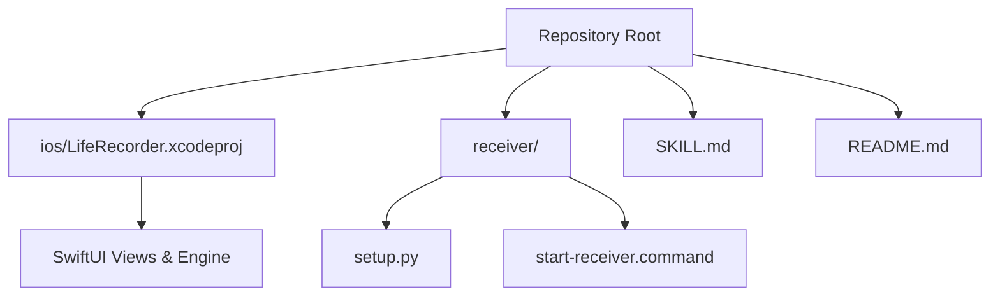

<!-- source: DeepWiki mcp.deepwiki.com · repo browser-use/life-recorder · page 1 Overview · fetched 2026-10-30 -->

# Overview

Relevant source files

The following files were used as context for generating this wiki page:

- [LICENSE](LICENSE)
- [README.md](README.md)
- [SKILL.md](SKILL.md)

Life Recorder is a native iOS application and a local Python-based Mac receiver service designed to capture audio on an iPhone in approximately one-minute chunks, securely upload them over a local HTTPS connection, transcribe them locally using `whisper.cpp`, and maintain a continuous Markdown transcript with hourly markers (`life.md`) [README.md:1-4](). The system requires no paid third-party transcription services or cloud backends, ensuring complete local data ownership [README.md:3]().

## System Architecture & End-to-End Pipeline

The end-to-end pipeline spans from microphone hardware on the iOS device to local disk storage and the Whisper transcription engine on macOS [README.md:3](). 

```mermaid
graph TD
    subgraph "Natural Language Space"
      Phone["iPhone Audio Capture"] -->|HTTPS Upload| Receiver["Mac HTTPS Receiver"]
      Receiver -->|Local Whisper Engine| Transcriber["Transcript Cleaning"]
      Transcriber -->|Markdown Export| Output["Continuous Life Transcript"]
    end

    subgraph "Code Entity Space"
      iOSApp["ios/LifeRecorder.xcodeproj"] -->|UploadManager| PythonServer["receiver/setup.py"]
      PythonServer -->|Inbox| WhisperProc["whisper-cli / ffmpeg"]
      WhisperProc -->|life.md| MarkdownFile["life.md"]
    end
```

Sources: [README.md:1-4](), [README.md:27-32]()

## Repository Layout & Component Overview

The codebase is structured into an iOS client project, a Mac receiver service, and documentation for setup automation [README.md:8]().

Sources: [README.md:8](), [README.md:27-31](), [SKILL.md:1-8]()

---

## 1.1. Getting Started & Setup

Setting up Life Recorder involves preparing macOS and iOS prerequisites, building and signing the Xcode project, and configuring the Python receiver agent on the Mac [README.md:5-34](). Prerequisites include Xcode, Python 3.10+, `ffmpeg`, `whisper.cpp` binaries (`whisper-cli`), and a downloaded GGML Whisper model [README.md:5-10](). 

The Mac receiver is initialized via a setup script that generates a self-signed TLS certificate, a SHA-256 certificate pin, a cryptographic bearer token, and an installer for a persistent background `launchd` agent [README.md:27-34](). The iOS application must then be built via Xcode or command-line `xcodebuild` and installed onto a developer-mode-enabled iPhone [README.md:12-23]().

For detailed instructions on environment setup, command-line build flags, pairing mechanics, and agent installation, see [Getting Started & Setup](#1.1).

Sources: [README.md:5-34](), [SKILL.md:26-34]()

---

## 1.2. Data Flow & End-to-End Pipeline

Audio recording is initiated by the user via the iOS interface, capturing audio buffers into local rotating AAC chunk files [README.md:3](). These chunks are organized into a local recording journal and queue store on the device [README.md:40](). 

The `UploadManager` component transmits pending audio chunks over an authenticated, pinned HTTPS connection to the Mac receiver inbox [README.md:34](), [README.md:40](). Once the Mac receiver acknowledges a durable receipt, the local chunk file is purged from the phone [README.md:3](). The receiver processes queued chunks through `ffmpeg` and local `whisper-cli`, strips repetitive hallucinations, and appends the resulting text into `life.md` [README.md:3](), [README.md:42]().

For a complete step-by-step trace of an audio chunk from microphone tap to local storage, network upload, transcription, and cleanup, see [Data Flow & End-to-End Pipeline](#1.2).

Sources: [README.md:3](), [README.md:34](), [README.md:40-42]()

---

## 1.3. Privacy, Secrets & Repo Hygiene

Life Recorder handles sensitive personal voice recordings and private transcripts. Consequently, strict security policies govern repository hygiene and runtime state isolation [README.md:33](). 

Artifacts such as runtime data directories, SQLite queues, raw audio segments, generated `life.md` transcripts, self-signed TLS certificates, bearer tokens, and pairing pages must **never** be committed to Git [README.md:33](), [README.md:50](). These operational boundaries, along with automated coding assistant constraints defined in `SKILL.md`, ensure that all private data remains exclusively on local machine storage [README.md:44-46](), [SKILL.md:24-33]().

For detailed guidelines on `.gitignore` enforcement, private directory layouts, keychain secret storage, and Codex operating constraints, see [Privacy, Secrets & Repo Hygiene](#1.3).

Sources: [README.md:33](), [README.md:44-50](), [SKILL.md:24-33]()

---

