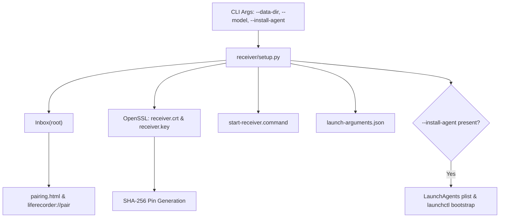
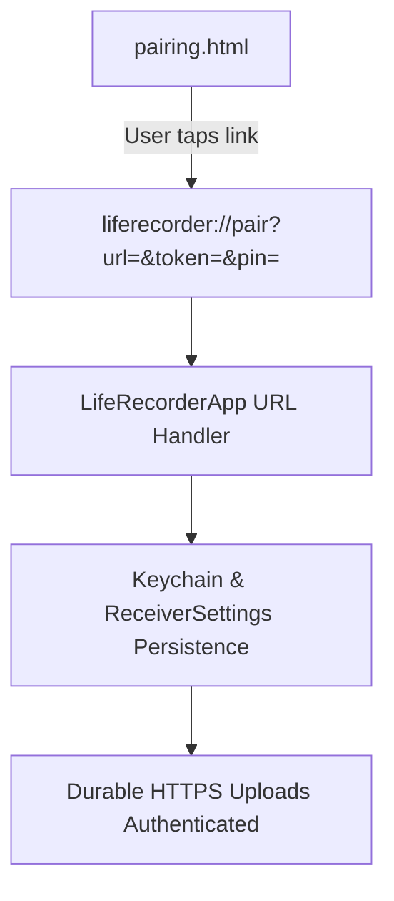

<!-- source: DeepWiki mcp.deepwiki.com · repo browser-use/life-recorder · page 1.1 Getting Started & Setup · fetched 2026-10-30 -->

# Getting Started & Setup

<details>
<summary>Relevant source files</summary>

The following files were used as context for generating this wiki page:

- [README.md](README.md)
- [SKILL.md](SKILL.md)
- [receiver/setup.py](receiver/setup.py)

</details>


## Purpose & Scope
This page details the initialization, prerequisites, and setup procedures required to run the Life Recorder system. It covers environment preparation on macOS and iOS, configuring the Mac receiver using `receiver/setup.py`, building and installing the native iOS target, and securely pairing the iPhone via custom deep links.

Sources: `README.md:1-11` [README.md:1-11](), `SKILL.md:6-35` [SKILL.md:6-35]()

---

## 1. System Prerequisites & Environment Dependencies

Before initializing the Life Recorder backend or client, ensure the host machine and mobile target meet all runtime dependencies.

| Dependency | Requirement / Path | Purpose |
| :--- | :--- | :--- |
| **macOS & Xcode** | Xcode with active developer tools, Apple Developer Account | Compiling and signing the iOS app target (`ios/LifeRecorder.xcodeproj`) [README.md:7-14]() |
| **iPhone** | iOS device with Developer Mode enabled | Capturing local audio chunks and running the native client [README.md:8]() |
| **Python** | Python 3.10+ | Executing the Mac receiver service and setup script [README.md:9]() |
| **FFmpeg** | `/opt/homebrew/bin/ffmpeg` | Audio decoding and stream manipulation within the Whisper transcription pipeline [README.md:9](), [receiver/setup.py:57]() |
| **Whisper.cpp** | `/opt/homebrew/bin/whisper-cli` | Local audio transcription CLI utility [README.md:9](), [receiver/setup.py:57]() |
| **GGML Model** | e.g., `ggml-small.bin` (passed via `--model`) [README.md:9](), [receiver/setup.py:21]() | Neural network weights for local speech-to-text processing |

Sources: `README.md:5-11` [README.md:5-11](), `SKILL.md:28` [SKILL.md:28](), `receiver/setup.py:19-57` [receiver/setup.py:19-57]()

---

## 2. Configuring the Mac Receiver (`receiver/setup.py`)

The receiver setup script initializes private credentials, generates a self-signed TLS certificate, computes its SHA-256 fingerprint (pin), writes a private pairing page, and optionally registers a background `launchd` agent.

### CLI Parameters & Execution Flow
The script parses arguments using `argparse` [receiver/setup.py:19-24](), enforces strict umask permissions (`0o077`) [receiver/setup.py:25](), initializes the `Inbox` data store [receiver/setup.py:27](), and queries the local hostname via `scutil` [receiver/setup.py:28]().

```sh
python3 receiver/setup.py \
  --data-dir /absolute/private/runtime \
  --model /absolute/path/to/ggml-small.bin \
  --install-agent
``` [README.md:27-31]()

### Diagram: Receiver Initialization & Artifact Generation

Sources: `receiver/setup.py:19-81` [receiver/setup.py:19-81](), `README.md:27-36` [README.md:27-36]()

---

## 3. iOS App Build & Installation

The native iOS client is structured as an Xcode project located in `ios/LifeRecorder.xcodeproj`. It requires manual configuration of your Apple developer team and device identifiers.

### Interactive Xcode Build
1. Open `ios/LifeRecorder.xcodeproj` in Xcode [README.md:14]().
2. Select the connected iPhone target device [README.md:14]().
3. Assign your Apple Development Team under the target signing settings [README.md:14]().
4. Build and run the app [README.md:14](). Approve microphone and local-network access when prompted [README.md:14]().

### Command-Line Build (`xcodebuild`)
For headless or automated builds via Codex/CoreDevice tooling, use `xcodebuild`:

```sh
DEVELOPER_DIR=/Applications/Xcode.app/Contents/Developer \
  xcodebuild -project ios/LifeRecorder.xcodeproj -scheme LifeRecorder \
  -destination 'id=YOUR_DEVICE_UDID' -allowProvisioningUpdates \
  DEVELOPMENT_TEAM=YOUR_TEAM_ID build
``` [README.md:18-23]()

Sources: `README.md:12-24` [README.md:12-24](), `SKILL.md:12-21` [SKILL.md:12-21]()

---

## 4. Pairing the iPhone

Once the Mac receiver is running and the iOS application is installed, the iPhone must be paired to exchange authenticated chunks securely over HTTPS.

### Pairing Artifacts & Deep Link Mechanics
`receiver/setup.py` constructs a custom URI scheme combining the reachable receiver URL, the random bearer token generated by `Inbox`, and the certificate pin [receiver/setup.py:39]():

```python
pair = "liferecorder://pair?" + urlencode({"url": url, "token": inbox.token, "pin": pin})
``` [receiver/setup.py:39]()

This URI is embedded inside `pairing.html` [receiver/setup.py:53](). Opening this page inside Safari on the target iPhone and tapping the pairing link invokes the custom URL handler within the iOS application.

### Diagram: iPhone Pairing & Credential Binding

Sources: `receiver/setup.py:39-53` [receiver/setup.py:39-53](), `README.md:34` [README.md:34]()

---

