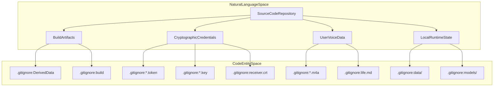
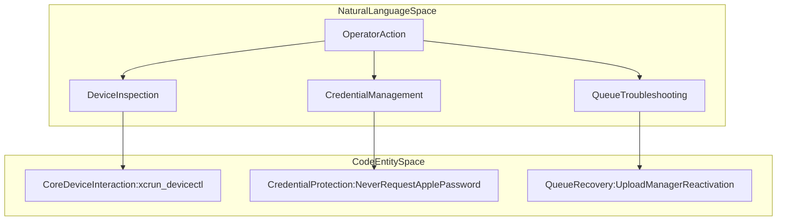

<!-- source: DeepWiki mcp.deepwiki.com · repo browser-use/life-recorder · page 1.3 Privacy, Secrets & Repo Hygiene · fetched 2026-10-30 -->

# Privacy, Secrets & Repo Hygiene

Relevant source files

The following files were used as context for generating this wiki page:

- [.gitignore](.gitignore)
- [SKILL.md](SKILL.md)

This page details the security boundaries, data segregation rules, repository hygiene protocols, and operational constraints for the Life Recorder system. It defines what categories of files must be strictly excluded from version control, how `.gitignore` enforces these rules, conventions for local private data directories, and operational constraints derived from `SKILL.md`.

---

## 1. Prohibited Repository Artifacts

Life Recorder processes and generates sensitive personal data, cryptographic credentials, and local audio assets. Under no circumstances may the following asset categories be committed to version control:

- **Authentication Tokens & Credentials**: Authorization tokens (`*.token`) used by the iOS client to communicate with the Mac receiver via bearer authentication.
- **Cryptographic Keys & Certificates**: Private keys (`*.key`), TLS certificates (`receiver.crt`), Privacy-Enhanced Mail files (`*.pem`), PKCS#12 bundles (`*.p12`), and provisioning profiles (`*.mobileprovision`) used for app signing and secure transport [/.gitignore:8-9,24-27]().
- **Raw Audio & Transcripts**: User voice captures (`*.m4a`, `*.wav`, `*.mp3`) recorded by the iOS client, along with generated continuous transcripts (`life.md`) and daily markdown logs (`days/`) [/.gitignore:18-20,30-31]().
- **Database & Runtime State**: SQLite database files (`*.sqlite*`, `*.db`), binary weights (`*.bin`), GGML models, and local execution caches [/.gitignore:4-6,21-23]().
- **Generated Setup Artifacts**: Auto-generated pairing web pages (`pairing.html`), launch arguments (`launch-arguments.json`), and startup commands (`start-receiver.command`) containing environment-specific paths or tokens [/.gitignore:10,28-29]().

Sources: [/.gitignore:4-33](), [SKILL.md:24-33]()

---

## 2. Git Ignore Rules & Repository Hygiene

The root `.gitignore` file enforces absolute segregation between the source codebase and local runtime state [/.gitignore:1-33](). 

*Figure 1: Mapping conceptual data categories to `.gitignore` exclusion rules.*

Sources: [/.gitignore:1-33]()

The ignore rules are grouped into logical security and hygiene classes:
- **Environment & OS Noise**: Excludes `.DS_Store`, Python bytecode caches (`__pycache__/`, `*.pyc`), and local environment variable files (`.env`, `.env.*`) [/.gitignore:1-3,32-33]().
- **Directories for State & Models**: Excludes local storage roots (`data/`, `runtime/`, `models/`, `work/`, `validation/`) [/.gitignore:4-6,13-14]().
- **Xcode IDE Artifacts**: Excludes user state (`*.xcuserstate`, `xcuserdata/`), build outputs (`DerivedData/`, `build/`), and test result bundles (`*.xcresult/`) [/.gitignore:7,11-12,15-16]().

Sources: [/.gitignore:1-33]()

---

## 3. Private Data-Dir Conventions

All operational runtime state must reside outside the Git work tree in designated private directories. When executing setup scripts or running the receiver service, operators must supply isolated paths (e.g., via `--data-dir`) [SKILL.md:8,30]().

- **`data/`**: Stores incoming chunk uploads, SQLite queues, and staging files prior to transcription.
- **`models/`**: Houses downloaded GGML Whisper binary weight files required by `whisper-cli`.
- **`runtime/`**: Contains execution sockets, PID files, and temporary buffers.

By keeping these directories decoupled from the repository clone, developers prevent accidental staging or committing of private audio and transcripts.

Sources: [SKILL.md:8,30-33]()

---

## 4. Agent Operating Constraints (`SKILL.md`)

Automated agents and human operators interacting with the codebase via `SKILL.md` must adhere to strict security boundaries and device access protocols [SKILL.md:1-35]().

*Figure 2: Mapping operator actions and security constraints to underlying execution boundaries.*

Sources: [SKILL.md:10-35]()

### Key Operating Rules:
- **Device Interaction**: Use Apple CoreDevice (`xcrun devicectl`) strictly for read-only device inspection, app installation, and bundle launching on connected physical devices [SKILL.md:12]().
- **Credential Protection**: Never request, read, log, or store user Apple IDs, passwords, iPhone passcodes, receiver tokens, private keys, or generated pairing pages inside repository tracking files [SKILL.md:24]().
- **Queue Recovery**: If processing stalls, inspect the receiver health endpoint and pending audio counts. Reactivate the iOS upload manager by opening the unlocked app; never force-quit background processes unnecessarily [SKILL.md:32-35]().

Sources: [SKILL.md:10-35]()

---

