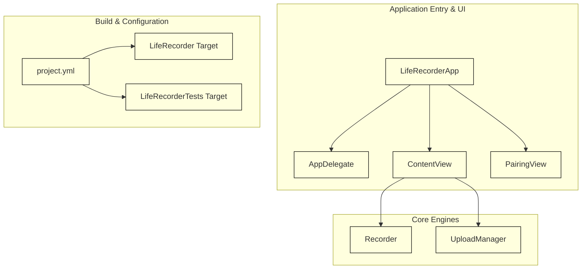
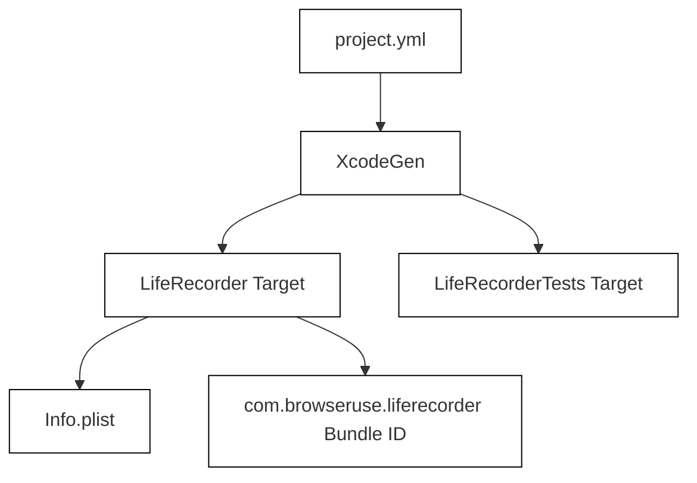

<!-- source: DeepWiki mcp.deepwiki.com · repo browser-use/life-recorder · page 2 iOS Client · fetched 2026-10-30 -->

# iOS Client

Relevant source files

The following files were used as context for generating this wiki page:

- [ios/LifeRecorder/LifeRecorderApp.swift](ios/LifeRecorder/LifeRecorderApp.swift)
- [ios/project.yml](ios/project.yml)

Purpose and Scope: This page provides a high-level overview of the SwiftUI iOS app targets, modules, and architecture for `LifeRecorder`. It outlines the core components—including the app lifecycle, audio capture engine, upload transport, and build configurations—while deferring deep technical details to the respective child pages.

Sources: `[ios/LifeRecorder/LifeRecorderApp.swift:1-51]`, `[ios/project.yml:1-31]()`

---

## Architecture Overview

The iOS client is built entirely in SwiftUI and structured around modular subsystems that run locally on device, recording audio into persistent chunks and securely transmitting them to the Mac receiver in the background.

*Figure 1: High-level architectural map of the iOS client modules and build layout.*

Sources: `[ios/LifeRecorder/LifeRecorderApp.swift:1-51]`, `[ios/project.yml:1-31]()`

---

## 2.1 App Lifecycle & UI

The entry point of the application is managed by `LifeRecorderApp`, which ties together the app lifecycle, scene phase activations, and deep link handling via `liferecorder://pair` URLs. The associated `AppDelegate` handles background URL session handoffs for `UploadManager`, ensuring uploads continue reliably when the app is suspended or terminated by the OS [ios/LifeRecorder/LifeRecorderApp.swift:4-12].

The main interface is powered by `ContentView`, which exposes recorder controls via an accessibility identifier (`recorderToggle`), displays pending clip counts, and surfaces warnings for interrupted or unrecovered clips. Configuration and Mac pairing are handled via `PairingView`, which persists connection parameters securely.

For full technical details on lifecycle events, background URL session delegates, deep link parsing, and scene phase transitions, see [App Lifecycle & UI](#2.1).

Sources: `[ios/LifeRecorder/LifeRecorderApp.swift:1-149]()`

---

## 2.2 Audio Capture Engine

The audio capture engine coordinates `AVAudioSession` and `AVAudioEngine` to record audio from the microphone, handling audio route changes, interruptions, and background execution states. It maintains status strings reflecting whether recording is active or idle [ios/LifeRecorder/LifeRecorderApp.swift:69-72].

Audio capture internals—such as PCM buffer copying, serial queue management, AAC/m4a encoding, 60-second file rotation, recording journals, disk-space guards, and file protection attributes—as well as on-device queue storage layout and recovery of interrupted files via `QueueStore`, are documented in detail in the child pages.

For full technical details, see [Audio Capture Engine](#2.2), [Chunk Writing & Rotation](#2.2.1), and [Queue Storage & Recovery](#2.2.2).

Sources: `[ios/LifeRecorder/LifeRecorderApp.swift:17-32]`

---

## 2.3 Upload Manager & Transport Security

`UploadManager` coordinates durable chunk uploads using background `URLSession` transfers. It attaches chunk metadata headers, handles automatic retries, manages durable receipt semantics, and enforces transport security through certificate pinning and bearer token authentication.

When connection parameters or pairing tokens are updated via deep links or `PairingView`, `UploadManager.configurationChanged()` is invoked to propagate the new target endpoints [ios/LifeRecorder/LifeRecorderApp.swift:41].

For full technical details on background task handoffs, chunk metadata headers, and authentication security, see [Upload Manager & Transport Security](#2.3).

Sources: `[ios/LifeRecorder/LifeRecorderApp.swift:8-10, 41]`

---

## 2.4 iOS Build Configuration

The iOS project structure is generated using XcodeGen via a central configuration file, `project.yml`. This configuration defines the base settings for iOS 17.0, target memberships for the main application (`LifeRecorder`) and test bundle (`LifeRecorderTests`), bundle identifiers (`com.browseruse.liferecorder`), and Info.plist capability associations [ios/project.yml:1-32].

*Figure 2: Build configuration flow from XcodeGen project specifications to generated targets.*

For full technical details on build settings, workspace generation, code signing styles, and required Info.plist capabilities, see [iOS Build Configuration](#2.4).

Sources: `[ios/project.yml:1-31]()`

---

