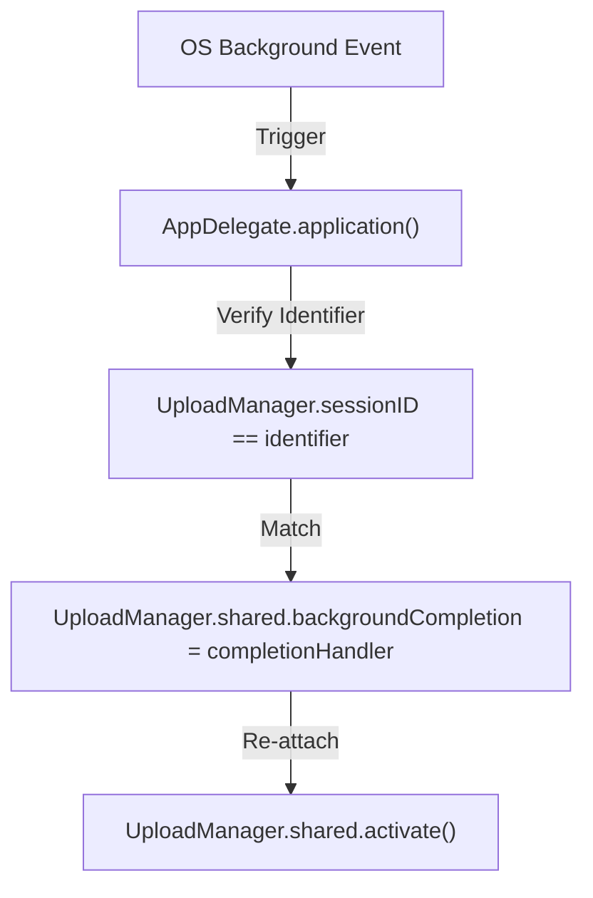
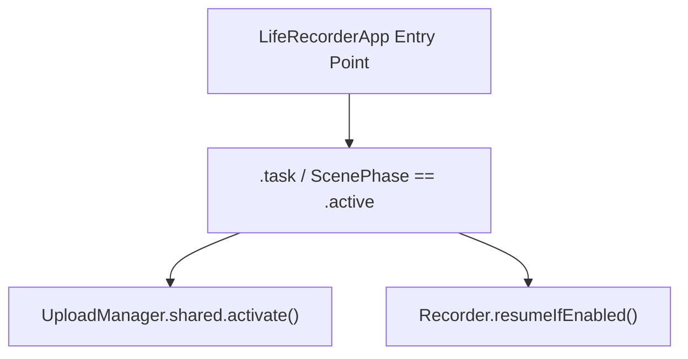
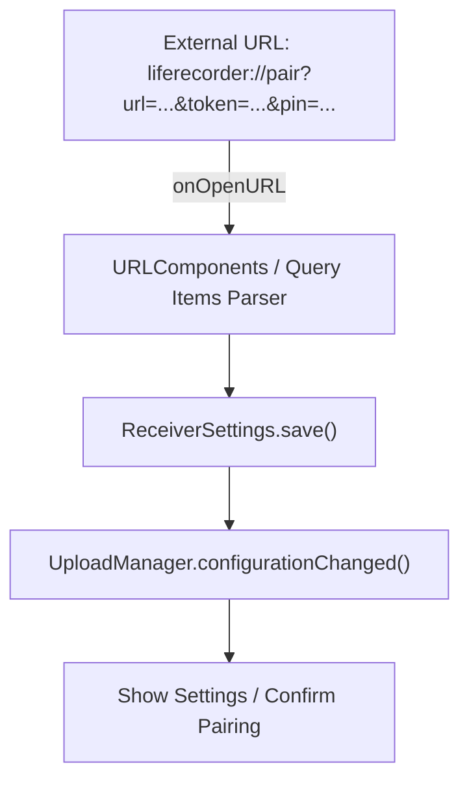
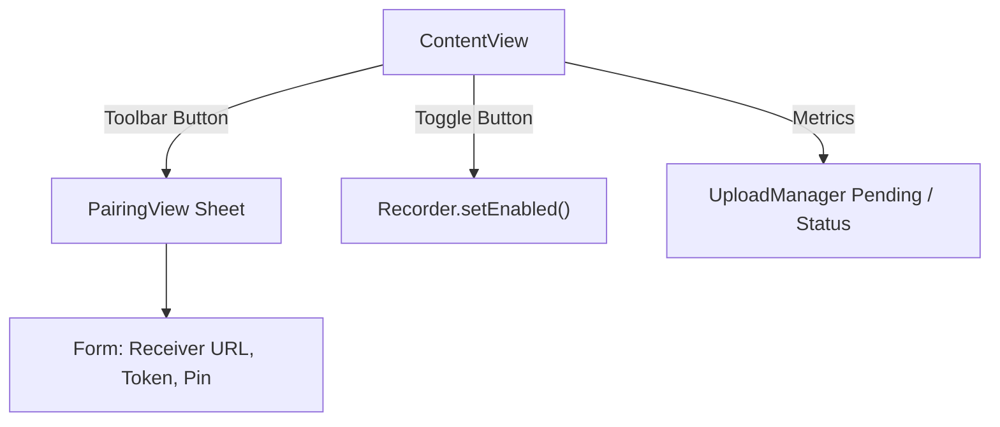

<!-- source: DeepWiki mcp.deepwiki.com · repo browser-use/life-recorder · page 2.1 App Lifecycle & UI · fetched 2026-10-30 -->

# App Lifecycle & UI

Relevant source files

The following files were used as context for generating this wiki page:

- [ios/LifeRecorder/Info.plist](ios/LifeRecorder/Info.plist)
- [ios/LifeRecorder/LifeRecorderApp.swift](ios/LifeRecorder/LifeRecorderApp.swift)

## Purpose and Scope
This section details the iOS client's entry point, app lifecycle orchestration, background transfer coordination via UIKit delegates, SwiftUI scene phase reactivity, deep-link handling for automated pairing (`liferecorder://pair`), and the root user interface components (`ContentView` and `PairingView`). 

---

## Background URL Session Handoff & `AppDelegate`

The iOS application uses a background `URLSession` inside `UploadManager` to ensure audio chunks continue uploading even when the application is suspended or terminated by the operating system. When background transfers complete or require attention while the app is suspended, iOS wakes up or launches the app in the background and calls the `UIApplicationDelegate` method `application(_:handleEventsForBackgroundURLSession:completionHandler:)`.

The custom `AppDelegate` class intercepts this call, verifies that the session identifier matches `UploadManager.sessionID`, stores the background `completionHandler`, and invokes `UploadManager.shared.activate()` to re-establish session tracking and drain pending completions.

### Implementation Details
- **`AppDelegate` Definition**: Defined in `ios/LifeRecorder/LifeRecorderApp.swift` [ios/LifeRecorder/LifeRecorderApp.swift:4-12](). Conforms to `UIApplicationDelegate`.
- **Background Identifier Check**: Compares the incoming session identifier against `UploadManager.sessionID` [ios/LifeRecorder/LifeRecorderApp.swift:8]().

Sources: `ios/LifeRecorder/LifeRecorderApp.swift:4-12`

---

## App Initialization & Scene Phase Reactivation

The SwiftUI entry point `LifeRecorderApp` manages global state objects for audio recording (`Recorder`) and upload synchronization (`UploadManager`) [ios/LifeRecorder/LifeRecorderApp.swift:14-18](). It binds to the environment's `scenePhase` to handle app foregrounding and reactivation [ios/LifeRecorder/LifeRecorderApp.swift:19-32]().

### Scene Phase Lifecycle Events
1. **Initial Task**: When the main window group loads, `.task` calls `uploads.activate()` and awaits `recorder.resumeIfEnabled()` [ios/LifeRecorder/LifeRecorderApp.swift:26]().
2. **Reactivation (`.active`)**: When the app transitions back to the `.active` scene phase, `.onChange(of: scenePhase)` triggers another activation cycle to resume any interrupted background uploads and ensure the recorder engine is running if enabled [ios/LifeRecorder/LifeRecorderApp.swift:27-32]().

Sources: `ios/LifeRecorder/LifeRecorderApp.swift:14-32`

---

## Deep Link Pairing (`liferecorder://pair`)

The app supports custom URL schemes declared in `Info.plist` [ios/LifeRecorder/Info.plist:17-17]() under the scheme `liferecorder` and host `pair`. This allows desktop setup scripts to configure the mobile app instantly by opening a custom link.

### Deep Link Processing Flow
1. **URL Interception**: The `.onOpenURL` modifier catches incoming URLs matching `liferecorder://pair` [ios/LifeRecorder/LifeRecorderApp.swift:33-35]().
2. **Query Parameter Extraction**: Parses query items (`url`, `token`, and `pin`) into a dictionary [ios/LifeRecorder/LifeRecorderApp.swift:36-37]().
3. **Credential Storage**: Invokes `ReceiverSettings.save(url:token:pin:)` to persist credentials securely [ios/LifeRecorder/LifeRecorderApp.swift:38-40]().
4. **State Refresh & Feedback**: Triggers `uploads.configurationChanged()` and displays the settings sheet or captures any validation errors in `pairingError` [ios/LifeRecorder/LifeRecorderApp.swift:41-48]().

Sources: `ios/LifeRecorder/LifeRecorderApp.swift:33-49`, `ios/LifeRecorder/Info.plist:17-17`

---

## Root User Interface: `ContentView` & `PairingView`

The primary user interface consists of a navigation stack (`ContentView`) displaying recorder status, audio capture toggles, pending upload metrics, incomplete clip recovery warnings, and a sheet presentation for configuration (`PairingView`) [ios/LifeRecorder/LifeRecorderApp.swift:53-130]().

### Key UI Components
- **`ContentView`**: Houses the main recording control button, accessibility identifier `"recorderToggle"` [ios/LifeRecorder/LifeRecorderApp.swift:82](), live waveform status icon, pending transfer counts, and a toolbar shortcut to open the pairing view [ios/LifeRecorder/LifeRecorderApp.swift:53-107]().
- **`PairingView`**: A form-based settings sheet allowing manual entry or review of the Mac receiver URL, pairing token, and certificate SHA-256 fingerprint [ios/LifeRecorder/LifeRecorderApp.swift:109-130]().

Sources: `ios/LifeRecorder/LifeRecorderApp.swift:53-130`

---

