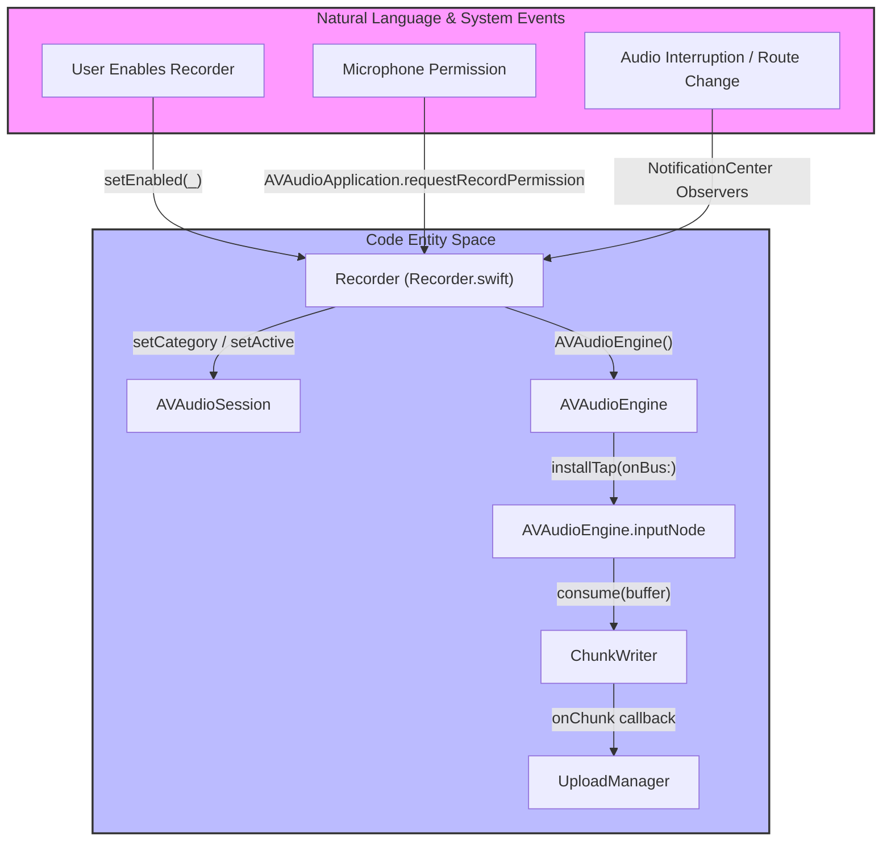

<!-- source: DeepWiki mcp.deepwiki.com · repo browser-use/life-recorder · page 2.2 Audio Capture Engine · fetched 2026-10-30 -->

# Audio Capture Engine

Relevant source files

The following files were used as context for generating this wiki page:

- [ios/LifeRecorder/Recorder.swift](ios/LifeRecorder/Recorder.swift)

## Purpose and Scope

The Audio Capture Engine manages the entire audio input lifecycle on the iOS client, acting as the bridge between raw microphone hardware and the local storage pipeline. Built around `AVAudioSession`, `AVAudioEngine`, and `ChunkWriter` [ios/LifeRecorder/Recorder.swift:1-147](), it handles user microphone permissions, background recording capabilities, audio route changes, interruptions (such as phone calls or Siri activations), and status reporting. 

As a parent page, this document provides a high-level architectural overview of the audio capture subsystem. Detailed mechanics regarding PCM buffering, AAC encoding, file rotation, and disk recovery are delegated to the child pages:
- [Chunk Writing & Rotation](#2.2.1)
- [Queue Storage & Recovery](#2.2.2)

---

## Architecture Overview

The capture engine coordinates several core components to ensure continuous, reliable recording even when the app is backgrounded or interrupted.

Sources: `ios/LifeRecorder/Recorder.swift:1-148`

---

## Session Setup, Permissions, and Background Recording

The `Recorder` class (`@MainActor final class Recorder: ObservableObject`) manages the recording state and underlying audio graph [ios/LifeRecorder/Recorder.swift:6-19](). When recording is enabled, `resumeIfEnabled(allowBackground:)` checks whether microphone permissions have been granted via `AVAudioApplication.shared.recordPermission` [ios/LifeRecorder/Recorder.swift:58-78](). If undetermined, it prompts the user while active [ios/LifeRecorder/Recorder.swift:70-73]().

Once authorized, the engine configures an `AVAudioSession` category of `.playAndRecord` with options `.mixWithOthers` and `.defaultToSpeaker`, activating it for background operation [ios/LifeRecorder/Recorder.swift:81-83](). It instantiates an `AVAudioEngine`, inspects the input node's hardware format, and installs a tap on bus 0 to feed audio buffers directly into a `ChunkWriter` instance [ios/LifeRecorder/Recorder.swift:84-104]().

Sources: `ios/LifeRecorder/Recorder.swift:58-111`

---

## Interruption and Route-Change Handling

To maintain robustness during system events, `Recorder` registers multiple `NotificationCenter` observers in its initializer [ios/LifeRecorder/Recorder.swift:20-46]():

1. **Interruption Notifications (`AVAudioSession.interruptionNotification`)**: Detects when phone calls, alarms, or other prioritized audio sessions take over. When an interruption begins (`.began`), capture is stopped cleanly without deactivating the session if unnecessary, and status updates are posted [ios/LifeRecorder/Recorder.swift:132-138](). When it ends, if `.shouldResume` is indicated, recording restarts automatically [ios/LifeRecorder/Recorder.swift:139-145]().
2. **Media Services Reset (`AVAudioSession.mediaServicesWereResetNotification`)**: Resets the entire audio server subgraph, triggering a full stop and automatic restart [ios/LifeRecorder/Recorder.swift:27-34]().
3. **Route Changes (`AVAudioSession.routeChangeNotification`)**: Listens for connected or disconnected hardware devices (such as Bluetooth headsets or headphones) and safely restarts capture to re-evaluate input formats [ios/LifeRecorder/Recorder.swift:35-45]().

Sources: `ios/LifeRecorder/Recorder.swift:20-46`, `ios/LifeRecorder/Recorder.swift:132-146`

---

## Status Strings and UI Integration

The `Recorder` publishes several state variables (`enabled`, `recording`, `status`, `incompleteClips`) observed by SwiftUI views [ios/LifeRecorder/Recorder.swift:7-11](). The `status` property provides real-time feedback strings to the user interface (e.g., `"Recorder is off"`, `"Ready to resume"`, `"Recording, including when locked"`, or error descriptions) [ios/LifeRecorder/Recorder.swift:10, 21, 106, 109]().

Sources: `ios/LifeRecorder/Recorder.swift:6-19`, `ios/LifeRecorder/Recorder.swift:48-56`

---

## Child Pages

For granular technical specifications, refer to the child pages:
- **[Chunk Writing & Rotation](#2.2.1)** — Details on PCM buffer copying, serial queue dispatch, AAC/m4a encoding via `AVAssetWriter`, 60-second file rotation, recording journals, and disk-space guards.
- **[Queue Storage & Recovery](#2.2.2)** — Details on `QueueStore` directory layouts, atomic journal sealing, recovery of interrupted files on startup, and keychain persistence for receiver settings.

---

