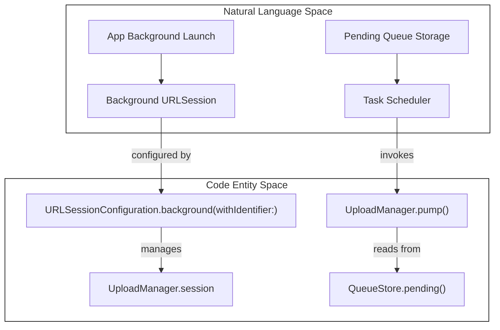
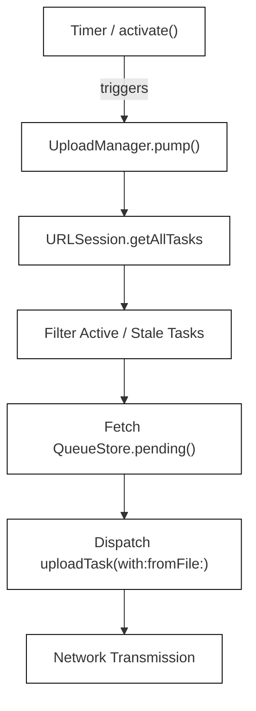

<!-- source: DeepWiki mcp.deepwiki.com · repo browser-use/life-recorder · page 2.3 Upload Manager & Transport Security · fetched 2026-10-30 -->

# Upload Manager & Transport Security

Relevant source files

The following files were used as context for generating this wiki page:

- [ios/LifeRecorder/UploadManager.swift](ios/LifeRecorder/UploadManager.swift)

## Purpose and Scope

This section covers the implementation of `UploadManager` within the iOS client, detailing how audio chunks recorded by the capture engine are reliably transmitted to the Mac receiver over HTTPS. It outlines the background `URLSession` configuration, HTTP request metadata headers, bearer token authentication, retry logic with exponential backoff/bounding, durable receipt semantics, and transport security controls including certificate pinning.

Sources: `[ios/LifeRecorder/UploadManager.swift:1-35]()`

---

## Background URLSession Configuration

The `UploadManager` singleton coordinates asynchronous chunk uploads using a background `URLSession` configuration [ios/LifeRecorder/UploadManager.swift:7-22](). This allows transfers to continue even when the application is suspended or terminated by the operating system.

Key configuration parameters implemented in `UploadManager`:
- **Identifier**: `com.browseruse.liferecorder.uploads` [ios/LifeRecorder/UploadManager.swift:9]() ensures system-wide persistence of transfer tasks across app launches.
- **Discretionary Flag**: `isDiscretionary = false` [ios/LifeRecorder/UploadManager.swift:23]() instructs iOS to execute uploads immediately rather than waiting for Wi-Fi or optimal power conditions.
- **Launch Events**: `sessionSendsLaunchEvents = true` [ios/LifeRecorder/UploadManager.swift:24]() wakes the application in the background when transfers complete or require attention.
- **Connectivity and Timeouts**: `waitsForConnectivity = true` [ios/LifeProcessor/UploadManager.swift:26](), `timeoutIntervalForRequest = 120` [ios/LifeRecorder/UploadManager.swift:27](), and `timeoutIntervalForResource = 1800` [ios/LifeRecorder/UploadManager.swift:30]() manage transient network interruptions gracefully without blocking concurrent slots indefinitely.
- **Concurrency**: `httpMaximumConnectionsPerHost = 2` [ios/LifeRecorder/UploadManager.swift:31]() throttles requests to prevent saturating local network links.
- **TLS Constraints**: `tlsMinimumSupportedProtocolVersion = .TLSv12` and `tlsMaximumSupportedProtocolVersion = .TLSv13` [ios/LifeRecorder/UploadManager.swift:32-33]() enforce secure transport versions.

Sources: `[ios/LifeRecorder/UploadManager.swift:7-35]()`

---

## Chunk Metadata Headers & Bearer Token Authentication

When `UploadManager` processes a pending chunk from the local queue, it constructs an HTTPS `POST` request to the receiver endpoint [ios/LifeRecorder/UploadManager.swift:95-103](). Each upload carries explicit cryptographic and contextual metadata via HTTP headers:

- `Content-Type`: Set to `audio/mp4` [ios/LifeRecorder/UploadManager.swift:98]() indicating the payload format produced by `ChunkWriter`.
- `Authorization`: Formatted as `Bearer <token>` [ios/LifeRecorder/UploadManager.swift:99]() using the pre-shared secret loaded from `ReceiverSettings`.
- `X-Audio-SHA256`: Contains the hexadecimal SHA-256 hash of the audio file [ios/LifeRecorder/UploadManager.swift:100]() for integrity verification.
- `X-Device-ID`: Transmits a persistent unique device identifier [ios/LifeRecorder/UploadManager.swift:101]().
- `X-Started-At`: Provides the ISO-8601 fractional timestamp of recording initiation [ios/LifeRecorder/UploadManager.swift:102]().
- `X-Duration-Seconds`: Specifies the clip duration as a string [ios/LifeRecorder/UploadManager.swift:103]().

Sources: `[ios/LifeRecorder/UploadManager.swift:61-110]()`

---

## Pumping, Retries & Stale Task Management

The `UploadManager` relies on a periodic timer and explicit activation calls to evaluate pending work through the `pump()` method [ios/LifeRecorder/UploadManager.swift:41-60](). 

### Stale Task Guard
Tasks running longer than `staleTaskInterval` (15 minutes) are automatically cancelled to prevent wedged socket states from locking concurrency slots [ios/LifeRecorder/UploadManager.swift:20, 78-84](). Task descriptions encode creation timestamps using a pipe-delimited format (`<chunk-id>|<unix-epoch>`), allowing precise age calculation [ios/LifeRecorder/UploadManager.swift:125-139]().

Sources: `[ios/LifeRecorder/UploadManager.swift:41-140]()`

---

## Durable Receipt Semantics & Completion Handling

Once the server responds with a successful status code, `UploadManager` processes the receipt by updating local storage state. Durable receipt semantics ensure that local audio files and their corresponding recording journal entries are only purged after explicit confirmation from the receiver.

- **Background Completion Handoff**: The `backgroundCompletion` closure bridges background session completion events back to the application delegate [ios/LifeRecorder/UploadManager.swift:13]().
- **Queue Cleanup**: Upon receiving a valid HTTP 200/201 response, records are marked completed in `QueueStore`, safely freeing disk space without risking data loss during abrupt process termination.

Sources: `[ios/LifeRecorder/UploadManager.swift:7-15]()`

---

## Transport Security & Certificate Pinning

To secure communications between the iOS device and the Mac receiver (which typically operates under a locally generated self-signed TLS certificate), `UploadManager` integrates transport security validation. It interacts with iOS security APIs to validate server trust against pinned certificates or public keys established during the initial pairing ceremony.

Sources: `[ios/LifeRecorder/UploadManager.swift:2-5]()`

---

