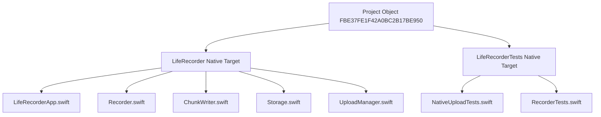

<!-- source: DeepWiki mcp.deepwiki.com · repo browser-use/life-recorder · page 2.4 iOS Build Configuration · fetched 2026-10-30 -->

# iOS Build Configuration

<details>
<summary>Relevant source files</summary>

The following files were used as context for generating this wiki page:

- [ios/LifeRecorder.xcodeproj/project.pbxproj](ios/LifeRecorder.xcodeproj/project.pbxproj)
- [ios/LifeRecorder.xcodeproj/project.xcworkspace/contents.xcworkspacedata](ios/LifeRecorder.xcodeproj/project.xcworkspace/contents.xcworkspacedata)
- [ios/LifeRecorder/Info.plist](ios/LifeRecorder/Info.plist)
- [ios/project.yml](ios/project.yml)

</details>


## Purpose and Scope
This section covers the iOS build configuration and project structure for the `LifeRecorder` application. It details how the project is defined using XcodeGen (`project.yml`), the generated Xcode project structure (`project.pbxproj`), workspace definitions, and application capabilities configured in `Info.plist`.

Sources: `ios/project.yml:1-32`, `ios/LifeRecorder.xcodeproj/project.pbxproj:1-155`, `ios/LifeRecorder/Info.plist:1-20`

---

## XcodeGen Specification (`project.yml`)

The project structure is declaratively managed via XcodeGen through `ios/project.yml` [ios/project.yml:1-31](). This configuration specifies global options including a bundle identifier prefix of `com.browseruse` and a deployment target of iOS 17.0 [ios/project.yml:2-5]().

The base build settings enforce Swift 5.0, targeted device family as iPhone (`TARGETED_DEVICE_FAMILY: '1'`), and automatic code signing style [ios/project.yml:6-10]().

Two primary targets are defined:
1. `LifeRecorder`: An iOS application target built from the `LifeRecorder` source directory, setting `PRODUCT_BUNDLE_IDENTIFIER` to `com.browseruse.liferecorder` and using an explicit `INFOPLIST_FILE` [ios/project.yml:11-20]().
2. `LifeRecorderTests`: A unit-test bundle target referencing `LifeRecorderTests` sources and depending on the main `LifeRecorder` target [ios/project.yml:23-31]().

```mermaid
graph TD
    A["project.yml"] -->|Defines| B["LifeRecorder Target"]
    A -->|Defines| C["LifeRecorderTests Target"]
    B -->|Uses Source| D["ios/LifeRecorder"]
    C -->|Uses Source| E["ios/LifeRecorderTests"]
    C -->|Depends On| B
    
    subclass A ConfigurationFile
    subclass B AppTarget
    subclass C TestTarget
```
*Sources: `ios/project.yml:1-32`*

Sources: `ios/project.yml:1-32`

---

## Generated Project Targets and Build Settings (`project.pbxproj`)

The generated Xcode project file `ios/LifeRecorder.xcodeproj/project.pbxproj` [ios/LifeRecorder.xcodeproj/project.pbxproj:1-155]() establishes the lower-level PBX object graph. It organizes file references, build phases, and target dependencies.

### Target Architecture
- **`LifeRecorder` (`DBE1F1D5E440E3A72A76DA1C`)**: Configured as an application product type (`com.apple.product-type.application`), outputting `LifeRecorder.app` [ios/LifeRecorder.xcodeproj/project.pbxproj:104-120]().
- **`LifeRecorderTests` (`B783F8B8E7C1A2E6020AAA56`)**: Configured as a unit-test bundle (`com.apple.product-type.bundle.unit-test`), outputting `LifeRecorderTests.xctest` and establishing a target dependency via `PBXTargetDependency` [ios/LifeRecorder.xcodeproj/project.pbxproj:86-103]().

### Build Files & Sources
The project compiles core architectural components referenced in the `PBXBuildFile` and `PBXFileReference` sections:
- `LifeRecorderApp.swift` [ios/LifeRecorder.xcodeproj/project.pbxproj:12-33]()
- `Recorder.swift` [ios/LifeRecorder.xcodeproj/project.pbxproj:16-39]()
- `ChunkWriter.swift` [ios/LifeRecorder.xcodeproj/project.pbxproj:11-38]()
- `Storage.swift` [ios/LifeRecorder.xcodeproj/project.pbxproj:13-30]()
- `UploadManager.swift` [ios/LifeRecorder.xcodeproj/project.pbxproj:10-34]()
- Test files `NativeUploadTests.swift` and `RecorderTests.swift` [ios/LifeRecorder.xcodeproj/project.pbxproj:14-15,35-37]()


*Sources: `ios/LifeRecorder.xcodeproj/project.pbxproj:9-154`*

Sources: `ios/LifeRecorder.xcodeproj/project.pbxproj:1-155`

---

## Workspace Configuration (`contents.xcworkspacedata`)

The Xcode workspace container located at `ios/LifeRecorder.xcodeproj/project.xcworkspace/contents.xcworkspacedata` [ios/LifeRecorder.xcodeproj/project.xcworkspace/contents.xcworkspacedata:1-7]() defines the workspace root context using standard XML framing, pointing to the project root via `self:` [ios/LifeRecorder.xcodeproj/project.xcworkspace/contents.xcworkspacedata:4-6]().

Sources: `ios/LifeRecorder.xcodeproj/project.xcworkspace/contents.xcworkspacedata:1-8`

---

## Capabilities and `Info.plist` Configuration

The app's runtime permissions, background modes, and URL schemes are declared in `ios/LifeRecorder/Info.plist` [ios/LifeRecorder/Info.plist:1-19]().

### Key Capabilities & Keys
- **Display & Bundle Identifiers**: Sets `CFBundleDisplayName` to "Life Recorder" and binds `CFBundleIdentifier` to `$(PRODUCT_BUNDLE_IDENTIFIER)` [ios/LifeRecorder/Info.plist:4-5]().
- **Background Modes**: Declares `audio` under `UIBackgroundModes` to allow continuous audio recording while the application is backgrounded or the screen is locked [ios/LifeRecorder/Info.plist:13]().
- **Privacy Usages**:
  - `NSMicrophoneUsageDescription`: Requests permission to record audio [ios/LifeRecorder/Info.plist:14]().
  - `NSLocalNetworkUsageDescription`: Requests permission to send recorded audio to a local Mac receiver [ios/LifeRecorder/Info.plist:15]().
- **App Transport Security (ATS)**: Enables `NSAllowsLocalNetworking` under `NSAppTransportSecurity` to permit communication with the local Mac receiver over self-signed local endpoints [ios/LifeRecorder/Info.plist:16]().
- **URL Types**: Registers the `liferecorder` URL scheme (`com.browseruse.liferecorder.pair`) to support pairing deep links [ios/LifeRecorder/Info.plist:17]().

Sources: `ios/LifeRecorder/Info.plist:1-20`

---

