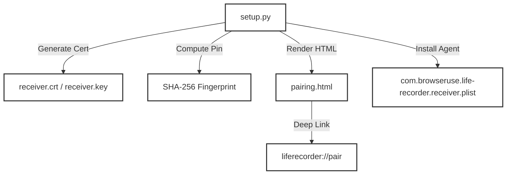

<!-- source: DeepWiki mcp.deepwiki.com · repo browser-use/life-recorder · page 3 Mac Receiver · fetched 2026-10-30 -->

# Mac Receiver

<details>
<summary>Relevant source files</summary>

The following files were used as context for generating this wiki page:

- [receiver/receiver.py](receiver/receiver.py)
- [receiver/setup.py](receiver/setup.py)

</details>


The Mac receiver service is a Python standard library-only application responsible for receiving encrypted audio chunks from iOS clients via an HTTPS inbox, queueing and tracking them in a local SQLite database, transcribing them asynchronously via `whisper-cli`, and compiling the results into human-readable Markdown exports (`life.md` and `days/*.md`).

Sources: `[receiver/receiver.py:1-25]()`, `[receiver/setup.py:1-25]()`

---

## 3.1 HTTP API & Authentication

The receiver exposes an HTTP server using Python's `ThreadingHTTPServer` and `BaseHTTPRequestHandler`. It listens for health check requests (`/health`) and authenticated chunk uploads (`POST /v1/chunks/<uuid>`). Authentication relies on a constant-time comparison against a local bearer token stored in `receiver.token`. Upload sizes are strictly bounded, and the server runs exclusively over TLS with pinned certificates.

For details, see [HTTP API & Authentication](#3.1).

```mermaid
graph TD
    Client[""iOS Client""] -->|"POST /v1/chunks/<uuid>"| Handler[""Handler (BaseHTTPRequestHandler)""]
    Handler -->|"Validate Token & Size"| Server[""ThreadingHTTPServer""]
    Server -->|"Accept Chunk"| Inbox[""Inbox Class""]

    classDef default fill:none,stroke:#333,stroke-width:2px;
```
Sources: `[receiver/receiver.py:25-26]`, `[receiver/receiver.py:155-179]()`

---

## 3.2 Inbox Storage & SQLite Schema

The `Inbox` class manages the local storage directory layout (`audio/`, `days/`, `inbox.sqlite3`, and `receiver.token`). It guarantees durability using atomic file writes with `os.fsync`, directory synchronization (`sync_dir`), and Write-Ahead Logging (`WAL`) mode in SQLite. Chunks are deduplicated by checking chunk identifiers against their cryptographic SHA-256 hashes. Completed audio files are purged only after transcripts and Markdown exports are safely committed.

For details, see [Inbox Storage & SQLite Schema](#3.2).

```mermaid
graph TD
    InboxInit[""Inbox.__init__""] -->|"WAL Mode"| SQLite[""inbox.sqlite3 (chunks Table)""]
    InboxInit -->|"Create Token"| Token[""receiver.token""]
    Accept[""Inbox.accept""] -->|"Atomic Write"| AudioDir[""audio/*.m4a""]
    Accept -->|"Insert Metadata"| SQLite
    Complete[""Inbox.complete""] -->|"Update Status"| SQLite
    Complete -->|"Cleanup"| AudioDir

    classDef default fill:none,stroke:#333,stroke-width:2px;
```
Sources: `[receiver/receiver.py:28-121]()`

---

## 3.3 Transcription Worker & Markdown Export

Background worker threads invoke `whisper-cli` and `ffmpeg` to process audio files from the inbox queue. Transcripts are cleaned, filtered for known hallucinations, and organized into chronological hourly capture markers (`### HH:MM UTC`). The export engine updates daily Markdown files (`days/*.md`) and safely rebuilds `life.md` using symlink-safe atomic writes.

For details, see [Transcription Worker & Markdown Export](#3.3).

```mermaid
graph TD
    Worker[""Transcription Worker""] -->|"Run whisper-cli & ffmpeg"| CLI[""External CLI Tools""]
    CLI -->|"Raw Transcript"| Clean[""clean_transcript()""]
    Clean -->|"Group by Hour"| Export[""Inbox.export()""]
    Export -->|"Atomic Write"| DaysMarkdown[""days/*.md""]
    Export -->|"Atomic Write"| LifeMarkdown[""life.md""]

    classDef default fill:none,stroke:#333,stroke-width:2px;
```
Sources: `[receiver/receiver.py:107-148]()`

---

## 3.4 Setup, Pairing & launchd Agent

The `setup.py` script provisions the receiver environment. It generates a self-signed RSA-3072 TLS certificate (`receiver.crt` / `receiver.key`), calculates its SHA-256 pin for certificate pinning, and renders a private `pairing.html` page embedded with a `liferecorder://pair` deep link URL. Additionally, it writes start scripts (`start-receiver.command`, `launch-arguments.json`) and registers a persistent macOS `launchd` LaunchAgent plist for automated service management.

For details, see [Setup, Pairing & launchd Agent](#3.4).


Sources: `[receiver/setup.py:1-85]()`

---

