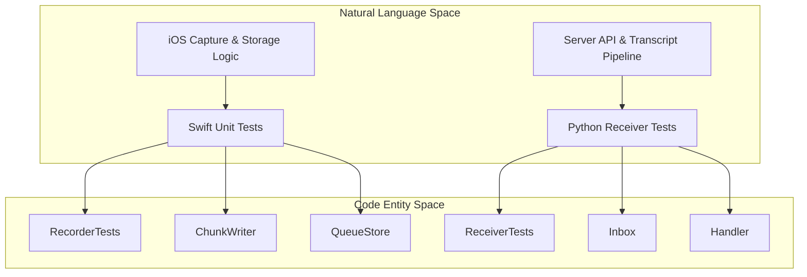
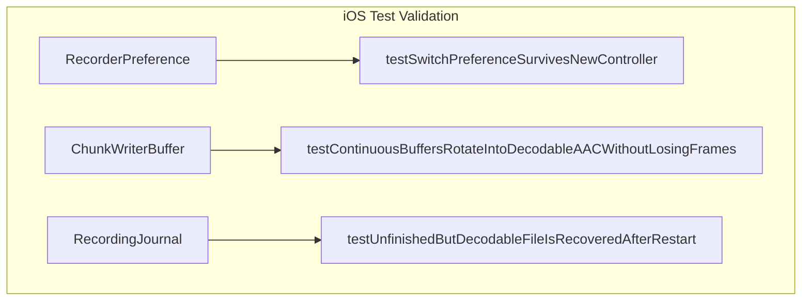
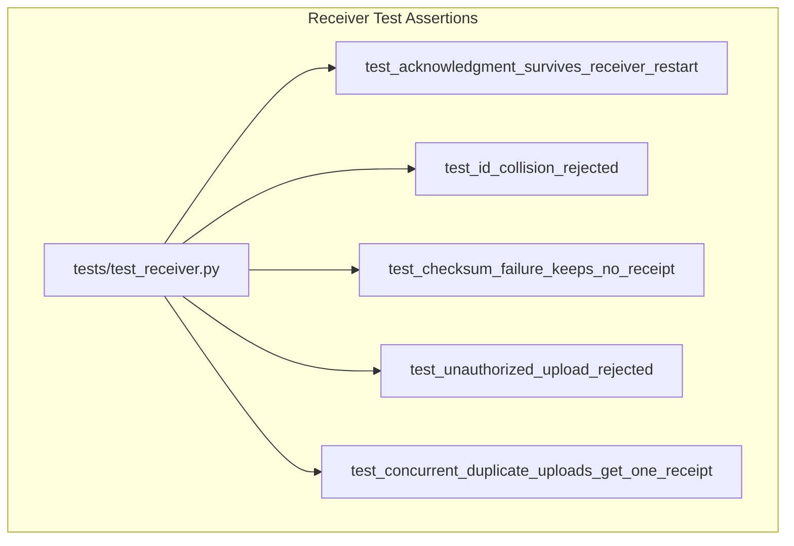

<!-- source: DeepWiki mcp.deepwiki.com · repo browser-use/life-recorder · page 4 Testing · fetched 2026-10-30 -->

# Testing

Relevant source files

The following files were used as context for generating this wiki page:

- [ios/LifeRecorderTests/RecorderTests.swift](ios/LifeRecorderTests/RecorderTests.swift)
- [tests/test_receiver.py](tests/test_receiver.py)

## Purpose and Scope

This page provides an overview of the two primary test suites in the `life-recorder` codebase: the Swift unit tests verifying iOS capture logic, and the Python receiver tests asserting end-to-end server behavior. 

As a parent page, this document outlines the high-level responsibilities of each test suite and how they fit into the verification lifecycle. For deep technical details, configuration instructions, and execution commands, refer to the respective child pages:
- For iOS-specific testing, see [iOS Unit Tests](#4.1).
- For server and audio pipeline checks, see [Receiver Tests & Audio Smoke Test](#4.2).

Sources: `ios/LifeRecorderTests/RecorderTests.swift:1-74` [ios/LifeRecorderTests/RecorderTests.swift:1-74](), `tests/test_receiver.py:1-132` [tests/test_receiver.py:1-131]()

---

## 4.1 iOS Unit Tests

The Swift test suite validates critical client-side operations including audio buffer rotation, persistence preferences, and the recovery of interrupted recording sessions. These tests execute within the `LifeRecorderTests` target using `XCTest`.

Key test cases verify that preference states survive controller re-instantiation, continuous audio frames correctly rotate into decodable AAC files without dropping frames [ios/LifeRecorderTests/RecorderTests.swift:23-50](), and incomplete journals are successfully recovered after an unexpected app restart [ios/LifeRecorderTests/RecorderTests.swift:52-73]().

For detailed coverage on test host configurations, native upload testing, and running suites via `xcodebuild`, see [iOS Unit Tests](#4.1).

Sources: `ios/LifeRecorderTests/RecorderTests.swift:1-74` [ios/LifeRecorderTests/RecorderTests.swift:1-74]()

---

## 4.2 Receiver Tests & Audio Smoke Test

The Python test suite (`tests/test_receiver.py`) provides end-to-end assertions for the Mac receiver service using standard library tools (`unittest`, `http.client`, `threading`) [tests/test_receiver.py:1-131](). It spins up an ephemeral HTTP server backed by a temporary `Inbox` directory to test authentication, idempotency, checksum validation, concurrency, and chronological Markdown exports.

Additionally, an audio smoke test script verifies the transcription pipeline locally. For comprehensive endpoint test assertions, failure mode handling, and audio pipeline verification steps, see [Receiver Tests & Audio Smoke Test](#4.2).

Sources: `tests/test_receiver.py:1-132` [tests/test_receiver.py:1-131]()

---

