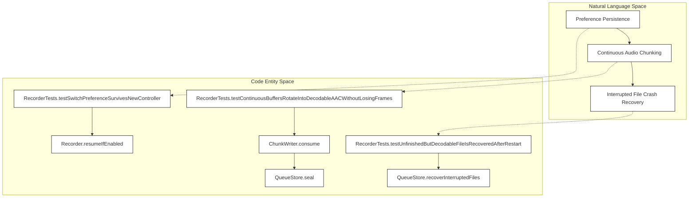
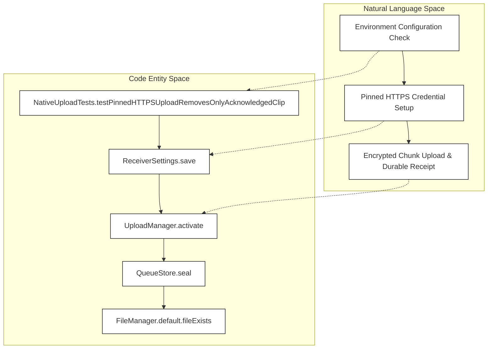

<!-- source: DeepWiki mcp.deepwiki.com · repo browser-use/life-recorder · page 4.1 iOS Unit Tests · fetched 2026-10-30 -->

# iOS Unit Tests

<details>
<summary>Relevant source files</summary>

The following files were used as context for generating this wiki page:

- [ios/LifeRecorderTests/NativeUploadTests.swift](ios/LifeRecorderTests/NativeUploadTests.swift)
- [ios/LifeRecorderTests/RecorderTests.swift](ios/LifeRecorderTests/RecorderTests.swift)

</details>


This page details the implementation, coverage, test host configuration, and execution procedures for the iOS unit and integration test suite contained within the `LifeRecorderTests` target. The suite covers persistent recorder preference logic, raw audio buffer processing, chunk rotation, crash recovery, and pinned HTTPS background upload workflows.

Sources: [ios/LifeRecorderTests/RecorderTests.swift](), [ios/LifeRecorderTests/NativeUploadTests.swift]()

---

## 1. Test Suite Architecture & Coverage

The `LifeRecorderTests` suite consists of two primary test classes designed to run on iOS Simulator targets: `RecorderTests` and `NativeUploadTests`. 

| Test Class | Target Component | Description & Coverage |
| :--- | :--- | :--- |
| `RecorderTests` | `Recorder`, `ChunkWriter`, `QueueStore` | Validates user preference survival across controller instances, verifies 60-second AAC chunk rotation without frame loss, and checks crash recovery of interrupted `.m4a` recordings via `.recording.json` journals. |
| `NativeUploadTests` | `UploadManager`, `ReceiverSettings`, `QueueStore` | Integration test validating encrypted loopback uploads, certificate pinning (`certificateSHA256`), bearer token authentication, and durable receipt semantics (deleting local audio only after explicit confirmation). |

Sources: [ios/LifeRecorderTests/RecorderTests.swift:1-74](), [ios/LifeRecorderTests/NativeUploadTests.swift:1-46]()

---

## 2. `RecorderTests` Implementation & Data Flow

`RecorderTests` exercises the local audio recording subsystem without requiring physical microphone hardware by feeding synthetic PCM buffers directly into chunk rotation and queue storage mechanisms.


*Figure 1: Mapping natural language testing concepts to code entities in `RecorderTests`.*

Sources: [ios/LifeRecorderTests/RecorderTests.swift:5-74]()

### 2.1 Preference Persistence (`testSwitchPreferenceSurvivesNewController`)
This test verifies that `Recorder` respects `UserDefaults` settings (`recorderEnabled`) when instantiated. It asserts that constructing a new `Recorder` instance does not trigger microphone access or start recording in background initialization paths [ios/LifeRecorderTests/RecorderTests.swift:7-21]().

Sources: [ios/LifeRecorderTests/RecorderTests.swift:7-21]()

### 2.2 Buffer Rotation & Frame Integrity (`testContinuousBuffersRotateIntoDecodableAACWithoutLosingFrames`)
This test instantiates a `ChunkWriter` with synthetic 16kHz mono sine-wave PCM buffers. It simulates 122 seconds of continuous audio streams, asserting that:
* Buffers rotate correctly into discrete AAC-encoded files in the local storage directory [ios/LifeRecorderTests/RecorderTests.swift:30-39]().
* Total duration matches expected output within precision limits [ios/LifeRecorderTests/RecorderTests.swift:40]() using `QueueStore.checksum()`.
* Decoded audio frames via `AVAudioFile` match expected sample counts across chunk boundaries [ios/LifeRecorderTests/RecorderTests.swift:41-49]().

Sources: [ios/LifeRecorderTests/RecorderTests.swift:23-50]()

### 2.3 Crash Recovery (`testUnfinishedButDecodableFileIsRecoveredAfterRestart`)
This test simulates an unexpected process termination during recording. It writes an unsealed `.m4a` file alongside a corresponding `.recording.json` journal managed by `QueueStore`. Calling `QueueStore.recoverInterruptedFiles()` successfully seals the abandoned stream into a valid pending queue item and purges the stale journal [ios/LifeRecorderTests/RecorderTests.swift:52-73]().

Sources: [ios/LifeRecorderTests/RecorderTests.swift:52-73]()

---

## 3. `NativeUploadTests` & Integration Environment

`NativeUploadTests` evaluates the background upload pipeline against an isolated loopback test receiver. Because it interacts with network sockets and cryptographic certificate pinning, it requires explicit environment variables to execute.


*Figure 2: Mapping network upload testing concepts to code entities in `NativeUploadTests`.*

Sources: [ios/LifeRecorderTests/NativeUploadTests.swift:5-46]()

### 3.1 Environment Guard & Skipping Logic
The integration test checks for the presence of three environment variables (`LIFE_TEST_URL`, `LIFE_TEST_TOKEN`, `LIFE_TEST_PIN`). If any are missing, or if `LIFE_TEST_URL` does not point strictly to `https://127.0.0.1:8766`, the test skips execution via `XCTSkip` to prevent accidental contamination of user-configured production credentials [ios/LifeRecorderTests/NativeUploadTests.swift:8-14]().

Sources: [ios/LifeRecorderTests/NativeUploadTests.swift:8-14]()

### 3.2 Pinned Upload & Durable Receipt Semantics
When active, the test:
1. Backs up prior `UserDefaults` and keychain token settings, restoring them via a `defer` block [ios/LifeRecorderTests/NativeUploadTests.swift:15-22]().
2. Injects test credentials using `ReceiverSettings.save(url:token:pin:)` [ios/LifeRecorderTests/NativeUploadTests.swift:23]().
3. Seals a synthetic audio chunk into `QueueStore` [ios/LifeRecorderTests/NativeUploadTests.swift:24-35]().
4. Triggers `UploadManager.shared` activation [ios/LifeRecorderTests/NativeUploadTests.swift:36-38]().
5. Polls for up to 45 seconds awaiting successful server acknowledgment and local file removal (`manifestURL` and `audioURL`), asserting that local audio is purged *only* after a durable receipt is received [ios/LifeRecorderTests/NativeUploadTests.swift:39-45]().

Sources: [ios/LifeRecorderTests/NativeUploadTests.swift:15-46]()

---

## 4. Running Tests via `xcodebuild`

Unit tests can be invoked from the command line using `xcodebuild`. 

### Standard Unit Tests (`RecorderTests`)
To execute local unit tests that do not require external network dependencies:
```bash
xcodebuild test \
  -workspace ios/LifeRecorder.xcworkspace \
  -scheme LifeRecorder \
  -destination 'platform=iOS Simulator,name=iPhone 16'
```
Sources: [ios/LifeRecorderTests/RecorderTests.swift:1-74]()

### Integration Tests (`NativeUploadTests`)
To execute the isolated HTTPS integration tests, spin up the test receiver and pass the required environment variables:
```bash
LIFE_TEST_URL="https://127.0.0.1:8766" \
LIFE_TEST_TOKEN="test-token" \
LIFE_TEST_PIN="test-sha256-pin" \
xcodebuild test \
  -workspace ios/LifeRecorder.xcworkspace \
  -scheme LifeRecorder \
  -destination 'platform=iOS Simulator,name=iPhone 16'
```
Sources: [ios/LifeRecorderTests/NativeUploadTests.swift:8-12]()

---

