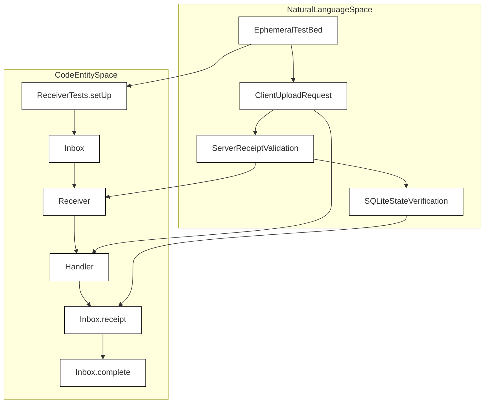
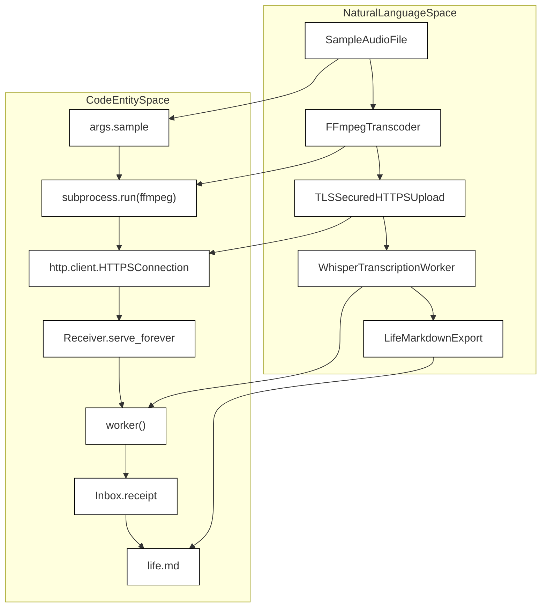

<!-- source: DeepWiki mcp.deepwiki.com · repo browser-use/life-recorder · page 4.2 Receiver Tests & Audio Smoke Test · fetched 2026-10-30 -->

# Receiver Tests & Audio Smoke Test

<details>
<summary>Relevant source files</summary>

The following files were used as context for generating this wiki page:

- [tests/audio_smoke.py](tests/audio_smoke.py)
- [tests/test_receiver.py](tests/test_receiver.py)

</details>


This page details the testing infrastructure for the Mac receiver service, specifically covering the unit and integration assertions in `tests/test_receiver.py` and the end-to-end audio pipeline verification script in `tests/audio_smoke.py`. These tests validate HTTP authentication, cryptographic checksum validation, SQLite inbox storage transactions, idempotency under retry conditions, offline backlog ordering, and local Whisper transcription integration.

Sources: [tests/test_receiver.py:1-131](), [tests/audio_smoke.py:1-93]()

---

## 1. Receiver Unit & Integration Test Suite (`tests/test_receiver.py`)

The `tests/test_receiver.py` module uses Python's standard `unittest` framework to execute integration tests against an ephemeral local instance of the receiver. Each test case instantiates a temporary directory, initializes an `Inbox` instance, and binds a `Receiver` server running with `Handler` on a random localhost port [tests/test_receiver.py:16-30]().

### Test Harness & Helper Methods

The base test class `ReceiverTests` defines a helper method `upload()` that simulates an iOS client transmitting an audio chunk via an HTTP POST request [tests/test_receiver.py:32-48](). It constructs required authorization headers, generates SHA-256 hashes of the payload, and sends the request over `http.client.HTTPConnection`.

```python
    def upload(self, body=b"test audio", chunk_id=None, started="2026-09-10T12:00:00.000Z", **overrides):
        chunk_id = chunk_id or str(uuid.uuid4())
        headers = {
            "Authorization": "Bearer " + self.inbox.token,
            "X-Device-ID": self.device,
            "X-Started-At": started,
            "X-Duration-Seconds": "60.0",
            "X-Audio-SHA256": hashlib.sha256(body).hexdigest(),
            "Content-Type": "audio/mp4",
        }
        headers.update(overrides)
        client = http.client.HTTPConnection(*self.server.server_address, timeout=5)
        client.request("POST", "/v1/chunks/" + chunk_id, body, headers)
        response = client.getresponse()
        result = response.status, json.loads(response.read()), chunk_id
        client.close()
        return result
```

Sources: [tests/test_receiver.py:32-48]()

### Core Assertion Suites

The test suite validates specific failure modes and reliability invariants:

* **Durability and Persistence**: `test_acknowledgment_survives_receiver_restart` verifies that once an HTTP `201 Created` response is returned, reopening the `Inbox` from disk correctly exposes the stored audio file and matching checksum [tests/test_receiver.py:50-58]().
* **Idempotency & Retry Safety**: `test_lost_receipt_retry_is_idempotent_even_after_audio_deletion` ensures that if an iOS client retries an upload whose acknowledgment was lost (even after the raw audio was transcribed and deleted), the server returns HTTP `200 OK`, maintains single transcript counts in `life.md`, and leaves the audio directory empty [tests/test_receiver.py:59-68]().
* **Collision Handling**: `test_id_collision_rejected` checks that uploading a different body with an existing `chunk_id` triggers an HTTP `409 Conflict` and preserves the original stored content [tests/test_receiver.py:69-74]().
* **Checksum Verification**: `test_checksum_failure_keeps_no_receipt` confirms that mismatched `X-Audio-SHA256` headers result in HTTP `422 Unprocessable Entity` and leave no artifacts or database entries [tests/test_receiver.py:75-80]().
* **Authentication**: `test_unauthorized_upload_rejected` validates that invalid or missing Bearer tokens return HTTP `401 Unauthorized` [tests/test_receiver.py:81-85]().
* **Backlog Ordering**: `test_offline_backlog_is_exported_by_capture_time` verifies that chunks uploaded out of chronological order are correctly sorted by `X-Started-At` timestamps into `life.md` and daily Markdown files [tests/test_receiver.py:86-95]().
* **Concurrency**: `test_concurrent_duplicate_uploads_get_one_receipt` launches multiple threads simultaneously uploading the same chunk ID, confirming transaction serialization yields exactly one `201 Created` and subsequent `200 OK` statuses without corrupting the queue [tests/test_receiver.py:107-115]().
* **Interrupted Uploads**: `test_interrupted_upload_never_acknowledged` simulates a truncated socket stream, asserting that incomplete payloads trigger an HTTP `400` error and leave no receipt [tests/test_receiver.py:116-128]().

Sources: [tests/test_receiver.py:50-128]()

### Diagram: Test Execution Entity Flow

This diagram maps the natural language testing concepts to their underlying Python code entities within `tests/test_receiver.py` and `receiver/receiver.py`.



Sources: [tests/test_receiver.py:16-48](), [receiver/receiver.py]()

---

## 2. Audio Pipeline Smoke Check (`tests/audio_smoke.py`)

The `tests/audio_smoke.py` script performs a full end-to-end integration verification of the Mac receiver pipeline. It tests actual audio transcoding, TLS-secured HTTP transmission, background thread execution of `whisper-cli`, transcription ingestion, Markdown export (`life.md`), and cleanup behavior [tests/audio_smoke.py:1-93]().

### Execution Workflow

1. **Argument Parsing**: Requires a path to a GGML Whisper model via `--model`, an optional audio sample (defaulting to the public JFK sample), and a report destination path via `--report` [tests/audio_smoke.py:18-22]().
2. **Audio Transcoding**: Uses `ffmpeg` to compress the raw audio sample into an AAC-encoded `.m4a` file at 32 kbps [tests/audio_smoke.py:24-28]().
3. **TLS Certificate Generation**: Generates an ephemeral self-signed RSA certificate and private key using `openssl` for local HTTPS testing [tests/audio_smoke.py:29-32]().
4. **Server & Worker Initialization**: Instantiates an `Inbox`, starts an HTTPS `Receiver` server using `ssl.SSLContext`, and spawns the background transcription `worker` thread pointing to `whisper-cli` and `ffmpeg` [tests/audio_smoke.py:33-44]().
5. **HTTPS Upload**: Computes the payload's SHA-256 hash, builds multipart/header metadata (`X-Device-ID`, `X-Started-At`, `X-Duration-Seconds`, `X-Audio-SHA256`), and sends an HTTPS `POST` request [tests/audio_smoke.py:45-58]().
6. **Polling & Verification**: Polls `inbox.receipt(chunk_id)` until status transitions to `complete`, asserts transcription contents contain expected terms (`country`, `ask`), and verifies raw audio deletion while preserving `life.md` [tests/audio_smoke.py:59-72]().
7. **Idempotency Check**: Executes a retry request for the same chunk ID to verify that duplicate acknowledgments do not duplicate transcript entries [tests/audio_smoke.py:73-79]().
8. **JSON Report Output**: Writes a structured summary dictionary to the path specified by `--report` [tests/audio_smoke.py:80-88]().

Sources: [tests/audio_smoke.py:18-88]()

### Diagram: Audio Smoke Test Architecture

This diagram illustrates the data flow and class interactions during the execution of `tests/audio_smoke.py`.



Sources: [tests/audio_smoke.py:24-71]()

---

