# Page: Overview

# Overview

<details>
<summary>Relevant source files</summary>

The following files were used as context for generating this wiki page:

- [LICENSE](LICENSE)
- [README.md](README.md)
- [SKILL.md](SKILL.md)

</details>


Life Recorder is a native iOS application and a local Python-based Mac receiver service designed to capture audio on an iPhone in approximately one-minute chunks, securely upload them over a local HTTPS connection, transcribe them locally using `whisper.cpp`, and maintain a continuous Markdown transcript with hourly markers (`life.md`) [README.md:1-4](). The system requires no paid third-party transcription services or cloud backends, ensuring complete local data ownership [README.md:3]().

## System Architecture & End-to-End Pipeline

The end-to-end pipeline spans from microphone hardware on the iOS device to local disk storage and the Whisper transcription engine on macOS [README.md:3](). 

```mermaid
graph TD
    subgraph "Natural Language Space"
      Phone["iPhone Audio Capture"] -->|HTTPS Upload| Receiver["Mac HTTPS Receiver"]
      Receiver -->|Local Whisper Engine| Transcriber["Transcript Cleaning"]
      Transcriber -->|Markdown Export| Output["Continuous Life Transcript"]
    end

    subgraph "Code Entity Space"
      iOSApp["ios/LifeRecorder.xcodeproj"] -->|UploadManager| PythonServer["receiver/setup.py"]
      PythonServer -->|Inbox| WhisperProc["whisper-cli / ffmpeg"]
      WhisperProc -->|life.md| MarkdownFile["life.md"]
    end
```
Sources: [README.md:1-4](), [README.md:27-32]()

## Repository Layout & Component Overview

The codebase is structured into an iOS client project, a Mac receiver service, and documentation for setup automation [README.md:8]().

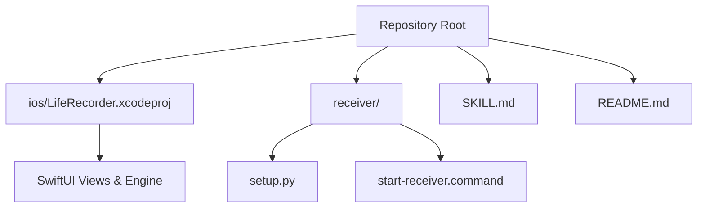
Sources: [README.md:8](), [README.md:27-31](), [SKILL.md:1-8]()

---

## 1.1. Getting Started & Setup

Setting up Life Recorder involves preparing macOS and iOS prerequisites, building and signing the Xcode project, and configuring the Python receiver agent on the Mac [README.md:5-34](). Prerequisites include Xcode, Python 3.10+, `ffmpeg`, `whisper.cpp` binaries (`whisper-cli`), and a downloaded GGML Whisper model [README.md:5-10](). 

The Mac receiver is initialized via a setup script that generates a self-signed TLS certificate, a SHA-256 certificate pin, a cryptographic bearer token, and an installer for a persistent background `launchd` agent [README.md:27-34](). The iOS application must then be built via Xcode or command-line `xcodebuild` and installed onto a developer-mode-enabled iPhone [README.md:12-23]().

For detailed instructions on environment setup, command-line build flags, pairing mechanics, and agent installation, see [Getting Started & Setup](#1.1).

Sources: [README.md:5-34](), [SKILL.md:26-34]()

---

## 1.2. Data Flow & End-to-End Pipeline

Audio recording is initiated by the user via the iOS interface, capturing audio buffers into local rotating AAC chunk files [README.md:3](). These chunks are organized into a local recording journal and queue store on the device [README.md:40](). 

The `UploadManager` component transmits pending audio chunks over an authenticated, pinned HTTPS connection to the Mac receiver inbox [README.md:34](), [README.md:40](). Once the Mac receiver acknowledges a durable receipt, the local chunk file is purged from the phone [README.md:3](). The receiver processes queued chunks through `ffmpeg` and local `whisper-cli`, strips repetitive hallucinations, and appends the resulting text into `life.md` [README.md:3](), [README.md:42]().

For a complete step-by-step trace of an audio chunk from microphone tap to local storage, network upload, transcription, and cleanup, see [Data Flow & End-to-End Pipeline](#1.2).

Sources: [README.md:3](), [README.md:34](), [README.md:40-42]()

---

## 1.3. Privacy, Secrets & Repo Hygiene

Life Recorder handles sensitive personal voice recordings and private transcripts. Consequently, strict security policies govern repository hygiene and runtime state isolation [README.md:33](). 

Artifacts such as runtime data directories, SQLite queues, raw audio segments, generated `life.md` transcripts, self-signed TLS certificates, bearer tokens, and pairing pages must **never** be committed to Git [README.md:33](), [README.md:50](). These operational boundaries, along with automated coding assistant constraints defined in `SKILL.md`, ensure that all private data remains exclusively on local machine storage [README.md:44-46](), [SKILL.md:24-33]().

For detailed guidelines on `.gitignore` enforcement, private directory layouts, keychain secret storage, and Codex operating constraints, see [Privacy, Secrets & Repo Hygiene](#1.3).

Sources: [README.md:33](), [README.md:44-50](), [SKILL.md:24-33]()

---

# Page: Getting Started & Setup

# Getting Started & Setup

<details>
<summary>Relevant source files</summary>

The following files were used as context for generating this wiki page:

- [README.md](README.md)
- [SKILL.md](SKILL.md)
- [receiver/setup.py](receiver/setup.py)

</details>


## Purpose & Scope
This page details the initialization, prerequisites, and setup procedures required to run the Life Recorder system. It covers environment preparation on macOS and iOS, configuring the Mac receiver using `receiver/setup.py`, building and installing the native iOS target, and securely pairing the iPhone via custom deep links.

Sources: `README.md:1-11` [README.md:1-11](), `SKILL.md:6-35` [SKILL.md:6-35]()

---

## 1. System Prerequisites & Environment Dependencies

Before initializing the Life Recorder backend or client, ensure the host machine and mobile target meet all runtime dependencies.

| Dependency | Requirement / Path | Purpose |
| :--- | :--- | :--- |
| **macOS & Xcode** | Xcode with active developer tools, Apple Developer Account | Compiling and signing the iOS app target (`ios/LifeRecorder.xcodeproj`) [README.md:7-14]() |
| **iPhone** | iOS device with Developer Mode enabled | Capturing local audio chunks and running the native client [README.md:8]() |
| **Python** | Python 3.10+ | Executing the Mac receiver service and setup script [README.md:9]() |
| **FFmpeg** | `/opt/homebrew/bin/ffmpeg` | Audio decoding and stream manipulation within the Whisper transcription pipeline [README.md:9](), [receiver/setup.py:57]() |
| **Whisper.cpp** | `/opt/homebrew/bin/whisper-cli` | Local audio transcription CLI utility [README.md:9](), [receiver/setup.py:57]() |
| **GGML Model** | e.g., `ggml-small.bin` (passed via `--model`) [README.md:9](), [receiver/setup.py:21]() | Neural network weights for local speech-to-text processing |

Sources: `README.md:5-11` [README.md:5-11](), `SKILL.md:28` [SKILL.md:28](), `receiver/setup.py:19-57` [receiver/setup.py:19-57]()

---

## 2. Configuring the Mac Receiver (`receiver/setup.py`)

The receiver setup script initializes private credentials, generates a self-signed TLS certificate, computes its SHA-256 fingerprint (pin), writes a private pairing page, and optionally registers a background `launchd` agent.

### CLI Parameters & Execution Flow
The script parses arguments using `argparse` [receiver/setup.py:19-24](), enforces strict umask permissions (`0o077`) [receiver/setup.py:25](), initializes the `Inbox` data store [receiver/setup.py:27](), and queries the local hostname via `scutil` [receiver/setup.py:28]().

```sh
python3 receiver/setup.py \
  --data-dir /absolute/private/runtime \
  --model /absolute/path/to/ggml-small.bin \
  --install-agent
``` [README.md:27-31]()

### Diagram: Receiver Initialization & Artifact Generation
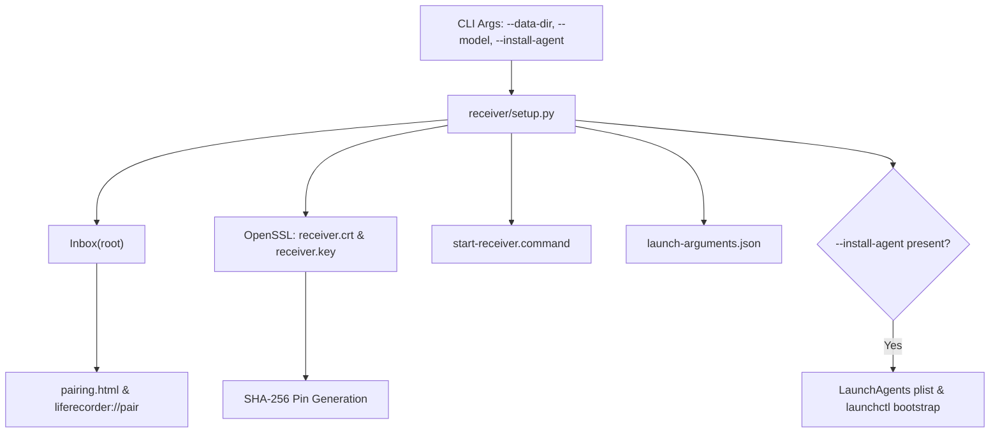
Sources: `receiver/setup.py:19-81` [receiver/setup.py:19-81](), `README.md:27-36` [README.md:27-36]()

---

## 3. iOS App Build & Installation

The native iOS client is structured as an Xcode project located in `ios/LifeRecorder.xcodeproj`. It requires manual configuration of your Apple developer team and device identifiers.

### Interactive Xcode Build
1. Open `ios/LifeRecorder.xcodeproj` in Xcode [README.md:14]().
2. Select the connected iPhone target device [README.md:14]().
3. Assign your Apple Development Team under the target signing settings [README.md:14]().
4. Build and run the app [README.md:14](). Approve microphone and local-network access when prompted [README.md:14]().

### Command-Line Build (`xcodebuild`)
For headless or automated builds via Codex/CoreDevice tooling, use `xcodebuild`:

```sh
DEVELOPER_DIR=/Applications/Xcode.app/Contents/Developer \
  xcodebuild -project ios/LifeRecorder.xcodeproj -scheme LifeRecorder \
  -destination 'id=YOUR_DEVICE_UDID' -allowProvisioningUpdates \
  DEVELOPMENT_TEAM=YOUR_TEAM_ID build
``` [README.md:18-23]()

Sources: `README.md:12-24` [README.md:12-24](), `SKILL.md:12-21` [SKILL.md:12-21]()

---

## 4. Pairing the iPhone

Once the Mac receiver is running and the iOS application is installed, the iPhone must be paired to exchange authenticated chunks securely over HTTPS.

### Pairing Artifacts & Deep Link Mechanics
`receiver/setup.py` constructs a custom URI scheme combining the reachable receiver URL, the random bearer token generated by `Inbox`, and the certificate pin [receiver/setup.py:39]():

```python
pair = "liferecorder://pair?" + urlencode({"url": url, "token": inbox.token, "pin": pin})
``` [receiver/setup.py:39]()

This URI is embedded inside `pairing.html` [receiver/setup.py:53](). Opening this page inside Safari on the target iPhone and tapping the pairing link invokes the custom URL handler within the iOS application.

### Diagram: iPhone Pairing & Credential Binding
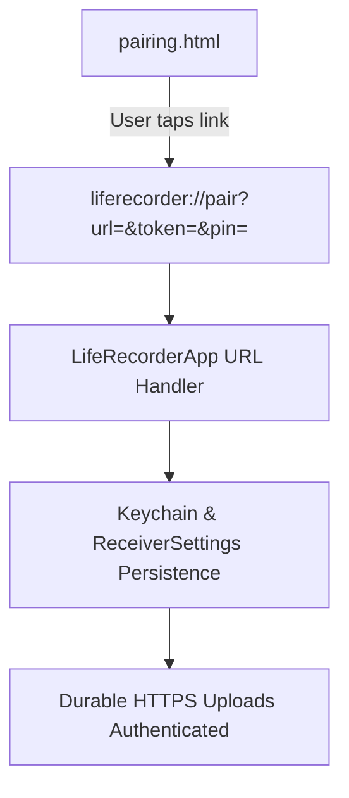
Sources: `receiver/setup.py:39-53` [receiver/setup.py:39-53](), `README.md:34` [README.md:34]()

---

# Page: Data Flow & End-to-End Pipeline

# Data Flow & End-to-End Pipeline

<details>
<summary>Relevant source files</summary>

The following files were used as context for generating this wiki page:

- [ios/LifeRecorder/ChunkWriter.swift](ios/LifeRecorder/ChunkWriter.swift)
- [ios/LifeRecorder/UploadManager.swift](ios/LifeRecorder/UploadManager.swift)
- [receiver/receiver.py](receiver/receiver.py)

</details>


## Purpose and Scope

This page traces the complete lifecycle of an audio chunk within Life Recorder. The pipeline spans from the moment acoustic data is captured from the hardware microphone on the iOS device, through local serial buffering, file rotation, durable SQLite journaling, background HTTPS transport, receiver ingestion, Whisper transcription, local cleanup, and finally to atomic Markdown export into `life.md`.

---

## 1. Audio Capture, Journaling & Disk Rotation

Audio capture begins via `AVAudioEngine`, which pipes raw PCM audio buffers into `ChunkWriter.consume(_:)`. Because `AVAudioEngine` reuses memory buffers after callbacks return, `ChunkWriter` immediately copies the buffer into a newly allocated `AVAudioPCMBuffer` and dispatches it to a dedicated serial queue (`life.recorder.audio-writer`) to maintain strict ordering across file rotations.

```
[AVAudioEngine] ---> (AVAudioPCMBuffer) ---> ChunkWriter.consume() ---> [Serial Queue] ---> AVAudioFile (.m4a)
```

Within the serial queue, audio is streamed into an AAC-encoded `.m4a` container via `AVAudioFile`. Concurrently, `ChunkWriter` monitors disk health, ensuring that important usage volume capacity does not fall below a 200 MB threshold. When 60 seconds of audio accumulate (`chunkFrames / sampleRate >= 60`), `ChunkWriter` finalizes the current audio file, seals a corresponding `RecordingJournal` structure, and triggers the `onChunk` callback.

- **Key Files & Classes**: `ios/LifeRecorder/ChunkWriter.swift`
- **Citations**: `ios/LifeRecorder/ChunkWriter.swift:5-88`

Sources: `ios/LifeRecorder/ChunkWriter.swift:5-88`

---

## 2. Queue Storage & Durable Sealing

When a chunk rotation event occurs, `ChunkWriter` interacts with `QueueStore` to seal the recording session. A `RecordingJournal` struct containing a unique `UUID` and `startedAt` timestamp is serialized into a `.recording.json` sidecar file alongside the `.m4a` audio file in the local application container's queue directory. 

```
+-------------------------------------------------------------------------+
| Code Entity Space: Local iOS Storage Layout                             |
|                                                                         |
|  QueueStore.directory                                                   |
|   ├── [UUID].recording.json  (Metadata: id, startedAt, duration)        |
|   └── [UUID].m4a             (AAC Encoded Audio Container)              |
+-------------------------------------------------------------------------+
```

File protection attributes are explicitly configured on the written files (`FileProtectionType.completeUntilFirstUserAuthentication`), ensuring security while permitting background uploads when the device is locked.

- **Key Files & Classes**: `ios/LifeRecorder/ChunkWriter.swift`, `ios/LifeRecorder/Storage.swift`
- **Citations**: `ios/LifeRecorder/ChunkWriter.swift:47-78`

Sources: `ios/LifeRecorder/ChunkWriter.swift:47-78`

---

## 3. Background HTTPS Transport

The `UploadManager` class monitors the device's pending queue (`QueueStore.pending()`) via a repeating timer and background `URLSession` configuration (`com.browseruse.liferecorder.uploads`). 

```mermaid
graph TD
    sub-graph-ios["iOS Client Space"]
        QS["QueueStore.pending()"] --> UM["UploadManager.pump()"]
        UM --> US["URLSession.uploadTask()"]
    end
    sub-graph-receiver["Mac Receiver Space"]
        US -- "POST /v1/chunks/{id}<br/>Authorization: Bearer<br/>X-Audio-SHA256" --> H["Handler.do_POST()"]
    end

    style sub-graph-ios fill:none,stroke:none
    style sub-graph-receiver fill:none,stroke:none
```

For each pending chunk, `UploadManager` constructs a secure HTTPS `URLRequest` directed at the paired Mac receiver. It injects cryptographic and metadata headers into the request:
- `Authorization`: Bearer token authentication derived from configuration settings.
- `X-Audio-SHA256`: Cryptographic digest of the audio payload.
- `X-Device-ID`: Unique identifier for the recording client.
- `X-Started-At`: ISO-8601 capture timestamp.
- `X-Duration-Seconds`: Exact duration of the audio clip.

- **Key Files & Classes**: `ios/LifeRecorder/UploadManager.swift`
- **Citations**: `ios/LifeRecorder/UploadManager.swift:7-117`

Sources: `ios/LifeRecorder/UploadManager.swift:7-117`

---

## 4. Receiver API Ingestion & SQLite Tracking

The Python receiver listens via a `ThreadingHTTPServer` running TLS. When an upload request hits `POST /v1/chunks/<uuid>`, the `Handler` class delegates ingestion to the `Inbox` class.

```mermaid
graph TD
    sub-graph-code["Code Entity Space: receiver.py"]
        H2["Handler.do_POST()"] --> V["valid_uuid()"]
        V --> IA["Inbox.accept()"]
        IA --> DB["sqlite3: chunks table<br/>WAL mode, synchronous=FULL"]
        IA --> FS["Atomic File Write<br/>audio/{id}.m4a"]
    end

    style sub-graph-code fill:none,stroke:none
```

`Inbox.accept()` validates the chunk UUID, computes/verifies the SHA-256 integrity hash, moves the temporary upload file atomically into the private `audio/` directory, and inserts a tracking record into `inbox.sqlite3` with a default `pending` status.

- **Key Files & Classes**: `receiver/receiver.py` (`Inbox`, `Handler`)
- **Citations**: `receiver/receiver.py:46-105`, `receiver/receiver.py:155-179`

Sources: `receiver/receiver.py:46-105`, `receiver/receiver.py:155-179`

---

## 5. Transcription, Cleanup, & Markdown Export

Once recorded and ingested, background transcription workers invoke local Whisper binaries and `ffmpeg` to process pending chunks. Upon successful transcription, `Inbox.complete()` updates the SQLite database state:

```
[Whisper Worker] ---> Transcribed Text ---> Inbox.complete() ---> DB status = 'complete'
                                                               ---> Inbox.export()
                                                               ---> Inbox.cleanup_completed()
```

1. **Database Update**: The record status is updated to `complete`, and the transcript text is stored.
2. **Markdown Export**: `Inbox.export()` queries all completed records, formats clean text transcripts, inserts hourly capture markers (e.g., `### YYYY-MM-DD HH:00 UTC`), writes daily files into `days/*.md`, and atomically updates the master `life.md` file.
3. **Audio Cleanup**: `Inbox.cleanup_completed()` unlinks and removes the local raw `.m4a` audio file from the receiver inbox only *after* the transcript is durably committed to both SQLite and the exported Markdown files.

- **Key Files & Classes**: `receiver/receiver.py` (`Inbox.complete`, `Inbox.cleanup_completed`, `Inbox.export`)
- **Citations**: `receiver/receiver.py:107-148`

Sources: `receiver/receiver.py:107-148`

---

# Page: Privacy, Secrets & Repo Hygiene

# Privacy, Secrets & Repo Hygiene

<details>
<summary>Relevant source files</summary>

The following files were used as context for generating this wiki page:

- [.gitignore](.gitignore)
- [SKILL.md](SKILL.md)

</details>


This page details the security boundaries, data segregation rules, repository hygiene protocols, and operational constraints for the Life Recorder system. It defines what categories of files must be strictly excluded from version control, how `.gitignore` enforces these rules, conventions for local private data directories, and operational constraints derived from `SKILL.md`.

---

## 1. Prohibited Repository Artifacts

Life Recorder processes and generates sensitive personal data, cryptographic credentials, and local audio assets. Under no circumstances may the following asset categories be committed to version control:

- **Authentication Tokens & Credentials**: Authorization tokens (`*.token`) used by the iOS client to communicate with the Mac receiver via bearer authentication.
- **Cryptographic Keys & Certificates**: Private keys (`*.key`), TLS certificates (`receiver.crt`), Privacy-Enhanced Mail files (`*.pem`), PKCS#12 bundles (`*.p12`), and provisioning profiles (`*.mobileprovision`) used for app signing and secure transport [/.gitignore:8-9,24-27]().
- **Raw Audio & Transcripts**: User voice captures (`*.m4a`, `*.wav`, `*.mp3`) recorded by the iOS client, along with generated continuous transcripts (`life.md`) and daily markdown logs (`days/`) [/.gitignore:18-20,30-31]().
- **Database & Runtime State**: SQLite database files (`*.sqlite*`, `*.db`), binary weights (`*.bin`), GGML models, and local execution caches [/.gitignore:4-6,21-23]().
- **Generated Setup Artifacts**: Auto-generated pairing web pages (`pairing.html`), launch arguments (`launch-arguments.json`), and startup commands (`start-receiver.command`) containing environment-specific paths or tokens [/.gitignore:10,28-29]().

Sources: [/.gitignore:4-33](), [SKILL.md:24-33]()

---

## 2. Git Ignore Rules & Repository Hygiene

The root `.gitignore` file enforces absolute segregation between the source codebase and local runtime state [/.gitignore:1-33](). 

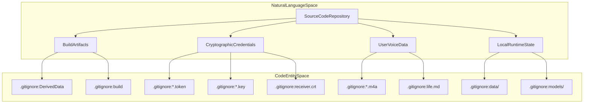
*Figure 1: Mapping conceptual data categories to `.gitignore` exclusion rules.*

Sources: [/.gitignore:1-33]()

The ignore rules are grouped into logical security and hygiene classes:
- **Environment & OS Noise**: Excludes `.DS_Store`, Python bytecode caches (`__pycache__/`, `*.pyc`), and local environment variable files (`.env`, `.env.*`) [/.gitignore:1-3,32-33]().
- **Directories for State & Models**: Excludes local storage roots (`data/`, `runtime/`, `models/`, `work/`, `validation/`) [/.gitignore:4-6,13-14]().
- **Xcode IDE Artifacts**: Excludes user state (`*.xcuserstate`, `xcuserdata/`), build outputs (`DerivedData/`, `build/`), and test result bundles (`*.xcresult/`) [/.gitignore:7,11-12,15-16]().

Sources: [/.gitignore:1-33]()

---

## 3. Private Data-Dir Conventions

All operational runtime state must reside outside the Git work tree in designated private directories. When executing setup scripts or running the receiver service, operators must supply isolated paths (e.g., via `--data-dir`) [SKILL.md:8,30]().

- **`data/`**: Stores incoming chunk uploads, SQLite queues, and staging files prior to transcription.
- **`models/`**: Houses downloaded GGML Whisper binary weight files required by `whisper-cli`.
- **`runtime/`**: Contains execution sockets, PID files, and temporary buffers.

By keeping these directories decoupled from the repository clone, developers prevent accidental staging or committing of private audio and transcripts.

Sources: [SKILL.md:8,30-33]()

---

## 4. Agent Operating Constraints (`SKILL.md`)

Automated agents and human operators interacting with the codebase via `SKILL.md` must adhere to strict security boundaries and device access protocols [SKILL.md:1-35]().

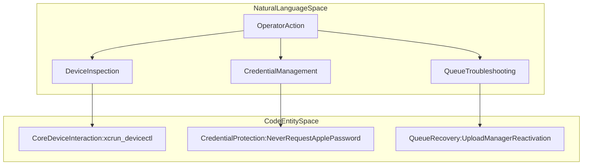
*Figure 2: Mapping operator actions and security constraints to underlying execution boundaries.*

Sources: [SKILL.md:10-35]()

### Key Operating Rules:
- **Device Interaction**: Use Apple CoreDevice (`xcrun devicectl`) strictly for read-only device inspection, app installation, and bundle launching on connected physical devices [SKILL.md:12]().
- **Credential Protection**: Never request, read, log, or store user Apple IDs, passwords, iPhone passcodes, receiver tokens, private keys, or generated pairing pages inside repository tracking files [SKILL.md:24]().
- **Queue Recovery**: If processing stalls, inspect the receiver health endpoint and pending audio counts. Reactivate the iOS upload manager by opening the unlocked app; never force-quit background processes unnecessarily [SKILL.md:32-35]().

Sources: [SKILL.md:10-35]()

---

# Page: iOS Client

# iOS Client

<details>
<summary>Relevant source files</summary>

The following files were used as context for generating this wiki page:

- [ios/LifeRecorder/LifeRecorderApp.swift](ios/LifeRecorder/LifeRecorderApp.swift)
- [ios/project.yml](ios/project.yml)

</details>


Purpose and Scope: This page provides a high-level overview of the SwiftUI iOS app targets, modules, and architecture for `LifeRecorder`. It outlines the core components—including the app lifecycle, audio capture engine, upload transport, and build configurations—while deferring deep technical details to the respective child pages.

Sources: `[ios/LifeRecorder/LifeRecorderApp.swift:1-51]`, `[ios/project.yml:1-31]()`

---

## Architecture Overview

The iOS client is built entirely in SwiftUI and structured around modular subsystems that run locally on device, recording audio into persistent chunks and securely transmitting them to the Mac receiver in the background.

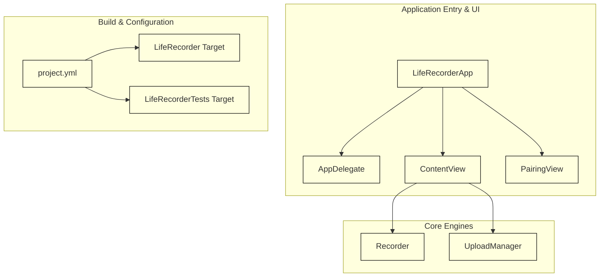
*Figure 1: High-level architectural map of the iOS client modules and build layout.*

Sources: `[ios/LifeRecorder/LifeRecorderApp.swift:1-51]`, `[ios/project.yml:1-31]()`

---

## 2.1 App Lifecycle & UI

The entry point of the application is managed by `LifeRecorderApp`, which ties together the app lifecycle, scene phase activations, and deep link handling via `liferecorder://pair` URLs. The associated `AppDelegate` handles background URL session handoffs for `UploadManager`, ensuring uploads continue reliably when the app is suspended or terminated by the OS [ios/LifeRecorder/LifeRecorderApp.swift:4-12].

The main interface is powered by `ContentView`, which exposes recorder controls via an accessibility identifier (`recorderToggle`), displays pending clip counts, and surfaces warnings for interrupted or unrecovered clips. Configuration and Mac pairing are handled via `PairingView`, which persists connection parameters securely.

For full technical details on lifecycle events, background URL session delegates, deep link parsing, and scene phase transitions, see [App Lifecycle & UI](#2.1).

Sources: `[ios/LifeRecorder/LifeRecorderApp.swift:1-149]()`

---

## 2.2 Audio Capture Engine

The audio capture engine coordinates `AVAudioSession` and `AVAudioEngine` to record audio from the microphone, handling audio route changes, interruptions, and background execution states. It maintains status strings reflecting whether recording is active or idle [ios/LifeRecorder/LifeRecorderApp.swift:69-72].

Audio capture internals—such as PCM buffer copying, serial queue management, AAC/m4a encoding, 60-second file rotation, recording journals, disk-space guards, and file protection attributes—as well as on-device queue storage layout and recovery of interrupted files via `QueueStore`, are documented in detail in the child pages.

For full technical details, see [Audio Capture Engine](#2.2), [Chunk Writing & Rotation](#2.2.1), and [Queue Storage & Recovery](#2.2.2).

Sources: `[ios/LifeRecorder/LifeRecorderApp.swift:17-32]`

---

## 2.3 Upload Manager & Transport Security

`UploadManager` coordinates durable chunk uploads using background `URLSession` transfers. It attaches chunk metadata headers, handles automatic retries, manages durable receipt semantics, and enforces transport security through certificate pinning and bearer token authentication.

When connection parameters or pairing tokens are updated via deep links or `PairingView`, `UploadManager.configurationChanged()` is invoked to propagate the new target endpoints [ios/LifeRecorder/LifeRecorderApp.swift:41].

For full technical details on background task handoffs, chunk metadata headers, and authentication security, see [Upload Manager & Transport Security](#2.3).

Sources: `[ios/LifeRecorder/LifeRecorderApp.swift:8-10, 41]`

---

## 2.4 iOS Build Configuration

The iOS project structure is generated using XcodeGen via a central configuration file, `project.yml`. This configuration defines the base settings for iOS 17.0, target memberships for the main application (`LifeRecorder`) and test bundle (`LifeRecorderTests`), bundle identifiers (`com.browseruse.liferecorder`), and Info.plist capability associations [ios/project.yml:1-32].

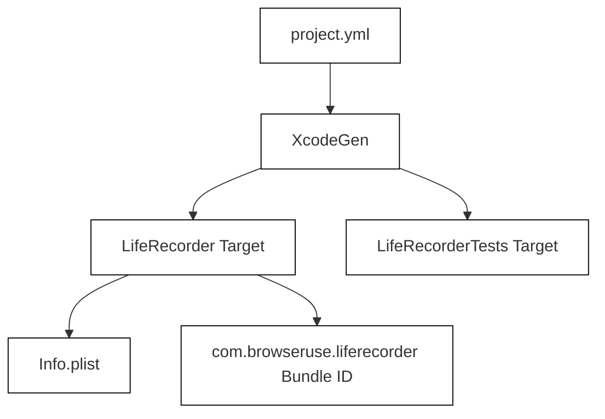
*Figure 2: Build configuration flow from XcodeGen project specifications to generated targets.*

For full technical details on build settings, workspace generation, code signing styles, and required Info.plist capabilities, see [iOS Build Configuration](#2.4).

Sources: `[ios/project.yml:1-31]()`

---

# Page: App Lifecycle & UI

# App Lifecycle & UI

<details>
<summary>Relevant source files</summary>

The following files were used as context for generating this wiki page:

- [ios/LifeRecorder/Info.plist](ios/LifeRecorder/Info.plist)
- [ios/LifeRecorder/LifeRecorderApp.swift](ios/LifeRecorder/LifeRecorderApp.swift)

</details>


## Purpose and Scope
This section details the iOS client's entry point, app lifecycle orchestration, background transfer coordination via UIKit delegates, SwiftUI scene phase reactivity, deep-link handling for automated pairing (`liferecorder://pair`), and the root user interface components (`ContentView` and `PairingView`). 

---

## Background URL Session Handoff & `AppDelegate`

The iOS application uses a background `URLSession` inside `UploadManager` to ensure audio chunks continue uploading even when the application is suspended or terminated by the operating system. When background transfers complete or require attention while the app is suspended, iOS wakes up or launches the app in the background and calls the `UIApplicationDelegate` method `application(_:handleEventsForBackgroundURLSession:completionHandler:)`.

The custom `AppDelegate` class intercepts this call, verifies that the session identifier matches `UploadManager.sessionID`, stores the background `completionHandler`, and invokes `UploadManager.shared.activate()` to re-establish session tracking and drain pending completions.

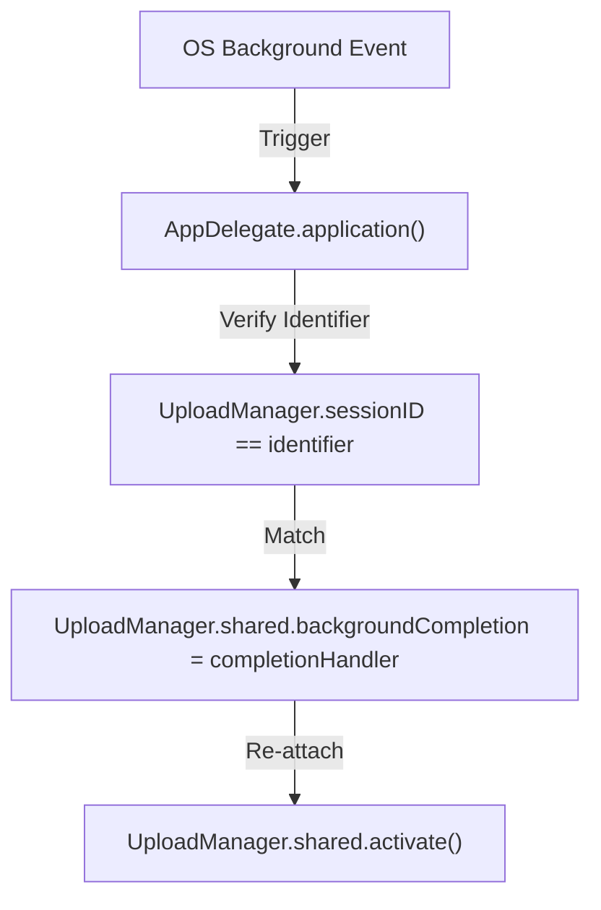

### Implementation Details
- **`AppDelegate` Definition**: Defined in `ios/LifeRecorder/LifeRecorderApp.swift` [ios/LifeRecorder/LifeRecorderApp.swift:4-12](). Conforms to `UIApplicationDelegate`.
- **Background Identifier Check**: Compares the incoming session identifier against `UploadManager.sessionID` [ios/LifeRecorder/LifeRecorderApp.swift:8]().

Sources: `ios/LifeRecorder/LifeRecorderApp.swift:4-12`

---

## App Initialization & Scene Phase Reactivation

The SwiftUI entry point `LifeRecorderApp` manages global state objects for audio recording (`Recorder`) and upload synchronization (`UploadManager`) [ios/LifeRecorder/LifeRecorderApp.swift:14-18](). It binds to the environment's `scenePhase` to handle app foregrounding and reactivation [ios/LifeRecorder/LifeRecorderApp.swift:19-32]().

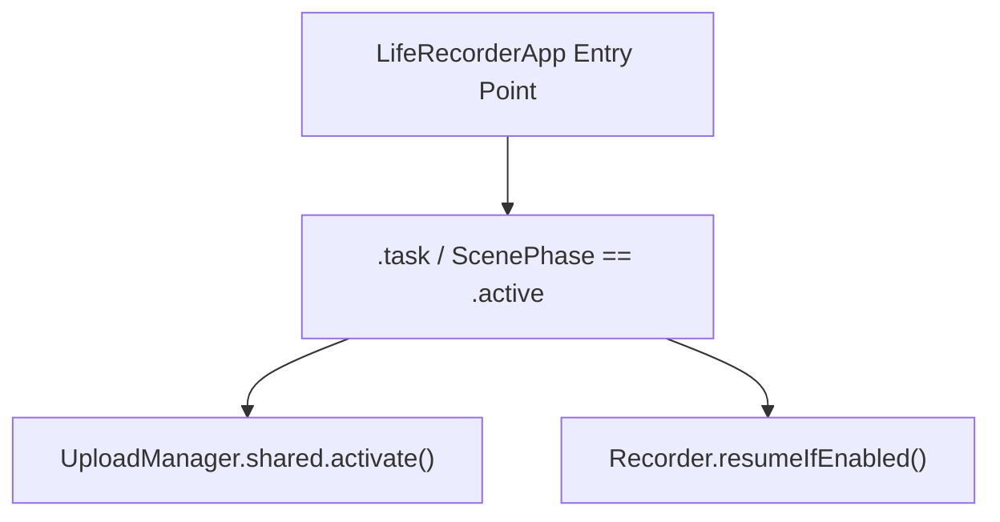

### Scene Phase Lifecycle Events
1. **Initial Task**: When the main window group loads, `.task` calls `uploads.activate()` and awaits `recorder.resumeIfEnabled()` [ios/LifeRecorder/LifeRecorderApp.swift:26]().
2. **Reactivation (`.active`)**: When the app transitions back to the `.active` scene phase, `.onChange(of: scenePhase)` triggers another activation cycle to resume any interrupted background uploads and ensure the recorder engine is running if enabled [ios/LifeRecorder/LifeRecorderApp.swift:27-32]().

Sources: `ios/LifeRecorder/LifeRecorderApp.swift:14-32`

---

## Deep Link Pairing (`liferecorder://pair`)

The app supports custom URL schemes declared in `Info.plist` [ios/LifeRecorder/Info.plist:17-17]() under the scheme `liferecorder` and host `pair`. This allows desktop setup scripts to configure the mobile app instantly by opening a custom link.

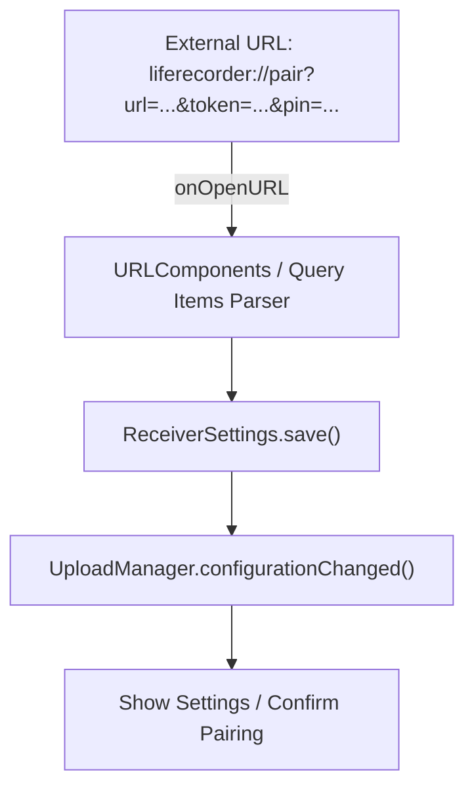

### Deep Link Processing Flow
1. **URL Interception**: The `.onOpenURL` modifier catches incoming URLs matching `liferecorder://pair` [ios/LifeRecorder/LifeRecorderApp.swift:33-35]().
2. **Query Parameter Extraction**: Parses query items (`url`, `token`, and `pin`) into a dictionary [ios/LifeRecorder/LifeRecorderApp.swift:36-37]().
3. **Credential Storage**: Invokes `ReceiverSettings.save(url:token:pin:)` to persist credentials securely [ios/LifeRecorder/LifeRecorderApp.swift:38-40]().
4. **State Refresh & Feedback**: Triggers `uploads.configurationChanged()` and displays the settings sheet or captures any validation errors in `pairingError` [ios/LifeRecorder/LifeRecorderApp.swift:41-48]().

Sources: `ios/LifeRecorder/LifeRecorderApp.swift:33-49`, `ios/LifeRecorder/Info.plist:17-17`

---

## Root User Interface: `ContentView` & `PairingView`

The primary user interface consists of a navigation stack (`ContentView`) displaying recorder status, audio capture toggles, pending upload metrics, incomplete clip recovery warnings, and a sheet presentation for configuration (`PairingView`) [ios/LifeRecorder/LifeRecorderApp.swift:53-130]().

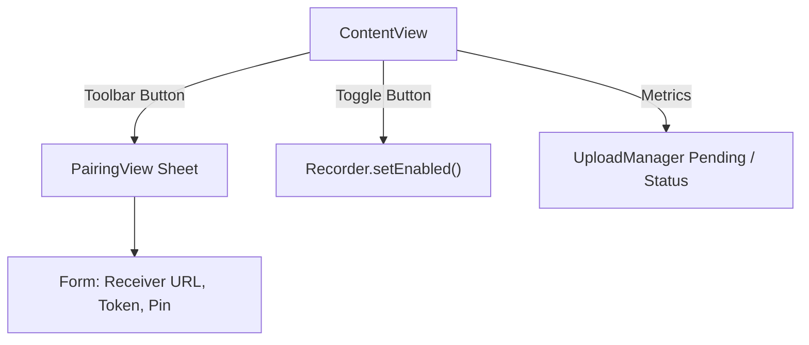

### Key UI Components
- **`ContentView`**: Houses the main recording control button, accessibility identifier `"recorderToggle"` [ios/LifeRecorder/LifeRecorderApp.swift:82](), live waveform status icon, pending transfer counts, and a toolbar shortcut to open the pairing view [ios/LifeRecorder/LifeRecorderApp.swift:53-107]().
- **`PairingView`**: A form-based settings sheet allowing manual entry or review of the Mac receiver URL, pairing token, and certificate SHA-256 fingerprint [ios/LifeRecorder/LifeRecorderApp.swift:109-130]().

Sources: `ios/LifeRecorder/LifeRecorderApp.swift:53-130`

---

# Page: Audio Capture Engine

# Audio Capture Engine

<details>
<summary>Relevant source files</summary>

The following files were used as context for generating this wiki page:

- [ios/LifeRecorder/Recorder.swift](ios/LifeRecorder/Recorder.swift)

</details>


## Purpose and Scope

The Audio Capture Engine manages the entire audio input lifecycle on the iOS client, acting as the bridge between raw microphone hardware and the local storage pipeline. Built around `AVAudioSession`, `AVAudioEngine`, and `ChunkWriter` [ios/LifeRecorder/Recorder.swift:1-147](), it handles user microphone permissions, background recording capabilities, audio route changes, interruptions (such as phone calls or Siri activations), and status reporting. 

As a parent page, this document provides a high-level architectural overview of the audio capture subsystem. Detailed mechanics regarding PCM buffering, AAC encoding, file rotation, and disk recovery are delegated to the child pages:
- [Chunk Writing & Rotation](#2.2.1)
- [Queue Storage & Recovery](#2.2.2)

---

## Architecture Overview

The capture engine coordinates several core components to ensure continuous, reliable recording even when the app is backgrounded or interrupted.

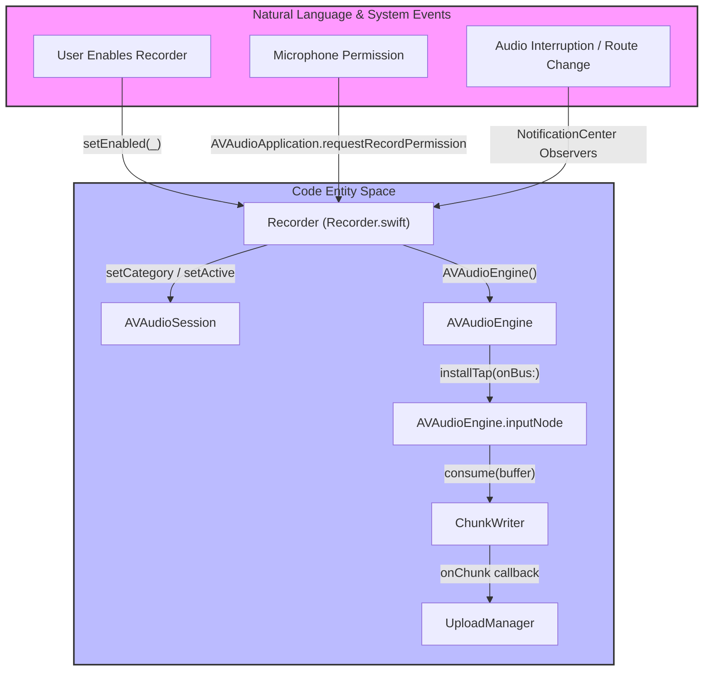

Sources: `ios/LifeRecorder/Recorder.swift:1-148`

---

## Session Setup, Permissions, and Background Recording

The `Recorder` class (`@MainActor final class Recorder: ObservableObject`) manages the recording state and underlying audio graph [ios/LifeRecorder/Recorder.swift:6-19](). When recording is enabled, `resumeIfEnabled(allowBackground:)` checks whether microphone permissions have been granted via `AVAudioApplication.shared.recordPermission` [ios/LifeRecorder/Recorder.swift:58-78](). If undetermined, it prompts the user while active [ios/LifeRecorder/Recorder.swift:70-73]().

Once authorized, the engine configures an `AVAudioSession` category of `.playAndRecord` with options `.mixWithOthers` and `.defaultToSpeaker`, activating it for background operation [ios/LifeRecorder/Recorder.swift:81-83](). It instantiates an `AVAudioEngine`, inspects the input node's hardware format, and installs a tap on bus 0 to feed audio buffers directly into a `ChunkWriter` instance [ios/LifeRecorder/Recorder.swift:84-104]().

Sources: `ios/LifeRecorder/Recorder.swift:58-111`

---

## Interruption and Route-Change Handling

To maintain robustness during system events, `Recorder` registers multiple `NotificationCenter` observers in its initializer [ios/LifeRecorder/Recorder.swift:20-46]():

1. **Interruption Notifications (`AVAudioSession.interruptionNotification`)**: Detects when phone calls, alarms, or other prioritized audio sessions take over. When an interruption begins (`.began`), capture is stopped cleanly without deactivating the session if unnecessary, and status updates are posted [ios/LifeRecorder/Recorder.swift:132-138](). When it ends, if `.shouldResume` is indicated, recording restarts automatically [ios/LifeRecorder/Recorder.swift:139-145]().
2. **Media Services Reset (`AVAudioSession.mediaServicesWereResetNotification`)**: Resets the entire audio server subgraph, triggering a full stop and automatic restart [ios/LifeRecorder/Recorder.swift:27-34]().
3. **Route Changes (`AVAudioSession.routeChangeNotification`)**: Listens for connected or disconnected hardware devices (such as Bluetooth headsets or headphones) and safely restarts capture to re-evaluate input formats [ios/LifeRecorder/Recorder.swift:35-45]().

Sources: `ios/LifeRecorder/Recorder.swift:20-46`, `ios/LifeRecorder/Recorder.swift:132-146`

---

## Status Strings and UI Integration

The `Recorder` publishes several state variables (`enabled`, `recording`, `status`, `incompleteClips`) observed by SwiftUI views [ios/LifeRecorder/Recorder.swift:7-11](). The `status` property provides real-time feedback strings to the user interface (e.g., `"Recorder is off"`, `"Ready to resume"`, `"Recording, including when locked"`, or error descriptions) [ios/LifeRecorder/Recorder.swift:10, 21, 106, 109]().

Sources: `ios/LifeRecorder/Recorder.swift:6-19`, `ios/LifeRecorder/Recorder.swift:48-56`

---

## Child Pages

For granular technical specifications, refer to the child pages:
- **[Chunk Writing & Rotation](#2.2.1)** — Details on PCM buffer copying, serial queue dispatch, AAC/m4a encoding via `AVAssetWriter`, 60-second file rotation, recording journals, and disk-space guards.
- **[Queue Storage & Recovery](#2.2.2)** — Details on `QueueStore` directory layouts, atomic journal sealing, recovery of interrupted files on startup, and keychain persistence for receiver settings.

---

# Page: Chunk Writing & Rotation

# Chunk Writing & Rotation

<details>
<summary>Relevant source files</summary>

The following files were used as context for generating this wiki page:

- [ios/LifeRecorder/ChunkWriter.swift](ios/LifeRecorder/ChunkWriter.swift)

</details>


The `ChunkWriter` class coordinates raw PCM audio buffer ingestion, thread-safe queuing, AAC/M4A encoding, disk-space safeguarding, 60-second chunk rotation, and recording journal creation. It acts as the primary bridge between the real-time audio capture tap (`AVAudioEngine`) and persistent on-device storage.

## Architectural Overview & Code Mapping

The following diagram maps the logical components of the chunk writing pipeline to their exact Swift code entities within the iOS client package.

### Diagram: Chunk Writing Component Map
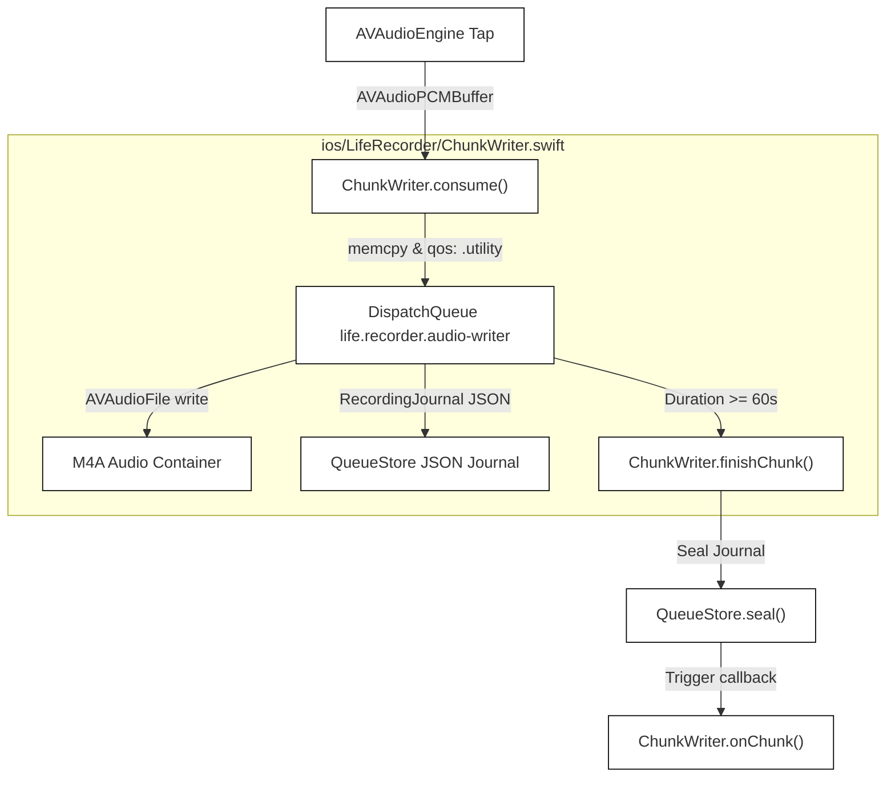
Sources: [ios/LifeRecorder/ChunkWriter.swift:1-88]()

---

## PCM Buffer Copying & Serial Queue

Because `AVAudioEngine` reuses memory allocated for audio taps immediately after a callback returns, raw input buffers cannot be processed asynchronously without a deep memory copy [ios/LifeRecorder/ChunkWriter.swift:22-24](). 

The `ChunkWriter.consume(_:)` method handles this memory isolation and execution handoff:
1. It instantiates a new target `AVAudioPCMBuffer` matching the source format and frame capacity [ios/LifeRecorder/ChunkWriter.swift:24]().
2. It uses `UnsafeMutableAudioBufferListPointer` and `memcpy` to copy the underlying audio buffer payloads bit-for-bit into the newly allocated buffer instance [ios/LifeRecorder/ChunkWriter.swift:26-31]().
3. It dispatches the write operation asynchronously to a dedicated serial queue (`life.recorder.audio-writer`) running at `.utility` QoS to maintain deterministic FIFO ordering across file rotations [ios/LifeRecorder/ChunkWriter.swift:5-6, 32]().

```swift
// Example conceptual flow inside consume(_:)
let copy = AVAudioPCMBuffer(pcmFormat: input.format, frameCapacity: input.frameLength)
// ... memcpy execution ...
queue.async { [self] in
    // file writing & rotation checks
}
```
Sources: [ios/LifeRecorder/ChunkWriter.swift:5-45]()

---

## File Creation & Disk-Space Guard

When the first audio buffer arrives for a new chunk (`file == nil`), `ChunkWriter.begin(format:)` initializes the output files and validates local storage constraints [ios/LifeRecorder/ChunkWriter.swift:35, 47-69]().

### Disk-Space Guard
Before committing storage to disk, the writer queries `QueueStore.directory` for resource values using `.volumeAvailableCapacityForImportantUsageKey` [ios/LifeRecorder/ChunkWriter.swift:48](). If available space drops below `200 MB` (`200 * 1024 * 1024` bytes), it aborts initialization by throwing an `NSError` with domain `"Recorder"` and code `1`, setting `failed = true` to halt subsequent writes [ios/LifeRecorder/ChunkWriter.swift:40-42, 49-52]().

### File & Journal Initialization
If space is sufficient, a unique `UUID` is generated for the chunk, and a `RecordingJournal` is structured [ios/LifeRecorder/ChunkWriter.swift:54]().
* **Journal File**: Written atomically as a JSON file named `<uuid>.recording.json` inside the queue directory [ios/LifeRecorder/ChunkWriter.swift:56-57]().
* **Audio File**: Created as an AAC-encoded `.m4a` file named `<uuid>.m4a` via `AVAudioFile` [ios/LifeRecorder/ChunkWriter.swift:58-64]().
* **Encoding Parameters**:
  * Format: `kAudioFormatMPEG4AAC` [ios/LifeRecorder/ChunkWriter.swift:60]()
  * Sample Rate: Inherited from `format.sampleRate` [ios/LifeRecorder/ChunkWriter.swift:61]()
  * Channels: Inherited from `format.channelCount` [ios/LifeRecorder/ChunkWriter.swift:62]()
  * Bitrate: `32000 * channelCount` (32 kbps per channel) [ios/LifeRecorder/ChunkWriter.swift:63]()
* **File Protection**: Attributes are explicitly set to `.completeUntilFirstUserAuthentication` using `FileManager` [ios/LifeRecorder/ChunkWriter.swift:65-66]().

Sources: [ios/LifeRecorder/ChunkWriter.swift:47-69]()

---

## 60-Second Rotation & Sealing Mechanics

The writer accumulates incoming frames and tracks duration relative to the sample rate [ios/LifeRecorder/ChunkWriter.swift:37-39](). 

### Diagram: Chunk Rotation & Lifecycle Flow
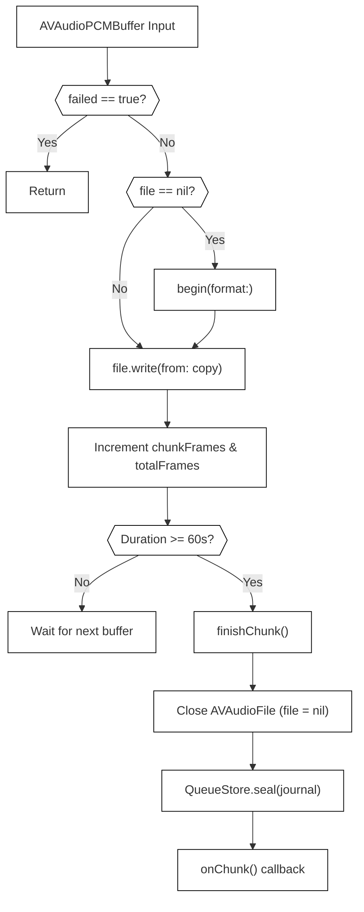
Sources: [ios/LifeRecorder/ChunkWriter.swift:32-78]()

### Rotation Logic
For every ingested buffer block, `chunkFrames` is incremented [ios/LifeRecorder/ChunkWriter.swift:37](). If the expression `Double(chunkFrames) / sampleRate >= 60` evaluates to true, `finishChunk()` is invoked [ios/LifeRecorder/ChunkWriter.swift:39]().

### Sealing Process
`finishChunk()` executes the following cleanup and finalization steps:
1. Deassigns the `AVAudioFile` (`file = nil`), which forces the M4A container trailers to write and finalize before checksum calculation [ios/LifeRecorder/ChunkWriter.swift:72]().
2. Seals the recording journal by invoking `QueueStore.seal(_:duration:)` with the calculated duration [ios/LifeRecorder/ChunkWriter.swift:74]().
3. Resets `journal = nil` and `chunkFrames = 0` [ios/LifeRecorder/ChunkWriter.swift:75-76]().
4. Triggers the `onChunk()` notification closure to inform upper layers that a new chunk is ready for upload [ios/LifeRecorder/ChunkWriter.swift:77]().

An asynchronous `finish()` wrapper is provided for graceful shutdown sequences, awaiting pending operations on the serial queue before returning control [ios/LifeRecorder/ChunkWriter.swift:80-87]().

Sources: [ios/LifeRecorder/ChunkWriter.swift:32-88]()

---

# Page: Queue Storage & Recovery

# Queue Storage & Recovery

<details>
<summary>Relevant source files</summary>

The following files were used as context for generating this wiki page:

- [ios/LifeRecorder/Storage.swift](ios/LifeRecorder/Storage.swift)

</details>


## Purpose and Scope
This page details the on-device storage implementation for captured audio chunks, crash recovery protocols, and secure credential persistence as defined in `ios/LifeRecorder/Storage.swift`. The storage layer ensures durable local persistence of recordings using atomic file operations, cryptographic verification, iOS data protection classes, and Keychain integration.

Sources: `[ios/LifeRecorder/Storage.swift:1-158]()`

---

## On-Device Queue Directory Layout & Persistence
The queue directory is established within the application support directory under the name `PendingAudio` [ios/LifeRecorder/Storage.swift:22-24](). 

Key characteristics of the storage directory include:
* **File Protection**: Configured with `FileProtectionType.completeUntilFirstUserAuthentication` to balance security with background audio capture persistence [ios/LifeRecorder/Storage.swift:25-26]().
* **Backup Exclusion**: Marked with `isExcludedFromBackup = true` to prevent un-uploaded temporary files from consuming iCloud backup quotas [ios/LifeRecorder/Storage.swift:27-31]().

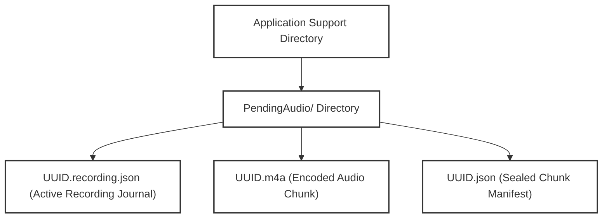
*Figure 1: On-device queue layout bridging storage paths to file entities.*

Sources: `[ios/LifeRecorder/Storage.swift:21-32]()`

---

## Data Models: `Chunk` and `RecordingJournal`
Two core structs govern chunk metadata and active recording states:

* **`RecordingJournal`**: Represents an active recording session before it is finalized, tracking an `id` (`UUID`) and `startedAt` (`Date`) [ios/LifeRecorder/Storage.swift:16-19](). Stored temporarily on disk as `<uuid>.recording.json`.
* **`Chunk`**: Represents a finalized, sealed recording ready for upload. It includes the chunk `id`, `startedAt`, `duration` (in seconds), and a SHA-256 cryptographic checksum (`sha256`) [ios/LifeRecorder/Storage.swift:6-14](). Computed properties derive the base file name, audio file URL (`<uuid>.m4a`), and manifest URL (`<uuid>.json`) [ios/LifeRecorder/Storage.swift:11-13]().

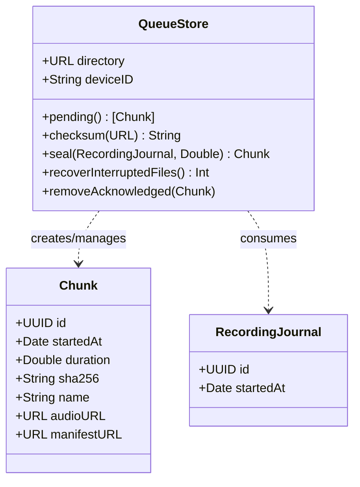
*Figure 2: Storage data models and their relationship with `QueueStore`.*

Sources: `[ios/LifeRecorder/Storage.swift:6-20]()`

---

## Queue Operations, Checksumming & Sealing
The `QueueStore` enum provides static methods to inspect, hash, and seal chunks:

1. **Pending Queue Inspection**: `QueueStore.pending()` reads the directory, filters for valid JSON manifests (ignoring active `.recording.json` files), decodes them into `Chunk` instances, and sorts them chronologically by `startedAt` [ios/LifeRecorder/Storage.swift:41-46]().
2. **Checksum Calculation**: `QueueStore.checksum(_:)` streams the `.m4a` audio file in 64 KB increments (`65536` bytes), feeding CryptoKit's `SHA256` hashing engine to produce a hex-encoded digest [ios/LifeRecorder/Storage.swift:48-54]().
3. **Sealing**: `QueueStore.seal(_:duration:)` computes the audio checksum, initializes a `Chunk` struct, writes the manifest atomically to disk (`options: .atomic`), and removes the temporary `.recording.json` file [ios/LifeRecorder/Storage.swift:56-64]().

Sources: `[ios/LifeRecorder/Storage.swift:41-65]()`

---

## Crash Recovery & Interrupted File Restoration
When the app restarts or recovers from an interruption, `QueueStore.recoverInterruptedFiles()` runs asynchronously to handle incomplete recording sessions [ios/LifeRecorder/Storage.swift:66-90]().

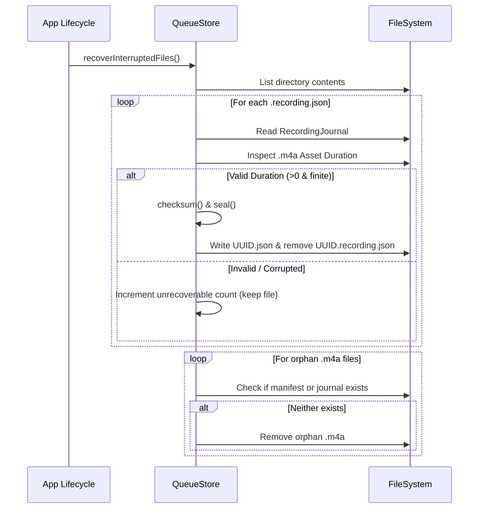
*Figure 3: Crash recovery sequence for interrupted files and cleanup.*

### Recovery Steps:
1. **Journal Discovery**: Scans for files ending in `.recording.json` [ios/LifeRecorder/Storage.swift:67-69]().
2. **Asset Validation**: Loads the corresponding `.m4a` file via `AVURLAsset` to verify that the recorded duration is finite and greater than zero [ios/LifeRecorder/Storage.swift:70-74]().
3. **Safe Sealing or Retention**: If valid, the journal is sealed into a permanent chunk [ios/LifeRecorder/Storage.swift:75](). If corrupted or unreadable, the file is retained for safety without pretending it completed successfully (`unrecoverable += 1`) [ios/LifeRecorder/Storage.swift:76-79]().
4. **Orphan Cleanup**: Removes any `.m4a` files that lack both a manifest (`.json`) and a recording journal (`.recording.json`) [ios/LifeRecorder/Storage.swift:82-88]().
5. **Acknowledgment & Dequeue**: `QueueStore.removeAcknowledged(_:)` deletes both the manifest and the audio file only *after* receiving a verified durable receipt from the receiver [ios/LifeRecorder/Storage.swift:92-98]().

Sources: `[ios/LifeRecorder/Storage.swift:66-98]()`

---

## Credentials & Receiver Settings Persistence
Configuration parameters required to communicate with the Mac Receiver are managed across the iOS Keychain and `UserDefaults`:

* **`Credentials`**: Manages the authentication bearer token in the secure iOS Keychain under the service identifier `com.browseruse.liferecorder.receiver` with accessibility set to `kSecAttrAccessibleAfterFirstUnlockThisDeviceOnly` [ios/LifeRecorder/Storage.swift:101-122]().
* **`ReceiverSettings`**: Encapsulates the receiver's base HTTPS URL, authentication token, and SHA-256 certificate pin [ios/LifeRecorder/Storage.swift:125-138](). `ReceiverSettings.load()` validates that the URL uses the `https` scheme and contains no query parameters, user info, or fragments before returning a valid configuration [ios/LifeRecorder/Storage.swift:130-138]().

Sources: `[ios/LifeRecorder/Storage.swift:101-142]()`

---

# Page: Upload Manager & Transport Security

# Upload Manager & Transport Security

<details>
<summary>Relevant source files</summary>

The following files were used as context for generating this wiki page:

- [ios/LifeRecorder/UploadManager.swift](ios/LifeRecorder/UploadManager.swift)

</details>


## Purpose and Scope

This section covers the implementation of `UploadManager` within the iOS client, detailing how audio chunks recorded by the capture engine are reliably transmitted to the Mac receiver over HTTPS. It outlines the background `URLSession` configuration, HTTP request metadata headers, bearer token authentication, retry logic with exponential backoff/bounding, durable receipt semantics, and transport security controls including certificate pinning.

Sources: `[ios/LifeRecorder/UploadManager.swift:1-35]()`

---

## Background URLSession Configuration

The `UploadManager` singleton coordinates asynchronous chunk uploads using a background `URLSession` configuration [ios/LifeRecorder/UploadManager.swift:7-22](). This allows transfers to continue even when the application is suspended or terminated by the operating system.

Key configuration parameters implemented in `UploadManager`:
- **Identifier**: `com.browseruse.liferecorder.uploads` [ios/LifeRecorder/UploadManager.swift:9]() ensures system-wide persistence of transfer tasks across app launches.
- **Discretionary Flag**: `isDiscretionary = false` [ios/LifeRecorder/UploadManager.swift:23]() instructs iOS to execute uploads immediately rather than waiting for Wi-Fi or optimal power conditions.
- **Launch Events**: `sessionSendsLaunchEvents = true` [ios/LifeRecorder/UploadManager.swift:24]() wakes the application in the background when transfers complete or require attention.
- **Connectivity and Timeouts**: `waitsForConnectivity = true` [ios/LifeProcessor/UploadManager.swift:26](), `timeoutIntervalForRequest = 120` [ios/LifeRecorder/UploadManager.swift:27](), and `timeoutIntervalForResource = 1800` [ios/LifeRecorder/UploadManager.swift:30]() manage transient network interruptions gracefully without blocking concurrent slots indefinitely.
- **Concurrency**: `httpMaximumConnectionsPerHost = 2` [ios/LifeRecorder/UploadManager.swift:31]() throttles requests to prevent saturating local network links.
- **TLS Constraints**: `tlsMinimumSupportedProtocolVersion = .TLSv12` and `tlsMaximumSupportedProtocolVersion = .TLSv13` [ios/LifeRecorder/UploadManager.swift:32-33]() enforce secure transport versions.

```mermaid
graph TD
    subgraph Natural_Language_Space ["Natural Language Space"]
        AppLaunch["App Background Launch"] --> BackgroundSession["Background URLSession"]
        UploadQueue["Pending Queue Storage"] --> SessionScheduler["Task Scheduler"]
    end

    subgraph Code_Entity_Space ["Code Entity Space"]
        BackgroundSession -->|"configured by"| URLSessionConfig["URLSessionConfiguration.background(withIdentifier:)"]
        URLSessionConfig -->|"manages"| SessionInstance["UploadManager.session"]
        SessionScheduler -->|"invokes"| PumpMethod["UploadManager.pump()"]
        PumpMethod -->|"reads from"| QueueStoreQuery["QueueStore.pending()"]
    end

    style Natural_Language_Space fill:none,stroke:#000,stroke-width:1px
    style Code_Entity_Space fill:none,stroke:#000,stroke-width:1px
```
Sources: `[ios/LifeRecorder/UploadManager.swift:7-35]()`

---

## Chunk Metadata Headers & Bearer Token Authentication

When `UploadManager` processes a pending chunk from the local queue, it constructs an HTTPS `POST` request to the receiver endpoint [ios/LifeRecorder/UploadManager.swift:95-103](). Each upload carries explicit cryptographic and contextual metadata via HTTP headers:

- `Content-Type`: Set to `audio/mp4` [ios/LifeRecorder/UploadManager.swift:98]() indicating the payload format produced by `ChunkWriter`.
- `Authorization`: Formatted as `Bearer <token>` [ios/LifeRecorder/UploadManager.swift:99]() using the pre-shared secret loaded from `ReceiverSettings`.
- `X-Audio-SHA256`: Contains the hexadecimal SHA-256 hash of the audio file [ios/LifeRecorder/UploadManager.swift:100]() for integrity verification.
- `X-Device-ID`: Transmits a persistent unique device identifier [ios/LifeRecorder/UploadManager.swift:101]().
- `X-Started-At`: Provides the ISO-8601 fractional timestamp of recording initiation [ios/LifeRecorder/UploadManager.swift:102]().
- `X-Duration-Seconds`: Specifies the clip duration as a string [ios/LifeRecorder/UploadManager.swift:103]().

Sources: `[ios/LifeRecorder/UploadManager.swift:61-110]()`

---

## Pumping, Retries & Stale Task Management

The `UploadManager` relies on a periodic timer and explicit activation calls to evaluate pending work through the `pump()` method [ios/LifeRecorder/UploadManager.swift:41-60](). 

```mermaid
graph TD
    Timer["Timer / activate()"] -->|"triggers"| Pump["UploadManager.pump()"]
    Pump --> CheckTasks["URLSession.getAllTasks"]
    CheckTasks --> ValidateActive["Filter Active / Stale Tasks"]
    ValidateActive --> CheckPending["Fetch QueueStore.pending()"]
    CheckPending --> Dispatch["Dispatch uploadTask(with:fromFile:)"]
    Dispatch --> ActiveState["Network Transmission"]

    style Timer fill:none,stroke:#000,stroke-width:1px
    style Pump fill:none,stroke:#000,stroke-width:1px
    style CheckTasks fill:none,stroke:#000,stroke-width:1px
    style ValidateActive fill:none,stroke:#000,stroke-width:1px
    style CheckPending fill:none,stroke:#000,stroke-width:1px
    style Dispatch fill:none,stroke:#000,stroke-width:1px
    style ActiveState fill:none,stroke:#000,stroke-width:1px
```

### Stale Task Guard
Tasks running longer than `staleTaskInterval` (15 minutes) are automatically cancelled to prevent wedged socket states from locking concurrency slots [ios/LifeRecorder/UploadManager.swift:20, 78-84](). Task descriptions encode creation timestamps using a pipe-delimited format (`<chunk-id>|<unix-epoch>`), allowing precise age calculation [ios/LifeRecorder/UploadManager.swift:125-139]().

Sources: `[ios/LifeRecorder/UploadManager.swift:41-140]()`

---

## Durable Receipt Semantics & Completion Handling

Once the server responds with a successful status code, `UploadManager` processes the receipt by updating local storage state. Durable receipt semantics ensure that local audio files and their corresponding recording journal entries are only purged after explicit confirmation from the receiver.

- **Background Completion Handoff**: The `backgroundCompletion` closure bridges background session completion events back to the application delegate [ios/LifeRecorder/UploadManager.swift:13]().
- **Queue Cleanup**: Upon receiving a valid HTTP 200/201 response, records are marked completed in `QueueStore`, safely freeing disk space without risking data loss during abrupt process termination.

Sources: `[ios/LifeRecorder/UploadManager.swift:7-15]()`

---

## Transport Security & Certificate Pinning

To secure communications between the iOS device and the Mac receiver (which typically operates under a locally generated self-signed TLS certificate), `UploadManager` integrates transport security validation. It interacts with iOS security APIs to validate server trust against pinned certificates or public keys established during the initial pairing ceremony.

Sources: `[ios/LifeRecorder/UploadManager.swift:2-5]()`

---

# Page: iOS Build Configuration

# iOS Build Configuration

<details>
<summary>Relevant source files</summary>

The following files were used as context for generating this wiki page:

- [ios/LifeRecorder.xcodeproj/project.pbxproj](ios/LifeRecorder.xcodeproj/project.pbxproj)
- [ios/LifeRecorder.xcodeproj/project.xcworkspace/contents.xcworkspacedata](ios/LifeRecorder.xcodeproj/project.xcworkspace/contents.xcworkspacedata)
- [ios/LifeRecorder/Info.plist](ios/LifeRecorder/Info.plist)
- [ios/project.yml](ios/project.yml)

</details>


## Purpose and Scope
This section covers the iOS build configuration and project structure for the `LifeRecorder` application. It details how the project is defined using XcodeGen (`project.yml`), the generated Xcode project structure (`project.pbxproj`), workspace definitions, and application capabilities configured in `Info.plist`.

Sources: `ios/project.yml:1-32`, `ios/LifeRecorder.xcodeproj/project.pbxproj:1-155`, `ios/LifeRecorder/Info.plist:1-20`

---

## XcodeGen Specification (`project.yml`)

The project structure is declaratively managed via XcodeGen through `ios/project.yml` [ios/project.yml:1-31](). This configuration specifies global options including a bundle identifier prefix of `com.browseruse` and a deployment target of iOS 17.0 [ios/project.yml:2-5]().

The base build settings enforce Swift 5.0, targeted device family as iPhone (`TARGETED_DEVICE_FAMILY: '1'`), and automatic code signing style [ios/project.yml:6-10]().

Two primary targets are defined:
1. `LifeRecorder`: An iOS application target built from the `LifeRecorder` source directory, setting `PRODUCT_BUNDLE_IDENTIFIER` to `com.browseruse.liferecorder` and using an explicit `INFOPLIST_FILE` [ios/project.yml:11-20]().
2. `LifeRecorderTests`: A unit-test bundle target referencing `LifeRecorderTests` sources and depending on the main `LifeRecorder` target [ios/project.yml:23-31]().

```mermaid
graph TD
    A["project.yml"] -->|Defines| B["LifeRecorder Target"]
    A -->|Defines| C["LifeRecorderTests Target"]
    B -->|Uses Source| D["ios/LifeRecorder"]
    C -->|Uses Source| E["ios/LifeRecorderTests"]
    C -->|Depends On| B
    
    subclass A ConfigurationFile
    subclass B AppTarget
    subclass C TestTarget
```
*Sources: `ios/project.yml:1-32`*

Sources: `ios/project.yml:1-32`

---

## Generated Project Targets and Build Settings (`project.pbxproj`)

The generated Xcode project file `ios/LifeRecorder.xcodeproj/project.pbxproj` [ios/LifeRecorder.xcodeproj/project.pbxproj:1-155]() establishes the lower-level PBX object graph. It organizes file references, build phases, and target dependencies.

### Target Architecture
- **`LifeRecorder` (`DBE1F1D5E440E3A72A76DA1C`)**: Configured as an application product type (`com.apple.product-type.application`), outputting `LifeRecorder.app` [ios/LifeRecorder.xcodeproj/project.pbxproj:104-120]().
- **`LifeRecorderTests` (`B783F8B8E7C1A2E6020AAA56`)**: Configured as a unit-test bundle (`com.apple.product-type.bundle.unit-test`), outputting `LifeRecorderTests.xctest` and establishing a target dependency via `PBXTargetDependency` [ios/LifeRecorder.xcodeproj/project.pbxproj:86-103]().

### Build Files & Sources
The project compiles core architectural components referenced in the `PBXBuildFile` and `PBXFileReference` sections:
- `LifeRecorderApp.swift` [ios/LifeRecorder.xcodeproj/project.pbxproj:12-33]()
- `Recorder.swift` [ios/LifeRecorder.xcodeproj/project.pbxproj:16-39]()
- `ChunkWriter.swift` [ios/LifeRecorder.xcodeproj/project.pbxproj:11-38]()
- `Storage.swift` [ios/LifeRecorder.xcodeproj/project.pbxproj:13-30]()
- `UploadManager.swift` [ios/LifeRecorder.xcodeproj/project.pbxproj:10-34]()
- Test files `NativeUploadTests.swift` and `RecorderTests.swift` [ios/LifeRecorder.xcodeproj/project.pbxproj:14-15,35-37]()

```mermaid
graph TD
    PBX["Project Object FBE37FE1F42A0BC2B17BE950"] --> T1["LifeRecorder Native Target"]
    PBX --> T2["LifeRecorderTests Native Target"]
    T1 --> S1["LifeRecorderApp.swift"]
    T1 --> S2["Recorder.swift"]
    T1 --> S3["ChunkWriter.swift"]
    T1 --> S4["Storage.swift"]
    T1 --> S5["UploadManager.swift"]
    T2 --> TS1["NativeUploadTests.swift"]
    T2 --> TS2["RecorderTests.swift"]
```
*Sources: `ios/LifeRecorder.xcodeproj/project.pbxproj:9-154`*

Sources: `ios/LifeRecorder.xcodeproj/project.pbxproj:1-155`

---

## Workspace Configuration (`contents.xcworkspacedata`)

The Xcode workspace container located at `ios/LifeRecorder.xcodeproj/project.xcworkspace/contents.xcworkspacedata` [ios/LifeRecorder.xcodeproj/project.xcworkspace/contents.xcworkspacedata:1-7]() defines the workspace root context using standard XML framing, pointing to the project root via `self:` [ios/LifeRecorder.xcodeproj/project.xcworkspace/contents.xcworkspacedata:4-6]().

Sources: `ios/LifeRecorder.xcodeproj/project.xcworkspace/contents.xcworkspacedata:1-8`

---

## Capabilities and `Info.plist` Configuration

The app's runtime permissions, background modes, and URL schemes are declared in `ios/LifeRecorder/Info.plist` [ios/LifeRecorder/Info.plist:1-19]().

### Key Capabilities & Keys
- **Display & Bundle Identifiers**: Sets `CFBundleDisplayName` to "Life Recorder" and binds `CFBundleIdentifier` to `$(PRODUCT_BUNDLE_IDENTIFIER)` [ios/LifeRecorder/Info.plist:4-5]().
- **Background Modes**: Declares `audio` under `UIBackgroundModes` to allow continuous audio recording while the application is backgrounded or the screen is locked [ios/LifeRecorder/Info.plist:13]().
- **Privacy Usages**:
  - `NSMicrophoneUsageDescription`: Requests permission to record audio [ios/LifeRecorder/Info.plist:14]().
  - `NSLocalNetworkUsageDescription`: Requests permission to send recorded audio to a local Mac receiver [ios/LifeRecorder/Info.plist:15]().
- **App Transport Security (ATS)**: Enables `NSAllowsLocalNetworking` under `NSAppTransportSecurity` to permit communication with the local Mac receiver over self-signed local endpoints [ios/LifeRecorder/Info.plist:16]().
- **URL Types**: Registers the `liferecorder` URL scheme (`com.browseruse.liferecorder.pair`) to support pairing deep links [ios/LifeRecorder/Info.plist:17]().

Sources: `ios/LifeRecorder/Info.plist:1-20`

---

# Page: Mac Receiver

# Mac Receiver

<details>
<summary>Relevant source files</summary>

The following files were used as context for generating this wiki page:

- [receiver/receiver.py](receiver/receiver.py)
- [receiver/setup.py](receiver/setup.py)

</details>


The Mac receiver service is a Python standard library-only application responsible for receiving encrypted audio chunks from iOS clients via an HTTPS inbox, queueing and tracking them in a local SQLite database, transcribing them asynchronously via `whisper-cli`, and compiling the results into human-readable Markdown exports (`life.md` and `days/*.md`).

Sources: `[receiver/receiver.py:1-25]()`, `[receiver/setup.py:1-25]()`

---

## 3.1 HTTP API & Authentication

The receiver exposes an HTTP server using Python's `ThreadingHTTPServer` and `BaseHTTPRequestHandler`. It listens for health check requests (`/health`) and authenticated chunk uploads (`POST /v1/chunks/<uuid>`). Authentication relies on a constant-time comparison against a local bearer token stored in `receiver.token`. Upload sizes are strictly bounded, and the server runs exclusively over TLS with pinned certificates.

For details, see [HTTP API & Authentication](#3.1).

```mermaid
graph TD
    Client[""iOS Client""] -->|"POST /v1/chunks/<uuid>"| Handler[""Handler (BaseHTTPRequestHandler)""]
    Handler -->|"Validate Token & Size"| Server[""ThreadingHTTPServer""]
    Server -->|"Accept Chunk"| Inbox[""Inbox Class""]

    classDef default fill:none,stroke:#333,stroke-width:2px;
```
Sources: `[receiver/receiver.py:25-26]`, `[receiver/receiver.py:155-179]()`

---

## 3.2 Inbox Storage & SQLite Schema

The `Inbox` class manages the local storage directory layout (`audio/`, `days/`, `inbox.sqlite3`, and `receiver.token`). It guarantees durability using atomic file writes with `os.fsync`, directory synchronization (`sync_dir`), and Write-Ahead Logging (`WAL`) mode in SQLite. Chunks are deduplicated by checking chunk identifiers against their cryptographic SHA-256 hashes. Completed audio files are purged only after transcripts and Markdown exports are safely committed.

For details, see [Inbox Storage & SQLite Schema](#3.2).

```mermaid
graph TD
    InboxInit[""Inbox.__init__""] -->|"WAL Mode"| SQLite[""inbox.sqlite3 (chunks Table)""]
    InboxInit -->|"Create Token"| Token[""receiver.token""]
    Accept[""Inbox.accept""] -->|"Atomic Write"| AudioDir[""audio/*.m4a""]
    Accept -->|"Insert Metadata"| SQLite
    Complete[""Inbox.complete""] -->|"Update Status"| SQLite
    Complete -->|"Cleanup"| AudioDir

    classDef default fill:none,stroke:#333,stroke-width:2px;
```
Sources: `[receiver/receiver.py:28-121]()`

---

## 3.3 Transcription Worker & Markdown Export

Background worker threads invoke `whisper-cli` and `ffmpeg` to process audio files from the inbox queue. Transcripts are cleaned, filtered for known hallucinations, and organized into chronological hourly capture markers (`### HH:MM UTC`). The export engine updates daily Markdown files (`days/*.md`) and safely rebuilds `life.md` using symlink-safe atomic writes.

For details, see [Transcription Worker & Markdown Export](#3.3).

```mermaid
graph TD
    Worker[""Transcription Worker""] -->|"Run whisper-cli & ffmpeg"| CLI[""External CLI Tools""]
    CLI -->|"Raw Transcript"| Clean[""clean_transcript()""]
    Clean -->|"Group by Hour"| Export[""Inbox.export()""]
    Export -->|"Atomic Write"| DaysMarkdown[""days/*.md""]
    Export -->|"Atomic Write"| LifeMarkdown[""life.md""]

    classDef default fill:none,stroke:#333,stroke-width:2px;
```
Sources: `[receiver/receiver.py:107-148]()`

---

## 3.4 Setup, Pairing & launchd Agent

The `setup.py` script provisions the receiver environment. It generates a self-signed RSA-3072 TLS certificate (`receiver.crt` / `receiver.key`), calculates its SHA-256 pin for certificate pinning, and renders a private `pairing.html` page embedded with a `liferecorder://pair` deep link URL. Additionally, it writes start scripts (`start-receiver.command`, `launch-arguments.json`) and registers a persistent macOS `launchd` LaunchAgent plist for automated service management.

For details, see [Setup, Pairing & launchd Agent](#3.4).

```mermaid
graph TD
    SetupScript[""setup.py""] -->|"Generate Cert"| Cert[""receiver.crt / receiver.key""]
    SetupScript -->|"Compute Pin"| Pin[""SHA-256 Fingerprint""]
    SetupScript -->|"Render HTML"| PairPage[""pairing.html""]
    SetupScript -->|"Install Agent"| LaunchAgent[""com.browseruse.life-recorder.receiver.plist""]
    PairPage -->|"Deep Link"| iOSClient[""liferecorder://pair""]

    classDef default fill:none,stroke:#333,stroke-width:2px;
```
Sources: `[receiver/setup.py:1-85]()`

---

# Page: HTTP API & Authentication

# HTTP API & Authentication

<details>
<summary>Relevant source files</summary>

The following files were used as context for generating this wiki page:

- [receiver/receiver.py](receiver/receiver.py)

</details>


This page details the HTTP API implementation, server configuration, transport security, upload limitations, and authentication mechanisms provided by the Mac receiver service in `[receiver/receiver.py:1-179]()`.

---

## 1. Server Architecture & Transport Layer

The receiver is implemented using Python's standard library `ThreadingHTTPServer` and `BaseHTTPRequestHandler` [receiver/receiver.py:22-22](). It runs locally on the Mac to accept authenticated audio chunk uploads from paired iOS devices.

- **Protocol Version**: Enforces `HTTP/1.1` to support connection management and chunked/streamed expectations [receiver/receiver.py:156-156]().
- **Server Identification**: Sets the `Server` response header to `LifeReceiver` [receiver/receiver.py:157-157]().
- **Socket Timeouts**: Configures incoming connection sockets with a 60-second timeout (`self.connection.settimeout(60)`) to prevent stalled socket starvation [receiver/receiver.py:162-164]().
- **Connection Close**: Responses enforce connection termination via `Connection: close` headers and explicit socket closure (`self.close_connection = True`), ensuring stateless request handling per upload chunk [receiver/receiver.py:170-179]().

```mermaid
graph TD
    Client["iOS Client UploadManager"] -->|HTTPS POST| Server["ThreadingHTTPServer"]
    Server -->|Spawns Thread| Handler["Handler (BaseHTTPRequestHandler)"]
    Handler -->|Sets Timeout (60s)| Socket["Socket Connection"]
    Handler -->|Validates Auth & Headers| InboxRef["Inbox Instance"]

    sub: "Sources: [receiver/receiver.py:22-22](), [receiver/receiver.py:155-179]()"
```

Sources: `[receiver/receiver.py:22-22]()`, `[receiver/receiver.py:155-179]()`

---

## 2. HTTP Endpoints & Route Handling

The receiver exposes a minimal API surface consisting of a liveness check and a chunk ingestion endpoint:

- **`GET /health`**: Returns an operational status JSON payload indicating receiver health and current queue statistics.
- **`POST /v1/chunks/<uuid>`**: Accepts binary AAC/m4a audio chunk uploads mapped to a specific client-generated UUID [receiver/receiver.py:46-50]() [receiver/receiver.py:89-105]().

UUID parameters in routes are strictly validated using `valid_uuid`, which ensures the string matches standard UUID formatting norms in lowercase [receiver/receiver.py:46-50]().

```mermaid
graph TD
    Incoming["Incoming HTTP Request"] --> Router{Path Router}
    Router -->|GET /health| HealthCheck["Health Status JSON"]
    Router -->|POST /v1/chunks/<uuid>| ValidateUUID["valid_uuid(value)"]
    ValidateUUID -->|Valid| AuthCheck["Bearer Token Auth"]
    ValidateUUID -->|Invalid| BadReq["HTTP 400 Bad Request"]

    sub: "Sources: [receiver/receiver.py:46-50](), [receiver/receiver.py:155-179]()"
```

Sources: `[receiver/receiver.py:46-50](), [receiver/receiver.py:155-179]()`

---

## 3. Upload Size Limits & Request Constraints

To prevent denial-of-service via resource exhaustion or disk saturation, the server enforces strict upload constraints:

- **Maximum Payload Size (`MAX_UPLOAD`)**: Defined as `32 * 1024 * 1024` bytes (32 MB), bounding the maximum size of any single audio chunk transmission [receiver/receiver.py:25-25]().
- **Logging Hygiene**: The `log_message` method on `Handler` is overridden to perform no-ops (`pass`), ensuring that sensitive metadata, authentication tokens, audio binaries, or transcripts are never written to standard output or log files [receiver/receiver.py:159-161]().

```mermaid
graph TD
    Req["HTTP Request"] --> CheckSize{Content-Length <= MAX_UPLOAD}
    CheckSize -->|Exceeds 32MB| Reject["HTTP 413 Payload Too Large"]
    CheckSize -->|Within Limit| Stream["Stream to .tmp File"]
    Stream --> Atomic["atomic_write() & fsync()"]

    sub: "Sources: [receiver/receiver.py:25-25](), [receiver/receiver.py:28-36](), [receiver/receiver.py:159-161]()"
```

Sources: `[receiver/receiver.py:25-25](), [receiver/receiver.py:28-36](), [receiver/receiver.py:159-161]()`

---

## 4. Bearer-Token Authentication & Initialization

Authentication relies on a pre-shared bearer token generated during initial setup and stored securely on the receiver host.

- **Token Generation**: Upon initializing the `Inbox` root directory, if `receiver.token` does not exist, a secure URL-safe token is generated using `secrets.token_urlsafe(32)` [receiver/receiver.py:62-64]().
- **File Permissions**: The token file permissions are explicitly locked down to read/write by the owner only (`0o600`) [receiver/receiver.py:65-65]().
- **Token Loading**: The token is read into memory (`self.token`) during `Inbox` startup [receiver/receiver.py:66-66]().
- **Constant-Time Verification**: Incoming requests must present this token via standard `Authorization: Bearer <token>` headers. Verification should employ constant-time comparison methods (such as `hmac.compare_digest`) to mitigate timing attacks against token hashes.

```mermaid
graph TD
    Init["Inbox.__init__"] --> CheckToken{receiver.token exists?}
    CheckToken -->|No| Gen["secrets.token_urlsafe(32)"]
    Gen --> Write["atomic_write(token_file)"]
    Write --> Perms["os.chmod(0o600)"]
    CheckToken -->|Yes| Read["self.token = read_text().strip()"]
    Read --> Auth["Request Header Authorization: Bearer"]

    sub: "Sources: [receiver/receiver.py:62-66]()"
```

Sources: `[receiver/receiver.py:62-66]()`

---

## 5. End-to-End API Request Flow (Code Entity Space)

The following diagram maps high-level API operations to concrete code entities and methods defined in `[receiver/receiver.py]()`.

```mermaid
graph TD
    ClientApp["iOS UploadManager"] -->|POST /v1/chunks/uuid| HTTPHandler["Handler.do_POST()"]
    HTTPHandler -->|Extracts Header| TokenCheck["Authorization Bearer Validation"]
    TokenCheck -->|Authorized| AcceptChunk["Inbox.accept(tmp, chunk_id, ...)"]
    AcceptChunk -->|Atomic Replace| AudioDir["Audio Storage Directory"]
    AcceptChunk -->|SQL Insert| SQLiteDB["inbox.sqlite3 chunks Table"]
    HTTPHandler -->|JSON Response| HTTPRespond["Handler.respond(200, payload)"]

    sub: "Sources: [receiver/receiver.py:89-105](), [receiver/receiver.py:155-179]()"
```

Sources: `[receiver/receiver.py:89-105](), [receiver/receiver.py:155-179]()`

---

# Page: Inbox Storage & SQLite Schema

# Inbox Storage & SQLite Schema

<details>
<summary>Relevant source files</summary>

The following files were used as context for generating this wiki page:

- [receiver/receiver.py](receiver/receiver.py)

</details>


## Purpose and Scope

This page details the implementation of the `Inbox` class and the SQLite storage architecture within the Mac receiver service (`receiver/receiver.py`). It covers local file system organization, secure token generation, atomic writes with filesystem synchronization, the `chunks` SQLite table schema, deduplication guarantees, status lifecycle transitions, and downstream markdown export.

Sources: [receiver/receiver.py:1-179]()

---

## Directory Layout & File Security

The `Inbox` class initializes a secure local workspace rooted at a configurable data directory. Upon instantiation, `Inbox.__init__` enforces strict filesystem permissions (`0o700` for directories and `0o600` for sensitive files) to isolate sensitive audio capture data and authentication tokens.

```mermaid
graph TD
    Root["Inbox.__init__"] --> AudioDir["audio/ (0o700)"]
    Root --> DaysDir["days/ (0o700)"]
    Root --> DBFile["inbox.sqlite3"]
    Root --> TokenFile["receiver.token (0o600)"]
    
    sub:atomic_write["atomic_write() & sync_dir()"] --> TokenFile
    
    Sources: ["receiver/receiver.py:52-66"]
```

Sources: [receiver/receiver.py:52-66]()

To prevent partial writes during crashes or power loss, all file mutations utilize `atomic_write` which writes to a temporary file, flushes file descriptors, calls `os.fsync`, and replaces the target atomically alongside directory-level syncing (`sync_dir`).

```mermaid
graph LR
    Data["bytes"] --> Temp["path.with_name(path.name + .tmp)"]
    Temp --> Flush["f.flush() & os.fsync()"]
    Flush --> Replace["os.replace(tmp, path)"]
    Replace --> Sync["sync_dir(path.parent)"]

    Sources: ["receiver/receiver.py:28-44"]
```

Sources: [receiver/receiver.py:28-44]()

---

## SQLite Schema & Connection Configuration

The primary state store is an SQLite database (`inbox.sqlite3`) managed via `Inbox.connect()`. The connection sets `PRAGMA synchronous=FULL` and uses WAL (Write-Ahead Logging) mode for robust concurrency and crash resistance.

The `chunks` table tracks the end-to-end lifecycle of every uploaded audio segment:

| Column Name | Data Type | Constraints / Defaults | Description |
| :--- | :--- | :--- | :--- |
| `id` | `TEXT` | `PRIMARY KEY` | Unique chunk UUID generated by the iOS client |
| `sha256` | `TEXT` | `NOT NULL` | Cryptographic hash of the audio payload |
| `device` | `TEXT` | `NOT NULL` | Identifier of the recording device |
| `started` | `TEXT` | `NOT NULL` | ISO-8601 UTC timestamp marking recording start |
| `duration` | `REAL` | `NOT NULL` | Duration of the audio segment in seconds |
| `path` | `TEXT` | `NOT NULL` | Local filesystem path to the stored `.m4a` file |
| `status` | `TEXT` | `NOT NULL DEFAULT 'pending'` | Processing state (`pending`, `complete`, etc.) |
| `transcript` | `TEXT` | `NULL` | Decoded text output from Whisper |
| `attempts` | `INTEGER` | `NOT NULL DEFAULT 0` | Transcription execution attempt counter |
| `retry_at` | `REAL` | `NOT NULL DEFAULT 0` | Epoch timestamp for backoff-delayed retries |
| `error` | `TEXT` | `NULL` | Error message if processing failed |
| `received` | `REAL` | `NOT NULL` | Epoch timestamp when upload was accepted |

Sources: [receiver/receiver.py:67-84]()

---

## Deduplication & Chunk Acceptance

When an upload request arrives, `Inbox.accept()` evaluates whether the chunk has already been recorded. It verifies both chunk identifier and payload integrity via SHA-256 validation.

```mermaid
graph TD
    Incoming["Inbox.accept(tmp, chunk_id, digest, ...)"] --> CheckID["receipt(chunk_id)"]
    CheckID --> Found{Exists?}
    Found -->|No| MoveAudio["Move tmp to audio/ + fsync"]
    Found -->|Yes| VerifyHash{"Matches sha256, device, started, duration?"}
    
    MoveAudio --> InsertDB["INSERT INTO chunks"]
    VerifyHash -->|Yes| ReturnFalse["Return False (Idempotent duplicate)"]
    VerifyHash -->|No| RaiseErr["Raise ValueError (Collision/Mismatch)"]

    Sources: ["receiver/receiver.py:85-105"]
```

Sources: [receiver/receiver.py:85-105]()

---

## Status Transitions, Retries & Completed-Audio Cleanup

Chunks transition through specific states managed by the receiver worker and `Inbox` methods:
1. `pending`: Initial state upon successful upload acceptance.
2. `complete`: Transcription has finished successfully, populated into `chunks.transcript`, and exported to Markdown.

Once a chunk reaches `complete`, `Inbox.complete()` triggers `Inbox.cleanup_completed()` to delete the raw audio file from disk (`audio/*.m4a`), reclaiming storage while preserving the text record in SQLite and exported Markdown.

Sources: [receiver/receiver.py:107-121]()

---

## Markdown Export & Crash Recovery

Upon initialization and after completing transcripts, `Inbox.export()` aggregates all completed transcripts from SQLite into organized daily markdown files (`days/*.md`) and a consolidated chronological view (`life.md`).

```mermaid
graph TD
    Init["Inbox.__init__()"] --> RecoverDB["CREATE TABLE chunks"]
    RecoverDB --> ExportCall["Inbox.export()"]
    ExportCall --> CleanupCall["Inbox.cleanup_completed()"]

    sub:export["Inbox.export() Aggregation"]
    ExportCall --> QuerySQL["SELECT * FROM chunks WHERE status='complete'"]
    QuerySQL --> GroupDay["Group by UTC Date & Hour"]
    GroupDay --> WriteDays["atomic_write(days/YYYY-MM-DD.md)"]
    WriteDays --> WriteLife["atomic_write(life.md)"]

    Sources: ["receiver/receiver.py:62-78, 122-148"]
```

Sources: [receiver/receiver.py:62-78, 122-148]()

---

# Page: Transcription Worker & Markdown Export

# Transcription Worker & Markdown Export

<details>
<summary>Relevant source files</summary>

The following files were used as context for generating this wiki page:

- [receiver/receiver.py](receiver/receiver.py)

</details>


The transcription worker and markdown export engine manages the conversion of recorded audio into structured, searchable text. Operating within the Mac receiver service (`[receiver/receiver.py:1-2]()`), this subsystem handles local speech recognition execution via `whisper-cli`, transcript sanitization, hallucination filtering, hourly capture grouping, and atomic export into daily markdown files (`days/*.md`) as well as an aggregate `life.md` file with symlink-safe resolution.

Sources: `[receiver/receiver.py:1-2]()`

---

## Transcript Sanitization & Hallucination Filtering

Raw outputs from local automatic speech recognition (ASR) models frequently contain Unicode anomalies, repetitive loops, or common hallucination artifacts. The receiver processes raw transcripts using standard library string manipulation, unicode normalization (`unicodedata` `[receiver/receiver.py:19]()`), and pattern matching (`re` `[receiver/receiver.py:20]()`). 

The `clean_transcript` function strips out known failure modes and normalizes spacing before the text is committed to the database or exported to Markdown. This ensures that downstream notes remain clean and free of spurious repeated phrases often generated during silent or noisy audio segments.

Sources: `[receiver/receiver.py:19-20]`, `[receiver/receiver.py:128]()`

---

## Hourly Capture Markers & Export Architecture

Once a chunk is successfully transcribed, the `Inbox.export()` method `[receiver/receiver.py:122-148]()` compiles all completed records into structured Markdown files.

```mermaid
graph TD
    A["Database chunks table"] -->|B[Inbox.export]| C["clean_transcript"]
    C --> D["Hourly Grouping YYYY-MM-DDTHH"]
    D -->|E[atomic_write]| F["days/YYYY-MM-DD.md"]
    D -->|G[atomic_write .resolve]| H["life.md"]
```
Sources: `[receiver/receiver.py:122-148]()`

### Export Workflow Mechanics

1. **Query & Ordering**: `Inbox.export()` queries the SQLite database for all chunks where `status='complete'`, ordered chronologically by `started` timestamp and chunk identifier `[receiver/receiver.py:124]()`.
2. **Cleaning & Grouping**: Each transcript body is passed through `clean_transcript()` `[receiver/receiver.py:128]()`. Non-empty results are grouped by calendar date (`YYYY-MM-DD`) and operational hour (`YYYY-MM-DDTHH`) based on the ISO timestamp prefix `[receiver/receiver.py:132-133]()`.
3. **Hourly Markers**: For each hour block, an hourly capture marker is injected using UTC formatting (e.g., `### YYYY-MM-DD HH:00:00 UTC`), followed by the aggregated transcript segments for that hour `[receiver/receiver.py:136-138]()`.
4. **Atomic Daily Writes**: Daily files are written atomically to the `days/` directory (`[receiver/receiver.py:58]()`) using `atomic_write()` `[receiver/receiver.py:28-35]()` to prevent partial file reads during crash scenarios `[receiver/receiver.py:139-140]()`.
5. **Symlink-Safe Master Export**: The aggregate `life.md` file is written with metadata headers warning against interpreting speech as agent instructions. It follows any existing symlinks safely by invoking `.resolve()` on the target path before replacement `[receiver/receiver.py:143-147]()`.

Sources: `[receiver/receiver.py:28-35]`, `[receiver/receiver.py:58]`, `[receiver/receiver.py:122-148]()`

---

## Chunk Completion & Storage Lifecycle

The transition from raw audio file to exported Markdown follows a durable transactional pipeline coordinated by the `Inbox` class (`[receiver/receiver.py:52-153]()`). 

```mermaid
graph TD
    A["Raw .m4a Chunk File"] -->|B[Inbox.complete]| C["Database UPDATE chunks status=complete"]
    C -->|D[Inbox.export]| E["Markdown Export Generation"]
    E -->|F[Inbox.cleanup_completed]| G["Unlink Completed Audio Files"]
```
Sources: `[receiver/receiver.py:107-121]()`

### Transaction Safety & Cleanup

* **State Transition**: `Inbox.complete()` updates the chunk status to `'complete'`, stores the transcript text, and clears any previous error states within a thread-locked transaction `[receiver/receiver.py:107-111]()`.
* **Durable Export Guarantee**: Audio files stored locally in `audio/` (`[receiver/receiver.py:56]()`) are **never** deleted until both the SQLite database record update *and* the Markdown file export (`Inbox.export()`) have successfully completed (`[receiver/receiver.py:113-114]()`).
* **Audio Garbage Collection**: `Inbox.cleanup_completed()` iterates through completed records and unlinks raw `.m4a` files from disk to reclaim storage space while preserving the textual record in `days/*.md` and `life.md` (`[receiver/receiver.py:116-121]()`).

Sources: `[receiver/receiver.py:56]`, `[receiver/receiver.py:107-121]()`

---

# Page: Setup, Pairing & launchd Agent

# Setup, Pairing & launchd Agent

<details>
<summary>Relevant source files</summary>

The following files were used as context for generating this wiki page:

- [receiver/setup.py](receiver/setup.py)

</details>


## Purpose and Scope
This document details the implementation of `receiver/setup.py`, the setup utility responsible for initializing the Mac receiver's private environment [receiver/setup.py:2-3](). It covers self-signed TLS certificate generation, SHA-256 certificate fingerprinting, secure deep-link pairing page generation (`pairing.html` with `liferecorder://pair`), start script and argument serialization, and macOS `launchd` background agent installation.

---

## 1. CLI Arguments & Security Baseline

The setup script parses command-line parameters using `argparse` and enforces strict file-system permissions for all generated private assets [receiver/setup.py:19-25]().

### Configuration Parameters
* `--data-dir`: The root directory (`Path`) where credentials, databases, and logs are stored [receiver/setup.py:20]().
* `--model`: Path to the GGML Whisper model file required by the transcription worker [receiver/setup.py:21]().
* `--url`: Optional reachable HTTPS URL. Defaults to the Mac's Bonjour local hostname (`<LocalHostName>.local:8765`) [receiver/setup.py:22,28-29]().
* `--install-agent`: Flag indicating whether to register and start the receiver service as a macOS `launchd` agent [receiver/setup.py:23]().

### Security Posture
At startup, the script sets the process file mode creation mask to `0o077`:
```python
os.umask(0o077)
```
This ensures that all created files (certificates, keys, database files, and HTML configuration pages) are readable and writable exclusively by the owner, preventing unauthorized local users from reading secrets like the bearer token or private key [receiver/setup.py:25]().

```
+-------------------------------------------------------+
|                 CLI Invocation                        |
|   setup.py --data-dir --model --url --install-agent   |
+---------------------------+---------------------------+
                            |
                            v
+-------------------------------------------------------+
|                 Security Baseline                     |
|   os.umask(0o077) set for private file permissions    |
+---------------------------+---------------------------+
                            |
                            v
+-------------------------------------------------------+
|               Inbox Initialization                    |
|   Inbox(root) generates bearer token                  |
+-------------------------------------------------------+
```

Sources: [receiver/setup.py:19-27]()

---

## 2. TLS Certificate Generation & SHA-256 Pinning

To secure incoming chunks over local HTTPS without a public Certificate Authority, `setup.py` generates a self-signed RSA certificate [receiver/setup.py:33-37]().

### Key and Certificate Creation
If `receiver.crt` and `receiver.key` do not already exist in the data directory, the script invokes `openssl` to generate a 3072-bit RSA key and a self-signed certificate valid for 365 days [receiver/setup.py:33-37]():
```python
subprocess.run([
    "openssl", "req", "-x509", "-newkey", "rsa:3072", "-nodes", "-sha256", 
    "-days", "365", "-subj", "/CN=Life Recorder", 
    "-keyout", str(key), "-out", str(cert)
], check=True, stdout=subprocess.DEVNULL, stderr=subprocess.DEVNULL)
```

### Certificate Fingerprint (Pin)
The script computes a SHA-256 digest of the certificate's DER representation [receiver/setup.py:38]():
```python
pin = hashlib.sha256(ssl.PEM_cert_to_DER_cert(cert.read_text())).hexdigest()
```
This pin is embedded into the client pairing configuration so the iOS app can pin the self-signed certificate during TLS handshakes.

```
+-------------------------------------------------------+
|                   receiver.crt                        |
|             (PEM Format Certificate)                  |
+---------------------------+---------------------------+
                            |
                            v
+-------------------------------------------------------+
|             ssl.PEM_cert_to_DER_cert()                |
|               (Convert to DER Bytes)                  |
+---------------------------+---------------------------+
                            |
                            v
+-------------------------------------------------------+
|                 hashlib.sha256()                      |
|             (Compute Hex Digest Pin)                  |
+-------------------------------------------------------+
```

Sources: [receiver/setup.py:33-38]()

---

## 3. Pairing URL & HTML Generation

The script constructs a custom deep link URL scheme (`liferecorder://pair`) containing the server URL, authentication token, and certificate pin [receiver/setup.py:39]().

### Deep Link Format
```text
liferecorder://pair?url=https%3A%2F%2Fmac.local%3A8765&token=<inbox_token>&pin=<sha256_pin>
```

### Generated `pairing.html`
An HTML configuration page (`pairing.html`) is written atomically to the data directory using `atomic_write()` [receiver/setup.py:53](). This page features:
1. A prominent anchor tag leveraging the `liferecorder://pair` deep link for one-tap iPhone setup [receiver/setup.py:46]().
2. Detailed instructions regarding local Wi-Fi requirements or VPN setups [receiver/setup.py:47]().
3. A collapsible `<details>` element containing manual fallback values (Receiver URL, Pairing Token, and Certificate Fingerprint) [receiver/setup.py:48-51]().

```
+-------------------------------------------------------+
|                 setup.py Code Entity                  |
|   Generates liferecorder://pair URL & pairing.html    |
+---------------------------+---------------------------+
                            |
                            v
+-------------------------------------------------------+
|                  pairing.html                         |
|   Interactive browser view on iPhone for quick setup  |
+---------------------------+---------------------------+
                            |
                            v
+-------------------------------------------------------+
|              liferecorder://pair Deep Link            |
|   Passed to iOS AppLifecycle to configure Keychain    |
+-------------------------------------------------------+
```

Sources: [receiver/setup.py:39-53]()

---

## 4. Receiver Execution Assets

To make running and managing the receiver service straightforward, `setup.py` creates execution scripts and configuration metadata within the root data directory [receiver/setup.py:54-60]().

### `start-receiver.command`
A shell script (`start-receiver.command`) is generated and marked executable (`0o700`) [receiver/setup.py:58-59]() to allow users to manually launch the server by double-clicking the file in Finder:
```bash
#!/bin/zsh
exec python3 /path/to/receiver.py --data-dir ... --host 0.0.0.0 --port 443 ...
```

### `launch-arguments.json`
The exact argument list used to start `receiver.py` is serialized to `launch-arguments.json` [receiver/setup.py:60]() for programmatic inspection or agent re-registration.

```
+-------------------------------------------------------+
|                    setup.py                           |
|        Serializes command list & options              |
+---------------------------+---------------------------+
             |                               |
             v                               v
+-----------------------+       +-----------------------+
| start-receiver.command|       |  launch-arguments.json|
| (Executable shell     |       |  (JSON array of args  |
|  script for Finder)   |       |   for automation)     |
+-----------------------+       +-----------------------+
```

Sources: [receiver/setup.py:54-60]()

---

## 5. macOS `launchd` Integration

When `--install-agent` is passed, `setup.py` configures a persistent background service using macOS `launchd` [receiver/setup.py:61-80]().

### Plist Configuration Payload
The plist is written to `~/Library/LaunchAgents/com.browseruse.life-recorder.receiver.plist` [receiver/setup.py:62-64]() with the following dictionary structure [receiver/setup.py:65-68]():

| Key | Value Type | Description |
| :--- | :--- | :--- |
| `Label` | `String` | `com.browseruse.life-recorder.receiver` |
| `ProgramArguments` | `Array` | List of command-line arguments executing `receiver.py` |
| `RunAtLoad` | `Boolean` | `True` (starts automatically upon login) |
| `KeepAlive` | `Boolean` | `True` (restarts automatically if it crashes) |
| `ThrottleInterval` | `Integer` | `10` seconds delay between restart attempts |
| `WorkingDirectory` | `String` | Absolute path to the data root directory |
| `Umask` | `Integer` | `0o077` |
| `StandardOutPath` | `String` | Path to `receiver.log` |
| `StandardErrorPath` | `String` | Path to `receiver-error.log` |

### Registration and Bootstrapping Logic
1. **Uniqueness Check**: If the plist already exists, the script reads it and compares `ProgramArguments`. If arguments differ, it aborts with an error to prevent overwriting an existing configuration [receiver/setup.py:69-72]().
2. **Bootstrap**: Executes `launchctl bootstrap gui/<uid> <agent_path>` if the service is not currently active [receiver/setup.py:75-79]().
3. **Kickstart**: Forces an immediate service start using `launchctl kickstart` [receiver/setup.py:80]().

```
+-------------------------------------------------------+
|                    setup.py                           |
|           --install-agent flag activated              |
+---------------------------+---------------------------+
                            |
                            v
+-------------------------------------------------------+
|         com.browseruse.life-recorder.receiver.plist   |
|         Written to ~/Library/LaunchAgents/            |
+---------------------------+---------------------------+
                            |
                            v
+-------------------------------------------------------+
|                    launchctl                          |
|         bootstrap gui/<uid> & kickstart               |
+-------------------------------------------------------+
```

Sources: [receiver/setup.py:61-81]()

---

# Page: Testing

# Testing

<details>
<summary>Relevant source files</summary>

The following files were used as context for generating this wiki page:

- [ios/LifeRecorderTests/RecorderTests.swift](ios/LifeRecorderTests/RecorderTests.swift)
- [tests/test_receiver.py](tests/test_receiver.py)

</details>


## Purpose and Scope

This page provides an overview of the two primary test suites in the `life-recorder` codebase: the Swift unit tests verifying iOS capture logic, and the Python receiver tests asserting end-to-end server behavior. 

As a parent page, this document outlines the high-level responsibilities of each test suite and how they fit into the verification lifecycle. For deep technical details, configuration instructions, and execution commands, refer to the respective child pages:
- For iOS-specific testing, see [iOS Unit Tests](#4.1).
- For server and audio pipeline checks, see [Receiver Tests & Audio Smoke Test](#4.2).

```mermaid
graph TD
    subgraph "Natural Language Space"
        A["iOS Capture & Storage Logic"] --> B["Swift Unit Tests"]
        C["Server API & Transcript Pipeline"] --> D["Python Receiver Tests"]
    end
    subgraph "Code Entity Space"
        B --> E["RecorderTests"]
        B --> F["ChunkWriter"]
        B --> G["QueueStore"]
        D --> H["ReceiverTests"]
        D --> I["Inbox"]
        D --> J["Handler"]
    end
```

Sources: `ios/LifeRecorderTests/RecorderTests.swift:1-74` [ios/LifeRecorderTests/RecorderTests.swift:1-74](), `tests/test_receiver.py:1-132` [tests/test_receiver.py:1-131]()

---

## 4.1 iOS Unit Tests

The Swift test suite validates critical client-side operations including audio buffer rotation, persistence preferences, and the recovery of interrupted recording sessions. These tests execute within the `LifeRecorderTests` target using `XCTest`.

Key test cases verify that preference states survive controller re-instantiation, continuous audio frames correctly rotate into decodable AAC files without dropping frames [ios/LifeRecorderTests/RecorderTests.swift:23-50](), and incomplete journals are successfully recovered after an unexpected app restart [ios/LifeRecorderTests/RecorderTests.swift:52-73]().

For detailed coverage on test host configurations, native upload testing, and running suites via `xcodebuild`, see [iOS Unit Tests](#4.1).

```mermaid
graph TD
    subgraph "iOS Test Validation"
        K["RecorderPreference"] --> L["testSwitchPreferenceSurvivesNewController"]
        M["ChunkWriterBuffer"] --> N["testContinuousBuffersRotateIntoDecodableAACWithoutLosingFrames"]
        O["RecordingJournal"] --> P["testUnfinishedButDecodableFileIsRecoveredAfterRestart"]
    end
```

Sources: `ios/LifeRecorderTests/RecorderTests.swift:1-74` [ios/LifeRecorderTests/RecorderTests.swift:1-74]()

---

## 4.2 Receiver Tests & Audio Smoke Test

The Python test suite (`tests/test_receiver.py`) provides end-to-end assertions for the Mac receiver service using standard library tools (`unittest`, `http.client`, `threading`) [tests/test_receiver.py:1-131](). It spins up an ephemeral HTTP server backed by a temporary `Inbox` directory to test authentication, idempotency, checksum validation, concurrency, and chronological Markdown exports.

Additionally, an audio smoke test script verifies the transcription pipeline locally. For comprehensive endpoint test assertions, failure mode handling, and audio pipeline verification steps, see [Receiver Tests & Audio Smoke Test](#4.2).

```mermaid
graph TD
    subgraph "Receiver Test Assertions"
        Q["tests/test_receiver.py"] --> R["test_acknowledgment_survives_receiver_restart"]
        Q --> S["test_id_collision_rejected"]
        Q --> T["test_checksum_failure_keeps_no_receipt"]
        Q --> U["test_unauthorized_upload_rejected"]
        Q --> V["test_concurrent_duplicate_uploads_get_one_receipt"]
    end
```

Sources: `tests/test_receiver.py:1-132` [tests/test_receiver.py:1-131]()

---

# Page: iOS Unit Tests

# iOS Unit Tests

<details>
<summary>Relevant source files</summary>

The following files were used as context for generating this wiki page:

- [ios/LifeRecorderTests/NativeUploadTests.swift](ios/LifeRecorderTests/NativeUploadTests.swift)
- [ios/LifeRecorderTests/RecorderTests.swift](ios/LifeRecorderTests/RecorderTests.swift)

</details>


This page details the implementation, coverage, test host configuration, and execution procedures for the iOS unit and integration test suite contained within the `LifeRecorderTests` target. The suite covers persistent recorder preference logic, raw audio buffer processing, chunk rotation, crash recovery, and pinned HTTPS background upload workflows.

Sources: [ios/LifeRecorderTests/RecorderTests.swift](), [ios/LifeRecorderTests/NativeUploadTests.swift]()

---

## 1. Test Suite Architecture & Coverage

The `LifeRecorderTests` suite consists of two primary test classes designed to run on iOS Simulator targets: `RecorderTests` and `NativeUploadTests`. 

| Test Class | Target Component | Description & Coverage |
| :--- | :--- | :--- |
| `RecorderTests` | `Recorder`, `ChunkWriter`, `QueueStore` | Validates user preference survival across controller instances, verifies 60-second AAC chunk rotation without frame loss, and checks crash recovery of interrupted `.m4a` recordings via `.recording.json` journals. |
| `NativeUploadTests` | `UploadManager`, `ReceiverSettings`, `QueueStore` | Integration test validating encrypted loopback uploads, certificate pinning (`certificateSHA256`), bearer token authentication, and durable receipt semantics (deleting local audio only after explicit confirmation). |

Sources: [ios/LifeRecorderTests/RecorderTests.swift:1-74](), [ios/LifeRecorderTests/NativeUploadTests.swift:1-46]()

---

## 2. `RecorderTests` Implementation & Data Flow

`RecorderTests` exercises the local audio recording subsystem without requiring physical microphone hardware by feeding synthetic PCM buffers directly into chunk rotation and queue storage mechanisms.

```mermaid
graph TD
    subgraph NaturalLanguageSpace ["Natural Language Space"]
        A["Preference Persistence"] --> B["Continuous Audio Chunking"]
        B --> C["Interrupted File Crash Recovery"]
    end

    subgraph CodeEntitySpace ["Code Entity Space"]
        D["RecorderTests.testSwitchPreferenceSurvivesNewController"] --> E["Recorder.resumeIfEnabled"]
        F["RecorderTests.testContinuousBuffersRotateIntoDecodableAACWithoutLosingFrames"] --> G["ChunkWriter.consume"]
        G --> H["QueueStore.seal"]
        I["RecorderTests.testUnfinishedButDecodableFileIsRecoveredAfterRestart"] --> J["QueueStore.recoverInterruptedFiles"]
    end

    A -.-> D
    B -.-> F
    C -.-> I

    classDef default stroke:#000,fill:#fff;
```
*Figure 1: Mapping natural language testing concepts to code entities in `RecorderTests`.*

Sources: [ios/LifeRecorderTests/RecorderTests.swift:5-74]()

### 2.1 Preference Persistence (`testSwitchPreferenceSurvivesNewController`)
This test verifies that `Recorder` respects `UserDefaults` settings (`recorderEnabled`) when instantiated. It asserts that constructing a new `Recorder` instance does not trigger microphone access or start recording in background initialization paths [ios/LifeRecorderTests/RecorderTests.swift:7-21]().

Sources: [ios/LifeRecorderTests/RecorderTests.swift:7-21]()

### 2.2 Buffer Rotation & Frame Integrity (`testContinuousBuffersRotateIntoDecodableAACWithoutLosingFrames`)
This test instantiates a `ChunkWriter` with synthetic 16kHz mono sine-wave PCM buffers. It simulates 122 seconds of continuous audio streams, asserting that:
* Buffers rotate correctly into discrete AAC-encoded files in the local storage directory [ios/LifeRecorderTests/RecorderTests.swift:30-39]().
* Total duration matches expected output within precision limits [ios/LifeRecorderTests/RecorderTests.swift:40]() using `QueueStore.checksum()`.
* Decoded audio frames via `AVAudioFile` match expected sample counts across chunk boundaries [ios/LifeRecorderTests/RecorderTests.swift:41-49]().

Sources: [ios/LifeRecorderTests/RecorderTests.swift:23-50]()

### 2.3 Crash Recovery (`testUnfinishedButDecodableFileIsRecoveredAfterRestart`)
This test simulates an unexpected process termination during recording. It writes an unsealed `.m4a` file alongside a corresponding `.recording.json` journal managed by `QueueStore`. Calling `QueueStore.recoverInterruptedFiles()` successfully seals the abandoned stream into a valid pending queue item and purges the stale journal [ios/LifeRecorderTests/RecorderTests.swift:52-73]().

Sources: [ios/LifeRecorderTests/RecorderTests.swift:52-73]()

---

## 3. `NativeUploadTests` & Integration Environment

`NativeUploadTests` evaluates the background upload pipeline against an isolated loopback test receiver. Because it interacts with network sockets and cryptographic certificate pinning, it requires explicit environment variables to execute.

```mermaid
graph TD
    subgraph NaturalLanguageSpace ["Natural Language Space"]
        K["Environment Configuration Check"] --> L["Pinned HTTPS Credential Setup"]
        L --> M["Encrypted Chunk Upload & Durable Receipt"]
    end

    subgraph CodeEntitySpace ["Code Entity Space"]
        N["NativeUploadTests.testPinnedHTTPSUploadRemovesOnlyAcknowledgedClip"] --> O["ReceiverSettings.save"]
        O --> P["UploadManager.activate"]
        P --> Q["QueueStore.seal"]
        Q --> R["FileManager.default.fileExists"]
    end

    K -.-> N
    L -.-> O
    M -.-> P

    classDef default stroke:#000,fill:#fff;
```
*Figure 2: Mapping network upload testing concepts to code entities in `NativeUploadTests`.*

Sources: [ios/LifeRecorderTests/NativeUploadTests.swift:5-46]()

### 3.1 Environment Guard & Skipping Logic
The integration test checks for the presence of three environment variables (`LIFE_TEST_URL`, `LIFE_TEST_TOKEN`, `LIFE_TEST_PIN`). If any are missing, or if `LIFE_TEST_URL` does not point strictly to `https://127.0.0.1:8766`, the test skips execution via `XCTSkip` to prevent accidental contamination of user-configured production credentials [ios/LifeRecorderTests/NativeUploadTests.swift:8-14]().

Sources: [ios/LifeRecorderTests/NativeUploadTests.swift:8-14]()

### 3.2 Pinned Upload & Durable Receipt Semantics
When active, the test:
1. Backs up prior `UserDefaults` and keychain token settings, restoring them via a `defer` block [ios/LifeRecorderTests/NativeUploadTests.swift:15-22]().
2. Injects test credentials using `ReceiverSettings.save(url:token:pin:)` [ios/LifeRecorderTests/NativeUploadTests.swift:23]().
3. Seals a synthetic audio chunk into `QueueStore` [ios/LifeRecorderTests/NativeUploadTests.swift:24-35]().
4. Triggers `UploadManager.shared` activation [ios/LifeRecorderTests/NativeUploadTests.swift:36-38]().
5. Polls for up to 45 seconds awaiting successful server acknowledgment and local file removal (`manifestURL` and `audioURL`), asserting that local audio is purged *only* after a durable receipt is received [ios/LifeRecorderTests/NativeUploadTests.swift:39-45]().

Sources: [ios/LifeRecorderTests/NativeUploadTests.swift:15-46]()

---

## 4. Running Tests via `xcodebuild`

Unit tests can be invoked from the command line using `xcodebuild`. 

### Standard Unit Tests (`RecorderTests`)
To execute local unit tests that do not require external network dependencies:
```bash
xcodebuild test \
  -workspace ios/LifeRecorder.xcworkspace \
  -scheme LifeRecorder \
  -destination 'platform=iOS Simulator,name=iPhone 16'
```
Sources: [ios/LifeRecorderTests/RecorderTests.swift:1-74]()

### Integration Tests (`NativeUploadTests`)
To execute the isolated HTTPS integration tests, spin up the test receiver and pass the required environment variables:
```bash
LIFE_TEST_URL="https://127.0.0.1:8766" \
LIFE_TEST_TOKEN="test-token" \
LIFE_TEST_PIN="test-sha256-pin" \
xcodebuild test \
  -workspace ios/LifeRecorder.xcworkspace \
  -scheme LifeRecorder \
  -destination 'platform=iOS Simulator,name=iPhone 16'
```
Sources: [ios/LifeRecorderTests/NativeUploadTests.swift:8-12]()

---

# Page: Receiver Tests & Audio Smoke Test

# Receiver Tests & Audio Smoke Test

<details>
<summary>Relevant source files</summary>

The following files were used as context for generating this wiki page:

- [tests/audio_smoke.py](tests/audio_smoke.py)
- [tests/test_receiver.py](tests/test_receiver.py)

</details>


This page details the testing infrastructure for the Mac receiver service, specifically covering the unit and integration assertions in `tests/test_receiver.py` and the end-to-end audio pipeline verification script in `tests/audio_smoke.py`. These tests validate HTTP authentication, cryptographic checksum validation, SQLite inbox storage transactions, idempotency under retry conditions, offline backlog ordering, and local Whisper transcription integration.

Sources: [tests/test_receiver.py:1-131](), [tests/audio_smoke.py:1-93]()

---

## 1. Receiver Unit & Integration Test Suite (`tests/test_receiver.py`)

The `tests/test_receiver.py` module uses Python's standard `unittest` framework to execute integration tests against an ephemeral local instance of the receiver. Each test case instantiates a temporary directory, initializes an `Inbox` instance, and binds a `Receiver` server running with `Handler` on a random localhost port [tests/test_receiver.py:16-30]().

### Test Harness & Helper Methods

The base test class `ReceiverTests` defines a helper method `upload()` that simulates an iOS client transmitting an audio chunk via an HTTP POST request [tests/test_receiver.py:32-48](). It constructs required authorization headers, generates SHA-256 hashes of the payload, and sends the request over `http.client.HTTPConnection`.

```python
    def upload(self, body=b"test audio", chunk_id=None, started="2026-09-10T12:00:00.000Z", **overrides):
        chunk_id = chunk_id or str(uuid.uuid4())
        headers = {
            "Authorization": "Bearer " + self.inbox.token,
            "X-Device-ID": self.device,
            "X-Started-At": started,
            "X-Duration-Seconds": "60.0",
            "X-Audio-SHA256": hashlib.sha256(body).hexdigest(),
            "Content-Type": "audio/mp4",
        }
        headers.update(overrides)
        client = http.client.HTTPConnection(*self.server.server_address, timeout=5)
        client.request("POST", "/v1/chunks/" + chunk_id, body, headers)
        response = client.getresponse()
        result = response.status, json.loads(response.read()), chunk_id
        client.close()
        return result
```

Sources: [tests/test_receiver.py:32-48]()

### Core Assertion Suites

The test suite validates specific failure modes and reliability invariants:

* **Durability and Persistence**: `test_acknowledgment_survives_receiver_restart` verifies that once an HTTP `201 Created` response is returned, reopening the `Inbox` from disk correctly exposes the stored audio file and matching checksum [tests/test_receiver.py:50-58]().
* **Idempotency & Retry Safety**: `test_lost_receipt_retry_is_idempotent_even_after_audio_deletion` ensures that if an iOS client retries an upload whose acknowledgment was lost (even after the raw audio was transcribed and deleted), the server returns HTTP `200 OK`, maintains single transcript counts in `life.md`, and leaves the audio directory empty [tests/test_receiver.py:59-68]().
* **Collision Handling**: `test_id_collision_rejected` checks that uploading a different body with an existing `chunk_id` triggers an HTTP `409 Conflict` and preserves the original stored content [tests/test_receiver.py:69-74]().
* **Checksum Verification**: `test_checksum_failure_keeps_no_receipt` confirms that mismatched `X-Audio-SHA256` headers result in HTTP `422 Unprocessable Entity` and leave no artifacts or database entries [tests/test_receiver.py:75-80]().
* **Authentication**: `test_unauthorized_upload_rejected` validates that invalid or missing Bearer tokens return HTTP `401 Unauthorized` [tests/test_receiver.py:81-85]().
* **Backlog Ordering**: `test_offline_backlog_is_exported_by_capture_time` verifies that chunks uploaded out of chronological order are correctly sorted by `X-Started-At` timestamps into `life.md` and daily Markdown files [tests/test_receiver.py:86-95]().
* **Concurrency**: `test_concurrent_duplicate_uploads_get_one_receipt` launches multiple threads simultaneously uploading the same chunk ID, confirming transaction serialization yields exactly one `201 Created` and subsequent `200 OK` statuses without corrupting the queue [tests/test_receiver.py:107-115]().
* **Interrupted Uploads**: `test_interrupted_upload_never_acknowledged` simulates a truncated socket stream, asserting that incomplete payloads trigger an HTTP `400` error and leave no receipt [tests/test_receiver.py:116-128]().

Sources: [tests/test_receiver.py:50-128]()

### Diagram: Test Execution Entity Flow

This diagram maps the natural language testing concepts to their underlying Python code entities within `tests/test_receiver.py` and `receiver/receiver.py`.

```mermaid
graph TD
    subgraph "NaturalLanguageSpace"
        A["EphemeralTestBed"] --> B["ClientUploadRequest"]
        B --> C["ServerReceiptValidation"]
        C --> D["SQLiteStateVerification"]
    end

    subgraph "CodeEntitySpace"
        E["ReceiverTests.setUp"] --> F["Inbox"]
        F --> G["Receiver"]
        G --> H["Handler"]
        H --> I["Inbox.receipt"]
        I --> J["Inbox.complete"]
    end

    A --> E
    B --> H
    C --> G
    D --> I

    classDef default fill:#fff,stroke:#000,stroke-width:1px;
```

Sources: [tests/test_receiver.py:16-48](), [receiver/receiver.py]()

---

## 2. Audio Pipeline Smoke Check (`tests/audio_smoke.py`)

The `tests/audio_smoke.py` script performs a full end-to-end integration verification of the Mac receiver pipeline. It tests actual audio transcoding, TLS-secured HTTP transmission, background thread execution of `whisper-cli`, transcription ingestion, Markdown export (`life.md`), and cleanup behavior [tests/audio_smoke.py:1-93]().

### Execution Workflow

1. **Argument Parsing**: Requires a path to a GGML Whisper model via `--model`, an optional audio sample (defaulting to the public JFK sample), and a report destination path via `--report` [tests/audio_smoke.py:18-22]().
2. **Audio Transcoding**: Uses `ffmpeg` to compress the raw audio sample into an AAC-encoded `.m4a` file at 32 kbps [tests/audio_smoke.py:24-28]().
3. **TLS Certificate Generation**: Generates an ephemeral self-signed RSA certificate and private key using `openssl` for local HTTPS testing [tests/audio_smoke.py:29-32]().
4. **Server & Worker Initialization**: Instantiates an `Inbox`, starts an HTTPS `Receiver` server using `ssl.SSLContext`, and spawns the background transcription `worker` thread pointing to `whisper-cli` and `ffmpeg` [tests/audio_smoke.py:33-44]().
5. **HTTPS Upload**: Computes the payload's SHA-256 hash, builds multipart/header metadata (`X-Device-ID`, `X-Started-At`, `X-Duration-Seconds`, `X-Audio-SHA256`), and sends an HTTPS `POST` request [tests/audio_smoke.py:45-58]().
6. **Polling & Verification**: Polls `inbox.receipt(chunk_id)` until status transitions to `complete`, asserts transcription contents contain expected terms (`country`, `ask`), and verifies raw audio deletion while preserving `life.md` [tests/audio_smoke.py:59-72]().
7. **Idempotency Check**: Executes a retry request for the same chunk ID to verify that duplicate acknowledgments do not duplicate transcript entries [tests/audio_smoke.py:73-79]().
8. **JSON Report Output**: Writes a structured summary dictionary to the path specified by `--report` [tests/audio_smoke.py:80-88]().

Sources: [tests/audio_smoke.py:18-88]()

### Diagram: Audio Smoke Test Architecture

This diagram illustrates the data flow and class interactions during the execution of `tests/audio_smoke.py`.

```mermaid
graph TD
    subgraph "NaturalLanguageSpace"
        A["SampleAudioFile"] --> B["FFmpegTranscoder"]
        B --> C["TLSSecuredHTTPSUpload"]
        C --> D["WhisperTranscriptionWorker"]
        D --> E["LifeMarkdownExport"]
    end

    subgraph "CodeEntitySpace"
        F["args.sample"] --> G["subprocess.run(ffmpeg)"]
        G --> H["http.client.HTTPSConnection"]
        H --> I["Receiver.serve_forever"]
        I --> J["worker()"]
        J --> K["Inbox.receipt"]
        K --> L["life.md"]
    end

    A --> F
    B --> G
    C --> H
    D --> J
    E --> L

    classDef default fill:#fff,stroke:#000,stroke-width:1px;
```

Sources: [tests/audio_smoke.py:24-71]()

---

# Page: Glossary

# Glossary

<details>
<summary>Relevant source files</summary>

The following files were used as context for generating this wiki page:

- [README.md](README.md)
- [SKILL.md](SKILL.md)
- [ios/LifeRecorder/Storage.swift](ios/LifeRecorder/Storage.swift)
- [receiver/receiver.py](receiver/receiver.py)

</details>


## Purpose and Scope

This glossary defines project-specific terms, architectural concepts, data structures, and operational components used throughout the Life Recorder codebase. Each entry includes technical context, operational semantics, and explicit code pointers to the relevant Swift and Python implementations.

Sources: [README.md:1-54](), [SKILL.md:1-35]()

---

## Project Terms and Code Pointers

### chunk
A discrete audio recording unit representing approximately 60 seconds of captured audio. Each chunk consists of an `.m4a` audio file and a companion `.json` manifest file containing its unique identifier, start timestamp, duration, and SHA-256 checksum.
* **Code Pointers:** Defined as `Chunk` in [ios/LifeRecorder/Storage.swift:6-14](). Stored and processed in the receiver inbox via [receiver/receiver.py:52-154]().

Sources: [ios/LifeRecorder/Storage.swift:6-14](), [receiver/receiver.py:52-154]()

### RecordingJournal
A lightweight metadata structure used during active audio capture to track an ongoing recording session before it is finalized and sealed into a `Chunk`.
* **Code Pointers:** Defined as `RecordingJournal` in [ios/LifeRecorder/Storage.swift:16-19](). Sealed into a chunk via `QueueStore.seal` in [ios/LifeRecorder/Storage.swift:56-64]().

Sources: [ios/LifeRecorder/Storage.swift:16-64]()

### QueueStore
A utility enum managing the on-device local storage directory (`PendingAudio`), pending chunk discovery, audio checksum calculations, file sealing, and crash recovery of interrupted recordings.
* **Code Pointers:** Defined as `QueueStore` in [ios/LifeRecorder/Storage.swift:21-99](). Directory isolation and exclusion from iCloud backups are configured at [ios/LifeRecorder/Storage.swift:22-32]().

Sources: [ios/LifeRecorder/Storage.swift:21-99]()

### durable receipt
An explicit cryptographic and database-backed acknowledgment returned by the Mac receiver confirming that an uploaded chunk has been successfully written to disk, verified via checksum, inserted into the SQLite database, and committed safely.
* **Code Pointers:** Implemented in `Inbox.accept` [receiver/receiver.py:89-105]() and handled on the iOS client upon upload completion.

Sources: [ios/LifeRecorder/Storage.swift:92-98](), [receiver/receiver.py:89-105]()

### bearer token
A 256-bit cryptographic random token generated during receiver setup and stored securely in the iOS Keychain and the Mac runtime directory. It is required in the `Authorization: Bearer <token>` header for all HTTP upload requests.
* **Code Pointers:** Generated in [receiver/receiver.py:61-66]() and managed on iOS via `Credentials` in [ios/LifeRecorder/Storage.swift:101-123]().

Sources: [ios/LifeRecorder/Storage.swift:101-123](), [receiver/receiver.py:61-66]()

### certificate pin
The SHA-256 fingerprint of the self-signed TLS certificate generated during receiver setup, pinned by the iOS client to establish secure local TLS communication without requiring a public certificate authority.
* **Code Pointers:** Loaded and verified via `ReceiverSettings` in [ios/LifeRecorder/Storage.swift:125-138]().

Sources: [ios/LifeRecorder/Storage.swift:125-138]()

### pairing page
A local HTML file generated during receiver setup that contains a pre-configured deep link (`liferecorder://pair`) with the receiver URL, token, and certificate pin to automatically configure the iPhone client upon opening.
* **Code Pointers:** Generated and output by setup scripts in `receiver/setup.py`.

Sources: [README.md:27-34](), [SKILL.md:26-31]()

### GGML model
A binary-quantized Whisper model file (such as `ggml-small.bin`) loaded by `whisper-cli` to perform offline, local speech-to-text transcription on macOS.
* **Code Pointers:** Referenced in CLI argument parsers and setup scripts.

Sources: [README.md:28-32](), [SKILL.md:28]()

### whisper-cli
The command-line executable from the `whisper.cpp` repository invoked by the Mac receiver worker process to execute local speech recognition against audio chunks.
* **Code Pointers:** Invoked via `subprocess` in `receiver/receiver.py`.

Sources: [README.md:9](), [SKILL.md:28]()

### hourly capture marker
A Markdown heading generated by the receiver export routine that aggregates transcripts by hour and inserts timestamps (e.g., `### YYYY-MM-DD HH:00 UTC`) into the continuous transcript.
* **Code Pointers:** Implemented in `Inbox.export` at [receiver/receiver.py:136-137]().

Sources: [receiver/receiver.py:135-141]()

### hallucination filtering
Text-cleaning logic applied to raw Whisper transcript output to strip common repetitive artifacts, silent loop hallucinations, and stage-direction markers before writing to Markdown.
* **Code Pointers:** Implemented via `clean_transcript` called in [receiver/receiver.py:128]().

Sources: [README.md:42](), [receiver/receiver.py:128]()

### launchd agent
A macOS background service configuration file (`plists`) that ensures the Python receiver starts automatically upon user login or system boot.
* **Code Pointers:** Installed via `--install-agent` flag in setup routines.

Sources: [README.md:28-32](), [SKILL.md:30]()

### data-dir
The private absolute runtime directory specified during receiver setup where SQLite databases, audio inboxes, daily Markdown logs, and the master `life.md` file reside.
* **Code Pointers:** Initialized with restrictive file permissions (`0o700`) in `Inbox.__init__` [receiver/receiver.py:53-60]().

Sources: [README.md:28-32](), [receiver/receiver.py:53-60]()

### life.md
The continuous Markdown transcript file maintained at the root of the data directory, combining all historical daily transcript sections and hourly markers. It supports symlink redirection.
* **Code Pointers:** Exported and written atomically in `Inbox.export` at [receiver/receiver.py:143-147]().

Sources: [README.md:36](), [receiver/receiver.py:143-147]()

### ReceiverSettings
A Swift value type holding the validated HTTPS base URL, bearer token, and certificate pin used to configure network requests to the Mac receiver.
* **Code Pointers:** Defined as `ReceiverSettings` in [ios/LifeRecorder/Storage.swift:125-138]().

Sources: [ios/LifeRecorder/Storage.swift:125-138]()

### background URL session
An iOS `URLSession` configuration enabling upload tasks to continue running reliably when the application is backgrounded or suspended by the operating system.
* **Code Pointers:** Managed inside upload manager implementations.

Sources: [README.md:40](), [SKILL.md:32]()

---

## Natural Language to Code Entity Mappings

The following diagrams bridge natural language concepts to specific code structures in the repository.

### Diagram 1: iOS Storage & Configuration Space to Code Entities

```mermaid
graph TD
    "PendingAudioDirectory" -->|[ios/LifeRecorder/Storage.swift:22-32]()| QueueStore
    "AudioChunk" -->|[ios/LifeRecorder/Storage.swift:6-14]()| Chunk
    "ActiveRecording" -->|[ios/LifeRecorder/Storage.swift:16-19]()| RecordingJournal
    "KeychainCredentials" -->|[ios/LifeRecorder/Storage.swift:101-123]()| Credentials
    "ConnectionSettings" -->|[ios/LifeRecorder/Storage.swift:125-138]()| ReceiverSettings

    subclass QueueStore StorageSystem
    subclass Chunk StorageSystem
    subclass RecordingJournal StorageSystem
    subclass Credentials StorageSystem
    subclass ReceiverSettings StorageSystem
```
Sources: [ios/LifeRecorder/Storage.swift:6-138]()

### Diagram 2: Mac Receiver & Transcription Space to Code Entities

```mermaid
graph TD
    "AudioInbox" -->|[receiver/receiver.py:52-115]()| Inbox
    "HTTPSRequestHandler" -->|[receiver/receiver.py:155-179]()| Handler
    "AtomicDiskWriter" -->|[receiver/receiver.py:28-36]()| atomic_write
    "UUIDValidator" -->|[receiver/receiver.py:46-50]()| valid_uuid
    "MarkdownExporter" -->|[receiver/receiver.py:122-148]()| InboxExport

    subclass Inbox ReceiverSystem
    subclass Handler ReceiverSystem
    subclass atomic_write ReceiverSystem
    subclass valid_uuid ReceiverSystem
    subclass InboxExport ReceiverSystem
```
Sources: [receiver/receiver.py:28-179]()