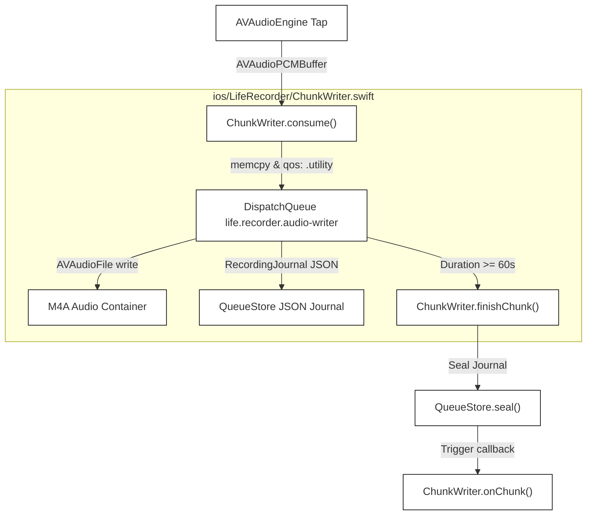
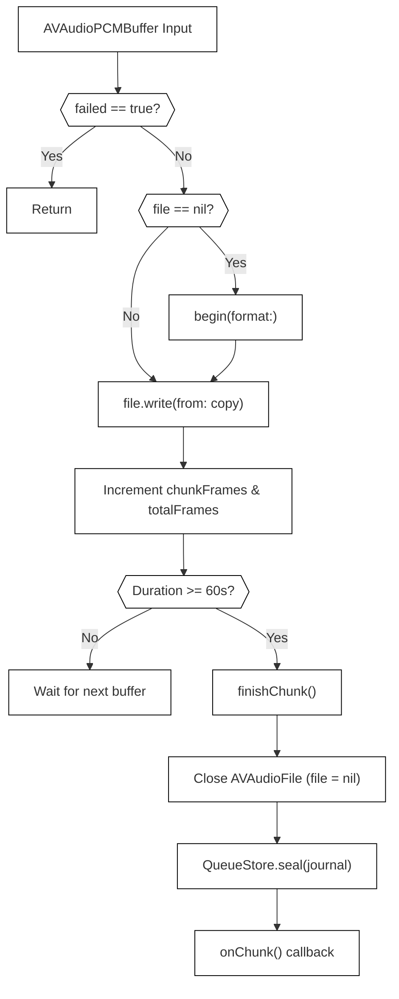

<!-- source: DeepWiki mcp.deepwiki.com · repo browser-use/life-recorder · extra page Chunk Writing & Rotation · fetched 2026-10-30 -->

# Chunk Writing & Rotation

<details>
<summary>Relevant source files</summary>

The following files were used as context for generating this wiki page:

- [ios/LifeRecorder/ChunkWriter.swift](ios/LifeRecorder/ChunkWriter.swift)

</details>


The `ChunkWriter` class coordinates raw PCM audio buffer ingestion, thread-safe queuing, AAC/M4A encoding, disk-space safeguarding, 60-second chunk rotation, and recording journal creation. It acts as the primary bridge between the real-time audio capture tap (`AVAudioEngine`) and persistent on-device storage.

## Architectural Overview & Code Mapping

The following diagram maps the logical components of the chunk writing pipeline to their exact Swift code entities within the iOS client package.

### Diagram: Chunk Writing Component Map

Sources: [ios/LifeRecorder/ChunkWriter.swift:1-88]()

---

## PCM Buffer Copying & Serial Queue

Because `AVAudioEngine` reuses memory allocated for audio taps immediately after a callback returns, raw input buffers cannot be processed asynchronously without a deep memory copy [ios/LifeRecorder/ChunkWriter.swift:22-24](). 

The `ChunkWriter.consume(_:)` method handles this memory isolation and execution handoff:
1. It instantiates a new target `AVAudioPCMBuffer` matching the source format and frame capacity [ios/LifeRecorder/ChunkWriter.swift:24]().
2. It uses `UnsafeMutableAudioBufferListPointer` and `memcpy` to copy the underlying audio buffer payloads bit-for-bit into the newly allocated buffer instance [ios/LifeRecorder/ChunkWriter.swift:26-31]().
3. It dispatches the write operation asynchronously to a dedicated serial queue (`life.recorder.audio-writer`) running at `.utility` QoS to maintain deterministic FIFO ordering across file rotations [ios/LifeRecorder/ChunkWriter.swift:5-6, 32]().

```swift
// Example conceptual flow inside consume(_:)
let copy = AVAudioPCMBuffer(pcmFormat: input.format, frameCapacity: input.frameLength)
// ... memcpy execution ...
queue.async { [self] in
    // file writing & rotation checks
}
```
Sources: [ios/LifeRecorder/ChunkWriter.swift:5-45]()

---

## File Creation & Disk-Space Guard

When the first audio buffer arrives for a new chunk (`file == nil`), `ChunkWriter.begin(format:)` initializes the output files and validates local storage constraints [ios/LifeRecorder/ChunkWriter.swift:35, 47-69]().

### Disk-Space Guard
Before committing storage to disk, the writer queries `QueueStore.directory` for resource values using `.volumeAvailableCapacityForImportantUsageKey` [ios/LifeRecorder/ChunkWriter.swift:48](). If available space drops below `200 MB` (`200 * 1024 * 1024` bytes), it aborts initialization by throwing an `NSError` with domain `"Recorder"` and code `1`, setting `failed = true` to halt subsequent writes [ios/LifeRecorder/ChunkWriter.swift:40-42, 49-52]().

### File & Journal Initialization
If space is sufficient, a unique `UUID` is generated for the chunk, and a `RecordingJournal` is structured [ios/LifeRecorder/ChunkWriter.swift:54]().
* **Journal File**: Written atomically as a JSON file named `<uuid>.recording.json` inside the queue directory [ios/LifeRecorder/ChunkWriter.swift:56-57]().
* **Audio File**: Created as an AAC-encoded `.m4a` file named `<uuid>.m4a` via `AVAudioFile` [ios/LifeRecorder/ChunkWriter.swift:58-64]().
* **Encoding Parameters**:
  * Format: `kAudioFormatMPEG4AAC` [ios/LifeRecorder/ChunkWriter.swift:60]()
  * Sample Rate: Inherited from `format.sampleRate` [ios/LifeRecorder/ChunkWriter.swift:61]()
  * Channels: Inherited from `format.channelCount` [ios/LifeRecorder/ChunkWriter.swift:62]()
  * Bitrate: `32000 * channelCount` (32 kbps per channel) [ios/LifeRecorder/ChunkWriter.swift:63]()
* **File Protection**: Attributes are explicitly set to `.completeUntilFirstUserAuthentication` using `FileManager` [ios/LifeRecorder/ChunkWriter.swift:65-66]().

Sources: [ios/LifeRecorder/ChunkWriter.swift:47-69]()

---

## 60-Second Rotation & Sealing Mechanics

The writer accumulates incoming frames and tracks duration relative to the sample rate [ios/LifeRecorder/ChunkWriter.swift:37-39](). 

### Diagram: Chunk Rotation & Lifecycle Flow

Sources: [ios/LifeRecorder/ChunkWriter.swift:32-78]()

### Rotation Logic
For every ingested buffer block, `chunkFrames` is incremented [ios/LifeRecorder/ChunkWriter.swift:37](). If the expression `Double(chunkFrames) / sampleRate >= 60` evaluates to true, `finishChunk()` is invoked [ios/LifeRecorder/ChunkWriter.swift:39]().

### Sealing Process
`finishChunk()` executes the following cleanup and finalization steps:
1. Deassigns the `AVAudioFile` (`file = nil`), which forces the M4A container trailers to write and finalize before checksum calculation [ios/LifeRecorder/ChunkWriter.swift:72]().
2. Seals the recording journal by invoking `QueueStore.seal(_:duration:)` with the calculated duration [ios/LifeRecorder/ChunkWriter.swift:74]().
3. Resets `journal = nil` and `chunkFrames = 0` [ios/LifeRecorder/ChunkWriter.swift:75-76]().
4. Triggers the `onChunk()` notification closure to inform upper layers that a new chunk is ready for upload [ios/LifeRecorder/ChunkWriter.swift:77]().

An asynchronous `finish()` wrapper is provided for graceful shutdown sequences, awaiting pending operations on the serial queue before returning control [ios/LifeRecorder/ChunkWriter.swift:80-87]().

Sources: [ios/LifeRecorder/ChunkWriter.swift:32-88]()

---

