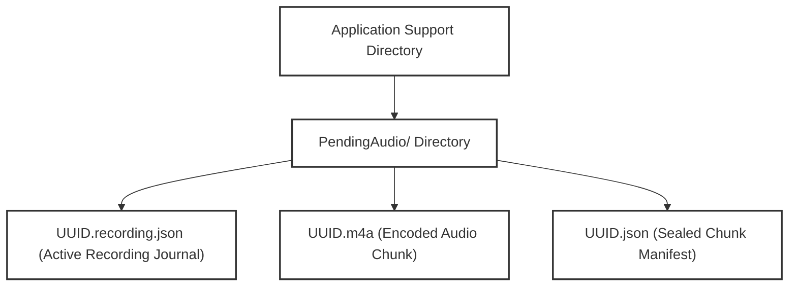
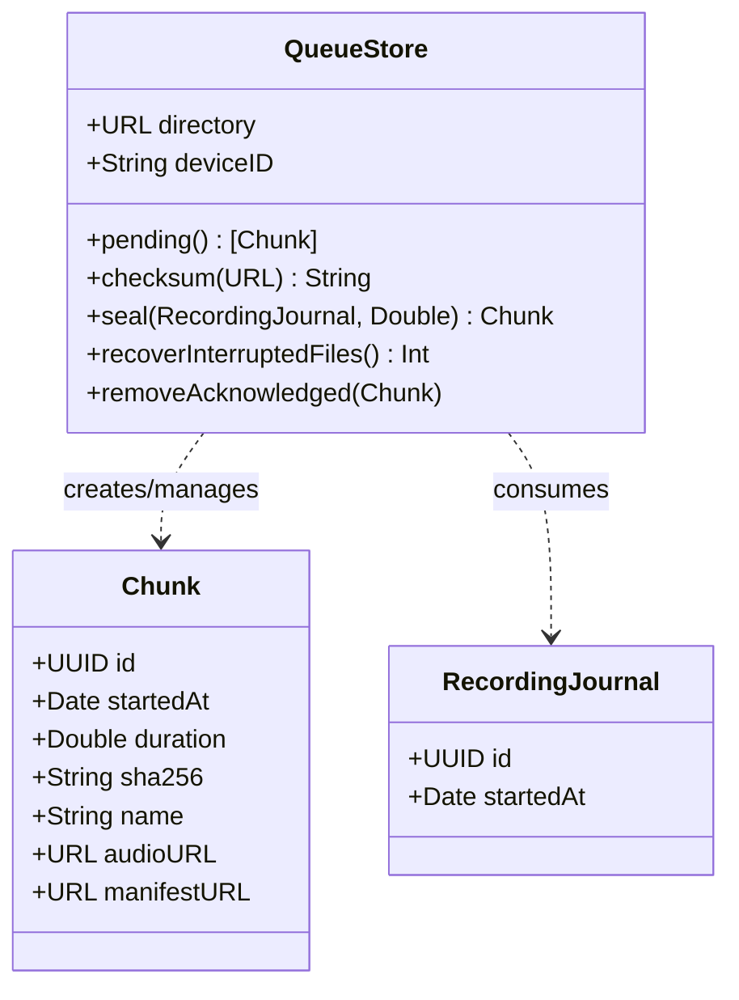
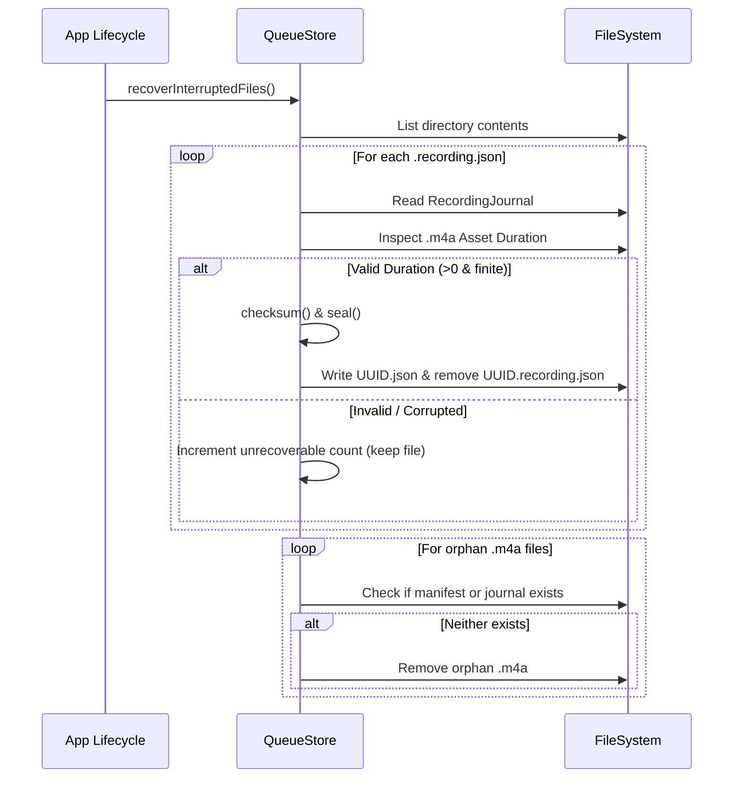

<!-- source: DeepWiki mcp.deepwiki.com · repo browser-use/life-recorder · extra page Queue Storage & Recovery · fetched 2026-10-30 -->

# Queue Storage & Recovery

Relevant source files

The following files were used as context for generating this wiki page:

- [ios/LifeRecorder/Storage.swift](ios/LifeRecorder/Storage.swift)

## Purpose and Scope
This page details the on-device storage implementation for captured audio chunks, crash recovery protocols, and secure credential persistence as defined in `ios/LifeRecorder/Storage.swift`. The storage layer ensures durable local persistence of recordings using atomic file operations, cryptographic verification, iOS data protection classes, and Keychain integration.

Sources: `[ios/LifeRecorder/Storage.swift:1-158]()`

---

## On-Device Queue Directory Layout & Persistence
The queue directory is established within the application support directory under the name `PendingAudio` [ios/LifeRecorder/Storage.swift:22-24](). 

Key characteristics of the storage directory include:
* **File Protection**: Configured with `FileProtectionType.completeUntilFirstUserAuthentication` to balance security with background audio capture persistence [ios/LifeRecorder/Storage.swift:25-26]().
* **Backup Exclusion**: Marked with `isExcludedFromBackup = true` to prevent un-uploaded temporary files from consuming iCloud backup quotas [ios/LifeRecorder/Storage.swift:27-31]().

*Figure 1: On-device queue layout bridging storage paths to file entities.*

Sources: `[ios/LifeRecorder/Storage.swift:21-32]()`

---

## Data Models: `Chunk` and `RecordingJournal`
Two core structs govern chunk metadata and active recording states:

* **`RecordingJournal`**: Represents an active recording session before it is finalized, tracking an `id` (`UUID`) and `startedAt` (`Date`) [ios/LifeRecorder/Storage.swift:16-19](). Stored temporarily on disk as `<uuid>.recording.json`.
* **`Chunk`**: Represents a finalized, sealed recording ready for upload. It includes the chunk `id`, `startedAt`, `duration` (in seconds), and a SHA-256 cryptographic checksum (`sha256`) [ios/LifeRecorder/Storage.swift:6-14](). Computed properties derive the base file name, audio file URL (`<uuid>.m4a`), and manifest URL (`<uuid>.json`) [ios/LifeRecorder/Storage.swift:11-13]().

*Figure 2: Storage data models and their relationship with `QueueStore`.*

Sources: `[ios/LifeRecorder/Storage.swift:6-20]()`

---

## Queue Operations, Checksumming & Sealing
The `QueueStore` enum provides static methods to inspect, hash, and seal chunks:

1. **Pending Queue Inspection**: `QueueStore.pending()` reads the directory, filters for valid JSON manifests (ignoring active `.recording.json` files), decodes them into `Chunk` instances, and sorts them chronologically by `startedAt` [ios/LifeRecorder/Storage.swift:41-46]().
2. **Checksum Calculation**: `QueueStore.checksum(_:)` streams the `.m4a` audio file in 64 KB increments (`65536` bytes), feeding CryptoKit's `SHA256` hashing engine to produce a hex-encoded digest [ios/LifeRecorder/Storage.swift:48-54]().
3. **Sealing**: `QueueStore.seal(_:duration:)` computes the audio checksum, initializes a `Chunk` struct, writes the manifest atomically to disk (`options: .atomic`), and removes the temporary `.recording.json` file [ios/LifeRecorder/Storage.swift:56-64]().

Sources: `[ios/LifeRecorder/Storage.swift:41-65]()`

---

## Crash Recovery & Interrupted File Restoration
When the app restarts or recovers from an interruption, `QueueStore.recoverInterruptedFiles()` runs asynchronously to handle incomplete recording sessions [ios/LifeRecorder/Storage.swift:66-90]().

*Figure 3: Crash recovery sequence for interrupted files and cleanup.*

### Recovery Steps:
1. **Journal Discovery**: Scans for files ending in `.recording.json` [ios/LifeRecorder/Storage.swift:67-69]().
2. **Asset Validation**: Loads the corresponding `.m4a` file via `AVURLAsset` to verify that the recorded duration is finite and greater than zero [ios/LifeRecorder/Storage.swift:70-74]().
3. **Safe Sealing or Retention**: If valid, the journal is sealed into a permanent chunk [ios/LifeRecorder/Storage.swift:75](). If corrupted or unreadable, the file is retained for safety without pretending it completed successfully (`unrecoverable += 1`) [ios/LifeRecorder/Storage.swift:76-79]().
4. **Orphan Cleanup**: Removes any `.m4a` files that lack both a manifest (`.json`) and a recording journal (`.recording.json`) [ios/LifeRecorder/Storage.swift:82-88]().
5. **Acknowledgment & Dequeue**: `QueueStore.removeAcknowledged(_:)` deletes both the manifest and the audio file only *after* receiving a verified durable receipt from the receiver [ios/LifeRecorder/Storage.swift:92-98]().

Sources: `[ios/LifeRecorder/Storage.swift:66-98]()`

---

## Credentials & Receiver Settings Persistence
Configuration parameters required to communicate with the Mac Receiver are managed across the iOS Keychain and `UserDefaults`:

* **`Credentials`**: Manages the authentication bearer token in the secure iOS Keychain under the service identifier `com.browseruse.liferecorder.receiver` with accessibility set to `kSecAttrAccessibleAfterFirstUnlockThisDeviceOnly` [ios/LifeRecorder/Storage.swift:101-122]().
* **`ReceiverSettings`**: Encapsulates the receiver's base HTTPS URL, authentication token, and SHA-256 certificate pin [ios/LifeRecorder/Storage.swift:125-138](). `ReceiverSettings.load()` validates that the URL uses the `https` scheme and contains no query parameters, user info, or fragments before returning a valid configuration [ios/LifeRecorder/Storage.swift:130-138]().

Sources: `[ios/LifeRecorder/Storage.swift:101-142]()`

---

