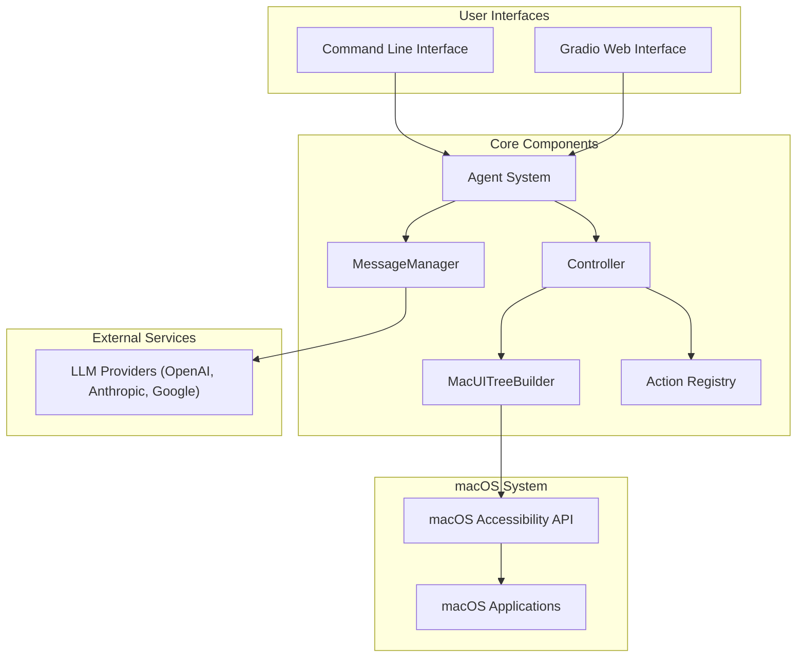
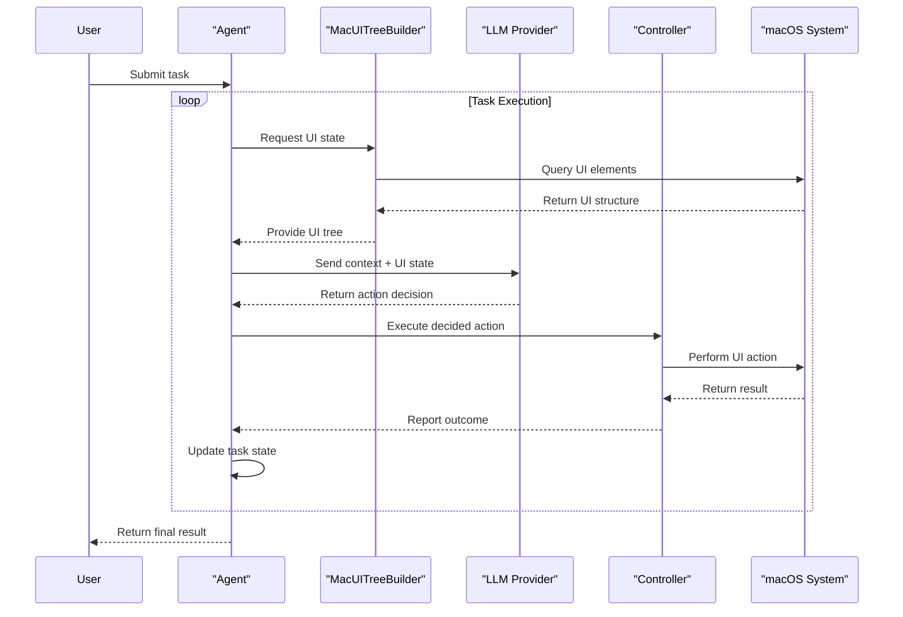
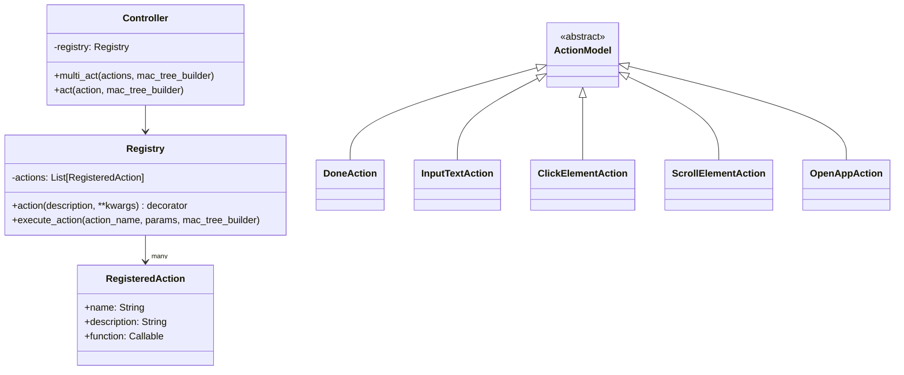

<!-- source: DeepWiki mcp.deepwiki.com · repo browser-use/macOS-use · page 1 Overview · fetched 2026-10-30 -->

# Overview

<details>
<summary>Relevant source files</summary>

The following files were used as context for generating this wiki page:

- [README.md](README.md)
- [pyproject.toml](pyproject.toml)

</details>


## Purpose and Scope

macOS-use is an open-source framework that enables AI agents to interact with macOS applications through natural language instructions. This system allows users to control any macOS application by simply describing what they want to accomplish. The framework integrates with various LLM providers to interpret instructions and uses the macOS Accessibility API to execute actions across the operating system.

This overview document provides a high-level introduction to the macOS-use system, its key components, and how they work together. For more detailed information about specific components, refer to their respective dedicated pages in this wiki.

Sources: [README.md:13-19](). [pyproject.toml:1-3]()

## Key Features

- **Universal Application Control**: Interact with any macOS application through natural language commands
- **Multi-LLM Support**: Compatible with OpenAI, Anthropic, and Google Gemini models
- **Multiple Interfaces**: Use through command-line interface or Gradio web interface
- **Automation Workflows**: Create and manage complex automation sequences
- **Accessibility Integration**: Deep integration with macOS Accessibility API for UI interaction
- **Application Awareness**: Ability to detect and interact with installed applications

Sources: [README.md:13-19](), [README.md:118-119](), [README.md:125-132]()

## System Architecture

The macOS-use system consists of several interconnected components that work together to interpret user instructions and execute them on macOS applications.

### System Component Overview



Sources: [README.md:19](), [README.md:40-42]()

### Execution Flow



Sources: [README.md:76-112]()

## Core Components

### Agent System

The Agent serves as the central coordinator in the macOS-use system. It receives tasks from the user, manages the conversation with the LLM, decides which actions to take based on LLM responses, and directs the Controller to execute those actions. The Agent maintains the state and history of the interaction throughout the task execution.

For more details about the Agent System, see [Agent System](#2.1).

### Controller System

The Controller bridges between the Agent's decisions and the actual macOS interactions. It manages a registry of actions (clicking, typing, scrolling, etc.) that can be performed on UI elements and executes these actions through the macOS Accessibility API. The Controller works closely with the MacUITreeBuilder to identify and interact with UI elements.

For more details about the Controller System, see [Controller System](#2.2).

### MacUITreeBuilder

The MacUITreeBuilder creates a hierarchical representation of UI elements in macOS applications by interfacing with the macOS Accessibility API. This tree representation allows the Agent to understand what's on screen and what can be interacted with. Each interactive element is assigned an index for easy reference during action execution.

For more details about the MacUITreeBuilder, see [MacOS UI Tree System](#2.3).

### LLM Integration

macOS-use supports multiple LLM providers, including OpenAI, Anthropic, and Google Gemini. These models interpret user instructions, understand the state of the UI, and determine appropriate actions to take. The system uses structured prompts to communicate with LLMs and expects structured outputs that can be translated into actionable commands.

For more details about LLM Integration, see [LLM Integration](#2.4).

Sources: [README.md:40-42]()

## Usage Modes

### Command Line Interface

macOS-use provides a command-line interface through various example scripts that demonstrate different functionalities:

```
python examples/try.py         # Basic usage example
python examples/calculate.py   # Calculator application example
python examples/login_to_auth0.py  # Authentication example
python examples/check_time_online.py  # Web searching example
```

For more details about the CLI, see [Command Line Interface](#3.1).

### Gradio Web Interface

The Gradio web interface provides a more user-friendly way to interact with the system, featuring:

- Agent Tab: For submitting and monitoring tasks
- Automations Tab: For creating and managing automation workflows
- Configuration Tab: For setting up LLM providers and API keys

For more details about the Gradio interface, see [Gradio Web Interface](#3.2).

Sources: [README.md:25-72]()

## Technical Implementation

### Action System



The action system uses a registry pattern where actions are registered with descriptive metadata and then executed through the Controller. This extensible design allows for adding new types of actions as needed.

Sources: [README.md:125-132]()

## Installation and Setup

macOS-use can be installed via pip:

```bash
pip install mlx-use
```

Or directly from the GitHub repository:

```bash
git clone https://github.com/browser-use/macOS-use.git
cd macOS-use
```

Configuration requires setting up API keys for the LLM provider of choice. The system currently works best with OpenAI or Anthropic, although Google Gemini is also supported.

For detailed setup instructions, see [Setup and Configuration](#5).

Sources: [README.md:21-51](), [pyproject.toml:1-36]()

## Project Status and Roadmap

macOS-use is under active development with the following goals:

1. **Enhance MacBook Support**:
   - Refine Agent prompting
   - Improve self-correction capabilities
   - Add user interaction features

2. **Enable Local Inference**:
   - Support for local models using MLX framework
   - Fine-tune small models for efficient local execution

3. **Expand to iPhone/iPad**:
   - Extend functionality to other Apple devices

**Warning**: As noted in the project documentation, this system can access all applications and UI components on your MacBook, including login forms and authentication services. The project is still under development, and user discretion is advised when using it.

Sources: [README.md:115-147]()

## Use Case Examples

macOS-use can perform a variety of tasks across different applications, including:

- Performing calculations using the Calculator app
- Logging into websites with authentication
- Searching for information online
- Data entry and manipulation
- Interacting with productivity applications

For detailed examples of these use cases, see [Example Use Cases](#4).

Sources: [README.md:74-111]()

---

