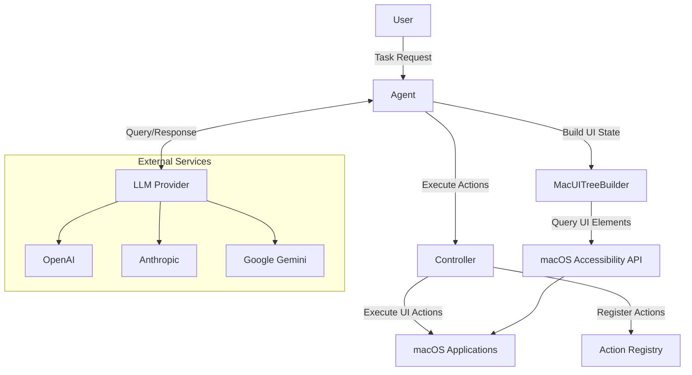
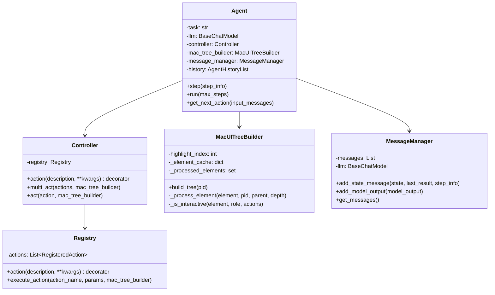
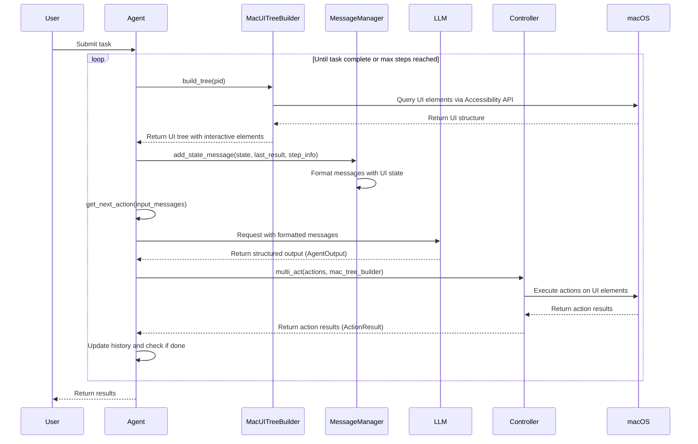
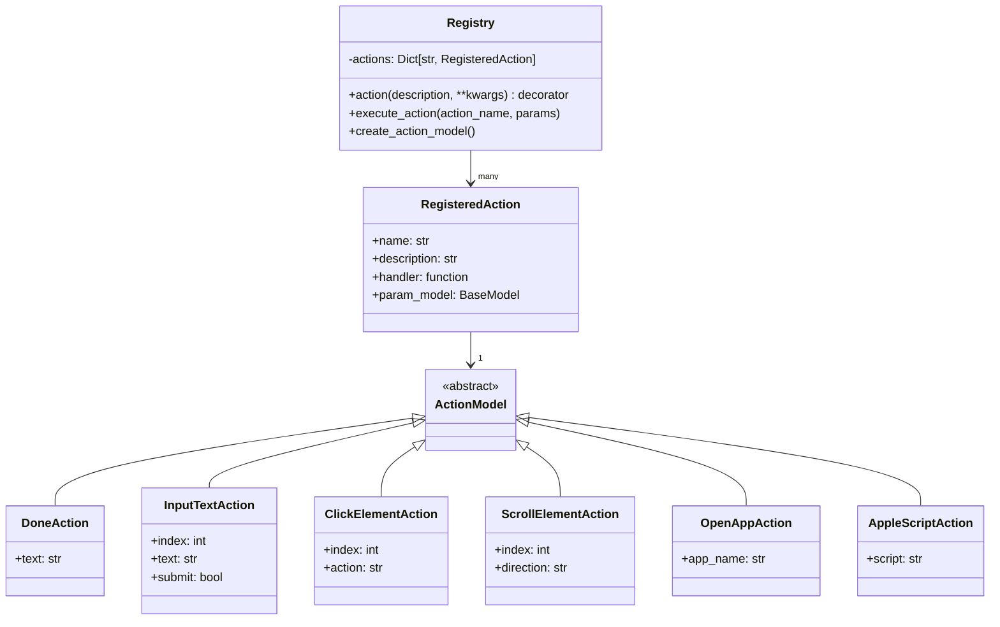
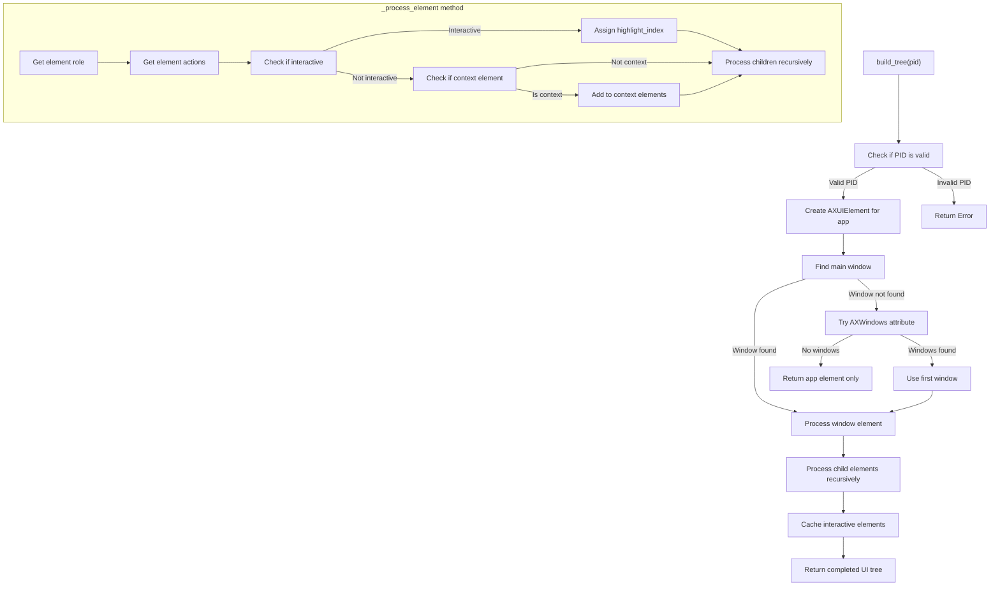

<!-- source: DeepWiki mcp.deepwiki.com · repo browser-use/macOS-use · page 2 System Architecture · fetched 2026-10-30 -->

# System Architecture

Relevant source files

The following files were used as context for generating this wiki page:

- [README.md](README.md)
- [mlx_use/agent/service.py](mlx_use/agent/service.py)
- [mlx_use/controller/service.py](mlx_use/controller/service.py)
- [mlx_use/mac/tree.py](mlx_use/mac/tree.py)
- [pyproject.toml](pyproject.toml)

This document provides a comprehensive overview of the macOS-use system architecture, detailing the major components and how they interact to enable AI-driven control of macOS applications. It covers the high-level design and relationships between components without diving deeply into individual subsystems.

For detailed information about specific subsystems, please refer to:
- Agent System ([Agent System](#2.1))
- Controller System ([Controller System](#2.2))
- MacOS UI Tree System ([MacOS UI Tree System](#2.3))
- LLM Integration ([LLM Integration](#2.4))

## System Overview

macOS-use is an architecture that enables AI agents to interact with macOS applications through the Accessibility API. The system translates natural language tasks into a sequence of UI operations, allowing an LLM-powered agent to control any macOS application without prior training on that specific application.

### High-Level Architecture Diagram

Sources: [mlx_use/agent/service.py:54-92](), [mlx_use/controller/service.py:28-36](), [mlx_use/mac/tree.py:45-53](), [README.md:19-20]()

## Core Components

### Agent System

The Agent is the central orchestrator responsible for understanding user tasks, querying UI state, making decisions through LLMs, and instructing the Controller to execute actions. It maintains state and history while managing conversation flow with the language model.

Key responsibilities:
- Task interpretation and planning
- Coordinating UI state extraction
- Interacting with LLM providers
- History tracking and error handling
- Implementing retry mechanisms

Sources: [mlx_use/agent/service.py:54-149]()

### Controller System

The Controller handles the execution of actions on macOS applications. It provides a registry of available actions and delegates execution to specialized handlers for each action type.

Key responsibilities:
- Registering available actions (click, type, scroll, etc.)
- Validating action parameters
- Executing actions on UI elements
- Handling action errors and reporting results

Sources: [mlx_use/controller/service.py:28-73]()

### MacOS UI Tree System

The MacUITreeBuilder builds a hierarchical representation of the macOS UI using the Accessibility API. It identifies interactive elements and makes them available for interaction.

Key responsibilities:
- Querying the macOS Accessibility API
- Building a tree structure of UI elements
- Identifying interactive elements
- Caching elements for future interaction

Sources: [mlx_use/mac/tree.py:45-53](), [mlx_use/mac/tree.py:258-353]()

### LLM Integration

The system integrates with various LLM providers (OpenAI, Anthropic, Google) to provide the intelligence for understanding tasks and determining actions.

Key responsibilities:
- Formatting prompts with UI state
- Handling LLM responses
- Parsing structured actions
- Managing API rate limits and errors

Sources: [mlx_use/agent/service.py:310-328]()

## Component Interaction Model

### Code-Level Component Diagram

Sources: [mlx_use/agent/service.py:54-149](), [mlx_use/controller/service.py:28-36](), [mlx_use/mac/tree.py:45-53]()

## Execution Flow

The following sequence diagram illustrates the execution flow for a single step in the agent's operation:

### Task Execution Sequence

Sources: [mlx_use/agent/service.py:192-261](), [mlx_use/agent/service.py:402-442]()

## Action System Architecture

The Action System defines how the agent interacts with macOS through a registry of available actions.

### Action Registry and Models

Sources: [mlx_use/controller/service.py:38-265]()

### Core Actions Table

| Action Name | Description | Parameters | Implementation |
|-------------|-------------|------------|----------------|
| `done` | Complete task with text for the user | `text: str` | [mlx_use/controller/service.py:40-44]() |
| `input_text` | Input text into an element | `index: int, text: str, submit: bool` | [mlx_use/controller/service.py:46-73]() |
| `click_element` | Click element and choose action | `index: int, action: str` | [mlx_use/controller/service.py:75-109]() |
| `right_click_element` | Right click element | `index: int` | [mlx_use/controller/service.py:111-138]() |
| `scroll_element` | Scroll element | `index: int, direction: str` | [mlx_use/controller/service.py:140-167]() |
| `open_app` | Open a mac app | `app_name: str` | [mlx_use/controller/service.py:169-222]() |
| `run_apple_script` | Run an AppleScript | `script: str` | [mlx_use/controller/service.py:223-265]() |

Sources: [mlx_use/controller/service.py:38-265]()

## MacOS UI Tree Architecture

The MacUITreeBuilder is responsible for creating a structured representation of the macOS UI using the Accessibility API.

### UI Tree Building Process

Sources: [mlx_use/mac/tree.py:128-227](), [mlx_use/mac/tree.py:258-353]()

## Dependencies and Integration

macOS-use relies on several key dependencies for functionality:

1. **Python Libraries:**
   - `langchain` ecosystem for LLM integration
   - `pyobjc` and `pycocoa` for macOS Accessibility API interactions
   - `gradio` for web interface

2. **External Services:**
   - LLM Providers (OpenAI, Anthropic, Google)

3. **macOS System Level:**
   - Accessibility API permissions (must be enabled by user)

Sources: [pyproject.toml:15-35](), [README.md:25-65]()

## Design Principles

The macOS-use architecture adheres to several key design principles:

1. **Modularity**: Components are loosely coupled to allow for independent development and testing.

2. **Extensibility**: The action registry pattern allows for easy addition of new actions without modifying core code.

3. **Error Resilience**: Robust error handling and retry mechanisms at multiple levels.

4. **Provider Agnosticism**: Support for multiple LLM providers without changing core functionality.

5. **Transparency**: Comprehensive history tracking and logging for debugging and audit purposes.

Sources: [mlx_use/agent/service.py:54-149](), [mlx_use/controller/service.py:28-36](), [mlx_use/mac/tree.py:45-53]()

---

