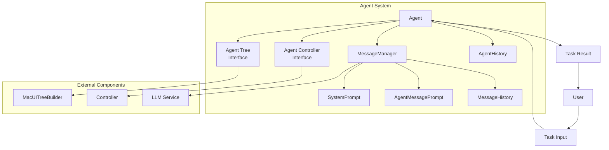
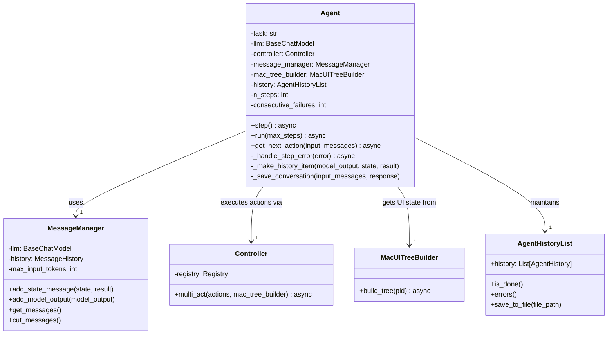
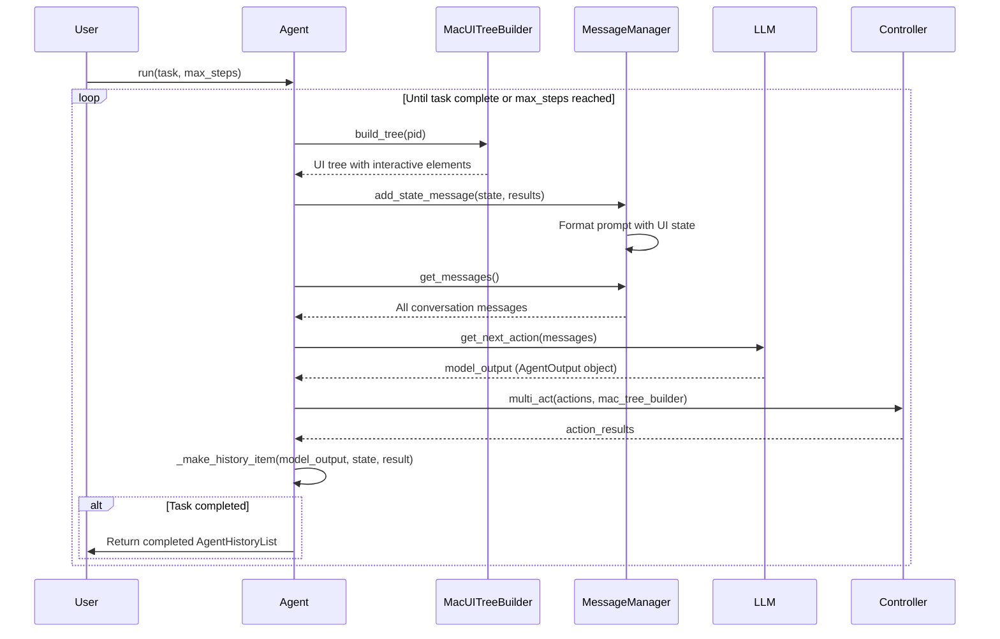
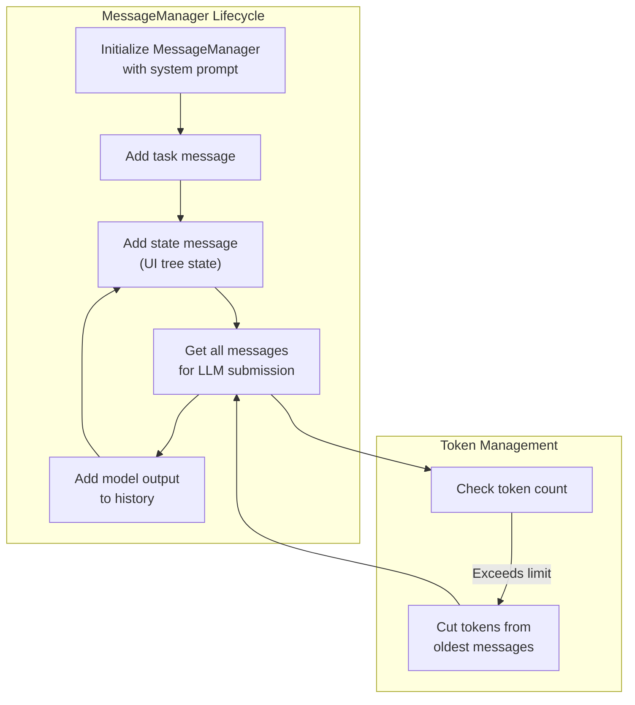
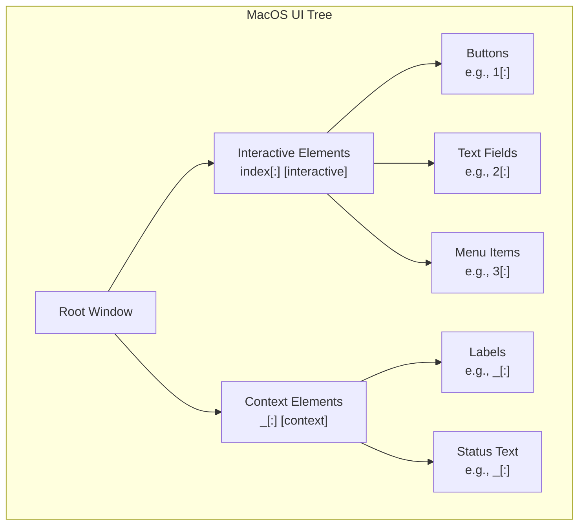
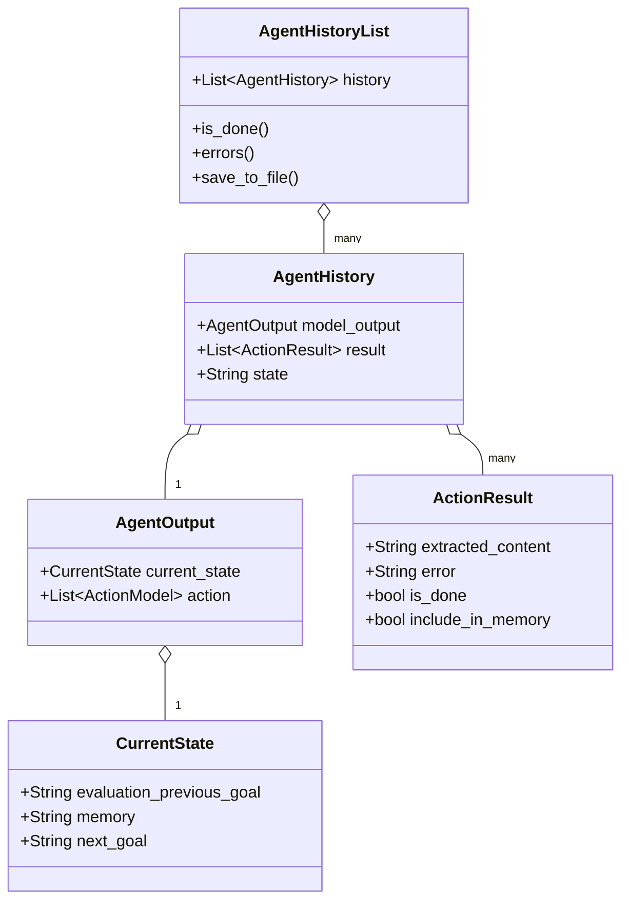

<!-- source: DeepWiki mcp.deepwiki.com · repo browser-use/macOS-use · page 2.1 Agent System · fetched 2026-10-30 -->

# Agent System

<details>
<summary>Relevant source files</summary>

The following files were used as context for generating this wiki page:

- [mlx_use/agent/message_manager/service.py](mlx_use/agent/message_manager/service.py)
- [mlx_use/agent/prompts.py](mlx_use/agent/prompts.py)
- [mlx_use/agent/service.py](mlx_use/agent/service.py)
- [mlx_use/mac/element.py](mlx_use/mac/element.py)

</details>


The Agent System forms the core intelligence layer of the macOS-use framework. It coordinates between Language Learning Models (LLMs) for decision-making and the Controller for executing actions on macOS applications. This document covers the architecture, components, and operational flow of the Agent System. For information about the Controller System that executes the agent's decisions, see [Controller System](#2.2).

## Agent System Overview

The Agent System processes user tasks, manages conversations with LLMs, executes actions through the Controller, and tracks the progress of task completion. It serves as the central orchestrator for automating macOS interactions, maintaining state across multiple steps, and handling errors gracefully.



Sources: [mlx_use/agent/service.py:54-491](), [mlx_use/agent/message_manager/service.py:25-236]()

## Core Components

The Agent System consists of several key components working together:

| Component | Purpose | Key Functionality |
|-----------|---------|-------------------|
| Agent | Main orchestrator | Task execution, step management, error handling |
| MessageManager | LLM interaction | Message formatting, conversation history, token management |
| SystemPrompt | Initial guidance | Provides instructions and constraints to LLM |
| AgentMessagePrompt | State communication | Formats current UI state and action results for LLM |
| AgentHistory | Record keeping | Maintains history of actions, results, and states |

Sources: [mlx_use/agent/service.py:54-491](), [mlx_use/agent/message_manager/service.py:25-236](), [mlx_use/agent/prompts.py:6-175]()

## Agent Class Architecture

The `Agent` class is the main entry point and orchestrator of the Agent System. It manages the overall task execution flow and integrates with other components.



Sources: [mlx_use/agent/service.py:54-491]()

## Agent Execution Flow

The Agent operates in a step-by-step execution model to achieve the user's task:



Sources: [mlx_use/agent/service.py:402-442](), [mlx_use/agent/service.py:193-261]()

## Message Management

The MessageManager handles all communication with the LLM, including formatting prompts, managing token limits, and maintaining conversation history.



Sources: [mlx_use/agent/message_manager/service.py:25-236]()

## Prompt System

The Agent System uses a structured prompt system to guide the LLM's understanding and responses:

### SystemPrompt

The `SystemPrompt` class provides the initial instructions to the LLM, including:

1. Response format requirements (JSON structure)
2. Available actions and their parameters
3. Rules for interacting with macOS applications
4. Guidelines for task completion and verification
5. Error handling strategies

### AgentMessagePrompt

The `AgentMessagePrompt` class formats each state update, including:

1. Current UI state (interactive elements from MacUITreeBuilder)
2. Results from previous actions
3. Any errors that occurred
4. Step information for progress tracking

Sources: [mlx_use/agent/prompts.py:6-95](), [mlx_use/agent/prompts.py:133-175]()

## MacOS UI Representation

The Agent system interprets the macOS UI through a structured representation that distinguishes between interactive and context elements:



Sources: [mlx_use/mac/element.py:77-112](), [mlx_use/agent/prompts.py:97-107]()

## Agent Error Handling

The Agent includes robust error handling to manage various failure scenarios:

1. **Validation Errors**: When LLM responses don't match expected format
2. **Rate Limit Errors**: When LLM provider enforces rate limits
3. **Action Execution Errors**: When actions on macOS fail
4. **Token Limit Errors**: When conversation exceeds token limits

The system tracks consecutive failures and can implement strategies like:
- Cutting tokens from history to stay within limits
- Adding guidance hints for format errors
- Backing off during rate limit errors
- Stopping after maximum failures threshold

Sources: [mlx_use/agent/service.py:262-288](), [mlx_use/agent/service.py:444-449]()

## Agent History Management

The Agent maintains a comprehensive history of its execution:



Sources: [mlx_use/agent/service.py:290-307](), [mlx_use/agent/views.py]() (referenced but not directly quoted)

## Integration with External Components

The Agent System interfaces with several external components:

1. **LLM Providers**: Through the LLM parameter (supporting OpenAI, Anthropic, and Google)
2. **MacUITreeBuilder**: To gather UI state information via macOS Accessibility API
3. **Controller**: To execute actions on macOS applications
4. **Telemetry**: To record agent performance and error metrics

The system adapts based on the LLM provider being used, adjusting features like tool calling methods and token handling strategies.

Sources: [mlx_use/agent/service.py:166-181]()

## Usage Example

The following demonstrates how the Agent is typically integrated and used:

```python
# Example usage (does not appear directly in codebase but inferred)
from mlx_use.agent.service import Agent
from mlx_use.controller.service import Controller
from some_llm_provider import ChatModel

# Initialize components
llm = ChatModel(api_key="...")
controller = Controller()

# Create and run agent
agent = Agent(
    task="Calculate 2+2 using the Calculator app",
    llm=llm,
    controller=controller,
    max_steps=10
)

# Run the agent asynchronously
import asyncio
history = asyncio.run(agent.run())

# Get the final result
final_result = history.get_final_result()
```

---

