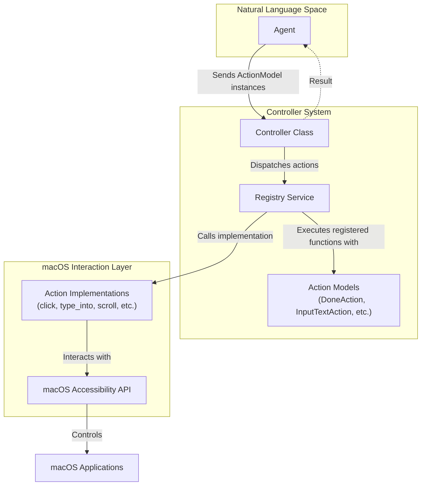
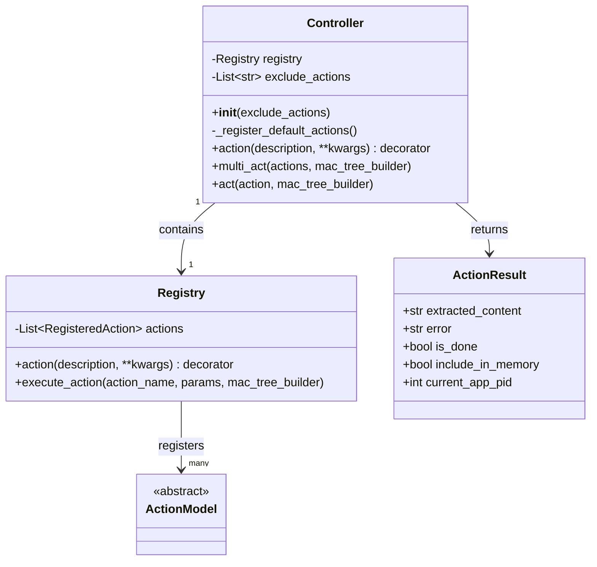
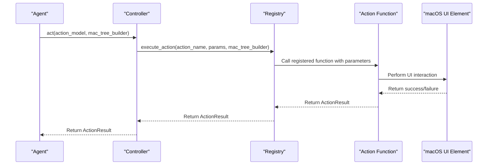
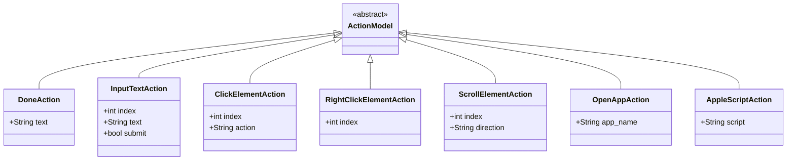
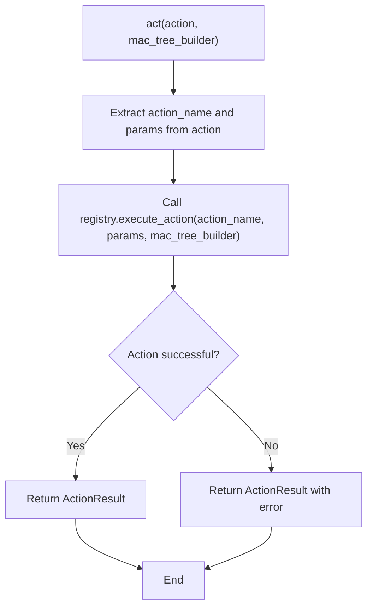
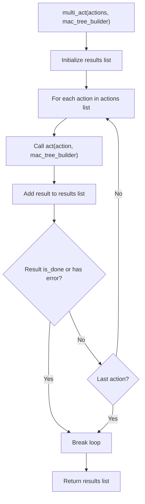

<!-- source: DeepWiki mcp.deepwiki.com · repo browser-use/macOS-use · page 2.2 Controller System · fetched 2026-10-30 -->

# Controller System

<details>
<summary>Relevant source files</summary>

The following files were used as context for generating this wiki page:

- [mlx_use/controller/service.py](mlx_use/controller/service.py)
- [mlx_use/controller/views.py](mlx_use/controller/views.py)
- [mlx_use/mac/actions.py](mlx_use/mac/actions.py)

</details>


The Controller System acts as the bridge between the Agent's decision-making capabilities and the concrete interactions with macOS applications. It provides a modular framework for executing actions like clicking UI elements, inputting text, scrolling, opening applications, and running AppleScript.

For information about how the Agent determines which actions to take, see [Agent System](#2.1). For details on how the system identifies UI elements to interact with, see [MacOS UI Tree System](#2.3).

## 1. Overview

The Controller System consists of several key components:

1. **Controller**: The central class that manages action execution
2. **Registry**: A service that maintains a collection of registered actions
3. **Action Models**: Pydantic models that define the parameters for each type of action
4. **Action Implementations**: The actual functions that interact with macOS UI elements



Sources: [mlx_use/controller/service.py:28-311](). [mlx_use/controller/views.py:1-32]().

## 2. Controller Architecture

The Controller acts as the orchestrator of UI interactions. It maintains a registry of available actions and provides methods to execute these actions on macOS applications.



The Controller's main responsibilities are:

1. Initializing and maintaining the action registry
2. Registering default system actions
3. Providing a decorator for registering custom actions
4. Executing single or multiple actions
5. Handling action results and errors

Sources: [mlx_use/controller/service.py:28-35](). [mlx_use/controller/service.py:267-309]().

## 3. Action Registry

The Registry maintains a collection of registered actions and provides methods to execute them. Actions are registered with descriptive text that helps the LLM understand when and how to use them.



The Registry is initialized by the Controller and actions are registered using a decorator pattern:

```python
@registry.action(
    'Description of what the action does',
    param_model=ActionParamModel,
    requires_mac_builder=Boolean
)
async def action_function(param1, param2, ...):
    # Implementation
    return ActionResult(...)
```

Sources: [mlx_use/controller/service.py:37-265](). [mlx_use/controller/service.py:267-272]().

## 4. Default Registered Actions

The Controller registers several default actions during initialization:

| Action Name | Description | Parameters | Purpose |
|-------------|-------------|------------|---------|
| `done` | Complete task with text for the user | text (str) | Signals task completion |
| `input_text` | Input text | index (int), text (str), submit (bool) | Types text into UI elements |
| `click_element` | Click element and choose action | index (int), action (str) | Clicks on UI elements |
| `right_click_element` | Right click element | index (int) | Right-clicks on UI elements |
| `scroll_element` | Scroll element | index (int), direction (str) | Scrolls UI elements |
| `open_app` | Open a mac app | app_name (str) | Launches macOS applications |
| `run_apple_script` | Run AppleScript | script (str) | Executes AppleScript code |

The `index` parameter in many actions refers to the index of a UI element in the MacUITreeBuilder's element cache.

Sources: [mlx_use/controller/service.py:40-265](). [mlx_use/controller/views.py:8-31]().

## 5. Action Models

Action models are Pydantic models that define the parameters for each type of action:



These models ensure that the parameters for each action are properly validated and structured.

Sources: [mlx_use/controller/views.py:1-32]().

## 6. Action Execution Flow

### 6.1 Single Action Execution

The `act` method executes a single action, dispatching it to the registry and handling any errors:



Sources: [mlx_use/controller/service.py:290-309]().

### 6.2 Multiple Action Execution

The `multi_act` method executes multiple actions sequentially and stops if an action completes the task, encounters an error, or reaches the end of the action list:



Sources: [mlx_use/controller/service.py:274-288]().

## 7. Core Mac UI Interaction Implementations

### 7.1 Click Operation

The `click` function handles clicking on UI elements:

1. Checks if the element is available and enabled
2. Verifies the element supports the requested action
3. Performs the action using macOS Accessibility API

Available click actions include:
- `AXPress` (standard click)
- `AXClick` (alternative click)
- `AXOpen` (open operation)
- `AXConfirm` (confirm/submit)
- `AXShowMenu` (show context menu)

Sources: [mlx_use/mac/actions.py:43-60](). [mlx_use/controller/service.py:75-109]().

### 7.2 Text Input Operation

The `type_into` function handles typing text into UI elements:

1. Checks if the element is available and enabled
2. Sets the element's value attribute
3. Optionally submits the form if requested

Sources: [mlx_use/mac/actions.py:62-99](). [mlx_use/controller/service.py:46-73]().

### 7.3 Right-Click Operation

The `right_click` function handles right-clicking on UI elements:

1. Checks if the element is available and enabled
2. Attempts to use `AXShowMenu` action
3. Falls back to regular click if `AXShowMenu` is not supported

Sources: [mlx_use/mac/actions.py:101-117](). [mlx_use/controller/service.py:111-138]().

### 7.4 Scroll Operation

The `scroll` function handles scrolling UI elements:

1. Maps the direction to the appropriate macOS action
2. Checks if the element supports the scrolling action
3. Performs the scroll action

Available scroll directions:
- up (`AXScrollUpByPage`)
- down (`AXScrollDownByPage`)
- left (`AXScrollLeftByPage`)
- right (`AXScrollRightByPage`)

Sources: [mlx_use/mac/actions.py:119-140](). [mlx_use/controller/service.py:140-167]().

### 7.5 Open App Operation

The `open_app` action handles launching macOS applications:

1. Attempts to launch the app by name
2. Tries lowercase name if the initial attempt fails
3. Identifies the process ID of the launched application
4. Returns the PID for further interactions

Sources: [mlx_use/controller/service.py:169-221]().

### 7.6 AppleScript Operation

The `run_apple_script` action executes AppleScript code:

1. Wraps the provided script with error handling
2. Executes the script using the `osascript` command
3. Processes the result and captures any errors

Sources: [mlx_use/controller/service.py:223-265]().

## 8. Extending the Controller with Custom Actions

Developers can extend the Controller with custom actions using the `action` decorator:

```python
@controller.action(
    'Description of what the action does',
    param_model=CustomActionModel,
    requires_mac_builder=True/False
)
async def custom_action(param1, param2, mac_tree_builder=None):
    # Implementation
    return ActionResult(extracted_content="Success message")
```

The `action` decorator registers the function with the Registry and sets up the necessary wiring to make it available to the Agent.

Sources: [mlx_use/controller/service.py:267-272]().

## 9. Action Error Handling

The Controller implements robust error handling at multiple levels:

1. Each action implementation has try-except blocks to catch and report errors
2. Action results include an `error` field that indicates if the action failed
3. The `act` method catches and reports any exceptions during action execution
4. The `multi_act` method stops execution when it encounters an error

This multi-layered approach ensures that errors are properly captured and reported to the Agent.

Sources: [mlx_use/controller/service.py:290-309](). [mlx_use/mac/actions.py:19-41]().

---

