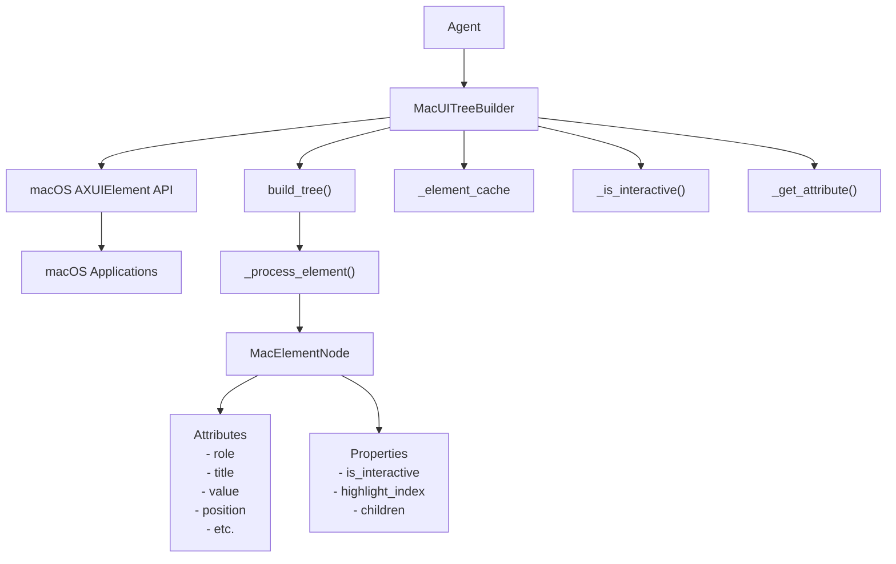
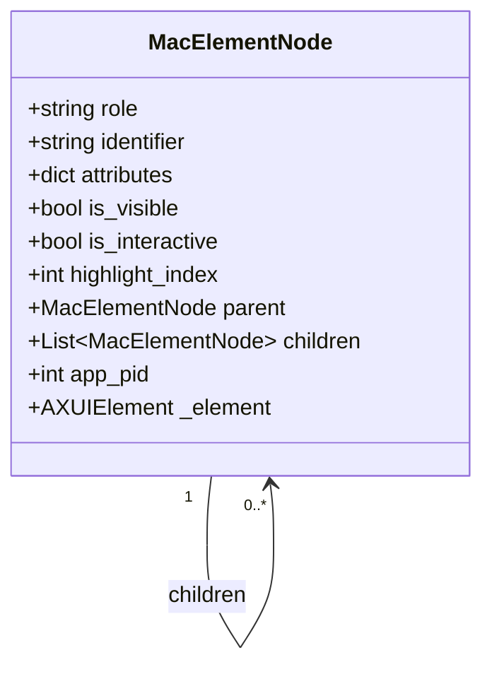
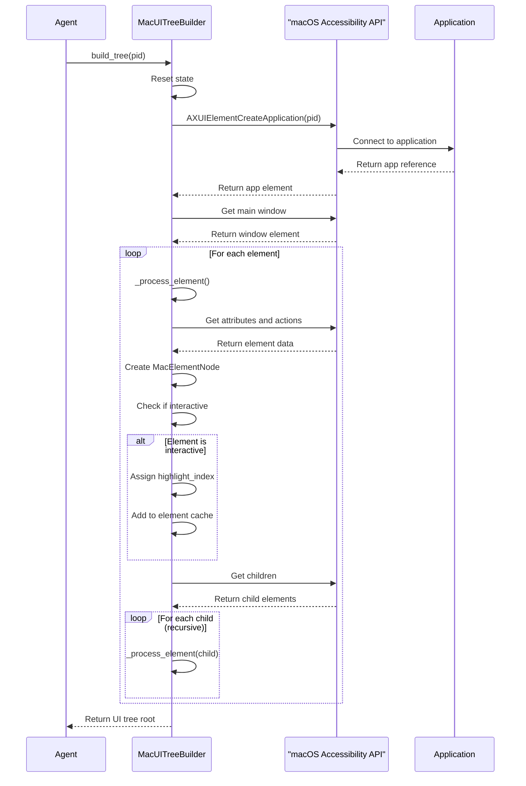
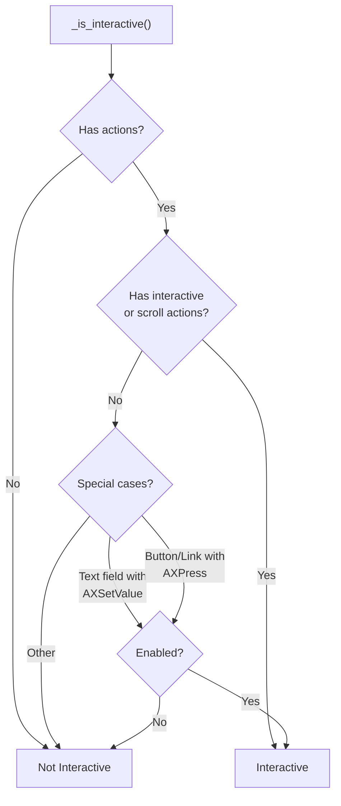
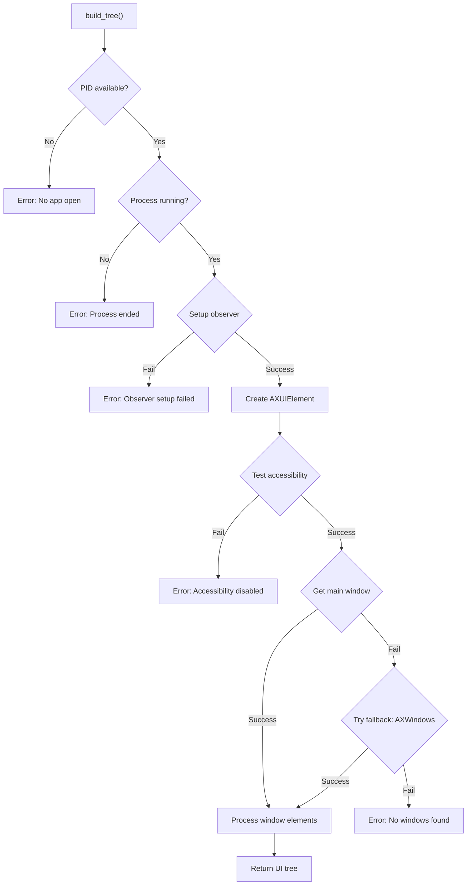
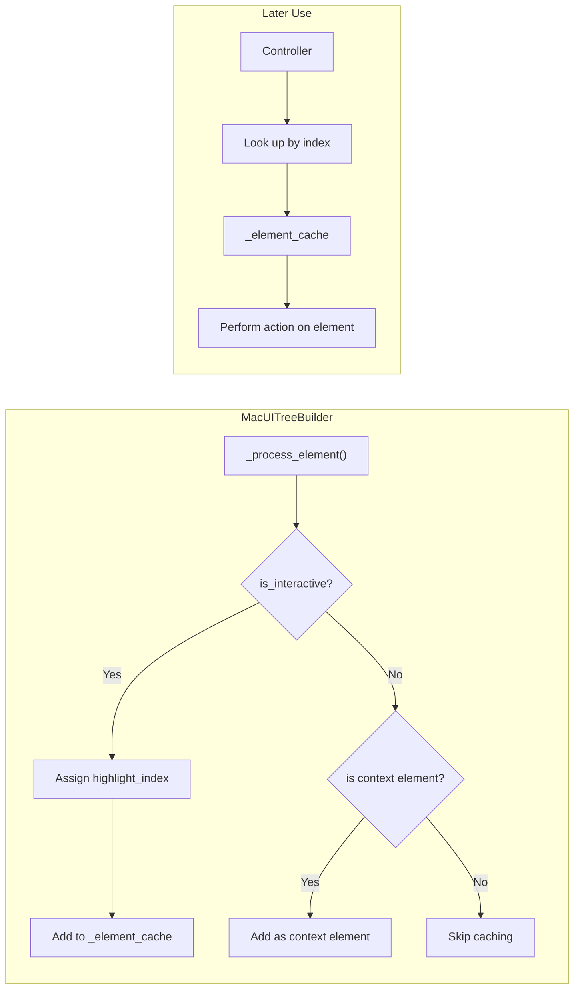

<!-- source: DeepWiki mcp.deepwiki.com · repo browser-use/macOS-use · page 2.3 MacOS UI Tree System · fetched 2026-10-30 -->

# MacOS UI Tree System

<details>
<summary>Relevant source files</summary>

The following files were used as context for generating this wiki page:

- [mlx_use/mac/tree.py](mlx_use/mac/tree.py)

</details>


## Purpose and Scope

The MacOS UI Tree System is a core component of the `macOS-use` repository that builds and manages an accessible representation of macOS application user interfaces. This system serves as the "eyes" of the automation framework, allowing the agent to understand what is displayed on screen and what elements can be interacted with. It leverages the macOS Accessibility API to create a hierarchical tree of UI elements that can be traversed, analyzed, and manipulated.

For information about how actions are executed on these UI elements, see [Controller System](#2.2).

## System Overview

The MacOS UI Tree System centers around the `MacUITreeBuilder` class, which scans applications to construct a structured representation of their interface elements. This representation enables the agent to "see" the application's state and identify interactive elements like buttons, text fields, and menus.



Sources: [mlx_use/mac/tree.py:44-353]()

## Key Components

### MacUITreeBuilder

The `MacUITreeBuilder` is the primary class responsible for discovering and organizing UI elements from macOS applications. It tracks interactive elements with a highlighting system and maintains a cache of elements for quick access.

#### Important Attributes

| Attribute | Description |
|-----------|-------------|
| `highlight_index` | Sequential index assigned to interactive elements |
| `_element_cache` | Dictionary mapping indexes to element nodes |
| `_processed_elements` | Set to prevent processing the same element twice |
| `max_depth` | Maximum recursion depth (30 by default) |
| `max_children` | Maximum children per element (250 by default) |
| `INTERACTIVE_ACTIONS` | Set of actions that indicate an element is interactive |
| `SCROLL_ACTIONS` | Set of actions related to scrolling capabilities |

Sources: [mlx_use/mac/tree.py:45-73]()

### MacElementNode

Each UI element is represented as a `MacElementNode` which stores its properties, attributes, and relationships. This creates a traversable tree structure that mirrors the application's UI hierarchy.



Sources: [mlx_use/mac/tree.py:146-156](), [mlx_use/mac/element.py]() (referenced but not shown)

## Tree Building Process

The tree building process starts from an application window and recursively discovers all UI elements within it, creating a hierarchical structure of `MacElementNode` objects.



Sources: [mlx_use/mac/tree.py:258-353](), [mlx_use/mac/tree.py:128-227]()

## Element Processing

The heart of the tree building system is the element processing logic, which determines what information to collect about each UI element and how to identify interactive elements.

### Element Attributes Collection

For each element, the system collects various attributes from the macOS Accessibility API:

| Attribute | Description | API Constant |
|-----------|-------------|--------------|
| Role | The element's type (button, text field, etc.) | `kAXRoleAttribute` |
| Title | Displayed text label | `kAXTitleAttribute` |
| Value | Current value (for inputs, sliders, etc.) | `kAXValueAttribute` |
| Description | Accessibility description | `kAXDescriptionAttribute` |
| Enabled | Whether the element is enabled | `'AXEnabled'` |
| Position | Screen coordinates | `'AXPosition'` |
| Size | Element dimensions | `'AXSize'` |
| Subrole | Additional role information | `'AXSubrole'` |

Sources: [mlx_use/mac/tree.py:160-186]()

### Interactive Element Detection

A critical function of the UI Tree System is identifying which elements are interactive. This is determined by examining the element's role and available actions.



The system considers these key action types:

| Action Type | Description | Used For |
|-------------|-------------|----------|
| `AXPress` | Basic click action | Buttons, links, checkboxes |
| `AXShowMenu` | Opens a menu | Dropdown buttons, context menus |
| `AXIncrement`/`AXDecrement` | Value adjustment | Spinners, steppers |
| `AXConfirm`/`AXCancel` | Dialog actions | Confirmation dialogs |
| `AXSetValue` | Value modification | Text fields, sliders |
| Scroll actions | Page navigation | Scrollable areas |

Sources: [mlx_use/mac/tree.py:56-73](), [mlx_use/mac/tree.py:107-126]()

## Integration with Accessibility API

The UI Tree System interacts extensively with the macOS Accessibility API to query application structures.

### Key Accessibility API Interactions

| Method | macOS API Used | Purpose |
|--------|---------------|----------|
| `build_tree` | `AXUIElementCreateApplication` | Create reference to application |
| `_get_attribute` | `AXUIElementCopyAttributeValue` | Retrieve element attributes |
| `_get_actions` | `AXUIElementCopyActionNames` | Get available actions for element |

Sources: [mlx_use/mac/tree.py:79-93](), [mlx_use/mac/tree.py:95-105]()

### Error Handling

The system includes robust error handling for accessibility API interactions, addressing common issues:

1. Accessibility permissions not granted
2. Application no longer running
3. Maximum recursion depth or children limits reached
4. Attributes not supported by elements
5. Window identification failures with fallback mechanisms



Sources: [mlx_use/mac/tree.py:258-353]()

## Element Caching and Management

The UI Tree System maintains an element cache to enable controller actions to reference UI elements by index.

### Highlighting System

As the tree is built, each interactive element is assigned a sequential `highlight_index` and stored in the `_element_cache` dictionary. This allows the Controller to reference elements by their index when executing actions.



Sources: [mlx_use/mac/tree.py:196-203]()

### State Management

The system includes methods to manage its state:

| Method | Purpose |
|--------|---------|
| `cleanup()` | Full resource release between sessions |
| `reset_state()` | Reset indexes and caches between steps |

Sources: [mlx_use/mac/tree.py:229-256]()

## Limitations and Boundaries

The MacUITreeBuilder has built-in limits to prevent excessive processing:

1. Maximum recursion depth of 30 levels
2. Maximum of 250 children per element
3. Tracking of already processed elements to prevent cycles

These limits help maintain performance while still providing comprehensive UI coverage for most applications.

Sources: [mlx_use/mac/tree.py:51-52](), [mlx_use/mac/tree.py:209-221]()

## Integration with Agent System

The UI Tree System provides the visual understanding component that enables the agent to make informed decisions about what actions to take.

```mermaid
flowchart LR
    subgraph "Agent Loop"
        AgentStart["Agent receives task"]
        BuildUITree["Build UI tree"]
        AnalyzeUI["Analyze UI state"]
        DetermineAction["Determine action"]
        ExecuteAction["Execute action"]
        AgentEnd["Check if task complete"]
        
        AgentStart --> BuildUITree
        BuildUITree --> AnalyzeUI
        AnalyzeUI --> DetermineAction
        DetermineAction --> ExecuteAction
        ExecuteAction --> AgentEnd
        AgentEnd -->|Not complete| BuildUITree
    end
    
    subgraph "MacUITreeBuilder"
        BuildUITree --> MacUITreeBuilder["MacUITreeBuilder.build_tree()"]
        MacUITreeBuilder --> MacElementNode["Creates tree of\nMacElementNodes"]
    end
    
    subgraph "Controller"
        ExecuteAction --> ControllerAction["Controller.act()"]
        ControllerAction --> ElementLookup["Look up by highlight_index"]
    end
```

Sources: [mlx_use/mac/tree.py:258-353]()

## Summary

The MacOS UI Tree System is the foundation of the macOS automation capabilities, providing a structured representation of application interfaces that enables intelligent interaction. By leveraging the macOS Accessibility API, it creates a navigable tree of UI elements with rich attributes and identifies interactive components that can be manipulated by the agent system.

---

